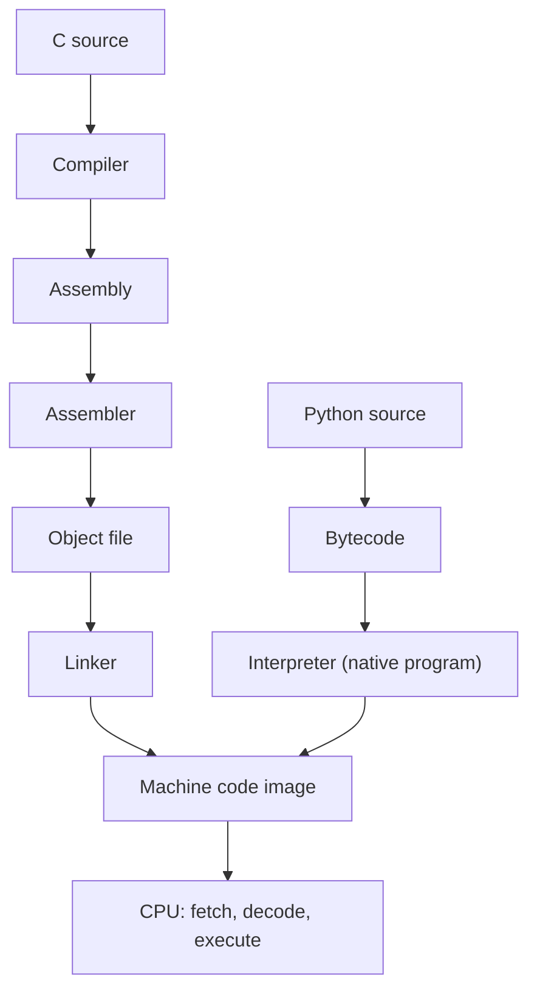

::: basics
### In plain words
A processor only understands machine code, which is binary instruction words. Assembly is the readable text form of those instructions. It has roughly one line per instruction, so it belongs to one processor family. C is a higher level. You describe what you want, and a compiler turns it into assembly. Python sits higher still. A separate program called an interpreter reads it and does the work as it goes.

### Picture it
Imagine giving directions to a driver. In Python, you say "take me to the airport", and the driver works out everything. In C, you give turn-by-turn directions, and a navigator turns them into driving actions. In assembly, you call out each exact steering and pedal move. Those moves are specific to one car model, just as assembly is specific to one processor family. More control means more work, and the driver rarely does better than a good navigator.

### Words you need
- **Machine code**: the binary instruction words a processor executes.
- **Assembly**: text names for machine instructions, such as `add` or `lw` (load a word from memory).
- **ISA**: the set of instructions and registers a processor family supports. Assembly is specific to one ISA.
- **Compiler / assembler**: the compiler turns C into assembly. The assembler turns assembly into machine code.
- **Interpreter**: a program that reads another program, such as Python code, and runs it step by step.
- **Register**: a tiny, fast storage slot inside the processor.

### The simplest example
One C statement, `sum += a[i]`, becomes about three RISC-V instructions. First `lw t2, 0(a0)` loads `a[i]` into a register. Then `add t0, t0, t2` adds it into the sum. Then `addi a0, a0, 4` moves the pointer on to the next element. Each line is one 32-bit machine word. For example, `addi x5, x0, 10` is the word `0x00A00293`. That is the whole idea. The rest of this page shows a real compiler output, how instructions are encoded, and when engineers still write or read assembly.
:::

::: testing
Whether you understand the **layers between your code and the hardware**. The interviewer is checking that you can say:

1. Assembly is a human-readable text form of **machine code**, with roughly one line per machine instruction, and is specific to one ISA ([[q0913]]).
2. How it differs from C (compiled, portable, one statement becomes many instructions) and Python (interpreted, dynamic, much further from the hardware).
3. What an assembler, compiler and linker each do.
4. When engineers actually use or read assembly: boot code, interrupt entry, tight loops, debugging, and understanding what the compiler did.
5. That you can read a few lines of it without panicking: registers, loads and stores, arithmetic, branches.
:::

::: why
Every program, whatever language it was written in, ends up as machine instructions the processor fetches and executes. A hardware engineer who can read assembly can debug a crash from a disassembly, understand why a loop is slow, see what `volatile` did to the generated code ([[q0970]]), write the first instructions that run after reset, and reason about a CPU's microarchitecture ([[q0914]]). Interviewers for CPU, firmware and architecture roles use this question to find out whether you understand what a processor actually executes, not just the high-level code.
:::

::: concepts
- **Instruction set architecture (ISA)**: the contract between software and hardware, the list of instructions, registers and addressing modes. See [[q0913]].
- **Machine code**: binary instruction words the CPU decodes; assembly is their mnemonic spelling.
- **Registers and memory**: fast on-chip storage versus slower main memory; assembly makes you manage both explicitly. See [[q0938]].
- **Fetch, decode, execute**: the basic cycle every CPU repeats; the program counter points to the next instruction.
- **Compiler, assembler, linker**: the toolchain that turns C into machine code.
- **Interpreters and virtual machines**: how Python runs without compiling to native code ahead of time.
- **Number systems**: addresses, immediates and instruction encodings are all shown in hex. See [[q0893]].
:::

::: answer
"Assembly is a low-level programming language that maps almost one-to-one onto the machine instructions a specific processor executes. Instead of writing the binary instruction, you write a mnemonic like `add t0, t1, t2` or `lw t2, 0(a0)`, and an assembler translates it to the binary encoding. Because it's tied to the instruction set, RISC-V assembly, ARM assembly and x86 assembly are all different languages.

Compared with C, assembly has no types, no loops or functions as such, and no portability. I handle registers, memory addresses, the stack and branches myself. A single C line like `sum += a[i]` becomes several instructions: a load, an add, and pointer updates. C is compiled to assembly and then to machine code, so one C source can target many processors, and the compiler does the register allocation and optimization for me.

Python is further away still. It's interpreted: the interpreter, itself a program compiled to machine code, executes Python bytecode, so a simple addition involves many machine instructions and runtime type checks. That's why Python is great for scripts and test automation, but not for a tight loop on a microcontroller.

I'd say assembly is for when I need exact control: boot code after reset, interrupt entry and context switching, hand-tuned kernels, and especially reading disassembly to debug or to see what the compiler did with my C."
:::

::: technical
**Definition.** Assembly language is a symbolic representation of a processor's machine instructions. Each instruction is an opcode mnemonic plus operands (registers, immediates, addresses, labels). An **assembler** converts it to machine code (object file); a **linker** combines object files, resolves labels and assigns addresses.

**Example (RISC-V RV32I).**

| Assembly | Meaning | Machine word (hex) |
|---|---|---|
| `addi x5, x0, 10` | x5 = 0 + 10 | `0x00A00293` |
| `add  x7, x5, x6` | x7 = x5 + x6 | `0x006283B3` |
| `lw   x6, 8(x2)` | x6 = Mem[x2 + 8] | `0x00812303` |
| `sw   x6, 12(x2)` | Mem[x2 + 12] = x6 | `0x00612623` |

Each is a 32-bit word. For `addi`, the fields are imm[11:0] = 10, rs1 = 0, funct3 = 0, rd = 5, opcode = `0010011`.

**Comparison.**

| | Assembly | C | Python |
|---|---|---|---|
| Abstraction | One line ≈ one instruction | One statement ≈ several instructions | One statement ≈ many instructions plus runtime |
| Portability | One ISA only | Recompile for each target | Runs wherever an interpreter exists |
| Execution | Assembled, runs directly | Compiled to native code | Interpreted (bytecode in a virtual machine) |
| Types | None (bits and registers) | Static | Dynamic |
| Memory | Entirely manual | Manual (`malloc`, stack) | Automatic (garbage collection) |
| Typical speed | Whatever you write | Near-optimal with a good compiler | Much slower than C for compute loops |

> [!UNCERTAIN]
> How much slower Python is than C depends heavily on the workload, on libraries such as NumPy that run compiled code underneath, and on the interpreter version. Treat any single "N times slower" figure as workload-specific.

**Toolchain.** `.c` source, then compiler (`-S` produces assembly), then assembler (`.o`), then linker (executable image with fixed addresses), then loader or flash programmer.

**Why use it.** Reset and startup code, interrupt vectors and context switches (setting up stack pointers, saving registers), special instructions the compiler cannot express (memory barriers, system registers), hand-optimized kernels (SIMD), and analysis of compiler output.
:::

::: short
"Assembly is the human-readable form of a processor's machine instructions, roughly one line per instruction, so it's specific to one instruction set like RISC-V, ARM or x86. C is compiled down to it: one C statement becomes several assembly instructions, and the same C can target many processors. Python is interpreted, so it's another layer further from the hardware. I'd use assembly for boot code, interrupt entry, tight optimized loops, and for reading disassembly to debug or check what the compiler generated."
:::

::: long
"Assembly is the lowest-level language humans normally write. It's a textual form of machine code: each line is one instruction for a particular processor, written with a mnemonic and operands, like `lw t2, 0(a0)` to load a word from memory into a register. An assembler turns that into the binary instruction word, which the CPU fetches and decodes. Because each instruction set is different, assembly isn't portable: RISC-V, ARM and x86 all look different.

In C, I write at a higher level: variables, loops, functions. The compiler translates that to assembly, deciding which registers hold which variables and how to lay out the stack. One C statement such as `sum += a[i]` typically turns into a load, an add and some pointer or index updates. The upside is portability: I recompile the same C for a different target. The downside is I give up exact control.

Python is a step further. It's interpreted: the interpreter is a compiled program that reads bytecode and executes it, with dynamic type checks and memory management. A single addition in Python takes many machine instructions, which is why I'd use Python for scripts, data processing and test automation, but I wouldn't use it in an interrupt handler.

So when do I actually use assembly? Three cases. First, code that has to run before C can: the reset handler that sets the stack pointer and clears memory. Second, things the language can't express, like saving context in an interrupt or issuing a special instruction. Third, reading it. When I debug a crash, check what the optimizer did to my loop, or analyze performance, I look at the disassembly. Even if I never write much, being able to read a short routine, trace the registers and count instructions is a core skill for hardware and architecture work."
:::

::: terms
- **Assembly language**: mnemonic text form of a processor's machine instructions.
- **Machine code**: the binary instruction words a CPU executes.
- **Mnemonic**: the short name of an instruction, such as `add`, `lw`, `beq`.
- **Assembler**: tool that translates assembly into machine code.
- **Compiler**: tool that translates a high-level language such as C into assembly or machine code.
- **Linker**: tool that combines object files and resolves addresses and labels.
- **ISA**: the set of instructions, registers and conventions a processor implements.
- **Register**: a small, fast storage location inside the CPU named in instructions.
- **Interpreter / virtual machine**: a program that executes another program's bytecode at runtime (as Python does).
- **Disassembly**: machine code turned back into assembly text.
:::

::: exceptional
**An average answer** says "assembly is low-level code that's close to the hardware and C/Python are higher level".

**An exceptional answer**:
- Says assembly is ISA-specific and about one line per instruction, and ties it to the ISA/microarchitecture split.
- Gives a concrete mapping, such as `sum += a[i]` to a load, an add and a pointer increment, and mentions the 32-bit encoding.
- Describes the full toolchain (compile, assemble, link) and how Python differs (interpreter plus bytecode).
- Gives specific use cases (reset code, interrupt entry, special instructions, reading compiler output).
- Is honest about trade-offs: modern compilers usually beat hand-written assembly for general code.
- Shows they can read a small piece of code, naming registers, load/store and branch.
:::

::: mistakes
- **"Assembly is the same on every processor."** It is specific to the ISA. Concepts transfer, syntax and instructions do not.
- **"Assembly is always faster than C."** A modern optimizing compiler usually matches or beats hand-written assembly for general code. Hand-written assembly wins only for narrow kernels where you know something the compiler doesn't.
- **"Python is compiled to machine code."** The CPython interpreter compiles source to bytecode and executes it in a virtual machine. (Some implementations add JIT compilation, which changes the speed story.)
- **Confusing assembly and machine code.** Assembly is text with labels and names; machine code is the binary result after assembly and linking.
- **Ignoring that C maps to many instructions.** Saying "one C line is one instruction" is wrong, and matters when estimating execution time ([[q0963]]).
- **Thinking you never need it.** Reading disassembly is a standard debugging step in firmware and hardware bring-up.
:::

::: deep
## The stack of languages

Hardware only understands **machine code**: binary words fetched from memory, decoded by control logic, executed by the datapath. Every other language is a layer of convenience on top.


Figure: Both paths end at machine code. C is translated ahead of time into assembly, assembled and linked into an image the CPU runs directly. Python's source becomes bytecode that a native interpreter program executes, so every Python operation costs interpreter work on top of the real instructions.

## What assembly looks like

Take a simple C function:

```c
int sum(const int *a, int n) {
  int s = 0;
  for (int i = 0; i < n; i++) s += a[i];
  return s;
}
```

Here is real x86-64 output from GCC 13 at `-O1` (with `-fcf-protection=none` so no `endbr64` landing pad is emitted), disassembled with `objdump -M intel`; the labels were renamed and comments added:

```
sum:
   0:  85 f6               test   esi,esi          ; n <= 0 ?
   2:  7e 1d               jle    .Lzero
   4:  48 89 f8            mov    rax,rdi          ; rax = pointer a
   7:  48 63 f6            movsxd rsi,esi
   a:  48 8d 0c b7         lea    rcx,[rdi+rsi*4]  ; rcx = end pointer
   e:  ba 00 00 00 00      mov    edx,0x0          ; s = 0
.Lloop:
  13:  03 10               add    edx,DWORD PTR [rax]  ; s += *p
  15:  48 83 c0 04         add    rax,0x4              ; p++
  19:  48 39 c8            cmp    rax,rcx
  1c:  75 f5               jne    .Lloop
  1e:  89 d0               mov    eax,edx          ; return s
  20:  c3                  ret
.Lzero:
  21:  ba 00 00 00 00      mov    edx,0x0          ; n <= 0: s = 0
  26:  eb f6               jmp    1e               ; to the return
```

Notice what the compiler did: it turned the index `i` into a **pointer** that walks the array, and computed the end address once so the loop test is one compare. It also emitted a load fused with the add (`add edx,[rax]`). None of that was in the C. x86 instructions also have **variable length**: `ret` is 1 byte, `add edx,[rax]` is 2 bytes, `mov edx,0` is 5.

The same function in RISC-V, written by hand in the simpler fixed-width style:

```
# a0 = a, a1 = n; result in a0
sum:    li   t0, 0          # s = 0
        li   t1, 0          # i = 0
loop:   bge  t1, a1, done   # exit when i >= n
        lw   t2, 0(a0)      # load a[i]
        add  t0, t0, t2     # s += a[i]
        addi a0, a0, 4      # advance pointer by one int
        addi t1, t1, 1      # i++
        j    loop
done:   mv   a0, t0         # return value
        ret
```

Counting instructions: 2 for setup, 6 per iteration (`bge`, `lw`, `add`, `addi`, `addi`, `j`), 1 for the final exit test, and 2 for return, so $6n + 5$ instructions: for $n=10$ that is 65. That counting skill is exactly what the follow-on question [[q0963]] asks for.

Try stepping a RISC-V loop to see registers, the program counter and the branch decisions:

```sim
{"id":"asm-stepper","program":"sum-loop"}
```
Figure: Step through the sum loop one instruction at a time. Watch the program counter jump back at each taken branch, the accumulator register a0 grow, and the instruction count and cycle estimate update. This loop sums 1 to n with no memory loads and tests at the bottom (`ble`), so it costs $3 + 3n$ instructions (18 for n = 5) rather than the $6n + 5$ of the array version above: no `lw`, no pointer update and no separate `j` per iteration.

## How instructions are encoded

A RISC-V instruction is always 32 bits, so the decoder is simple. For an I-type instruction such as `addi`:

| bits 31..20 | 19..15 | 14..12 | 11..7 | 6..0 |
|---|---|---|---|---|
| imm[11:0] | rs1 | funct3 | rd | opcode |

`addi x5, x0, 10` fills this as imm = 10 (`000000001010`), rs1 = 0, funct3 = 0, rd = 5, opcode = `0010011`, giving `0x00A00293`. The 12-bit signed immediate means `addi` can add constants from -2048 to +2047; larger constants need a second instruction (`lui` for the upper 20 bits). The assembler's job is to do this bit-packing; the CPU's decoder reverses it in hardware.

## Registers, memory and the load-store idea

On RISC-style ISAs, arithmetic works only on **registers** and memory is touched only by explicit loads and stores. RISC-V has 32 integer registers, with `x0` hard-wired to zero. x86 can do arithmetic directly on a memory operand (as in `add edx, [rax]`), which is why it is called CISC-like. Registers are the fastest storage, so a good compiler keeps hot variables in them. See [[q0938]] for registers and [[q0917]] for RISC versus CISC.

## Calls, the stack and why conventions matter

C functions become `jal`/`call` and `ret` instructions, but the language of assembly has no built-in notion of a function. What makes a call work is an agreed **calling convention**: which registers carry arguments (`a0`, `a1`, ... in RISC-V), which carry the return value (`a0`), which registers a callee must preserve (`s0`-`s11`) and which it may freely overwrite (`t0`-`t6`). The return address goes in `ra`, and anything that does not fit in registers is saved on the **stack**, a region of memory addressed by the stack pointer `sp`.

That is why a routine that calls another function must first save `ra` on the stack: the inner `call` overwrites it. It is also why deep recursion or big local arrays can overflow the stack on a small microcontroller ([[q0941]]). In C all of this is generated for you; in assembly, forgetting to save a register the convention says you must preserve is one of the most common bugs, and the symptom (a crash somewhere far from the cause) is exactly the kind of thing you diagnose by reading disassembly in a debugger.

A practical reading technique when someone hands you an unfamiliar routine: first mark the labels and the branch targets to find the loops, then note which registers are only read (inputs) and which are written (results), then work out what each loop does per iteration. Only then think about the individual instructions.

## Where each language wins

- **Python**: fastest to write, best for scripting, data analysis, test automation and glue. Runtime cost is high per operation, which is fine when the work is done by libraries or the program is I/O bound.
- **C**: the working language of firmware, drivers and operating systems. It gives control over memory layout and registers (with `volatile` and bit operations, [[q0970]]) without writing instructions by hand.
- **Assembly**: used where the language itself is not enough. Examples: the reset handler (set the stack pointer, zero `.bss`, copy `.data`, call `main`), interrupt entry that saves and restores registers, a context switch in an RTOS, atomic or barrier instructions, and SIMD kernels.

> [!INTERVIEW]
> If you are handed a few lines of assembly, read it aloud: "this loads a word from the address in a0, adds it into t0, increments the pointer by 4, and loops until a counter reaches n." Naming what each register is *for* is more impressive than translating mnemonics one by one.

## Common misconceptions about performance

Hand-written assembly is not automatically fast. Modern compilers know instruction scheduling, loop unrolling, vectorization and register allocation across a whole function, and they re-do it for each target and each `-O` level. You will usually beat them only in narrow, well-understood kernels or on hardware features they don't expose. A better use of your time is to write clean C, look at the disassembly if the loop is hot, and see whether the compiler did what you expected.
:::

::: applications
- **Reset and boot code**: the first instructions after reset set the stack pointer, initialize memory sections and jump to `main` on microcontrollers.
- **RTOS context switching**: saving and restoring registers on a task switch is done in a few lines of assembly.
- **Interrupt entry**: vector table stubs preserve processor state before calling a C handler.
- **Performance kernels**: DSP and SIMD routines (e.g. FIR filters, matrix multiplies) tuned with processor-specific instructions.
- **Debugging**: reading disassembly in a debugger to find the instruction that faulted, to see whether the compiler removed code, or to inspect a hard fault.
- **Security and reverse engineering**: analyzing binaries without source uses a disassembler.
:::

::: assumptions
- **ISA choice.** Examples use RISC-V (a clean, fixed-width ISA) and x86-64 (variable-length). ARM Cortex-M assembly (Thumb) looks different again; the concepts carry over.
- **Compiled vs JIT-compiled languages.** The "Python is interpreted" statement describes the standard CPython interpreter; other implementations may compile to machine code at runtime.
- **Compiler output varies** with compiler version, optimization level and flags; the x86 listing above is from GCC 13 at `-O1` and would differ at `-O0` or `-O3`.
- **Syntax conventions** differ: x86 has Intel and AT&T syntaxes with operand order swapped.
- **Bare-metal vs OS context.** On a PC under an OS most code never needs assembly; on bare-metal microcontrollers a little is unavoidable.
:::

::: followups
### Is one line of C one machine instruction?
No. A line like `sum += a[i]` becomes a load (to fetch `a[i]`), an add (to accumulate) and often an address or index update. Function calls become several instructions for argument setup, jump and return. This many-to-one mapping is why you count machine instructions, not C lines, when estimating run time.

### What does an assembler do that a compiler does not?
An assembler is a mostly mechanical translator: mnemonic to binary encoding, labels to addresses or offsets, and directives (data sections, alignment). A compiler does much more: parses a high-level language, type-checks, optimizes, allocates registers and emits assembly. Assemblers don't decide what instructions to use; you did.

### Why is RISC-V assembly easier to read than x86?
Fixed 32-bit instructions, a regular load/store model (only `lw`/`sw` touch memory), 32 uniform registers and few addressing modes. x86 has variable-length encodings, many addressing modes and instructions that mix memory and arithmetic, with decades of backward compatibility.

### Why would a firmware engineer write assembly today?
The reset handler, context switch and interrupt entry/exit need exact control of the stack pointer and registers, which C cannot express. Also special instructions (barriers, wait-for-interrupt, system register access) and the occasional hand-tuned DSP loop. Everything else is C.

### Your C loop is slower than expected. How do you use assembly to investigate?
Compile with `-S` or disassemble the binary and inspect the hot loop. Count instructions per iteration, look for loads inside the loop that could be hoisted, check whether the compiler kept the loop variables in registers or spilled them to the stack, and whether `volatile` forced a load on every pass. Then compare with the optimization level and see what changes.

### How would Python and C compare for a 100 MHz microcontroller timing-critical interrupt handler?
C, or even assembly. The handler must meet a hard latency budget; Python's interpreter overhead, dynamic dispatch and garbage collection make timing unpredictable and need much more memory and CPU. MicroPython exists for small microcontrollers, but is used for application logic, not hard real-time handlers.
:::

::: interpretations
The question is under VLSI/Computer Architecture, so the answer should connect assembly to the **ISA and what the hardware executes**, not only to programming style. The follow-up [[q0963]] asks you to read a program and count instructions, so a good answer to this one sets up that skill. "Assembly" may also mean the *assembler* as a tool; clarify if needed. Note that "Assembly" in a hardware context never means manufacturing assembly (PCB assembly), though the word is shared.
:::

::: references
- Patterson & Hennessy, *Computer Organization and Design: RISC-V Edition*: instructions as the language of the computer, and the assembler/linker/loader toolchain.
- RISC-V International, *The RISC-V Instruction Set Manual, Volume I: Unprivileged ISA*: instruction formats and the RV32I base integer ISA.
- Bryant & O'Hallaron, *Computer Systems: A Programmer's Perspective*: machine-level representation of programs.
- Harris & Harris, *Digital Design and Computer Architecture*: architecture chapter on assembly language and machine language.
:::

::: rubric
- Defines assembly as the mnemonic form of machine instructions, specific to an ISA :: The core definition, and the ISA-specific point separates it from "just another language".
- Contrasts with C: compiled, portable, one statement becomes several instructions :: Shows you understand the abstraction gap.
- Contrasts with Python: interpreted or bytecode in a virtual machine, dynamic types, runtime overhead :: Completes the comparison the question asks for.
- Names the toolchain (compiler, assembler, linker) :: Shows you know how source becomes a running program.
- Gives concrete reasons to use or read assembly (boot, interrupts, special instructions, debugging) :: Connects to real hardware work.
- Can read or give a small example including registers, load/store and a branch :: Demonstrates working familiarity, not just definitions.
- Is honest that compilers usually beat hand-written assembly for general code :: Avoids the common "assembly is always faster" myth.
:::

::: quiz
```json
[
 {"type":"mcq","level":"fundamental","q":"What is the relationship between an assembly instruction and a machine instruction?","options":["Roughly one-to-one: assembly is a mnemonic form of machine code","One assembly line becomes dozens of machine instructions","They are unrelated; assembly is interpreted at runtime","Assembly is portable across ISAs; machine code is not"],"answer":0,"explain":"An assembler translates each assembly line (mostly) into one machine instruction. Assembly is tied to one ISA, so it is not portable across processor families."},
 {"type":"truefalse","level":"fundamental","q":"The same assembly source can be assembled for RISC-V, ARM and x86 without changes.","answer":false,"explain":"Each ISA has its own instructions, registers and encodings, so assembly written for one does not assemble for another. C source, by contrast, is recompiled for each target."},
 {"type":"mcq","level":"intermediate","q":"Which best describes how standard CPython runs a Python program?","options":["It compiles it ahead of time into native machine code for the target CPU","It compiles source to bytecode which a native interpreter program executes","It converts the source straight into assembly and links it","It sends each statement to the hardware as one instruction"],"answer":1,"explain":"CPython compiles to bytecode and runs it on a virtual machine written in C. That extra layer is why each Python operation costs many machine instructions."},
 {"type":"numeric","level":"intermediate","q":"The RISC-V loop on this page takes 2 setup instructions, 6 instructions per iteration, 1 final exit test and 2 return instructions. How many instructions execute for n = 10?","answer":65,"tolerance":0.001,"unit":"instructions","explain":"$2 + 6\\times10 + 1 + 2 = 65$, i.e. $6n+5$."},
 {"type":"numeric","level":"intermediate","q":"The largest positive constant that a single RISC-V `addi` can add (12-bit signed immediate) is what?","answer":2047,"tolerance":0.001,"unit":"","explain":"A 12-bit two's-complement immediate ranges from $-2048$ to $+2047$ ($2^{11}-1$). Bigger constants need `lui` plus `addi`."},
 {"type":"multi","level":"advanced","q":"Select all tasks where writing or reading assembly is typically justified.","options":["The reset handler that sets the stack pointer before C runs","Context switching in an RTOS","Writing a JSON parser for a web service","Checking what the compiler did to a hot loop"],"answer":[0,1,3],"explain":"Reset code and context switches need exact register and stack control, and disassembly is how you inspect compiler output. A JSON parser is ordinary application code, better written in a high-level language."}
]
```
:::
