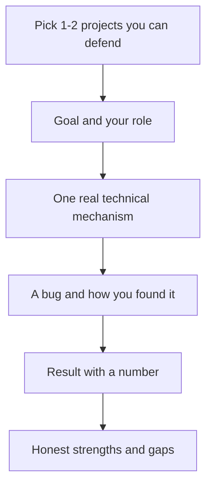

::: basics
### In plain words
The interviewer is not asking for a list of languages. They want to know whether you have turned an idea into working code, what kind of code, and whether you can debug it when it fails. In a hardware role, code is a tool for getting hardware and data work done. Whatever you mention, they will pick one item and ask how it actually worked, so mention only what you can explain.

### Picture it
A good answer is a small story. It names one project and what it was for. It says what you did yourself, shows one real technical detail, tells how a bug was found, and ends with a result and a lesson. A list of language names is like a toolbox with the lid closed. A story shows a tool being used.

### Words you need
- **Firmware**: code that runs on a small device such as a microcontroller (a tiny computer on one chip), usually written in C.
- **Test automation**: scripts that run instruments and collect results so measurements can be repeated.
- **Version control (Git)**: a system that records changes to code so you can compare and go back.
- **Debugging method**: reproduce the problem, shrink it, form a guess, test the guess, and fix it.
- **Scripting**: short programs, often in Python, that automate tasks.

### The simplest example
Here is a skeleton with *[placeholders]* to fill with true details, never invented ones. "My biggest project was *[what it did]*, in *[language]*, and I was responsible for *[your part]*. The interesting part was *[one technical mechanism]*. When it failed, I found the cause by *[your method]*. The result was *[a measurable outcome]*, and I learned *[a lesson]*. I am strongest in *[language]* and I am building depth in *[another]* by *[a concrete step]*." That is the whole idea. The rest of this page covers kinds of hardware coding, making a small project sound as strong as it is, and the follow-ups to expect.
:::

::: testing
This is a behavioral question, so the interviewer is not looking for a language list. They are checking:

1. **Level and breadth**: have you written real programs (not only tutorials), in which languages, and for what purpose?
2. **Relevance to hardware**: firmware, test automation, data analysis, HDL, scripting. They want to know whether code is a tool you use to get hardware work done.
3. **Engineering habits**: version control, debugging method, testing, reading other people's code.
4. **Honesty and self-awareness**: can you describe the true size of your projects and your role in them, without inflating it?
5. **Depth under follow-ups**: whatever you mention, they will pick one item and ask how it actually worked.
:::

::: why
Almost every hardware role involves code now. Firmware engineers write C, validation engineers write Python to drive instruments and parse logs, design engineers write RTL, scripts and testbenches, and architects write models and simulators. The interviewer wants evidence that you can turn an idea into working software and debug it when it fails. This question is also an easy one to answer badly: a vague list ("C, C++, Python, MATLAB") with no stories sounds weak, while one or two specific projects with technical detail sounds like someone who has done the work. It sets the agenda for the rest of the interview, because the interviewer will probe whatever you mention.
:::

::: concepts
- **Language versus problem**: describing a program by what it did and why, not just which language it used. See [[q0965]] for language-specific detail.
- **Hardware-adjacent coding types**: firmware (C), test automation and data analysis (Python), HDL (Verilog/SystemVerilog, see [[q0956]]), shell scripts, MATLAB.
- **Debugging method**: reproduce, isolate, hypothesize, test, fix; with print statements, a debugger, logic analyzer or scope.
- **Version control**: Git basics (commits, branches, diffs) as evidence of working in a team-like way.
- **Testing**: unit tests, test benches, or at least a repeatable check against known data.
- **Self-rating**: giving honest, calibrated levels. See [[q0966]].
:::

::: answer
"I'd say my coding is mostly applied: I write code to get hardware and data work done. The most substantial thing was *[your project: e.g., firmware for a sensor board / a Python tool that automates scope measurements / a small CPU in Verilog plus a testbench]*. I wrote it in *[language]* and I was responsible for *[your part]*.

Technically, what made it interesting was *[one real detail: e.g., reading an IMU over SPI at 1 kHz with a timer interrupt, a ring buffer so the ISR never blocks, and bit-masking the status register; or parsing a 200 MB CSV with a regex and plotting the results]*. When something didn't work, I narrowed it down by *[your method: e.g., toggling a GPIO and watching it on a scope, adding assertions, testing on a known input]*. The result was *[a measurable outcome: it sampled without dropping data, saved X minutes per test, passed the lab's checks]*, and I learned *[a specific lesson]*.

Beyond that I've used Python for scripting and plotting, C in embedded coursework, and Git for version control. I'm strongest in *[language]* and I'm still building depth in *[language]*, which I'm working on by *[something concrete]*."
:::

::: technical
**Structure that works (situation, role, technical substance, result, lesson).**

1. **Situation and goal**: one sentence on what the program was for (the user or the hardware it served).
2. **Your role and the size**: solo or team, rough size (hundreds of lines versus thousands), time span.
3. **Technical substance**: the one or two non-trivial pieces, such as an interrupt-driven design, a state machine, a communication protocol, a data structure, a numerical method.
4. **Debugging and verification**: how you found a bug and how you knew it worked.
5. **Result and lesson**: a measured outcome, and what you would do differently.

**What to cover, by category of experience.**

| Type | Typical content | What they may ask next |
|---|---|---|
| Embedded C | GPIO, timers, UART/SPI/I2C, ISRs | Why `volatile`? How do you avoid blocking in an ISR? ([[q0970]]) |
| Python automation | Instrument control, parsing logs, plotting | Regex, lists vs dicts, how you handled errors ([[q0967]]) |
| HDL | Counters, FSMs, a small CPU or FIFO | Blocking vs non-blocking, how you tested it ([[q0956]]) |
| C++/OOP | Classes, STL, a simulator or driver | RAII, references vs pointers ([[q0965]]) |
| Scripting | Bash, Makefiles, build flow | How you made it repeatable |

**If experience is limited.** Describe classwork or personal projects honestly, with specifics. A 300-line project you understand completely beats a 5,000-line project you cannot explain. Say what you are learning and how.

**Red flags to avoid.** Claiming a language you cannot write a loop in; "we" for everything with no description of your part; listing 10 languages with no detail on any.
:::

::: short
"My coding is mostly applied to hardware work. The biggest example is *[project]*, where I wrote *[language]* to *[goal]*. The interesting technical part was *[one specific mechanism]*, and I debugged it by *[method]*. It ended up *[measured result]*. Beyond that I've used C for embedded work, Python for scripting and plotting, and Git for version control. I'm strongest in *[language]* and actively building depth in *[other]*."
:::

::: long
"I'd frame my experience around what I've built, not a list of languages.

My most substantial project was *[your project]*. The goal was *[what it had to do]*. I wrote it in *[language]*, working *[alone / in a team of N]*, and I was responsible for *[your specific part]*. It was around *[rough size]* and took about *[time]*.

The technical piece I'm proudest of is *[a concrete mechanism]*. For example, on an embedded project: a timer interrupt triggers a sensor read over SPI, the ISR only copies the data into a ring buffer, and the main loop processes it, so the ISR stays short and I don't lose samples. Or on an automation project: a Python script that drives the instrument over a serial or VISA connection, logs every measurement with a timestamp, and plots the results, which turned a manual hour-long measurement into a few-minute run.

When it didn't work I followed a routine: reproduce the failure, shrink it to the smallest case, form a hypothesis, test it. In that project the bug was *[a real bug and how you found it: a missing volatile, an off-by-one in the buffer, a wrong bit mask]*, and I found it by *[print statements, a debugger, a GPIO toggle on a scope]*. I kept it under Git so I could compare against the last working version.

Outside that, I've used C in *[courses/labs]*, Python for data analysis and test scripting, and *[Verilog or MATLAB]* for *[purpose]*. I'd say I'm most comfortable in *[language]*. I'm less experienced in *[language]*, and I've been working on that by *[concrete step]*.

What I took from it: write the smallest thing that works, test it against a known case, and keep the hardware in the loop early."
:::

::: terms
- **Firmware**: software that runs on a microcontroller or embedded device, usually in C or C++.
- **Test automation**: scripts that control instruments and collect results so measurements are repeatable.
- **Version control (Git)**: system that records changes to code so you can compare and revert.
- **Unit test**: a small automated check of one function or module against a known result.
- **Debugger**: tool for stepping through code and inspecting variables (for example GDB).
- **Interrupt service routine (ISR)**: code that runs in response to a hardware event; should be short. See [[q0801]].
- **HDL**: hardware description language such as Verilog or VHDL; describes circuits, not sequential programs.
- **Scripting**: short programs (Python, Bash) that automate tasks and glue tools together.
- **Code review**: having others read your code to find defects and improve clarity.
:::

::: exceptional
**An average answer** lists languages ("I know C, C++ and Python") and a vague "I did some projects".

**An exceptional answer**:
- Leads with one concrete project and what it was *for*.
- States their own role and the rough size honestly.
- Includes a specific technical mechanism (an ISR plus ring buffer, a state machine, a parser) that proves depth.
- Describes a real debugging episode and the method, not just "I fixed bugs".
- Gives a measurable outcome (time saved, samples per second, test coverage).
- Mentions version control and testing habits in one sentence.
- Is calibrated about strengths and gaps and says what they are doing about the gaps.
:::

::: mistakes
- **A language shopping list.** "C, C++, Python, Java, MATLAB, Verilog" with nothing behind it invites an awkward probe. Pick the two or three you can defend.
- **Inflating the size or your role.** The follow-ups find out immediately. Say "I wrote the driver; my teammate did the UI".
- **Only describing coursework as "assignments".** Say what the program did and a technical decision you made.
- **No mention of hardware.** In a hardware interview, show how code interacts with hardware: registers, timing, instruments, data.
- **Having no story about a bug.** Debugging is the real skill; prepare one clear example.
- **Apologizing for limited experience.** Be honest and specific instead: "A small project, but I understand all of it. Here is what I learned."
:::

::: deep
## What the interviewer is really sampling

When an interviewer asks "what coding experience do you have?" they are sampling three things at once, and good answers feed all three.

**Evidence of competence.** A story with detail is the strongest evidence. A single paragraph such as "an SPI driver that reads a 16-bit register, masks the status bits and pushes samples into a 256-entry circular buffer from a 1 kHz timer interrupt" tells them you know hardware registers, interrupts and data structures without them asking.

**Evidence of judgment.** Did you pick the right tool? A Python script for one-off data processing and a C ISR for a deadline are both good choices. Choosing Python for a microsecond-deadline loop would not be.

**Evidence of learning speed.** For internship candidates, the experience is expected to be limited, so the interviewer is predicting how fast you will learn. Projects that show you taught yourself something new (a protocol, a language feature, a tool) are strong evidence.


Figure: A reusable skeleton for any experience answer. Spend most of your time in the middle: the technical mechanism and the debugging story are what the interviewer remembers and probes.

## The kinds of coding hardware teams care about

**Embedded C/C++.** Registers are memory-mapped, so bit manipulation and `volatile` matter ([[q0970]]). Typical pieces: GPIO, timers, ADC reads, UART/SPI/I2C drivers, interrupt handlers, state machines. Constraints: small memory, no operating system, hard timing.

**Python for hardware work.** Instrument control (serial, VISA, USB), parsing log files and CSVs, plotting, statistics, calibration scripts, test sequencing. Regex ([[q0967]]) and a data library such as NumPy or pandas come up often.

**HDL and verification code.** Verilog or SystemVerilog for modules and testbenches ([[q0956]], [[q0960]]). It looks like code but describes concurrent hardware, so show you know the difference between blocking and non-blocking assignment, and between combinational and sequential logic.

**Scripting and build.** Bash, Make, small tools that run simulations, collect results and generate reports.

**Numerical and modeling code.** MATLAB or Python models of a circuit, a controller or a sensor.

## Making a small project sound as good as it is

Suppose your best project is a 400-line Python script that reads oscilloscope CSVs and extracts rise time. Compare:

- *Weak*: "I wrote a Python script to analyze data."
- *Strong*: "I wrote a Python script that parsed 40 scope CSV files, found the 10% to 90% rise time of each edge with linear interpolation between samples, and plotted rise time against load capacitance. It replaced about ten minutes of manual cursor measurement per file, and I verified it against hand measurements on three files to within the scope's sample period."

Both describe the same project; the second contains a method (interpolation), an outcome (time saved), and verification. Interpolating between samples matters because a scope sampling every 400 ps gets only two or three samples on a 1 ns edge, so without interpolation the answer is quantized to 400 ps steps.

**Quantifying the payoff of automation.** Say a manual measurement takes 10 minutes per file, writing and testing the script took 3 hours (180 minutes) and each script run takes 20 seconds. The break-even point is

$$n^* = \frac{180}{10 - 20/60} \approx 18.6\ \text{files}$$

so the script wins from the 19th file on. For 40 files the manual route is 400 minutes against $180 + 40\times\tfrac13 \approx 193$ minutes.

```plot
{"title":"Automating a measurement: cumulative minutes spent","x":{"label":"Number of files processed","min":0,"max":40},"y":{"label":"Minutes","min":0,"max":420},
 "vars":{"manual":10,"build":180,"run":0.3333},
 "series":[{"label":"manual, 10 min per file","fn":"manual*x","color":"red"},{"label":"script: 180 min to build, 20 s per file","fn":"build+run*x","color":"accent"}],
 "points":[{"x":18.6,"y":186,"label":"break-even 18.6 files"}]}
```
Figure: The script costs more at first and wins once enough files have been processed. The same reasoning is how you decide whether automating a test is worth it, a good thing to say in an interview. The numbers are an example, not measured data.

## Habits that show maturity

1. **Version control.** Even for solo projects, committing regularly lets you go back to the last working version. Mention Git by name and one thing you did with it (branching, a diff that located a regression).
2. **A repeatable test.** A script, a testbench or a known-input check. "I checked it against hand calculations on three cases" counts.
3. **Debugging as method.** Reproduce, reduce, hypothesize, test. For firmware: toggle a GPIO and watch it on a scope or logic analyzer, since a debugger can disturb timing. For scripts: print intermediate values, check units and array shapes.
4. **Readable code.** Meaningful names, small functions, comments saying *why*. Someone else (or you in six months) must be able to read it.
5. **Reading other people's code.** Interns spend much of their time in code they did not write. Mention an example of working from an existing codebase, datasheet driver or library.

## If you have little experience

Be specific and honest. A good template: "My experience is mostly from *[courses and a personal project]*. In the project I *[did X]*. It's small, around *[N lines]*, but I wrote all of it and I can explain every part. I've been building depth by *[concrete step]*." Then pivot to what you can show: how you learn, a bug you tracked down, a tool you picked up fast. Saying "I don't have experience with X but I've done Y, which is similar, and here's how I'd learn X" is stronger than bluffing and being found out.

> [!INTERVIEW]
> Whatever you mention, be ready for "walk me through how that works". Before the interview, re-read your own code for each project on your resume so you can explain the data flow, the trickiest function and one thing you'd change.

## Prepare these probes

- "What was the hardest bug and how did you find it?"
- "How did you test it?"
- "What would you change if you did it again?"
- "How does your code behave if the sensor never responds?" (error handling and timeouts)
- "What happens if two things need the CPU at once?" (interrupts, concurrency)
- "How big was it, and how did you organize the files?"
:::

::: applications
- **Firmware for a sensor or motor-control board**: C on a microcontroller, with timers, ADC and communication peripherals.
- **Instrument automation**: Python scripts that drive power supplies, scopes and meters for characterization and production test.
- **Data analysis of lab measurements**: parsing CSV/logs, filtering, fitting and plotting (rise time, jitter, efficiency curves).
- **RTL and testbenches**: Verilog/SystemVerilog for a small CPU, UART, FIFO or arbiter with self-checking tests.
- **Simulation and modeling**: MATLAB or Python models of a filter, a controller or a power converter.
- **Build and test infrastructure**: scripts that run regressions and generate reports.
:::

::: assumptions
- **Intern or early-career context.** Interviewers expect limited professional experience; coursework and personal projects count if described with substance.
- **Hardware-focused interview.** The advice favors embedded, scripting and HDL examples over web or app development; if your best experience is in another area, use it and connect it to hardware.
- **Placeholders are yours to fill.** Never invent experience. The templates show structure and the kind of technical detail to include; replace them with your actual work.
- **Language-specific detail** is covered on [[q0965]] and the self-rating on [[q0966]]; this page covers the overall story.
- **Length.** Aim for about two minutes unless asked to elaborate, and let the interviewer choose where to dig.
:::

::: followups
### Walk me through the hardest bug you hit in that project.
Use the structure symptom, hypothesis, test, cause, fix, lesson. For example: "The sensor readings occasionally jumped. I suspected a race between the ISR and the main loop. I toggled a GPIO inside the ISR and saw on the scope it fired mid-read of a 16-bit value. The main loop read two bytes non-atomically. I fixed it by disabling the interrupt around the copy and made the shared variable `volatile`." Real details matter more than drama.

### How did you test your code?
Name what you actually did: compare to hand-calculated values, run a known input (a sine wave through a filter), write a self-checking testbench, or use unit tests. If you had little testing, say how you would test it now. Admitting a gap and describing the fix is better than claiming perfection.

### What would you do differently if you started again?
Pick one concrete improvement: structure the code into modules earlier, add a simulation before touching hardware, use version control from day one, write the test first, or avoid a global variable. It shows reflection.

### You said you know Python. How would you read a 2 GB log file and count the lines that contain "ERROR"?
Iterate over the file line by line (`for line in f:`) instead of reading it into memory, and count lines where `"ERROR" in line`; use a compiled regex ([[q0967]]) if the pattern is more complex. This streams the file with constant memory.

### What if you have no project experience in the language they want?
Say so plainly, then bridge: "I haven't used C++ professionally, but I've written C for microcontrollers, so I understand pointers, memory and bit manipulation. I'd get up to speed on classes and the STL with a small project." Then give evidence you learn quickly, such as a tool you picked up in a week.

### How do you make sure your code is not just working on your machine?
Keep dependencies listed (a `requirements.txt` or Makefile), commit the code with a README of how to run it, avoid hard-coded paths, and run it from a clean checkout. For embedded, record the toolchain version and the board setup so another engineer can reproduce the build.
:::

::: interpretations
"What sort of coding experience do you have?" is deliberately open and is usually the **opening** of a coding discussion: the interviewer will pick one thing you say and dig into it. It may mean general programming, or coding relevant to the role (firmware, scripting, HDL). The related questions are [[q0965]] (specific languages: C, C++, Python), [[q0966]] (strongest languages and self-rating), and [[q0971]]/[[q0972]] (coding exercises). Treat this page as the narrative layer; those pages cover the technical specifics.
:::

::: references
- Kernighan & Ritchie, *The C Programming Language*: standard introduction to C, useful for firmware experience.
- Kernighan & Pike, *The Practice of Programming*: debugging, testing, style and portability habits.
- Pro Git (Chacon & Straub, freely available book): version control basics.
- Python Software Foundation, *The Python Tutorial* (docs.python.org): a reliable overview of the language.
- McConnell, *Code Complete*: construction practices such as naming, structure and debugging.
:::

::: rubric
- Leads with a specific project, its goal and the candidate's own role :: Concrete evidence is more convincing than a language list.
- Gives rough size and timescale honestly :: Calibration builds trust; inflation is discovered in follow-ups.
- Includes a real technical mechanism (ISR plus buffer, parser, FSM, protocol) :: Shows depth beyond syntax.
- Describes a debugging episode with method :: Debugging is the core engineering skill being assessed.
- Mentions testing and version control habits :: Indicates professional working practice.
- Connects code to hardware or hardware workflows :: Keeps the answer relevant to a hardware role.
- States strengths and gaps with a plan for the gaps :: Self-awareness and learning speed are what interns are hired for.
:::

::: quiz
```json
[
 {"type":"mcq","level":"fundamental","q":"Which opening best answers 'What sort of coding experience do you have?' in a hardware interview?","options":["A list of every language you have ever touched","One or two specific projects: what they did, your role, a technical detail, and a result","'I'm a fast learner and have done lots of coding'","'Only school assignments, nothing worth mentioning'"],"answer":1,"explain":"Specific projects with a role, a technical mechanism and an outcome give the interviewer evidence and something to probe. A list or a vague claim gives them nothing, and dismissing your own work wastes the chance."},
 {"type":"truefalse","level":"fundamental","q":"If your experience is limited to a small personal project, you should avoid mentioning it.","answer":false,"explain":"A small project you understand completely, described with specifics, is good evidence. Be honest about its size and show what you learned."},
 {"type":"numeric","level":"intermediate","q":"A manual measurement takes 10 min per file. A script takes 180 min to write and 20 s per file to run. After how many files does the script's cumulative time drop below the manual time? (Give the break-even point to one decimal.)","answer":18.6,"tolerance":0.02,"unit":"files","explain":"Solve $180 + n/3 = 10n$ so $n = 180/(10 - 1/3) = 18.6$. From the 19th file on, the script saves time."},
 {"type":"mcq","level":"intermediate","q":"Your firmware occasionally returns a corrupted 16-bit sensor value read in main while an ISR updates it. Which statement best describes a likely cause and fix?","options":["The compiler has a bug; recompile with -O3","A non-atomic read of the 2-byte value interrupted by the ISR; disable the interrupt around the copy and mark the variable volatile","The sensor is faulty; replace it","The baud rate is wrong"],"answer":1,"explain":"On an 8-bit core a 16-bit read is two accesses, so the ISR can change the value between them. Protect the read with a short critical section and use volatile so the compiler re-reads the variable."},
 {"type":"multi","level":"advanced","q":"Which of these make an experience answer stronger in a hardware interview? Select all that apply.","options":["A debugging story with the method used","An accurate statement of your role in a team project","Claiming expert level in six languages","A measured result such as time saved or samples per second"],"answer":[0,1,3],"explain":"Method, honest role and a measurable outcome all show real engagement. Claiming expert level in many languages invites probing that you cannot survive."}
]
```
:::
