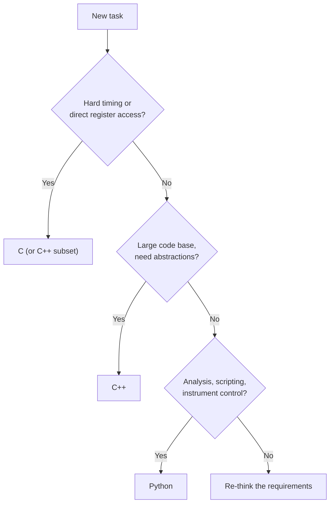

::: testing
This question has two layers. The surface layer is "which of these three languages have you used?". The real layer is whether your answer survives the follow-up, because the interviewer will pick a concept from whatever you claim and test it. They are checking:

1. **Honest, calibrated claims** for each language: used in a project, used in a class, or only read about.
2. **Core concepts for each language**: C (pointers, memory, bit manipulation, `volatile`), C++ (classes, RAII, references, the standard library) and Python (dynamic types, lists and dicts, scripting for hardware work).
3. **Judgment**: which language you would choose for which job, and why.
4. **Learning ability**: if you say "no" to one, can you say how you'd pick it up using what you know?
:::

::: why
These three languages cover most hardware-adjacent coding. C (and increasingly C++) runs firmware, drivers and low-level tools; Python runs test automation, data analysis and glue scripts. The interviewer's list is the three they get asked about most, so teams expect candidates to touch them. Answering well means connecting each language to what it is used for in hardware and showing you know a few of its sharp edges, which is a much stronger signal than saying "yes, all three".
:::

::: concepts
- **Compiled vs interpreted**: C and C++ compile to machine code, Python runs on an interpreter. See [[q0962]].
- **Memory model in C**: stack vs heap, pointers, arrays, and what undefined behavior means. See [[q0968]].
- **Bit manipulation**: set, clear, toggle and mask bits, the daily work of register access. See [[q0893]].
- **`volatile` and hardware registers**: tells the compiler a value can change outside the program's control. See [[q0970]].
- **C++ resource management**: constructors and destructors (RAII) tie resources to scope.
- **Python data structures**: lists, tuples, dicts, comprehensions, plus libraries for plotting and instruments.
:::

::: answer
"Yes to all three, at different levels, so let me be specific.

*[C]*: I've used C on *[microcontroller / coursework]*, where I wrote *[GPIO, timer, UART, or an ISR]*. I'm comfortable with pointers, arrays, structs, bit manipulation for register access, and I know why a flag shared with an interrupt has to be `volatile`.

*[C++]*: I've used it for *[a class project / simulator / driver]*. I understand classes, constructors and destructors, references versus pointers, and I've used the standard library containers like `vector`. I'm less deep in templates and the more advanced features, so I'd call that intermediate.

*[Python]*: this is what I use most for scripting, data analysis and test automation. For example *[parsing logs, plotting with matplotlib, driving an instrument]*. I know lists, dictionaries, comprehensions, and file handling.

If one of these were new to me, I'd say so directly and point to the closest thing I've done. For example, 'I haven't used C++ professionally, but I know C well, so pointers and memory are familiar and I'd pick up classes quickly.' In general: C when I need control of memory and registers, Python when speed of development matters and performance doesn't, and C++ when I want abstraction without giving up C-like performance."
:::

::: technical
**Where each language sits in hardware work.**

| | C | C++ | Python |
|---|---|---|---|
| Execution | Compiled to native code | Compiled to native code | Interpreted (bytecode VM) |
| Typical hardware use | Firmware, drivers, bootloaders, RTOS | Larger embedded code, simulators, tools, EDA internals | Test automation, instrument control, data analysis, scripting |
| Memory | Manual (`malloc`/`free`, stack) | Manual plus RAII, smart pointers | Automatic (reference counting and garbage collection) |
| Types | Static, weak | Static, stronger, templates | Dynamic |
| Typical pitfalls | Buffer overflow, uninitialized vars, dangling pointers | Object lifetime, copies, ABI/size surprises | Slow loops, mutable default arguments, silent type issues |

**C essentials to be able to explain.**

- Pointer arithmetic scales by element size: for `int *p`, `p + 2` is 8 bytes (with 4-byte `int`) past `p`. With `a = {10,20,30,40}`, `*(p+2)` is 30 and `p[3]` is 40.
- Bit manipulation: `r |= (1u<<2)` sets bit 2; `r &= ~(1u<<1)` clears bit 1; `r ^= (1u<<3)` toggles bit 3. Starting from `0x0A`: set bit 2 gives `0x0E` (14), clear bit 1 gives `0x0C` (12), toggle bit 3 gives `0x04` (4).
- Struct padding: `struct {char c; int i; char d;}` is 12 bytes on a typical ABI with 4-byte alignment, while `struct {int i; char c; char d;}` is 8 bytes.
- `volatile` for memory-mapped registers and ISR-shared flags ([[q0970]]).

**C++ essentials.** Classes with constructors/destructors (RAII: a lock or file closes when the object leaves scope), references vs pointers, `const` correctness, `std::vector` and `std::string`, `virtual` functions and their cost (a vtable lookup), templates for generic code, `constexpr`. Embedded C++ often avoids exceptions and dynamic allocation.

**Python essentials.** Lists (mutable), tuples (immutable), dicts, comprehensions, slicing, `with` for files, exceptions, modules, and libraries such as NumPy/matplotlib (analysis) and pyserial/PyVISA (instruments). Pitfall: a mutable default argument is shared across calls: `def f(x, acc=[])` returns `[1, 2]` for `f(1)` then `f(2)`.
:::

::: short
"Yes, at different levels. C I've used on *[microcontrollers or coursework]*: pointers, structs, bit manipulation for registers, and `volatile` for ISR flags. C++ I've used for *[project]*, so classes, references, RAII and the STL containers, intermediate level. Python is what I use most, for scripting, data analysis and instrument automation. I'd pick C for hardware-level control, Python for fast scripting and analysis, and C++ when I need abstraction with C-like performance. Where I'm weaker, I'll say so and explain how I'd close the gap."
:::

::: long
"I'll take them one at a time and be honest about the level.

C first. I've used C on *[a microcontroller / in coursework]*. I wrote *[something concrete: GPIO and timer code, a UART driver, an interrupt-driven sampler]*. I'm comfortable with pointers and arrays, structs, function pointers at a basic level, and especially bit manipulation: setting, clearing and toggling bits with OR, AND-NOT and XOR, and extracting fields with a shift and a mask, because that's how you talk to hardware registers. I know why a variable shared between an ISR and the main loop must be `volatile`, and that `volatile` doesn't make an access atomic.

C++: I've used it for *[a project]*. I understand classes, constructors and destructors, why RAII is useful, the difference between a reference and a pointer, and I've used `std::vector` and `std::string`. I'd rate myself intermediate: I haven't used templates heavily or the more advanced parts of the language. On embedded targets I know people often avoid exceptions and dynamic allocation.

Python is the one I use most. I use it for scripting, parsing logs with regular expressions, plotting with matplotlib, and driving instruments over serial or VISA for test automation. I know lists, tuples and dictionaries, comprehensions, and how mutable default arguments can bite.

As for choosing: C when I need to control memory layout, registers and timing; Python when development speed matters and performance doesn't; C++ when the code base is large and abstraction helps without a performance penalty.

If I haven't used one, I'd say so, name the nearest thing I've done, and explain how I'd ramp up, for example by building a small project and reading the code of an existing driver."
:::

::: terms
- **Pointer**: a variable holding a memory address; arithmetic on it scales by the pointed-to type's size.
- **Stack / heap**: automatic, scope-based memory versus manually or dynamically allocated memory.
- **Undefined behavior**: C/C++ code the standard places no requirements on (e.g. out-of-bounds access); the compiler may do anything.
- **RAII**: C++ idiom that ties a resource's lifetime to an object's scope via constructor and destructor.
- **Reference (C++)**: an alias for an existing object; cannot be null or reseated, unlike a pointer.
- **STL**: the C++ standard library's containers and algorithms (`vector`, `map`, `sort`).
- **Bit mask**: a constant used with AND/OR/XOR to read or modify specific bits.
- **Interpreter / bytecode**: how standard Python executes code at runtime.
- **List comprehension**: compact Python syntax to build a list from an iterable.
- **GIL**: CPython's global interpreter lock, which limits threads running Python bytecode in parallel.
:::

::: exceptional
**An average answer** says "yes, I know C, C++ and Python" and adds one project.

**An exceptional answer**:
- Gives each language a level and a concrete example, and is clear about which is strongest.
- Demonstrates depth with one idiom per language: `volatile` and bit-masks in C, RAII in C++, a dict or comprehension in Python.
- Explains **when to choose** each language for hardware work.
- Mentions a real pitfall for each (buffer overflow or undefined behavior in C, object lifetime in C++, mutable default argument or slow loops in Python).
- Handles "no" gracefully: names the closest experience and a plan.
- Does not oversell: "intermediate in C++" is believable; "expert in everything" is not.
:::

::: mistakes
- **Claiming a language you cannot write a loop in.** Follow-ups reveal it quickly. Say "coursework only" if that's the truth.
- **Treating C and C++ as the same.** C++ adds classes, references, templates and RAII; "C with classes" misses most of the point.
- **Saying `volatile` makes code thread-safe or atomic.** It only prevents the compiler from caching or removing accesses.
- **Calling Python "slow so it's useless for hardware".** It is excellent for test automation and analysis, and NumPy runs compiled code underneath.
- **Not knowing pointer arithmetic.** `p + 1` moves by `sizeof(*p)` bytes, not one byte.
- **Ignoring that `sizeof('A')` differs.** It is 4 in C (a character constant has type `int`) and 1 in C++.
:::

::: deep
## Giving an honest level per language

A useful private rubric (also see [[q0966]]):

| Level | Meaning |
|---|---|
| Heard of it | Read some code, no programs |
| Coursework | Completed assignments; can write small programs with reference material |
| Working | Built a project; debug it; know common pitfalls |
| Strong | Comfortable with advanced features and tooling; can review others' code |

Pick the level that is true and have one story for it. "Working in C, coursework in C++, strong in Python" is a perfectly good profile for an intern.

## Which language for which job


Figure: A simple decision tree. Hard real-time and register-level work points to C; big structured native projects to C++; analysis and automation to Python. Real choices also depend on team conventions and tooling, so treat this as a starting point.

## C: the things interviewers actually probe

**Pointers and arrays.** An array name decays to a pointer to its first element, and pointer arithmetic is scaled. For example:

```c
int a[4] = {10, 20, 30, 40};
int *p = a;
// *(p + 2) -> 30,  p[3] -> 40,  (char*)(p+1) - (char*)p -> 4 bytes
```

**Bit manipulation.** Hardware registers pack many fields into one word. The three idioms to know cold:

```c
reg |=  (1u << n);          // set bit n
reg &= ~(1u << n);          // clear bit n
reg ^=  (1u << n);          // toggle bit n
field = (reg >> LSB) & MASK;  // extract a field
```

Worked check with an 8-bit register starting at `0x0A` (0000 1010): setting bit 2 gives 0000 1110 = `0x0E` = 14; clearing bit 1 gives 0000 1100 = `0x0C` = 12; toggling bit 3 gives 0000 0100 = `0x04` = 4. Extracting a 2-bit field at bits [5:4] from `0xB6` (1011 0110): shift right 4 gives 1011, mask with `0x3` gives 3.

Use the register decoder to practice exactly this: define fields, enter a hex value and see the mask-and-shift C expressions.

```sim
{"id":"register-decoder","preset":"ctrl"}
```
Figure: Change the hex value and watch each field's binary and decimal value update (each field is `(reg & mask) >> lsb`). Then type a new value into one field's write box, for example PRESCALE = 10, and read the generated C expression: the old register value is ANDed with `~mask` first, so the other fields are not disturbed (read-modify-write).

**Struct layout and padding.** The compiler inserts padding so each member is aligned. `struct {char c; int i; char d;}` occupies 12 bytes while `struct {int i; char c; char d;}` is 8 on a typical 4-byte-aligned ABI. Reordering members saves memory, and for hardware register maps or network packets you need `packed` attributes or explicit fixed-width fields. Layout is implementation-defined, which is why portable code uses `stdint.h` types ([[q0968]]).

**`volatile` and the optimizer.** Without `volatile`, `while (!flag) {}` can be compiled to read `flag` once and loop forever. See [[q0970]] for the full treatment.

**Undefined behavior.** Out-of-bounds array access, signed overflow, use of an uninitialized variable, or dereferencing a dangling pointer have no defined result. The compiler may assume they never happen and optimize accordingly, which produces bugs that vanish in a debug build.

## C++: what a hardware interview wants

The question is rarely "do you know templates". It is: do you understand **object lifetime and resource ownership**. RAII is the central idea:

```cpp
struct R { R(){ std::cout << "acquire "; } ~R(){ std::cout << "release\n"; } };
{ R r; std::cout << "work "; }   // prints: acquire work release
```

The destructor runs when `r` leaves scope, even if an exception or early return happens, so locks, file handles and peripherals are released reliably. Other fundamentals: a reference is a non-null alias, a pointer can be null and reseated; `const` correctness; copy vs move; `std::vector` grows by reallocating (so pointers into it can dangle after `push_back`); virtual functions add a vtable pointer per object and an indirect call. Embedded teams frequently restrict C++ to a subset: no exceptions, no RTTI, limited heap use.

## Python: what a hardware interview wants

Show that you use it to *get hardware work done* and know where it bites:

```python
def f(x, acc=[]):          # the default list is created once
    acc.append(x); return acc
f(1); f(2)                 # second call returns [1, 2]
```

Other points: lists are mutable and aliased (`b = a` makes both names refer to one list, so `b.append(4)` changes `a`), tuples are immutable (`t[0] = 5` raises `TypeError`), integers have arbitrary precision (`(2**100).bit_length()` is 101), `7 // 2` is 3 but `-7 // 2` is -4 (floor division), and `0.1 + 0.2 == 0.3` is `False` because of binary floating point ([[q0968]]). Libraries: pyserial and PyVISA for instruments, NumPy and matplotlib for analysis. The GIL means CPU-bound threads do not run Python code in parallel; use multiprocessing or native extensions for that.

## Answering "no" or "a little"

Honesty plus a bridge works best. A template: "I haven't used *[language]* in a project. I have used *[related language]*, so I'm familiar with *[shared concepts]*. I'd get productive by *[specific step: working through a small project, reading an open-source driver]*." Interviewers for internships hire for learning ability. A candidate who can say precisely how C++ differs from C, having only used C, is more convincing than one who claims C++ and cannot explain RAII.

> [!INTERVIEW]
> Have one 60-second story per language and one "pitfall" per language ready. Example pitfalls: C, a buffer overflow from an off-by-one; C++, a dangling reference after a `vector` reallocation; Python, a mutable default argument.
:::

::: applications
- **C**: firmware for microcontrollers, device drivers, bootloaders, RTOS kernels, register-level code.
- **C++**: larger embedded and robotics code bases, simulators, EDA and CAD tools, game and graphics engines.
- **Python**: test benches and instrument automation (serial, USB, VISA), log parsing, data analysis, plotting, calibration scripts.
- **Mixed systems**: a C library on the device and a Python host tool that talks to it over UART or USB.
- **Verification**: Python (for example with cocotb) or SystemVerilog testbenches checking RTL against reference models.
- **Prototyping**: MicroPython or CircuitPython on small boards for quick experiments.
:::

::: assumptions
- **Experience claims are yours to fill in.** The page gives structure and technical content; use real projects only.
- **Typical ABI.** Sizes such as `int` = 4 bytes and the struct padding example assume a common 32/64-bit platform with 4-byte `int` alignment; embedded targets (for example 8- or 16-bit MCUs) differ, which is why fixed-width types exist.
- **Language standards.** C vs C++ differences like `sizeof('A')` assume ISO C and C++.
- **Python implementation.** Behavior described is for CPython; other implementations (PyPy, MicroPython) differ in speed and in some features.
- **Role context.** For a verification role Python and SystemVerilog may matter more than C++; for firmware, C and bit manipulation matter most.
:::

::: followups
### What does `volatile` do, and does it make a variable thread-safe?
It tells the compiler the value may change outside the program's normal flow (hardware register, ISR), so every access must actually happen and cannot be cached in a register or removed. It does not make read-modify-write atomic and does not order accesses with respect to other threads. For shared data between an ISR and main code you also need atomic access or a critical section. See [[q0970]].

### What's the difference between a pointer and a reference in C++?
A reference is an alias bound at initialization: it cannot be null and cannot be reseated. A pointer holds an address, can be null, can be reassigned, and supports arithmetic. References give cleaner syntax for pass-by-reference; pointers are needed for optional or reseatable relationships and for C interfaces.

### How would you set bits 3 and 4 of an 8-bit register and clear bit 0 without disturbing the others?
`reg = (reg | (1u<<3) | (1u<<4)) & ~(1u<<0);` Equivalent: `reg |= 0x18; reg &= ~0x01;`. If the register is volatile hardware, a single read-modify-write expression is preferable to two separate ones, and you should check whether the peripheral provides atomic set/clear registers.

### In Python, why does `f(1)` then `f(2)` return `[1, 2]` for `def f(x, acc=[])`?
The default value is evaluated once, when the function is defined, so the same list object is reused by every call that omits `acc`. The fix is `acc=None` and `if acc is None: acc = []` inside the function.

### You need to log 1 million samples per second from an ADC and save them. Which language(s)?
The acquisition path (ADC, DMA, ISR, buffer) in C on the microcontroller, because of hard timing, then stream to a host. The host side in Python for parsing, saving and plotting, with NumPy for bulk processing so the loop isn't in interpreted Python. At 1 MS/s with 2 bytes per sample the stream is 2 MB/s (16 Mbit/s), well beyond a typical UART (a few Mbaud, so a few hundred kB/s at most), so you would use USB high-speed, Ethernet or on-board storage instead.

### What if the interviewer asks about a C++ feature you don't know?
Say you haven't used it, connect it to something you do know, and reason aloud about what it probably does. For example, "I haven't used `std::unique_ptr` directly, but I know the RAII idea: it owns the object and frees it in its destructor, so there's no manual `delete`." Reasoning from concepts is better than bluffing.
:::

::: interpretations
The source lists three languages with the note that "these are the three most I get asked about", so this is a breadth question, with each language an opportunity for a follow-up. The wording "coding experience in" accepts coursework, personal projects and internships. See [[q0964]] for the overall experience narrative and [[q0966]] for rating your strongest languages. The language-specific details here (volatile, strings, variable types) are developed in [[q0970]], [[q0969]] and [[q0968]].
:::

::: references
- Kernighan & Ritchie, *The C Programming Language*, 2nd ed.: pointers, arrays, bit operations.
- Stroustrup, *A Tour of C++* (or *The C++ Programming Language*): classes, RAII and the standard library.
- Python Software Foundation, *The Python Language Reference* and *Tutorial*: data model, mutable default arguments, built-in types.
- ISO/IEC C and C++ standards (for example the C11 and C++17 documents): definitions of `volatile`, undefined behavior and `sizeof` rules.
- Barr Group, *Embedded C Coding Standard*: widely used guidance on safe C for firmware (a real published standard; check the current edition).
:::

::: rubric
- Gives an honest level and a concrete example for each language :: Calibrated claims with evidence are more credible than blanket "yes".
- Shows C fundamentals: pointers, bit manipulation, `volatile` :: These are what hardware interviewers probe first.
- Shows C++ fundamentals: classes, RAII, references vs pointers :: Demonstrates that you know why C++ differs from C.
- Shows Python usage for hardware work (scripting, analysis, automation) and a pitfall :: Connects the language to the job.
- Explains which language to choose for which task and why :: Shows engineering judgment.
- Handles gaps honestly with a bridge to related experience :: Interns are hired for learning ability, not omniscience.
:::

::: quiz
```json
[
 {"type":"numeric","level":"fundamental","q":"An 8-bit register holds 0x0A. After `reg |= (1u<<2);` what is its value in decimal?","answer":14,"tolerance":0.001,"unit":"","explain":"0x0A = 0000 1010. Setting bit 2 (value 4) gives 0000 1110 = 0x0E = 14."},
 {"type":"mcq","level":"fundamental","q":"In C, `int a[4] = {10,20,30,40}; int *p = a;` What does `*(p + 2)` evaluate to?","options":["20","30","40","The address of the third element"],"answer":1,"explain":"Pointer arithmetic scales by the element size, so `p + 2` points at the third element, `a[2]`, which is 30."},
 {"type":"truefalse","level":"intermediate","q":"Marking a variable `volatile` in C makes read-modify-write operations on it atomic.","answer":false,"explain":"`volatile` only forces the compiler to perform every access; it provides no atomicity or inter-thread ordering. An increment is still a read, modify and write that an interrupt can split."},
 {"type":"mcq","level":"intermediate","q":"What does this Python print? `def f(x, acc=[]): acc.append(x); return acc` then `print(f(1), f(2))`","options":["[1] [2]","[1, 2] [1, 2]","[1] [1, 2]","An error"],"answer":1,"explain":"The default list is created once at definition time and shared across calls. Both calls return the same list object, which ends up as [1, 2], so it prints it twice."},
 {"type":"numeric","level":"intermediate","q":"Extract the 2-bit field at bits [5:4] from the value 0xB6 using `(v >> 4) & 0x3`. What is the result?","answer":3,"tolerance":0.001,"unit":"","explain":"0xB6 = 1011 0110. Shifting right by 4 gives 1011 (0xB); masking with 0x3 keeps the low 2 bits, 11, which is 3."},
 {"type":"multi","level":"advanced","q":"Select all statements that are true.","options":["`sizeof('A')` is 4 in C but 1 in C++ on a typical platform","A C++ reference can be null","RAII ties a resource's lifetime to an object's scope","`struct {char c; int i; char d;}` is typically larger than `struct {int i; char c; char d;}` because of padding"],"answer":[0,2,3],"explain":"A character constant has type int in C and char in C++. RAII releases resources in destructors. Member order affects padding (12 vs 8 bytes with 4-byte alignment). A reference must refer to an object, so it cannot be null."}
]
```
:::
