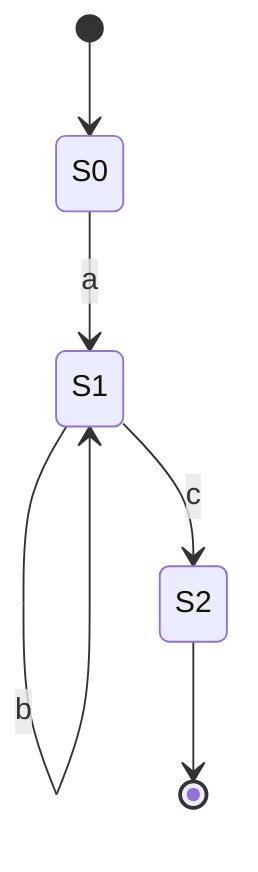

::: basics
### In plain words
A regular expression, or regex, is a short pattern that describes a whole set of text strings. Instead of searching for one exact word, you describe a shape, such as "VDD= then a number then V". A regex engine then finds, pulls out or replaces whatever fits. Hardware engineers use regexes to dig voltages, addresses and error codes out of long logs and reports.

### Picture it
Think of a license plate rule: three letters, then four digits. That rule describes millions of plates without listing any. A regex is that kind of rule for text. It has fixed parts, like the letters VDD, and flexible parts, like "any run of digits". It can describe a shape. It cannot count unlimited nesting, such as matching every opening bracket with its closing one. For that you need a real parser (a program built to read nested structure).

### Words you need
- **Character class**: a set of allowed characters in square brackets. `[0-9A-Fa-f]` is one hex digit (0 to 9 or A to F, the digits of base 16).
- **Quantifier**: how many times the item before it may repeat. `+` means one or more, and `*` means zero or more.
- **Capture group**: parentheses that mark the part of a match you want to pull out.
- **Greedy vs lazy**: a greedy quantifier takes as much text as it can, and a lazy one takes as little.
- **Anchor**: a marker for a position rather than a character, such as `^` for the start of a line.

### The simplest example
A log line reads `VDD=3.29V IDD=12.5mA addr=0x1F4A`. In the pattern `VDD=(\d+\.\d+)V`, `\d+` means one or more digits, `\.` means a literal dot, and the parentheses capture the number. It returns `3.29`. The pattern `0x[0-9A-Fa-f]+` finds the hex address `0x1F4A`. One trap is greediness. On `<b>x</b><b>y</b>`, `<b>.*</b>` matches the whole string, but the lazy `<b>.*?</b>` matches only `<b>x</b>`. That is the whole idea. The rest of this page covers escaping, runaway backtracking, and the link to finite state machines.
:::

::: testing
Whether you can explain regular expressions as a **practical text-processing tool** and also know a little of the theory behind them. The interviewer is checking:

1. A clear definition: a compact pattern language for matching, extracting and replacing text.
2. Fluency with the basic building blocks: literals, character classes, quantifiers, anchors, groups, alternation.
3. A real hardware example, such as pulling a voltage or an address out of a log file.
4. Awareness of pitfalls: greedy versus lazy matching, escaping, over-matching, and catastrophic backtracking.
5. A bonus: the link to finite automata. A regular expression describes a regular language that a finite state machine can recognize ([[q0896]]).
:::

::: why
Hardware engineers drown in text: simulator logs, synthesis and timing reports, test-bench output, instrument CSVs, register definitions, netlists and configuration files. Regular expressions are the fastest way to search, filter and extract data from that text, and they appear in `grep`, `sed`, editors, Python scripts and most EDA tool command languages. In an interview it is a light "do you actually automate things" question, and it connects to string handling ([[q0969]]), to coding exercises ([[q0973]]), and, through finite automata, to digital design.
:::

::: concepts
- **Pattern vs text**: a regex is itself a string that describes a set of strings; the engine finds matches in input text.
- **Literals and metacharacters**: most characters match themselves; `. * + ? [ ] ( ) { } ^ $ | \` have special meaning.
- **Character classes and quantifiers**: `[0-9A-Fa-f]` is one hex digit, `+` means one or more.
- **Groups and capture**: parentheses select the part of a match to extract.
- **Greedy vs lazy**: whether a quantifier takes as much as possible or as little as possible.
- **Finite automata**: regular expressions correspond to finite state machines. See [[q0896]].
- **Strings in memory**: the engine works on character sequences. See [[q0969]].
:::

::: answer
"A regular expression, or regex, is a compact pattern language for describing a set of strings, so you can search for, extract or replace text. Instead of looking for one exact string, I describe a shape. For example, `0x[0-9A-Fa-f]+` matches a hex number like `0x1F4A`, and `VDD=(\d+\.\d+)V` matches a supply voltage and captures the number in the parentheses.

The building blocks are literals, character classes in square brackets, quantifiers like star, plus and question mark, anchors like caret and dollar for start and end of line, groups with parentheses, and alternation with a pipe.

In hardware work I use it constantly for parsing logs and reports: pulling the voltage and current out of a test log, finding every line with an error code, or extracting register addresses from a header file, usually in Python with the `re` module or on the command line with grep.

A couple of things I watch for: quantifiers are greedy by default, so `<b>.*</b>` swallows everything between the first and last tag, and I'd use a lazy `.*?` instead. And certain nested patterns can backtrack catastrophically on bad input. On the theory side, regexes describe regular languages, which a finite state machine can recognize, which is why they can't handle things like arbitrarily nested parentheses."
:::

::: technical
**Definition.** A regular expression is a pattern over an alphabet defined by three operations: concatenation, alternation (`|`) and repetition (`*`). Practical engines add shorthand (`+`, `?`, `{n,m}`, classes) and extensions such as capture groups, backreferences and lookarounds.

**Core syntax (Python `re` / PCRE-style).**

| Element | Meaning | Example |
|---|---|---|
| `.` | any character except newline | `a.c` matches `abc` |
| `[abc]`, `[a-f]`, `[^0-9]` | one char from a set / range / not in set | `[0-9A-Fa-f]` one hex digit |
| `\d \w \s` | digit, word char, whitespace | `\d+` |
| `* + ?` | 0 or more, 1 or more, 0 or 1 | `ab*c` |
| `{n}` `{n,m}` | exact / range of repeats | `[01]{8}` |
| `^ $` | start / end of line (or string) | `^ERR` |
| `\b` | word boundary | `\bR\d+\b` |
| `( )` | capture group | `(\d+)mA` |
| `a\|b` | alternation | `OK\|FAIL` |
| `*? +?` | lazy quantifiers | `<b>.*?</b>` |
| `(?<=x)` `(?=x)` | look-behind / look-ahead | `(?<=VDD=)[\d.]+` |

**Verified examples (Python 3 `re`)** on the line `[12.345] VDD=3.29V IDD=12.5mA addr=0x1F4A ERR: code=0xDEAD`:

- `re.findall(r'VDD=(\d+\.\d+)V', line)` returns `['3.29']`.
- `re.findall(r'0x[0-9A-Fa-f]+', line)` returns `['0x1F4A', '0xDEAD']`.
- On `<b>x</b><b>y</b>`, the greedy `<b>.*</b>` matches the whole string; the lazy `<b>.*?</b>` matches `<b>x</b>` first.

**Theory.** Every pure regex (concatenation, alternation, star) can be converted to a nondeterministic finite automaton (NFA) and to a DFA: that is Kleene's theorem. Engines are either **automaton-based** (guaranteed linear time in the input length) or **backtracking** (Python, Perl, JavaScript, PCRE; flexible, supports backreferences, but can be exponential on pathological patterns).

**Limits.** Regexes cannot match arbitrarily nested structures such as balanced parentheses or full HTML/JSON, because that needs a stack, not a finite number of states. Use a real parser.
:::

::: short
"A regex is a compact pattern language for describing sets of strings so you can search, extract or replace text. Building blocks are literals, character classes, quantifiers like `*` and `+`, anchors, groups and alternation. I use them to parse logs and reports, like pulling `VDD=3.29V` out of a test log with `VDD=(\d+\.\d+)V`. Watch out for greedy versus lazy matching and catastrophic backtracking. Theoretically they correspond to finite state machines, so they can't handle nested structures."
:::

::: long
"A regular expression is a mini-language for describing patterns in text. Instead of searching for one exact string, I describe a set of strings by shape, and the regex engine finds, extracts or replaces whatever matches.

The pieces are simple. Literals match themselves. Square brackets give a character class, so `[0-9A-Fa-f]` is one hex digit. Quantifiers say how many: star for zero or more, plus for one or more, question mark for optional, and curly braces for exact counts. Caret and dollar anchor to the start and end of a line, parentheses group and capture, and a pipe means 'or'.

Here's a hardware example. My test log has lines like `VDD=3.29V IDD=12.5mA`. The pattern `VDD=(\d+\.\d+)V` finds the supply voltage and the parentheses capture just the number, 3.29. In Python that's `re.search` or `re.findall`, and I can feed the numbers into a plot. The pattern `0x[0-9A-Fa-f]+` pulls every hex address out of a file, and `^ERR` finds lines that start with an error tag. On the command line the same thing is `grep -E`.

Two gotchas I'd mention. First, quantifiers are greedy, so on `<b>x</b><b>y</b>` the pattern `<b>.*</b>` matches the whole line; adding a question mark makes it lazy and gets just the first tag. Second, backtracking engines can blow up on patterns like `(a+)+$` with an input that almost matches; at 26 characters that takes seconds in Python. So I keep patterns simple and anchored, and for anything structured I use a real parser instead.

On the theory side, regexes are equivalent to finite state machines. That's neat for a hardware person, because a pattern like `ab*c` is just a three-state machine, and it's also why regexes can't match nested parentheses: that needs a stack."
:::

::: terms
- **Regular expression (regex)**: a pattern that describes a set of strings.
- **Metacharacter**: a character with special meaning in a pattern, such as `.` or `*`; escape with a backslash to match it literally.
- **Character class**: a set of allowed characters in square brackets.
- **Quantifier**: how many times the preceding item may repeat (`*`, `+`, `?`, `{n,m}`).
- **Anchor**: matches a position, not a character (`^`, `$`, `\b`).
- **Capture group**: parentheses whose matched text can be retrieved separately.
- **Greedy / lazy**: take the longest possible match versus the shortest.
- **Backtracking**: the engine trying alternatives and undoing choices when a path fails.
- **Finite automaton (NFA/DFA)**: the state machine equivalent of a regular expression.
- **Raw string**: a Python `r'...'` literal that leaves backslashes alone, the normal way to write patterns.
:::

::: exceptional
**An average answer** says "regex is for pattern matching in text" and gives `\d+` as an example.

**An exceptional answer**:
- Defines it precisely (a pattern describing a set of strings) and shows two or three building blocks in context.
- Gives a hardware-relevant example with a capture group (voltage or address from a log).
- Explains greedy versus lazy with a concrete case and how to fix it.
- Mentions escaping and raw strings, and anchoring (`fullmatch`) to avoid partial matches.
- Names catastrophic backtracking and says how to avoid it.
- Connects to finite state machines and states the limit: no arbitrary nesting.
- Knows when not to use a regex: structured formats such as JSON or XML deserve a parser.
:::

::: mistakes
- **Forgetting to escape metacharacters.** `.` matches any character, so `3.29` also matches `3x29`. Use `3\.29` for a literal dot.
- **Greedy over-matching.** `.*` takes as much as it can. Use `.*?` or a negated class like `[^<]*`.
- **Using `search` when you need the whole string to match.** `re.search(r'\d+', 'abc123def')` succeeds. Use `re.fullmatch` or anchors for validation.
- **Validating complex formats with a regex.** `(\d{1,3})(\.\d{1,3}){3}` accepts `999.1.1.1`; range checks need code.
- **Writing Python patterns without raw strings.** `'\d'` and `'\b'` behave unexpectedly (`\b` becomes backspace) unless written as `r'\d'`.
- **Assuming regex can parse nested structure.** Balanced parentheses and HTML need a stack, so use a parser.
:::

::: deep
## What problem regexes solve

Suppose a test script writes lines like:

```
[12.345] VDD=3.29V IDD=12.5mA addr=0x1F4A ERR: code=0xDEAD
[12.350] VDD=3.31V IDD=12.7mA addr=0x2000 OK
```

You want the supply voltages as numbers, the hex addresses, and the error lines. You could write string-splitting code, but formats change and the code becomes brittle. A regular expression states the *shape* you want, in one line.

## Building a pattern step by step

Goal: capture the timestamp and the voltage.

1. Literal text and an escaped bracket: `\[` and `\]` match the square brackets.
2. A number with a decimal point: `\d+\.\d+` (one or more digits, a literal dot, one or more digits).
3. Wrap the parts you want in parentheses and name them if useful.

```python
import re
pat = re.compile(r'\[(?P<t>\d+\.\d+)\]\s+VDD=(?P<v>[\d.]+)V')
m = pat.search(line)
m.group('t'), m.group('v')      # ('12.345', '3.29')
```

All of the examples on this page were run in Python 3 and the outputs shown are real. `re.findall(r'0x[0-9A-Fa-f]+', log)` returns `['0x1F4A', '0xDEAD', '0x2000']` for the two-line log above, and with the multiline flag `(?m)` the anchors `^` and `$` apply to each line: `re.findall(r'(?m)^.*ERR.*$', log)` returns the whole first line. Note that `(?m)^ERR` would find nothing in this log, because `ERR` appears mid-line rather than at the start; check where the anchor really sits.

## Greedy versus lazy

Quantifiers match as much as possible, then give back characters if the rest of the pattern fails. On the text `<b>x</b><b>y</b>`:

| Pattern | Match | Why |
|---|---|---|
| `<b>.*</b>` | `<b>x</b><b>y</b>` | `.*` runs to the end, then backs up to the last `</b>` |
| `<b>.*?</b>` | `<b>x</b>` | lazy `.*?` expands one character at a time and stops at the first `</b>` |
| `<b>[^<]*</b>` | `<b>x</b>` | the negated class cannot cross a `<`; often the fastest and clearest fix |

> [!TIP]
> When a regex "matches too much", the cure is almost never a more complicated pattern. It is a lazy quantifier or a negated character class.

## Regex and finite state machines

A regular expression is a compact description of a finite state machine, a connection that is natural for a hardware engineer. The pattern `ab*c` (an `a`, any number of `b`s, then a `c`) is recognized by this machine:


Figure: The state machine for the regex `ab*c`. S0 waits for `a`; S1 loops on each `b` (that is the `*`); `c` moves to the accepting state S2. Any other input has no transition, which means no match. A hardware pattern-matcher (for example in network packet inspection) implements exactly such machines with a state register and next-state logic ([[q0896]]).

Checks with real runs: `ab*c` matches `abbbc` and `ac` but not `abbd`.

This equivalence explains the limits. A finite machine has a fixed number of states, so it cannot count arbitrarily deep nesting. Recognizing balanced parentheses needs a counter or a stack (a pushdown automaton), which is beyond a pure regular expression. That is the formal reason you should not parse HTML or JSON with regex.

## Catastrophic backtracking

Backtracking engines such as Python's `re` try alternatives one at a time. For a pattern with nested quantifiers, such as `^(a+)+$`, an input that almost matches makes the number of paths explode: the engine tries every way to divide the run of `a`s between the inner and outer `+`.

Measured on one desktop machine (CPython 3) with `re.match(r'^(a+)+$', 'a'*n + 'b')`:

| n | Time |
|---|---|
| 22 | 0.17 s |
| 24 | 0.62 s |
| 26 | 2.5 s |

Each extra character roughly doubles the time ($2^n$ growth), so 40 characters would take hours. This is a real security problem (regular-expression denial of service, ReDoS) when a pattern runs on untrusted input. Mitigations: avoid nested quantifiers over overlapping sets, make alternatives mutually exclusive, anchor patterns, set input length limits, or use an engine with linear-time guarantees (automaton-based).

> [!UNCERTAIN]
> The absolute timings depend on the machine, Python version and regex engine. Treat the doubling-per-character trend, not the exact seconds, as the lesson.

## Practical recipes for hardware work

| Task | Pattern (Python raw string) |
|---|---|
| Hex value | `0x[0-9A-Fa-f]+` |
| 8-bit binary string | `[01]{8}` |
| Voltage with unit | `(\d+(?:\.\d+)?)\s*[mM]?V` |
| Reference designators (R12, C3) | `\b[RCLUQ]\d+\b` |
| Lines starting with ERROR or FATAL | `^(?:ERROR\|FATAL)` |
| Value after a label (look-behind) | `(?<=VDD=)[\d.]+` |
| IPv4-looking text (not range-checked) | `(\d{1,3})(\.\d{1,3}){3}` |

On the command line, `grep -E 'ERR|FATAL' sim.log` (extended regex) finds error lines, and `grep -oE '0x[0-9A-Fa-f]+' map.txt` prints only the matched addresses. `sed -E 's/([0-9]+)mA/\1 milliamps/'` rewrites text using a capture group (backreference `\1`).

Check on the reference designator pattern: on `R12 R7 C3 R100 XR5` the pattern `\bR\d+\b` finds `['R12', 'R7', 'R100']` and correctly skips `XR5` because `\b` requires a word boundary before the `R`.

## Dialects

"Regex" is a family, not one language. POSIX basic and extended regular expressions (used by `grep` and `sed`), Perl-compatible regular expressions (PCRE, used by many tools), Python's `re`, and JavaScript's engine overlap heavily for simple patterns but differ for advanced features such as look-behind, named groups and Unicode handling. Always check the tool's dialect, and test on real sample data.

## When not to use a regex

- **Structured formats** (JSON, XML, CSV with quotes, source code): use a parser (`json`, `csv`, an HDL parser).
- **Simple fixed substrings**: `in` or `str.find` is clearer and faster.
- **Very complex patterns**: a regex nobody can read is a maintenance burden. Break it up, use verbose mode with comments (`re.VERBOSE`), or write a small state machine.
:::

::: applications
- **Log and report mining**: extracting voltages, timings, warnings and error codes from simulator, synthesis or lab-test output with Python or `grep`.
- **Test automation**: validating that an instrument's reply matches the expected format before parsing it.
- **Register and netlist processing**: pulling addresses, signal names and instance paths out of header files and netlists.
- **Editors and refactoring**: search-and-replace across a code base (renaming signals consistently).
- **Network and security tools**: pattern matching in intrusion detection, often compiled to automata and sometimes implemented in hardware.
- **Input validation**: simple format checks for configuration files and user input (with the limits noted above).
:::

::: assumptions
- **Dialect.** Examples use Python `re` / PCRE-style syntax, with `grep -E` equivalents. POSIX basic regex needs backslashes before `( ) { } + ?`, so syntax differs.
- **Backtracking engine.** The catastrophic backtracking discussion applies to backtracking engines (Python, Perl, JavaScript, PCRE). Automaton-based engines (for example RE2-style or `grep` for many patterns) avoid it, but often do not support backreferences.
- **Text encoding.** `\d` and `\w` in Python 3 match Unicode digits and letters unless the ASCII flag is used; in log parsing this rarely matters, but it can.
- **Pure regex vs "regex" in practice.** Formal regular expressions have no backreferences or look-around; those features make practical regexes more powerful than regular languages (and can make matching harder).
- **Context of the question.** In a hardware interview, a short definition plus an example plus one pitfall is enough; theory is a bonus.
:::

::: followups
### Write a regex that matches a hexadecimal number like `0x1F4A`.
`0x[0-9A-Fa-f]+` for any length, or `0x[0-9A-Fa-f]{1,8}` to bound it to 32 bits. To validate a whole string, use `re.fullmatch` or anchors `^...$`; otherwise `0x1G` still "matches" as `0x1`. Case-insensitive mode (`re.I`) makes the class `[0-9a-f]` enough.

### What's the difference between `.*` and `.*?`?
`.*` is greedy: it takes as many characters as possible and backs up only as needed for the rest of the pattern to match. `.*?` is lazy: it takes as few as possible. On `<b>x</b><b>y</b>`, `<b>.*</b>` matches the whole string while `<b>.*?</b>` matches just `<b>x</b>`.

### How does a regex relate to a finite state machine?
Every regular expression has an equivalent finite automaton (NFA, and from it a DFA). `ab*c` is a three-state machine: `a` leaves the start state, `b` loops, `c` reaches the accepting state. Hardware pattern matchers implement such automata directly. The limitation is that a finite machine cannot count unbounded nesting, so regex cannot recognize balanced parentheses.

### Your regex hangs on a particular log line. What might be happening?
Probably catastrophic backtracking from nested or overlapping quantifiers such as `(a+)+` or `(.*)*`, on a line that almost matches. The time can double per extra character. Fix the pattern (remove nesting, make alternatives exclusive, use a negated class instead of `.*`), anchor it, limit line length, or use a linear-time engine.

### How would you extract the average of all `IDD=` values from a 100 MB log without loading it into memory?
Stream the file line by line with a compiled pattern like `IDD=(\d+(?:\.\d+)?)mA`, keep a running sum and count, and divide at the end. `re.compile` once outside the loop avoids recompiling the pattern per line. This uses constant memory.

### Why not parse HTML or JSON with a regex?
Those formats allow arbitrary nesting, which needs a stack. A regex (a finite automaton) cannot track depth, so it will fail on edge cases such as nested tags or escaped quotes. Use the standard parser (`json`, an HTML parser), which also handles encoding and error reporting.
:::

::: interpretations
"What is regex?" is a definition-plus-use question. In a hardware interview, the expected depth is: what it is, a simple example, a real use for parsing logs or files, and one or two pitfalls. Interviewers who come from a computer architecture or digital design background may take it further to **finite automata**, so be ready to sketch `ab*c` as a state machine ([[q0896]]). It often precedes a coding task such as "parse a file to find and modify specific text" ([[q0973]]).
:::

::: references
- Kernighan & Pike, *The Practice of Programming*: a short chapter on a simple regular-expression matcher, and testing and debugging practice.
- Python Software Foundation, *Regular Expression HOWTO* and the `re` module documentation (docs.python.org): syntax, flags and behavior used in the examples.
- Friedl, *Mastering Regular Expressions*: practical depth on backtracking and engine behavior.
- Sipser, *Introduction to the Theory of Computation*: regular languages, finite automata and the equivalence with regular expressions.
- POSIX / IEEE 1003.1 specification: regular-expression syntax used by `grep` and `sed`.
:::

::: rubric
- Defines a regex as a pattern language describing a set of strings for search, extract and replace :: This is the core definition the question asks for.
- Shows basic syntax: classes, quantifiers, anchors, groups, alternation :: Demonstrates working knowledge, not just awareness.
- Gives a hardware-relevant example with a capture group :: Connects the tool to real engineering use.
- Explains greedy vs lazy matching with a case :: A very common source of bugs and an easy depth signal.
- Mentions escaping and anchoring (`fullmatch`, raw strings) :: Prevents silent mismatches in real scripts.
- Knows catastrophic backtracking and mitigations :: Shows awareness of performance and security pitfalls.
- Links to finite state machines and states the nesting limit :: The theory link that suits a hardware audience.
:::

::: quiz
```json
[
 {"type":"mcq","level":"fundamental","q":"Which pattern matches a hexadecimal literal such as 0x1F4A?","options":["0x[0-9]+","0x[0-9A-Fa-f]+","0x.*","[0-9A-Fa-f]*x"],"answer":1,"explain":"A hex digit is 0-9 or A-F (either case), so `[0-9A-Fa-f]+` after the literal `0x` is correct. `0x[0-9]+` misses letters; `0x.*` matches anything; `[0-9A-Fa-f]*x` has the `x` in the wrong place."},
 {"type":"mcq","level":"fundamental","q":"On the text `<b>x</b><b>y</b>`, what does the lazy pattern `<b>.*?</b>` match first?","options":["`<b>x</b><b>y</b>`","`<b>x</b>`","`<b>y</b>`","Nothing"],"answer":1,"explain":"Lazy `.*?` expands one character at a time and stops at the first `</b>`, so the first match is `<b>x</b>`. The greedy `.*` would run to the last `</b>`."},
 {"type":"truefalse","level":"intermediate","q":"A single regular expression can correctly check that parentheses in an arbitrarily nested expression are balanced.","answer":false,"explain":"Balanced nesting needs a stack or counter, which a finite automaton lacks. Pure regular expressions cannot do it; some practical engines add recursion or other extensions, but a parser is the right tool."},
 {"type":"numeric","level":"intermediate","q":"For the pattern `[01]{8}`, how many different 8-character strings can it match?","answer":256,"tolerance":0.001,"unit":"strings","explain":"Each of the 8 positions can be 0 or 1, so $2^8 = 256$ strings."},
 {"type":"numeric","level":"advanced","q":"A backtracking engine takes 0.62 s on the pathological input at n = 24 characters, and the time doubles with each additional character. Estimate the time at n = 28 characters.","answer":9.9,"tolerance":0.05,"unit":"s","explain":"Four extra characters multiply the time by $2^4 = 16$, so $0.62\\times16 \\approx 9.9$ s. The measured value at n = 26 was 2.5 s, consistent with $0.62\\times4 = 2.5$."},
 {"type":"mcq","level":"advanced","q":"A pattern validates an input with `re.search(r'\\d+', s)` and accepts 'abc123def'. What is the most direct fix if the whole string must be digits?","options":["Use `re.fullmatch(r'\\d+', s)` or anchor with ^ and $","Make the quantifier lazy: `\\d+?`","Replace `\\d` with `.`","Compile the pattern with `re.I`"],"answer":0,"explain":"`search` finds a match anywhere in the string. Anchoring (`^\\d+$`) or `fullmatch` requires the entire string to match. Laziness and flags do not change that."}
]
```
:::
