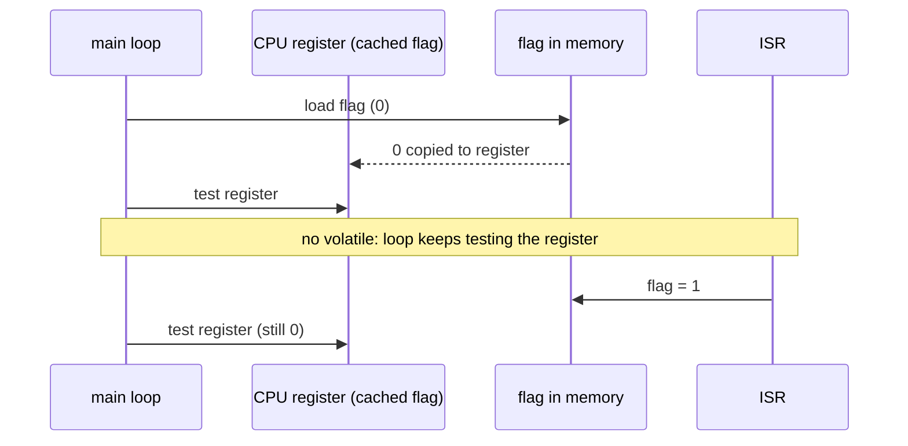

::: basics
### In plain words
`volatile` is a word you put on a C variable to tell the compiler: "this value can change behind your back, so look at it every time." Compilers speed up code by remembering values instead of re-reading them. That is wrong for a variable that hardware can change, so `volatile` switches the shortcut off.

### Picture it
Imagine you check a mailbox once at 8 a.m., see it is empty, and then write "still empty" on a sticky note. Later you just read your note, even though mail has come. An assistant who does this to save trips is the optimizer. `volatile` is a sign on the mailbox saying "walk over and look every single time." The sign forces the looking, but cannot stop the mail arriving halfway through you opening the box.

### Words you need
- **Compiler / optimizer**: the tool that turns your C into machine code, and the part of it that rewrites code to run faster.
- **Register (hardware)**: a special memory location that controls or reports on a device. See [[q0829]].
- **Interrupt / ISR**: a hardware event that pauses your main code to run a short handler function at any moment. See [[q0801]].
- **Atomic**: finishes in one uninterruptible step. Adding 1 to a variable is usually not atomic: it reads, adds, then writes.

### The simplest example
Main code waits with `while (!flag) {}`. An interrupt handler sets `flag` to 1 when a button is pressed. The optimizer sees that nothing in the loop changes `flag`. So it reads `flag` once, finds 0, and loops forever on that stale answer. The program hangs, but only in an optimized build.

Declare it `volatile int flag;` and the loop re-reads the variable on every pass. It sees the 1 and exits.

That is the whole idea. The rest of this page shows the generated code, the three standard uses (hardware registers, interrupt flags, polling loops), and what `volatile` does not fix: lost updates, torn reads and multi-core sharing.
:::

::: testing
Whether you understand what an **optimizing compiler assumes** and how hardware breaks those assumptions. The interviewer is checking:

1. A precise definition: `volatile` tells the compiler a variable can change, or an access can have an effect, outside the program's normal flow, so every access must really happen, in order.
2. The three classic uses: memory-mapped hardware registers, variables shared with an interrupt service routine, and polling loops.
3. A concrete example of the bug when it is missing ("works in debug, hangs in release").
4. The limits: `volatile` is **not** atomic, not a lock, and not a memory barrier.
5. Judgment: you do not sprinkle it everywhere; you use it where it belongs.
:::

::: why
This is the most famous embedded C keyword because the bug it prevents is maddening: code that works at `-O0` and fails at `-O2`, a status flag that never seems to change, a register write that vanishes. Embedded and driver code constantly meets values that change without the program changing them: peripherals, DMA engines, interrupts. Interviewers ask it to see whether you understand the contract between your C code, the compiler and the hardware ([[q0829]], [[q0801]]), and whether you also know that `volatile` is often mistakenly offered as a fix for concurrency problems that it does not solve.
:::

::: concepts
- **Compiler optimization**: the compiler may keep a variable in a CPU register, reorder, merge or delete memory accesses it considers redundant. See [[q0962]].
- **Memory-mapped I/O**: peripheral registers appear at fixed addresses; reading or writing them has side effects. See [[q0829]].
- **Interrupts and ISRs**: code that runs asynchronously and can change shared variables. See [[q0801]] and [[q0800]].
- **Atomicity**: an operation that cannot be interrupted partway; a read-modify-write on a variable usually is not atomic.
- **Memory ordering and barriers**: compiler and hardware may reorder accesses; barriers prevent it.
- **Types and sizes**: how many bytes a variable spans determines whether one access is atomic. See [[q0968]].
:::

::: answer
"`volatile` is a qualifier that tells the compiler: this variable can change in ways you can't see from the code, so don't optimize away or cache its accesses. Every read in the source must be an actual read from memory, and every write an actual write, in the order I wrote them.

The reason it matters is that optimizing compilers assume that, unless my code writes to a variable, its value doesn't change. So if I write `while (!flag) {}` and `flag` is set by an interrupt, the compiler can read `flag` once into a register and loop forever on the stale copy. That's the classic 'works in debug, hangs in release' bug. Marking `flag` volatile forces a fresh read every iteration.

I use it in three places. First, memory-mapped hardware registers, where reading a status register or writing a control register must really happen, every time, because it has side effects. Second, variables shared between an ISR and main code. And third, busy-wait loops polling something the hardware updates.

What I'd stress is what volatile doesn't do. It doesn't make an operation atomic: `counter++` on a volatile is still a read, an increment and a write, and an interrupt can land in the middle, so I'd disable interrupts around it or use atomics. It doesn't synchronize threads on a multi-core system, and it doesn't act as a memory barrier. So it's the right tool for hardware registers and ISR flags, and the wrong tool for general thread safety."
:::

::: technical
**Definition (C11 §6.7.3).** An object of volatile-qualified type may be modified in ways unknown to the implementation or have other unknown side effects. Accesses to it are *side effects* that the compiler must perform strictly according to the abstract machine: it may not remove, merge, or invent them, and it may not reorder them relative to other volatile accesses (non-volatile accesses may still move around them).

**What goes wrong without it.** Compiled with GCC 13 at `-O2` on x86-64:

```c
int flag;                 // not volatile
void wait_plain(void) { while (!flag) {} }
```

```
wait_plain:
    mov   eax, [flag]     ; read ONCE
    test  eax, eax
    jne   .done
.spin:
    jmp   .spin           ; infinite loop, never re-reads flag
.done:
    ret
```

Declared `volatile int vflag`, the loop becomes `.L: mov eax,[vflag]; test; je .L`, a genuine re-read each pass. At `-O0` even the plain version re-reads (the variable lives in memory), which is why the bug appears only in optimized builds.

**Typical usage.**

```c
#define UART_SR  (*(volatile uint32_t *)0x40004400u)   // status register
#define UART_DR  (*(volatile uint32_t *)0x40004404u)   // data register

while ((UART_SR & (1u << 5)) == 0) { }   // wait for RX not empty
uint8_t b = (uint8_t)UART_DR;            // read data (may clear the flag)
```

```c
volatile bool data_ready;                 // set in ISR, polled in main
void ISR(void) { data_ready = true; }
```

**Qualifier placement.** `volatile uint32_t *p` is a pointer to a volatile uint32_t (the data is volatile, what you want for registers). `uint32_t *volatile p` makes the pointer itself volatile. `volatile const uint32_t` is a read-only register that can still change.

**Limits.** `volatile` does not give atomicity (`x++` is load, add, store), does not provide inter-thread synchronization or visibility guarantees on multicore, and does not insert hardware memory barriers or control caches. Use atomics (`_Atomic`, `<stdatomic.h>`), critical sections (disable interrupts), mutexes or barriers for those.
:::

::: short
"`volatile` tells the compiler a variable can change outside the program's flow, or that accesses have side effects, so every read and write in the source must actually happen, in order. Without it the optimizer can cache a flag in a register and loop forever. I use it for memory-mapped hardware registers, variables shared between an ISR and main code, and polling loops. But it isn't atomic, isn't a lock and isn't a memory barrier, so shared counters still need interrupts disabled or atomics."
:::

::: long
"`volatile` is a type qualifier that tells the compiler: the value of this variable can change, or accessing it has an effect, in ways you cannot see by reading the code. So don't cache it, don't remove accesses, and don't reorder them relative to other volatile accesses.

To see why it's needed, think about how an optimizing compiler reasons. If my code doesn't write to a variable inside a loop, the compiler assumes it doesn't change, so it can load it once into a register. Take `while (!flag) {}` where an interrupt sets `flag`. At optimization level two, GCC reads `flag` once, and if it's zero, jumps into an empty infinite loop; you can see it in the generated assembly. At `-O0` it re-reads every time and works, which is the infamous works-in-debug, hangs-in-release bug. With `volatile`, the loop reloads the flag every pass.

I'd use it in three situations. First, memory-mapped peripheral registers, like a UART status register, where each read really has to hit the bus, and a write must happen even if the compiler thinks the value was already written, because the write triggers hardware. Reading some registers even clears flags, so two reads aren't the same as one. Second, variables written by an ISR and read by the main loop. Third, polling loops on anything the hardware updates.

Now the limits, which interviewers love. `volatile` isn't atomic. If main does `count++` on a volatile counter and an ISR also increments it, the read-modify-write can be interrupted and an update lost. A 16-bit variable on an 8-bit MCU can be read in two pieces, and an ISR can change it between them, giving a torn value. For that I'd disable interrupts briefly or use atomic operations. And `volatile` is not a memory barrier and isn't for multicore synchronization, so there I'd use atomics or a mutex.

So: volatile for registers and ISR flags, atomics or critical sections for sharing, and don't sprinkle it on everything."
:::

::: terms
- **volatile**: C/C++ qualifier meaning accesses are observable side effects the compiler must not elide or reorder among themselves.
- **Memory-mapped I/O**: peripheral registers accessed through ordinary memory addresses.
- **Optimizer**: the compiler stage that removes redundant loads, hoists values into registers and reorders code.
- **ISR (interrupt service routine)**: code run asynchronously in response to a hardware event.
- **Atomic operation**: one that completes without any other observer seeing an intermediate state.
- **Race condition**: a bug where the result depends on the timing of asynchronous events.
- **Critical section**: a code region where interrupts (or other tasks) are blocked to protect shared data.
- **Memory barrier / fence**: an instruction preventing reordering of memory accesses across it.
- **Torn read**: reading a multi-byte value in pieces while it changes, producing a mix of old and new bytes.
- **Side effect (of a read)**: a read that changes hardware state, such as clearing a flag.
:::

::: exceptional
**An average answer** says "volatile stops the compiler from optimizing a variable" and mentions interrupts.

**An exceptional answer**:
- Frames it as a contract with the optimizer: each access is an observable side effect that must occur, in order.
- Shows the failure: `while (!flag)` compiled to a single load and an infinite loop at `-O2`, fine at `-O0`.
- Names all three uses (hardware registers, ISR-shared variables, polling loops) and notes read side effects.
- Knows the pointer syntax difference (`volatile uint32_t *p` versus `uint32_t *volatile p`) and `volatile const` for read-only status registers.
- States clearly what it does **not** do: not atomic, not a barrier, not multithreading synchronization, no cache control.
- Gives the right fix for shared data (critical section, atomics, double buffering) and mentions torn reads and lost updates.
:::

::: mistakes
- **Believing `volatile` makes access atomic.** `count++` is still load, add, store; an ISR can interleave and lose an update.
- **Using it for thread synchronization on multicore.** It gives no ordering or visibility guarantees across cores; use atomics or a mutex.
- **Forgetting it on ISR-shared flags.** The loop hangs only at higher optimization levels, making the bug seem random.
- **Putting `volatile` on everything "to be safe".** It disables useful optimization, costs speed and code size, and hides real design problems.
- **Wrong qualifier placement.** `uint32_t *volatile p` makes the pointer volatile, not the register it points to; registers need `volatile uint32_t *p`.
- **Assuming volatile controls cache or hardware reordering.** Registers must also be in non-cacheable memory, and some systems need explicit barriers (for example `DMB` on ARM).
:::

::: deep
## The compiler's mental model

A C compiler optimizes under the **as-if rule**: it may transform your program in any way as long as the observable behavior stays the same. For ordinary variables it assumes that, between visible writes, the value doesn't change. That assumption is what lets it keep variables in registers, hoist loads out of loops, merge repeated reads and delete dead stores. It is also exactly wrong for hardware: a status register changes because the *peripheral* changed it, and an ISR flag changes because *interrupt code* ran, neither of which the compiler can see in your function.

`volatile` tells the compiler that accesses to this object are themselves observable behavior. So each source-level read must become a real load and each source-level write a real store, none removed and none merged, and in the written order relative to other volatile accesses.

## Seeing it in the generated code

Here is real output from GCC 13 on x86-64 for the same function, with and without the qualifier (compiled at `-O2`; the labels are the compiler's own):

```
; int flag;                         ; volatile int vflag;
wait_plain:                         wait_vol:
    mov  eax, [flag]                .L6:
    test eax, eax                       mov  eax, [vflag]
    jne  .L1                            test eax, eax
.L3:                                    je   .L6
    jmp  .L3          <-- spins         ret
.L1:                                
    ret
```

On the left, the compiler loaded `flag` once and, if zero, entered `jmp .L3` which jumps to itself forever: it proved "nothing in this loop changes `flag`, so if it is 0 now it stays 0". On the right, the load is **inside** the loop. At `-O0` the left version also reloads each time, because everything lives in memory, which is why the bug seems to appear only in release builds.

A second pair shows merging:

```c
int twice(volatile int *r) { return *r + *r; }
int twice_p(int *r)        { return *r + *r; }
```

For the non-volatile one the compiler emits one load and `add eax, eax` (doubles it). For the volatile one it emits **two** loads and adds them, which matters if reading the register changes it (a FIFO data register returns a new byte on every read).


Figure: Without volatile the main loop loads the flag once into a register and keeps testing that stale copy. The ISR's write to memory is never seen, so the loop never exits. With volatile, each iteration reloads from memory and sees the update.

## The three standard uses

**1. Memory-mapped registers.** A peripheral register is a hardware location, not a variable:

```c
#define TIMER_CNT (*(volatile uint32_t *)0x40010024u)
uint32_t t0 = TIMER_CNT;
do_work();
uint32_t t1 = TIMER_CNT;      // compiler must not reuse t0's load
```

Without `volatile` the compiler could assume both reads return the same value and compute zero elapsed time. Writes need it too: writing `1` then `0` to a control bit to generate a pulse must produce both writes, not just the last. Reading some status registers has side effects: reading a UART data register pops a byte from the FIFO and may clear a flag, so one source-level read must be exactly one hardware read. Try the register decoder to see how fields in such a register pack together:

```sim
{"id":"register-decoder","preset":"status"}
```
Figure: A UART status register (UART_SR) with flag fields. Software polls the RXNE bit (bit 5) in a loop and then reads the data register; both accesses are to hardware, so both must be volatile. Toggle the bits and see the field values change: each pass of the polling loop needs a fresh read. Note the W1C error flags, cleared by writing a 1, another case where every write must actually reach the hardware.

**2. Variables shared with an ISR.** An ISR sets a flag or fills a buffer, and main polls it. See the timeline of interrupts and the main loop here:

```sim
{"id":"interrupt-lab","nesting":false}
```
Figure: The main loop is preempted by ISRs at times it cannot predict. Anything the ISR writes and main reads (flags, counters, buffer indices) is an asynchronous change from the compiler's point of view and must be volatile. Lengthen an ISR and watch pending events pile up, a reminder to keep ISRs short ([[q0800]]).

**3. Busy-wait polling loops** on any value that hardware changes, such as `while (!(STATUS & READY)) {}`, which is case 1 in a loop.

## Where volatile is not enough

**Not atomic: the lost update.** Suppose `volatile uint8_t count = 5;`. Main executes `count++`, compiled as load, add, store. If the ISR fires between main's load and store and increments to 6, then main stores its stale 5 + 1 = 6. Final value 6 rather than 7: one update lost. Fix: disable interrupts around the read-modify-write, use hardware atomic instructions or `<stdatomic.h>`, or restructure so only one context writes each variable.

**Torn reads on small CPUs.** A `volatile uint16_t` on an 8-bit microcontroller is read in two byte accesses. If the value is 0x00FF and the ISR increments it to 0x0100 between reading the low byte (0xFF) and the high byte (now 0x01), main assembles 0x01FF = 511, a value that never existed. Same remedy: protect with a critical section or read until two consecutive reads agree.

**Not a barrier.** `volatile` orders accesses only relative to other volatile accesses *as seen by the compiler*. It doesn't stop the CPU from reordering memory operations, flush write buffers or caches, and doesn't order non-volatile accesses around it. For example, you write data to a buffer (non-volatile), then set a "go" bit in a DMA control register (volatile): the compiler may legally move the buffer writes after the register write. You need a compiler or hardware barrier (`atomic_thread_fence`, or on ARM `DMB`/`DSB` as the architecture requires) between them.

**Multicore.** `volatile` provides no cross-core visibility or ordering guarantees; use atomics with proper memory ordering or locks. Also device memory regions must be mapped non-cacheable or strongly-ordered by the memory system, otherwise reads may return cached stale data regardless of the qualifier.

## Reading the declarations

| Declaration | Meaning |
|---|---|
| `volatile uint32_t x;` | x may change unexpectedly |
| `volatile uint32_t *p;` | p points to a volatile uint32_t (typical for registers) |
| `uint32_t *volatile p;` | p itself is volatile; the data it points to is not |
| `volatile const uint32_t *p;` | read-only status register that hardware can change |
| `const volatile uint32_t x;` | same qualifiers in either order |

`const` and `volatile` are not opposites: `volatile const` means *my code must not write it, but it can still change*.

## Choosing the right tool

| Situation | Right tool |
|---|---|
| Peripheral register access | `volatile` pointer |
| Flag set in ISR, polled in main | `volatile` flag (single byte or word) |
| Counter shared with ISR | `volatile` plus critical section or atomic |
| Multi-byte value shared with ISR | critical section, double buffering or sequence-counter read |
| Data shared between RTOS tasks or cores | mutex, queue or atomics |
| DMA descriptors and buffers | volatile plus barriers and cache maintenance |

> [!INTERVIEW]
> A crisp line: "volatile guarantees the access happens; it doesn't guarantee the access is atomic, ordered against non-volatile code, or visible to another core."

## Debugging checklist: "works at -O0 but not at -O2"

1. Look for shared variables polled in a loop or used across an ISR boundary; check `volatile`.
2. Look at the disassembly of the loop (as above): is there a load inside it?
3. Check for register accesses through plain pointers.
4. Check for read-modify-write on shared data without protection, and for multi-byte accesses on narrow CPUs.
5. Consider ordering: is a barrier needed between data writes and a "go" register write?
6. Enable warnings and sanitizers; but note that this bug is a missing qualifier, which compilers cannot detect.
:::

::: applications
- **Peripheral drivers**: GPIO, UART, SPI and timer registers accessed as volatile pointers or through vendor register structs.
- **ISR flags and counters**: a "new sample ready" flag, a tick counter, a ring buffer head and tail updated by interrupt code.
- **Bootloaders and startup code**: waiting for a PLL lock bit or a flash-ready flag with polling loops.
- **Shared memory with DMA or another processor**: descriptors and status words written by hardware, read by software (with barriers).
- **Timing measurements**: reading a free-running hardware counter twice to measure elapsed cycles.
- **Signal handlers in hosted C**: `volatile sig_atomic_t` flags set by a signal handler.
:::

::: assumptions
- **C and C++ semantics**, with GCC-style optimization as the example. The generated assembly shown is for x86-64 with GCC 13 and will differ on other compilers or targets, but the principle is the same.
- **Single-core microcontroller with interrupts** is the primary context. Multicore and cache coherence add requirements beyond `volatile`.
- **In C++ and Java**, the same word means different things: C++ `volatile` is like C; Java `volatile` does give visibility and ordering guarantees between threads, and C# has its own semantics. Don't transfer the Java meaning to C.
- **Register access style.** Many vendors wrap registers in `volatile` structs; the pattern is the same.
- **ISR design.** A good ISR sets a flag or copies data and returns; heavy processing happens in main, which is why volatile flags are common.

> [!UNCERTAIN]
> How aggressively a given compiler merges or reorders around `volatile` accesses to *different* objects, and what ordering the toolchain guarantees for device memory, is target and compiler specific. Check the compiler and architecture documentation when ordering matters.
:::

::: followups
### Can a variable be both `const` and `volatile`?
Yes. `volatile const uint32_t *status` is a read-only hardware status register: your code may not write it, but the hardware can change it, so every read must be performed. `const` restricts what the program does; `volatile` says what the outside world may do.

### Is `volatile` enough to share a counter between an ISR and main?
No. `count++` is read, modify, write; if the ISR increments between main's read and write, one update is lost (5 becomes 6 instead of 7). Wrap main's access in a critical section (disable interrupts briefly), use an atomic increment, or make the ISR the only writer and have main read a snapshot.

### Why does this work at -O0 but hang at -O2?
At `-O0` every variable access goes to memory, so the loop re-reads the flag. At `-O2` the optimizer keeps the variable in a register and, seeing nothing in the loop change it, compiles `while(!flag){}` to a single load followed by an infinite loop (verified in the assembly above). Declaring the flag `volatile` forces a load per iteration.

### Does `volatile` guarantee thread safety in C or C++?
No. It doesn't provide atomicity, ordering between threads, or visibility across cores. In C11/C++11 use `_Atomic`/`std::atomic` with an appropriate memory order, or mutexes. (Java's `volatile` is different and does give visibility and ordering.)

### I read a 16-bit sensor value in main while an ISR updates it, on an 8-bit MCU. What can go wrong and how do you fix it?
A torn read: main reads the low byte, the ISR updates both bytes, main reads the high byte, and the combined value is a mix of old and new (0x00FF becoming 0x0100 can be read as 0x01FF = 511). Fix by briefly disabling interrupts around the copy, by reading until two consecutive reads match, or by having the ISR publish with a sequence counter or double buffer.

### How would you write to a DMA control register after filling a buffer, and what could `volatile` fail to guarantee?
Fill the buffer, then issue a barrier (`atomic_thread_fence`, or the architecture's data synchronization barrier on ARM), then write the volatile "start" register. The compiler could otherwise move the non-volatile buffer writes after the volatile register write, and the CPU or write buffers could reorder them too. Also make sure the buffer is in memory the DMA can see coherently (non-cacheable or flushed).
:::

::: interpretations
The question has two parts: **what `volatile` refers to** (the qualifier and its meaning) and **when to use it** (hardware registers, ISR-shared variables, polling loops, plus the limits). It is a C and C++ concept; Java's and C#'s `volatile` differ. In an embedded interview it often follows ISR questions ([[q0801]], [[q0800]], [[q0911]]), and in a C-experience discussion it is a likely probe after you mention firmware ([[q0965]], [[q0964]]).
:::

::: references
- ISO/IEC 9899:2011 (C11), section 6.7.3 (type qualifiers, `volatile`) and the abstract-machine rules on side effects.
- Eide & Regehr, "Volatiles Are Miscompiled, and What to Do about It" (EMSOFT 2008): a study of how compilers mishandle `volatile` accesses in practice.
- Barr Group, *Embedded C Coding Standard*: rules on use of `volatile` for registers and ISR-shared data.
- Arm, *Architecture Reference Manual* and memory-ordering documentation: barriers (`DMB`, `DSB`) and device memory types.
- Kernighan & Ritchie, *The C Programming Language*; Harbison & Steele, *C: A Reference Manual*: type qualifiers.
:::

::: rubric
- Defines `volatile` as telling the compiler that accesses are observable and must not be removed, cached or reordered :: The core definition, in terms of what the compiler does.
- Gives the three uses: hardware registers, ISR-shared variables, polling loops :: These are the expected "when to use" answers.
- Shows or describes the failure (flag loop optimized into an infinite loop, works at -O0) :: Proves you understand why, not just what.
- States that volatile is not atomic and gives a lost-update or torn-read example :: The most common misconception and the key depth signal.
- States it is not a memory barrier or multicore synchronization :: Distinguishes embedded competence from folklore.
- Knows the right tools for sharing (critical sections, atomics, double buffering, barriers) :: Completes the answer with a correct solution.
- Mentions pointer qualifier placement or `volatile const` :: Shows hands-on register-access experience.
:::

::: quiz
```json
[
 {"type":"mcq","level":"fundamental","q":"What does the `volatile` qualifier tell the compiler?","options":["The variable is stored in flash","Accesses to the variable must really occur and may not be cached or removed, because it can change outside the program's control","The variable is thread-safe","The variable is constant"],"answer":1,"explain":"`volatile` makes each access an observable side effect. It does not place data in any memory region, give thread safety, or make a value constant."},
 {"type":"mcq","level":"fundamental","q":"A flag is set by an ISR. Main runs `while (!flag) {}` and hangs when compiled with -O2 but works at -O0. What is the most likely fix?","options":["Declare `flag` as `volatile`","Add more delay inside the ISR","Compile with -O3","Make `flag` a `const`"],"answer":0,"explain":"At -O2 the compiler loads `flag` once into a register and loops forever on the stale value. `volatile` forces a real load on each iteration."},
 {"type":"truefalse","level":"intermediate","q":"Marking a counter `volatile` makes `count++` safe to use from both main code and an ISR.","answer":false,"explain":"`count++` is still a read, an add and a write. An interrupt between them can cause a lost update. Use a critical section or an atomic operation."},
 {"type":"numeric","level":"intermediate","q":"A 16-bit counter holds 0x00FF on an 8-bit MCU. Main reads the low byte (0xFF); then an ISR increments the counter to 0x0100; then main reads the high byte. What decimal value does main assemble?","answer":511,"tolerance":0.001,"unit":"","explain":"High byte is now 0x01 and the low byte read earlier was 0xFF, so main sees 0x01FF = 511, a value that never existed (the counter went 255 then 256)."},
 {"type":"mcq","level":"intermediate","q":"Which declaration describes a read-only hardware status register at a fixed address?","options":["`const uint32_t *p;`","`volatile uint32_t *p;` only","`volatile const uint32_t *p;`","`uint32_t *volatile p;`"],"answer":2,"explain":"The data pointed to must be volatile (hardware changes it) and const (software must not write it). `uint32_t *volatile p` makes the pointer volatile rather than the register."},
 {"type":"multi","level":"advanced","q":"Select all statements that are true about `volatile` in C.","options":["It prevents the compiler from deleting or merging accesses to the object","It guarantees atomic updates of multi-byte values","It does not insert hardware memory barriers or manage caches","It is the correct mechanism for synchronizing two cores"],"answer":[0,2],"explain":"`volatile` preserves accesses but provides no atomicity, no barriers and no cross-core ordering. For atomic updates and multicore synchronization use atomics, critical sections, mutexes or explicit barriers."}
]
```
:::
