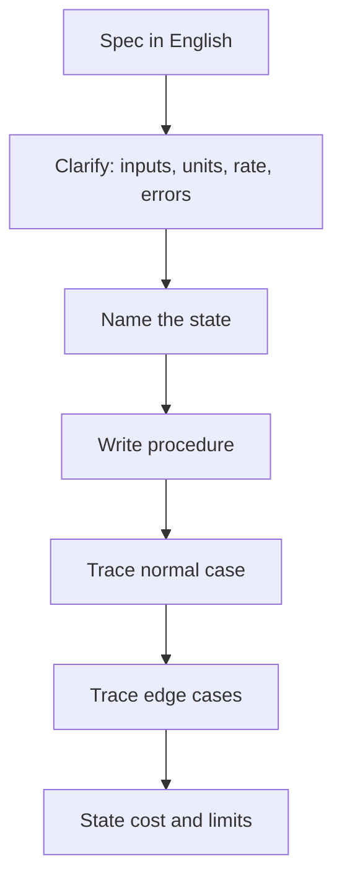

::: testing
Whether you can turn a vague English requirement into a precise, checkable procedure **before** worrying about syntax. Pseudocode questions are rarely about the algorithm being hard. The interviewer is watching for four things:

1. You ask clarifying questions (inputs, outputs, units, timing, what counts as an error).
2. You decompose the problem and name your state explicitly.
3. You handle edge cases without being prompted: empty input, overflow, first call, noisy input, timeouts.
4. You can say what it costs: time, memory, and for hardware roles, how often it runs and whether it can block.
:::

::: why
Hardware engineers write small amounts of code that has to be right: bring-up scripts, test automation, firmware for a sensor board, a state machine inside a testbench. Nobody expects compilable C on a whiteboard, but they do expect you to think in states, loops and invariants. Pseudocode is also how engineers communicate designs in reviews and design docs, so the skill is directly reusable. A candidate who writes a clean 10-line procedure with the edge cases handled signals more than one who races into half-correct C.
:::

::: concepts
- **Specification to I/O contract**: write down inputs, outputs, units and rates first. Everything else follows from that.
- **State**: any value that must survive between calls (a counter, the previous sample, a flag). If you can't name the state, you probably don't have an algorithm yet. See [[q0968]] for the variable types that hold it.
- **Control flow**: sequence, branch, loop. Pseudocode is just these three with names.
- **Invariants and edge cases**: what is always true after each step, and what happens at the first call, at the limit, and on garbage input.
- **Complexity**: time and memory as a function of input size, plus (in firmware) worst-case execution time and RAM bytes.
- **Event-driven vs polling**: whether the code waits for time or reacts to events.
:::

::: answer
"I treat it as a design problem, not a typing problem. First I restate the spec in my own words and ask what I need: what are the inputs and their units, how often does this run, what should happen on bad input, and does it run forever or once? Then I write down the state the procedure needs to remember, because that usually decides the structure.

Then I write the pseudocode at the level of a flowchart: a few named variables, a loop, and clear conditions. Each line should be something I could turn into one or two lines of real code. I keep it language-neutral, so no semicolons, but I do use real operations like 'read ADC', 'wait until timer expires' or 'append to buffer'.

Once it's written, I walk one normal input through it, then the nasty cases: first call, empty input, overflow, noise. I say the complexity out loud: 'one pass, constant memory'. If it's firmware I'll also say whether any step can block and how long the worst case takes.

For example, if the spec is 'detect a button press', I'd ask about bounce time, then write a counter that only accepts a change after N identical samples. That's about eight lines and it has a clear invariant."
:::

::: technical
**A reliable template.**

1. *Contract*: inputs (type, range, units, rate), outputs, side effects, failure behavior.
2. *State*: list persistent variables with initial values.
3. *Procedure*: one entry point, then loops and branches. Use named helper steps for anything repeated.
4. *Walk-through*: trace a normal case and two edge cases by hand with actual numbers.
5. *Cost*: time $O(\cdot)$, memory, worst-case latency, whether it blocks.

**Worked spec: "debounce a mechanical switch sampled every 1 ms."** Contact bounce on a typical tactile switch lasts roughly 1-10 ms (I assume 5 ms below; measure yours). An integrator-style debounce needs one counter and one stable-state variable:

```text
state: stable = RELEASED, count = 0
every 1 ms:
    raw = read_pin()
    if raw == stable:
        count = 0                  # no disagreement, reset
    else:
        count = count + 1          # raw disagrees with accepted state
        if count >= 5:             # 5 consecutive disagreeing samples
            stable = raw
            count = 0
            emit_event(stable)
```

Memory: two small variables. Time per call: constant, $O(1)$. Latency: 5 ms. An invariant: `stable` changes only after 5 consecutive contradicting samples, so a glitch shorter than 5 ms never gets through.

**Second spec: "moving average of the last 8 ADC readings."** Keep a ring buffer and a running sum so the work is constant per sample instead of 8 additions:

```text
state: buf[8] = 0, idx = 0, sum = 0
on new sample x:
    sum = sum - buf[idx] + x
    buf[idx] = x
    idx = (idx + 1) mod 8
    return sum / 8       # shift by 3 bits in real code
```

With a 12-bit ADC the largest sum is $8 \times 4095 = 32760$, which fits in a signed 16-bit integer. With 16 samples it would not, and that is exactly the kind of overflow check an interviewer looks for. Also note the first 7 outputs are biased low because the buffer starts at zero; either pre-fill with the first sample or report "not valid yet".

**Third: hysteresis ("turn a fan on above 60 C, off below 55 C")**: a branch that depends on current output state, otherwise the fan chatters at 60 C. This is the same pattern as a Schmitt trigger.
:::

::: short
"I'd restate the spec, ask about inputs, units, rates and error cases, and name the state the code has to remember. Then I write a short, language-neutral procedure with a clear loop and conditions, trace a normal case and an edge case through it by hand, and say the cost, like 'one pass, constant memory'. For firmware I'd also say whether it blocks and how long the worst case takes. A debounce routine is a good example: one counter, five consecutive samples to accept a change, eight lines total."
:::

::: long
"My process is the same whatever the spec is. Step one is clarifying: what are the inputs, in what units, how often do they arrive, what should the output be, and what should happen when something goes wrong. People skip that and it's where most bugs actually come from.

Step two is naming the state. Anything the code has to remember between calls, like a previous sample, a counter, or a flag, gets a name and an initial value. Usually once I have the state, the structure of the code falls out.

Step three is writing it at flowchart level. Real operations, no syntax. Say the spec is 'debounce a button sampled every millisecond'. I'd keep a stable value and a counter. Each tick, if the pin matches the stable value I reset the counter. If it disagrees I increment, and when it's disagreed five times in a row I accept the new value and emit an event. That's it, constant time and two variables.

Step four is testing it by hand. Normal case: clean press, accepted after five milliseconds. Edge case: a two millisecond glitch never reaches five, so it's ignored. Another edge case: what is the state at power-up if the button is already held? I'd decide and say it.

Step five is cost. I'd say time per call, memory, and for embedded, the worst-case execution time and whether anything blocks. If a spec says 'wait for the sensor', I'd flag that a blocking wait inside a main loop starves everything else, and offer a timer or interrupt-driven version.

If I have time, I'd mention how I'd test it: feed it a recorded bounce waveform and check the event count."
:::

::: terms
- **Pseudocode**: structured, language-neutral description of an algorithm using real operations but no syntax rules.
- **State**: data that persists between invocations of a routine.
- **Invariant**: a condition that holds after every step, used to argue correctness.
- **Edge case**: an input at or beyond the boundary of expected behavior (empty, full, first, overflow).
- **Time complexity**: how the number of operations grows with input size, written $O(n)$.
- **Worst-case execution time (WCET)**: longest time a routine can take, which matters for real-time firmware.
- **Hysteresis**: using different thresholds for rising and falling decisions to avoid chatter.
- **Ring buffer**: fixed-size array indexed modulo its length, used for sliding windows.
:::

::: exceptional
**An average answer** immediately starts writing code-like lines, never asks a question, and stops when the lines end.

**An exceptional answer**:
- Asks two or three sharp clarifying questions and writes the I/O contract on the board.
- Lists the state variables with initial values before any loop.
- Handles first-call, overflow and noise unprompted, with a number ("8 x 4095 fits in 16 bits, 16 x 4095 does not").
- Traces a concrete input through the code by hand.
- States complexity and, for firmware, WCET and blocking behavior.
- Offers a second version if a constraint changes (interrupt-driven instead of polled, fixed-point instead of float).
:::

::: mistakes
- **Starting to write before asking anything.** Spec ambiguity is the most common source of wrong answers. Ask about units, rates and errors first.
- **Hidden state.** Using a "previous value" that was never declared or initialized. List state explicitly.
- **Writing real syntax badly.** Half-correct C invites nitpicking. Clean pseudocode with real operations is better than broken code.
- **Ignoring the first and last iteration.** Ring buffers, filters and parsers all misbehave at startup. Say what you return.
- **Blocking waits in a main loop.** "Wait 10 ms" with a busy loop stops everything else. Use a timer tick or state machine.
- **Never testing it.** Always trace at least one concrete input. It catches off-by-one errors immediately.
:::

::: deep
## Pseudocode is a thinking tool

Pseudocode is not a weaker form of code. It is the level at which you decide whether the algorithm is correct, before language details such as integer widths, pointer syntax or library names get in the way. A good test: can another engineer implement it in C, Python or Verilog and get the same behavior? If the answer depends on guesses about what a line means, it is not pseudocode, it is a sketch.

The goal in an interview is to show the *process*. A rough template is requirements, state, procedure, trace, cost. That is also how you do real design reviews.


Figure: The order matters. Skipping the first two boxes is what makes people write correct code for the wrong problem; skipping the last three is how off-by-one and overflow bugs survive.

## Worked example: debouncing, from the physics

A mechanical contact does not make or break cleanly. The metal surfaces bounce for a while, so one press produces several transitions. Reading the pin as fast as the CPU runs would produce many "presses". Bounce time varies by switch; a few milliseconds to ten or so is a common order of magnitude, and a cheap switch that is old can be worse, so the right approach is to scope your actual switch ([[q0988]] covers why the sample rate of your measurement tool matters here too).

```timing
{"signals":[{"name":"Pin (raw)","wave":"110101000000001011111111","color":"red"},{"name":"stable","wave":"111111111100000000001111"},{"name":"event","wave":"000000000010000000001000"}],"hscale":0.6}
```
Figure: One sample per tick, N = 5. The raw pin chatters after each real edge, but `stable` flips only after five consecutive disagreeing samples (ticks 6 to 10 for the press, 16 to 20 for the release, counting from tick 0), so each real edge produces exactly one event, a few ticks late. Making N larger rejects more noise but adds latency.

The integrator algorithm in the technical section implements this. Choosing N is a trade-off you can compute: if bounce lasts at most $t_b$ and you sample every $T_s$, then you need $N \ge t_b/T_s$ consecutive samples to be sure that bounce alone cannot satisfy the condition, and the latency of a press is $N T_s$. With $t_b = 5$ ms, $T_s = 1$ ms, $N = 5$ gives 5 ms latency, which is well below the roughly 100 ms humans notice as delay.

## Polling vs events

A polling version checks the pin every tick from a timer interrupt or a scheduler. An interrupt-driven version triggers on the pin edge, then starts a timer and ignores further edges for $t_b$. The second uses less CPU but is easier to get wrong if the switch is noisy after the lockout. Both are valid; say which you chose and why. For an interview, the polling version is simpler to reason about, and its worst-case execution time is fixed.

## Cost and overflow reasoning

Interviewers love one numeric sanity check. For the moving average, a 12-bit ADC gives values up to 4095. A sum of $N$ samples is at most $4095N$. For $N = 8$ that is 32760, which just fits a signed 16-bit integer (max 32767). For $N = 16$ it is 65520, which fits unsigned 16-bit but not signed. For $N = 32$ you need 32 bits. The running-sum trick turns an $O(N)$ per-sample cost into $O(1)$, at the cost of $N$ words of RAM, and it can accumulate rounding drift if you use floats, which is why the integer version is preferred.

The start-up bias is also real: with the buffer zeroed, after $k < N$ samples the output is low by roughly $(N-k)/N$ of the true value. Pre-filling the buffer with the first sample removes it.

## Hysteresis as a pattern

The thermostat-with-hysteresis spec is a good third example because the decision depends on the *current output*, not just the input. If you write "if T > 60 then fan = on else fan = off", a noisy reading near 60 C toggles the fan constantly, which wears the relay and causes EMI. Writing "if fan is off and T > 60 then on; if fan is on and T < 55 then off" gives a 5 degree dead band, which is the same idea as a Schmitt trigger. The state (fan on or off) is explicit. If you notice that the spec secretly needed state, say it. That observation is the point of the question.

## What to say when the spec is truly ambiguous

If the interviewer says "just write something", state your assumptions and carry on: "I'll assume sample period 1 ms, 5 ms of bounce, and that the pin idles high." Then flag the place in the code where each assumption is used. Interviewers read this as an engineer who can make progress under uncertainty.

> [!INTERVIEW]
> When you finish, say "let me test that" and trace an input by hand. Even a wrong line you catch yourself is a better signal than a right line you never checked.
:::

::: applications
- **Button and switch inputs on any MCU board**: integrator debounce as above, run from a 1 kHz timer tick.
- **Sensor smoothing**: moving-average or exponential filter on thermistor ADC readings before comparing to a threshold.
- **Thermostat or fan control**: hysteresis on temperature to avoid relay chatter.
- **Test automation**: pseudocode for "sweep supply 0 to 5 V in 100 mV steps, wait 10 ms, measure, log" before turning it into a Python/SCPI script.
- **Protocol parsers**: a state machine that consumes a UART byte stream looking for a header, length and checksum.
:::

::: assumptions
- The spec is "given" in the interview, so I assume I may ask clarifying questions. If not, I state assumptions aloud.
- Pseudocode level is flowchart-like: real operations, no syntax. Some interviewers want near-Python; the same structure maps directly.
- Timing numbers (1 ms tick, 5 ms bounce) are illustrative. Real bounce depends on the switch and should be measured on a scope.
- I assume a single thread of control. With interrupts or an RTOS you also have to protect shared state (see [[q0970]] on `volatile`).
- Integer arithmetic assumed for the filter examples; floating-point would change the overflow discussion but add its own drift and cost on small MCUs.
:::

::: followups
### How would you make the debounce interrupt-driven instead of polled?
Configure an edge interrupt. In the ISR, disable that interrupt and start a one-shot timer for the bounce time (say 10 ms). When the timer fires, read the pin once, update the stable state, and re-enable the interrupt. CPU load is lower than polling at 1 kHz and the CPU can sleep, but a noisy line that bounces after the lockout can produce a false event, so check the pin level rather than trusting the edge.

### What is the time and memory cost of your moving average?
Constant time per sample ($O(1)$: one subtract, one add, one store, one index update) and $N$ words of memory plus the sum and index. The naive version sums $N$ values every time, which is $O(N)$ per sample. For $N = 8$ and a 1 kHz sample rate either is cheap, but at $N = 256$ and 100 kHz the difference matters.

### What if the input can arrive faster than your routine can process it?
Decouple with a buffer. The producer (ISR or DMA) writes to a ring buffer; the consumer reads it. Size the buffer for the worst-case burst: rate difference times burst duration. For example, 10 kSa/s arriving in a 50 ms burst while the consumer is stalled needs 500 slots. Also define the policy on overflow: drop oldest, drop newest, or raise a flag.

### Write pseudocode that finds the maximum of a stream without storing it.
Keep `max = -infinity`; on each value, `if x > max then max = x`. One variable, $O(1)$ memory, $O(n)$ time. Edge cases: empty stream (return "none", not a made-up value), and NaN or invalid readings. A natural follow-up is "now the max of the last 100 values", which needs a monotonic deque or a ring buffer.

### Your debounce works on the bench but the product occasionally double-triggers. What would you check?
First scope the real switch, with a sample rate high enough to see the actual bounce (it may be 20 ms on a worn switch, longer than N x Ts). Then check that the tick is really 1 ms (timer misconfigured, or ISR jitter), that the event consumer is not reading the flag twice, and whether ESD or cable noise creates short spikes. Fix: longer N, hardware RC plus Schmitt input, or both.
:::

::: interpretations
The source spells it "psuedocode"; it means **pseudocode**. "Some given functionality" means the interviewer supplies a small spec on the spot (debounce a button, average a sensor, parse a packet), so the page teaches a repeatable process rather than one fixed program. Sibling coding prompts: [[q0972]] (explain existing code) and [[q0973]] (specific string and file tasks).
:::

::: references
- Ganssle, J., "A Guide to Debouncing" (The Ganssle Group, widely circulated article on switch bounce measurements and software methods).
- Cormen, Leiserson, Rivest, Stein, *Introduction to Algorithms*: the chapters on algorithm analysis and elementary data structures (arrays, queues).
- Williams, E., *Making Embedded Systems* (O'Reilly): chapters on state machines and handling inputs in firmware.
- Kernighan & Pike, *The Practice of Programming*: chapters on design, testing and debugging at small scale.
:::

::: rubric
- Asks clarifying questions about inputs, units, rate and errors before writing :: Misread requirements are the dominant cause of wrong answers.
- Names the state and its initial values :: Hidden state is the source of most bugs and shows whether you understand the problem structure.
- Produces a clear procedure with loops and branches at a sensible abstraction level :: Shows you can communicate a design without syntax.
- Handles edge cases (first call, overflow, empty input) unprompted :: Distinguishes careful engineers from people who only handle the happy path.
- Traces a concrete input through the code :: Verifies correctness and shows habit of testing.
- States time and memory complexity, and for firmware WCET and blocking :: Hardware roles care about deterministic cost.
- Offers an alternative design if constraints change (interrupt vs polling, fixed vs float) :: Shows design flexibility.
:::

::: quiz
```json
[
 {"type": "mcq", "level": "fundamental", "q": "Before writing any pseudocode for a spec, what should you do first?", "options": ["Clarify inputs, outputs, units, rates and error behavior", "Choose a programming language", "Optimize for speed", "Write the unit tests"], "answer": 0, "explain": "The contract determines the algorithm. Language choice and optimization come later; a perfect solution to the wrong problem scores nothing."},
 {"type":"numeric","level":"fundamental","q":"A switch bounces for up to 6 ms and you sample every 1 ms. What is the minimum number of consecutive disagreeing samples N needed so that bounce alone cannot flip the accepted state?","answer":6,"tolerance":0.01,"unit":"samples","explain":"$N \\ge t_b/T_s = 6/1 = 6$. Latency is then $6 \\times 1$ ms = 6 ms."},
 {"type":"numeric","level":"intermediate","q":"A 12-bit ADC (max code 4095) feeds a running-sum moving average over 16 samples. What is the largest possible sum?","answer":65520,"tolerance":0.001,"unit":"","explain":"$16 \\times 4095 = 65520$. That fits an unsigned 16-bit integer (max 65535) but overflows a signed 16-bit one (max 32767)."},
 {"type":"mcq","level":"intermediate","q":"Why does a thermostat spec such as 'on above 60 C, off below 55 C' need explicit state in the pseudocode?","options":["Because floats are inexact","Because the decision depends on the current output state, not just the input","Because C has no else statement","Because the ADC is noisy"],"answer":1,"explain":"Between 55 C and 60 C the correct output depends on whether the fan is currently on. Without a stored state the code cannot implement hysteresis."},
 {"type":"truefalse","level":"advanced","q":"A running-sum moving average has O(1) time per sample but still needs O(N) memory for the window.","answer":true,"explain":"You must remember which sample to subtract when it leaves the window, so you need the N-word ring buffer. The trick removes the O(N) additions, not the O(N) storage."},
 {"type":"multi","level":"advanced","q":"Select all edge cases that matter for a moving-average routine in firmware.","options":["Output bias during the first N-1 samples","Integer overflow of the sum","Whether the compiler is GCC or Clang","What to return if the ADC read fails"],"answer":[0,1,3],"explain":"Start-up bias, overflow and error handling all change the output. The compiler brand does not affect the algorithm."}
]
```
:::
