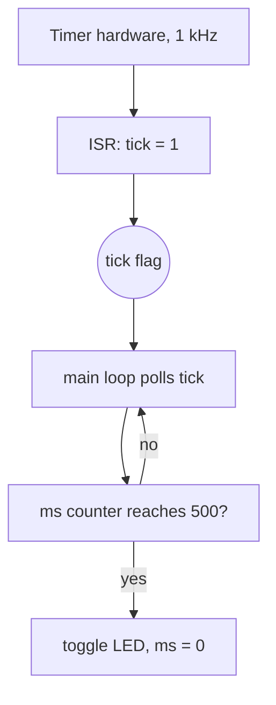

::: testing
Whether you can **read code like an engineer reads a schematic**: find the entry point, the state, the data flow and the timing, then explain it top-down before diving into lines. Interviewers hand you a short program (often C, sometimes a bit-twiddling function or an ISR plus main loop) and watch how you approach it. Hidden sub-skills:

1. Summarising the purpose first, then the mechanism.
2. Tracking variable values with a trace table instead of guessing.
3. Spotting bugs, undefined behaviour and hardware pitfalls (missing `volatile`, overflow, race between ISR and main).
4. Estimating cost: how long it runs, how many times a function executes.
:::

::: why
Most hardware work involves reading code someone else wrote: vendor drivers, bring-up scripts, a coworker's testbench. Debugging a board often means understanding a program well enough to predict what the pins should do. The same skill appears in Q963 (describe what this program does, how long it takes) for assembly. An engineer who narrates a program clearly is someone teammates can learn from and trust in code review.
:::

::: concepts
- **Entry point and flow**: where execution starts (`main`, reset vector) and what runs asynchronously (ISRs, DMA, timers). See [[q0963]] for the assembly version of the same skill.
- **State and variables**: what persists, its type and width, and who writes it. See [[q0968]].
- **`volatile` and shared data**: variables changed by an ISR or hardware must be read from memory every time. See [[q0970]].
- **Trace table**: a table of variable values after each step or loop iteration.
- **Bit operations**: AND, OR, shift, `x & (x-1)` patterns appear constantly in register-level code.
- **Cost model**: iterations times cost per iteration, converted to time with the clock rate.
:::

::: answer
"I start at the top level before reading line by line. I'd ask: what is the entry point, what are the inputs and outputs, and is anything running outside the main flow, like an interrupt? I'd give a one-sentence summary like 'this blinks an LED every 500 milliseconds using a timer interrupt', and then justify it.

Then I go through the mechanism in the order it executes. For each function I say what it takes, what it returns, and what state it changes. If there's a loop I do a quick trace table with the first couple of iterations and the exit condition, and if there's a bit trick I plug in a concrete number.

I also look for the things that bite hardware people: is a variable shared with an ISR and missing `volatile`, can an integer overflow, is there a blocking wait, does the loop depend on a hardware flag that might never get set?

Finally I'd answer the cost question: how many iterations, how long each takes at the clock frequency, so total runtime. I'd also say if anything surprised me, like 'the flag is cleared in main, but it's set in the ISR, so there's a small race I'd fix by disabling interrupts around the read-modify-write'. Narrating it like that shows I understand not just what it does but what could go wrong."
:::

::: technical
**A systematic read, in order.**

1. *Purpose*: names, comments, and which peripherals are touched give the intent.
2. *Structure*: entry point, helper functions, ISRs, global state. Mark which variables are shared between contexts.
3. *Trace*: choose simple concrete inputs and build a table of variable values.
4. *Bugs and hazards*: undefined behaviour, overflow, missing `volatile`, non-atomic updates, unbounded waits.
5. *Cost*: loop count times per-iteration cost.

**Example program.**

```c
volatile uint8_t tick = 0;          // set by ISR, cleared by main

void TIM_IRQHandler(void) {         // fires every 1 ms
    tick = 1;
    clear_timer_flag();
}

uint8_t popcount(uint8_t x) {
    uint8_t c = 0;
    while (x) { x &= x - 1; c++; }  // clears lowest set bit
    return c;
}

int main(void) {
    uint16_t ms = 0;
    init_timer_1kHz(); init_led();
    for (;;) {
        if (tick) {
            tick = 0;
            if (++ms >= 500) { ms = 0; led_toggle(); }
        }
    }
}
```

**What it does.** A 1 kHz timer interrupt sets a flag; the main loop polls that flag, counts 500 ticks and toggles an LED, so the LED toggles every 500 ms (period 1 s, 1 Hz blink). `popcount` counts set bits using Kernighan's trick: `x & (x-1)` clears the lowest set bit, so the loop runs once per set bit, not once per bit.

**Trace of `popcount(0xB4)`** ($10110100_2$): iterations give `10110000`, `10100000`, `10000000`, `00000000`, so $c = 4$ after 4 iterations. Worst case is 8 iterations (`0xFF`), so runtime is bounded.

**Timer arithmetic**: for a 16 MHz clock with prescaler 64 and auto-reload 250 counts, the tick is $16\,\text{MHz}/(64 \times 250) = 1\,\text{kHz}$.

**Hazards spotted.** If a second tick arrives before main clears `tick`, the first is lost (the flag is 1 bit, not a counter), so the LED slowly drifts if the main loop ever stalls for more than 1 ms. A counter incremented in the ISR avoids that. The `tick` flag is correctly `volatile`; without it an optimising compiler could hoist the read out of the loop and spin forever.
:::

::: short
"I'd first summarise what it does in a sentence, then go top-down: entry point, state, anything asynchronous like an ISR. I'd walk a concrete input through any loop with a trace table, check bit tricks by plugging in a real number, and look for hardware hazards like a missing `volatile`, overflow or a race between the ISR and main. Last I'd estimate runtime as iterations times cost per iteration at the clock rate."
:::

::: long
"My approach is to understand it top-down first and then line by line. I'd ask what the entry point is, what the inputs and outputs are, and whether anything runs outside the main flow, like an interrupt or DMA. Then I'd give a one-sentence summary and say if I'm unsure.

Take a typical embedded example: a timer interrupt every millisecond sets a flag, and the main loop polls the flag, counts to 500, and toggles an LED. I'd say it's a 1 Hz blinker built on a 1 kHz tick, and I'd check the tick arithmetic: a 16 MHz clock divided by prescaler 64 and a reload of 250 gives exactly 1 kHz.

For loops and bit tricks I make a trace table. For a popcount using `x & (x minus 1)`, I'd plug in 0xB4, which is 10110100, and show the lowest set bit disappearing each pass: four iterations, answer four. I'd also say the worst case is eight iterations, so it's bounded.

Then I look for hazards. Is the shared flag volatile? It is, which is good. Is the flag a single bit? Then if main stalls for more than a millisecond we lose ticks and the blink drifts; a counter in the ISR would fix that. Is anything blocking? No.

Last, cost: how often each function runs and how long it takes. The ISR runs a thousand times a second and takes a few cycles; the main loop is mostly idle. If asked how many times a subroutine executes, I'd count loop iterations symbolically, then plug in numbers.

If the program were assembly I'd use the same method, just with registers in the trace table instead of variables."
:::

::: terms
- **Entry point**: the first code executed, `main` in C or the reset vector on a microcontroller.
- **ISR (interrupt service routine)**: a function run asynchronously by hardware when an event occurs.
- **Trace table**: a table of variable values after each step, used to follow program flow by hand.
- **`volatile`**: tells the compiler a variable can change outside the visible flow, so every access must really read memory.
- **Race condition**: a bug where the result depends on the relative timing of an ISR and main code.
- **Atomic operation**: an operation that cannot be interrupted partway, such as a single aligned store on many MCUs.
- **Undefined behaviour**: code the language standard gives no meaning to (signed overflow, out-of-bounds access).
- **Kernighan popcount**: counting set bits by repeatedly clearing the lowest set bit with `x & (x-1)`.
:::

::: exceptional
**An average answer** reads each line in order, in a monotone voice, and ends with "so it toggles an LED".

**An exceptional answer**:
- Opens with purpose and architecture ("timer ISR sets flag, main polls and divides down"), then confirms with details.
- Verifies the numbers: tick period from clock and prescaler, runtime from iteration count.
- Uses a trace table on a concrete input and states best and worst cases.
- Flags hazards without being asked (`volatile`, lost ticks, read-modify-write races, overflow of `uint8_t` counters).
- Suggests a fix and says what it costs.
- Admits what is not determinable from the snippet (e.g. what `clear_timer_flag` does) and states the assumption.
:::

::: mistakes
- **Narrating syntax instead of meaning.** "This is a for loop that..." tells the interviewer nothing; say what the loop is for.
- **Skipping the trace.** Guessing the result of `x & (x-1)` or a shift loop is how wrong answers happen; plug in a number.
- **Forgetting asynchronous code.** The ISR is part of the program; ignoring it misses the real behaviour.
- **Assuming integer widths.** `uint8_t` wraps at 255; `int` might be 16 or 32 bits. Check types before claiming a count is safe.
- **Ignoring runtime.** If the question includes "how long does it take", you must give a number or expression, even approximate.
- **Not saying what you can't tell.** Hidden function bodies need stated assumptions, not silent guesses.
:::

::: deep
## Read top-down, then bottom-up

Reading a program from line 1 to line N is the slowest and least informative way to understand it. Experienced engineers scan for structure first: what is the entry point, what peripherals are initialised, what handlers exist, which globals are written by more than one context. Only then do they trace individual routines. Narrating this order out loud is exactly what the interviewer wants to hear.


Figure: The program has two execution contexts that communicate only through the `tick` flag. Anything shared between them is where bugs live, so mark it first.

## The trace table

A trace table is how you answer "what does this print" or "how many times does this run" without hand-waving. For `popcount(0xB4)`:

| Iteration | `x` before | `x - 1` | `x & (x-1)` | `c` |
|---|---|---|---|---|
| 1 | 10110100 | 10110011 | 10110000 | 1 |
| 2 | 10110000 | 10101111 | 10100000 | 2 |
| 3 | 10100000 | 10011111 | 10000000 | 3 |
| 4 | 10000000 | 01111111 | 00000000 | 4 |

The reason this works: subtracting 1 from a number flips the lowest set bit to 0 and all the zeros below it to 1; ANDing with the original therefore clears exactly the lowest set bit and leaves everything above it. The loop count equals the number of set bits, so runtime is $O(\text{set bits})$, at most 8 for a byte. Compare this with the naive loop that tests each of the 8 bits: always 8 iterations. On a core with a hardware popcount instruction (many ARM and RISC-V cores with the right extensions have one; check the specific part) the whole thing is one instruction.

## Cost: how long, how many times

Runtime estimates multiply iteration count by cycles per iteration, then divide by clock frequency. For the blinker: the ISR fires 1000 times per second. If it takes 20 cycles on a 16 MHz core that is $20/16\text{ MHz} = 1.25\ \mu\text{s}$ per call, so the ISR load is $1000 \times 1.25\ \mu\text{s} = 1.25\ \text{ms per second}$, about 0.125 percent of CPU time. The LED toggles when `ms` reaches 500, so the toggle count in one minute is $60{,}000/500 = 120$ toggles, or 60 full blinks. Questions like "how many times does the subroutine run" are exactly this: count iterations of the outer structure, then multiply by the inner count. For nested loops `for i in 0..9 { for j in 0..i {...} }` the inner body runs $0+1+\dots+9 = 45$ times, not 100.

## Hardware-specific hazards

**Missing `volatile`.** Suppose `tick` was a plain `uint8_t`. The compiler sees a loop that never writes `tick` before the read, so at `-O2` it may load it once into a register and spin on the register. The program then hangs, only in optimised builds, which is the classic "works in debug" bug.

**Lost events.** `tick` is a one-bit flag. If the main loop is delayed by a long operation such as a 3 ms flash write, three ticks collapse into one and the blinker runs slow by those ticks. Using `volatile uint16_t ticks` incremented in the ISR and consumed with `while (ticks) {ticks--; ...}` preserves the count, though the decrement must be protected from the ISR if the MCU cannot do it atomically.

**Non-atomic read-modify-write.** On an 8-bit MCU a 16-bit variable read takes two instructions. If the ISR updates it between the two reads, main sees a corrupted value (high byte old, low byte new). The fix is to disable interrupts briefly around the read, or use a single-byte flag.

**Overflow.** `uint8_t c` in `popcount` cannot overflow for an 8-bit argument. But a `uint8_t ms` counting to 500 would wrap at 256 and never reach 500, so the LED would never toggle. That is why the example uses `uint16_t`. Always check the largest value a counter must hold against its type.

**Unbounded waits.** `while (!(STATUS & READY));` spins forever if the peripheral is not clocked or the bit is wrong. In review you ask for a timeout.

## What to say about unknown functions

You will often see calls to `init_timer_1kHz()` whose body is not shown. Say what you infer from the name, state the assumption ("I'm assuming this configures the timer so the interrupt fires every millisecond"), and move on. Interviewers like candidates who can carry on with partial information, because that is the real situation when reading someone else's driver.

> [!INTERVIEW]
> Before you finish, say one sentence on what you would change if you owned the code. "I'd turn the flag into a counter so ticks aren't lost" shows engineering judgement, not just reading comprehension.

## If the program is assembly or Verilog

The same method applies. For assembly ([[q0963]]), the trace table has register columns and a cycle count column, and you add up cycles per instruction from the architecture manual. For Verilog, replace "execution" with "what happens on each clock edge": which registers update, which signals are combinational. In both cases the order is the same: purpose, structure, trace, hazards, cost.
:::

::: applications
- **Code review of a vendor driver**: walk through the init sequence to check clock, pin mux and interrupt enable are all set.
- **Board bring-up**: predict what a pin should do from firmware (blink period, PWM frequency) and compare with the scope.
- **Debugging a field return**: reading logs and code together to reconstruct why a timer-based task drifted.
- **Interview on-site whiteboard**: the interviewer's program is usually short and has one deliberate trap.
- **Onboarding to a codebase**: top-down reading to find where a register is written.
:::

::: assumptions
- Code is in C on a generic 8/32-bit microcontroller; other languages follow the same method.
- Timer arithmetic assumes a 16 MHz clock and the stated prescaler; the real clock tree could differ.
- Cycle counts for the ISR (about 20 cycles) are illustrative; real numbers depend on the core, compiler and interrupt entry latency (check the reference manual).
- If the program uses an RTOS, tasks and priorities add another layer of concurrency to the trace.
- If the interviewer's program has hidden helper functions, state your assumptions rather than refuse to continue.
:::

::: followups
### What happens if you remove `volatile` from `tick`?
With optimisation on, the compiler may assume `tick` is unchanged inside the loop (nothing visible writes it between reads) and keep it in a register. The loop then never sees the ISR's update and the LED never toggles. Debug builds often hide it because `-O0` reloads every time. `volatile` forces a real memory read on each access.

### How would you make the blinker immune to lost ticks?
Make the ISR increment a counter instead of setting a flag, and have main consume it: `while (ticks > 0) { ticks--; handle_tick(); }`. If the counter is wider than the MCU's native word size, wrap the decrement in a short critical section. Alternatively, let the hardware do the blink: a timer with output-compare toggling the pin has zero CPU cost and cannot drift.

### How long does `popcount` take on a 16 MHz core if each loop iteration costs 6 cycles?
Worst case 8 iterations (`0xFF`): $8 \times 6 = 48$ cycles, plus call overhead, so about $48/16\text{ MHz} = 3\ \mu\text{s}$. Best case (`x = 0`) skips the loop entirely. For `0xB4`, 4 iterations is 24 cycles, 1.5 microseconds.

### The program works at 16 MHz but fails at 48 MHz. Why might that be?
Candidates: a software delay loop calibrated for 16 MHz now runs three times faster; a peripheral clock prescaler now yields a baud rate or tick out of range; flash wait states are not configured for the higher speed; or a race that was masked by slow execution now shows. I'd check the timer arithmetic and flash latency first.

### An ISR and main both modify the same 32-bit counter on an 8-bit MCU. What's wrong?
The update is several instructions, so the other context can interrupt midway: a classic lost-update or torn-read bug. Fix with a critical section (disable interrupts around main's access) or restructure so only one side writes it. Test by making the ISR fire as fast as possible and checking for impossible values.
:::

::: references
- Kernighan & Ritchie, *The C Programming Language*: chapters on operators (bitwise) and functions.
- Barr, M., *Programming Embedded Systems* (O'Reilly): chapters on interrupts and the use of `volatile`.
- ISO/IEC 9899 (the C standard), sections on the `volatile` qualifier and on integer conversions and overflow.
- Warren, H., *Hacker's Delight*: chapter on counting bits, including the `x & (x-1)` method.
:::

::: rubric
- Gives a one-sentence purpose summary before details :: Shows you can see structure and communicate to an audience.
- Identifies entry point, state and asynchronous contexts (ISR/timer) :: Hardware programs behave according to all contexts, not just main.
- Uses a trace table or concrete input for loops and bit tricks :: Avoids guessing and demonstrates verification.
- Verifies numeric details such as timer period or iteration count :: Hardware engineers must connect code to real time.
- Flags `volatile`, overflow, races or unbounded waits :: These are the real-world bugs the exercise is designed to expose.
- States runtime or execution count with an expression and a number :: The question often explicitly asks "how long" or "how many times".
- Suggests an improvement or states assumptions about unseen code :: Shows judgement beyond reading.
:::

::: quiz
```json
[
 {"type": "mcq", "level": "fundamental", "q": "What should you do first when asked to walk through an unfamiliar program?", "options": ["Read every line aloud in order", "Count the lines of code", "Identify the entry point, the purpose and any asynchronous code, then go deeper", "Rewrite it more cleanly"], "answer": 2, "explain": "A top-down summary gives the listener a frame; line-by-line narration without purpose is hard to follow and misses ISRs and shared state."},
 {"type":"numeric","level":"fundamental","q":"A 16 MHz timer clock with prescaler 64 and auto-reload 250 counts produces an interrupt at what frequency?","answer":1000,"tolerance":0.01,"unit":"Hz","explain":"$16\\,\\text{MHz}/(64\\times 250) = 1000$ Hz, a 1 ms tick."},
 {"type":"numeric","level":"intermediate","q":"How many loop iterations does the Kernighan popcount (`while(x){x&=x-1;c++;}`) take for x = 0xB4 (10110100)?","answer":4,"tolerance":0.01,"unit":"iterations","explain":"It clears one set bit per pass and 0xB4 has four set bits, so 4 iterations; the result c is also 4."},
 {"type":"mcq","level":"intermediate","q":"A flag is set in an ISR and polled in a main-loop `while(!flag);`. The program hangs only when compiled with -O2. Most likely cause?","options":["The ISR is too slow","The flag is not declared volatile","Stack overflow","The timer is mis-clocked"],"answer":1,"explain":"Without `volatile`, the optimiser may hoist the read out of the loop and spin on a register copy. Debug builds do not do that, which explains the build-dependent behaviour."},
 {"type":"numeric","level":"advanced","q":"A nested loop is `for i in 0..9 { for j in 0..i-1 { body } }` (j runs i times). How many times does `body` execute?","answer":45,"tolerance":0.01,"unit":"times","explain":"$\\sum_{i=0}^{9} i = 45$. It is not 100 because the inner count grows with i."},
 {"type":"truefalse","level":"advanced","q":"A `uint8_t` counter is a safe choice for counting 500 millisecond ticks in an ISR.","answer":false,"explain":"A uint8_t wraps at 255 (modulo 256), so it never reaches 500. Use uint16_t at least."}
]
```
:::
