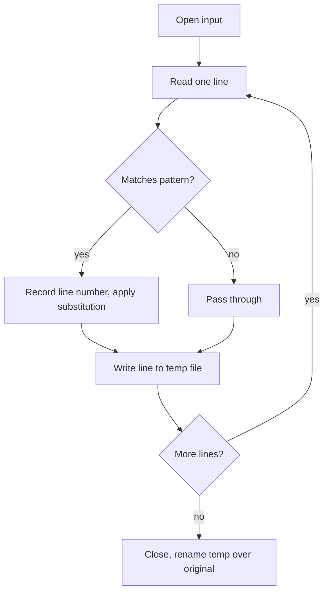

::: testing
Whether you can write **small, correct, edge-case-aware code** under observation. The five tasks (reverse a string, parse/modify a file, sketch an API, find a substring, check a palindrome) are classic warm-ups, so the algorithm isn't the hard part. The interviewer watches for:

1. Clean two-pointer and index handling with no off-by-one errors.
2. How you treat strings in C (null terminator, in-place vs copy, buffer sizes) versus Python.
3. Edge cases: empty string, single character, needle longer than haystack, missing file.
4. Whether you can state complexity and say when you would use a library call instead.
5. For the API question, whether you think about the user of your code: errors, ownership, units, thread safety.
:::

::: why
Hardware engineers write throwaway-but-important code every week: a script that scans a 200 MB log for "ERROR", a parser for a lab instrument's CSV, a firmware function that matches a command string from a UART. The same patterns appear in each. These tasks also test whether you understand how strings really live in memory ([[q0969]]), since an off-by-one in C is a buffer overflow rather than a typo. An API sketch tests whether you can design an interface another engineer can use without reading your source.
:::

::: concepts
- **Strings as arrays**: a C string is a `char` array terminated by `'\0'`; length requires scanning. See [[q0969]].
- **Two-pointer technique**: indices moving from both ends (reverse, palindrome) or one lagging behind another.
- **Nested-loop search**: naive substring search compares the needle at each offset.
- **Streaming I/O**: read a file line by line instead of loading it all, so memory stays constant.
- **Regular expressions**: pattern matching for "find and modify specific text". See [[q0967]].
- **Interface design**: init/read/close, return codes, ownership, what the caller must guarantee.
- **Complexity**: $O(n)$, $O(nm)$ and why constant factors matter on small MCUs.
:::

::: answer
"For each of these I'd start by asking about the edge cases and the language, then write it, then test it by hand.

Reverse a string: two indices, one at each end, swap and move inward until they meet. In C I'd do it in place and make sure to handle the empty string, since computing length minus one on an unsigned zero is a classic bug. It's linear time, constant extra space.

Palindrome: same two pointers, comparing instead of swapping, and I'd ask whether to ignore case and punctuation. If yes, skip non-alphanumeric characters.

Substring search: for each starting offset in the haystack, compare the needle character by character. That's O(n times m) worst case. I'd mention KMP gets it to O(n plus m), but for short strings the simple loop is fine, and in practice I'd call `strstr` or Python's `in`.

File parsing: open the file, read line by line so memory is constant, apply a regex or substring test, and write modified lines to a new file, then swap it in. I'd handle a missing file and not edit in place.

For API design pseudocode, I'd define the handle, an init that returns an error code, read and close functions, and say who owns memory and what happens on timeouts. For example a temperature sensor driver."
:::

::: technical
**Reverse a string (C, in place).**

```c
void reverse(char *s) {
    size_t n = strlen(s);
    if (n == 0) return;                 // avoid n-1 underflow
    for (size_t i = 0, j = n - 1; i < j; i++, j--) {
        char t = s[i]; s[i] = s[j]; s[j] = t;
    }
}
```
Time $O(n)$, space $O(1)$. Python: `s[::-1]` (new string; strings are immutable).

**Find a substring (returns index or -1).**

```c
int find(const char *h, const char *n) {
    size_t hl = strlen(h), nl = strlen(n);
    if (nl == 0) return 0;
    if (nl > hl) return -1;
    for (size_t i = 0; i <= hl - nl; i++) {
        size_t k = 0;
        while (k < nl && h[i+k] == n[k]) k++;
        if (k == nl) return (int)i;
    }
    return -1;
}
```
Worst case $O(nm)$ (e.g. `aaaa...ab` in `aaaa...a`); KMP or Boyer-Moore reduce it to $O(n+m)$ or better in practice. I tested this one: `find("abcabd","abd") = 3`, `find("aaab","ab") = 2`.

**Palindrome (ignore case and punctuation).**

```c
bool is_pal(const char *s) {
    int i = 0, j = (int)strlen(s) - 1;
    while (i < j) {
        while (i < j && !isalnum((unsigned char)s[i])) i++;
        while (i < j && !isalnum((unsigned char)s[j])) j--;
        if (tolower((unsigned char)s[i]) != tolower((unsigned char)s[j])) return false;
        i++; j--;
    }
    return true;
}
```
`"A man, a plan, a canal: Panama"` is true, `"abca"` false, `""` true.

**Parse a file and modify text (Python).**

```python
import re
def process(inp, out, pat, rep):
    rx = re.compile(pat); n = 0
    with open(inp) as f, open(out, "w") as g:
        for ln, line in enumerate(f, 1):
            if rx.search(line): n += 1; print(ln, line.rstrip())
            g.write(rx.sub(rep, line))
    return n
```
Streams one line at a time (constant memory), writes to a new file so a crash cannot corrupt the original.

**API design (pseudocode).**

```text
handle = sensor_open(bus, address, &config)  -> OK | ERR_NODEV | ERR_BUS
sensor_read_temp(handle, &temp_milliC, timeout_ms) -> OK | ERR_TIMEOUT | ERR_CRC
sensor_close(handle)
```
Decide: units (milli-degrees as integer, no float), who allocates the handle, blocking or not, thread safety, and idempotent close.
:::

::: short
"Reverse and palindrome are two-pointer loops: indices at both ends moving inward, swapping or comparing, O(n) time and O(1) space, with care for empty strings and, for palindromes, case and punctuation. Substring search checks the needle at every offset, O(nm) worst case, and KMP makes it linear, though in real code I'd use the library. File tasks stream line by line with a regex and write to a new file. For an API I'd define init, read and close, return codes, units and ownership."
:::

::: long
"Let me take them in order. For reversing a string, I'd use two indices, i at the start and j at the end, swap and move toward the middle. In C I compute the length, return early on zero so I don't underflow length minus one, and the loop condition is i less than j. It's O(n) time, O(1) space. In Python strings are immutable so I'd just slice with minus one.

Palindrome is the same loop but comparing instead of swapping. I'd ask whether we ignore case and punctuation; if so I skip characters that aren't alphanumeric from both ends and compare lowercase. Edge cases are the empty string and a single character, both true.

Substring search: slide the needle across the haystack, and at each offset compare characters until a mismatch. If the needle is empty I return zero; if it's longer than the haystack, minus one. Worst case is O(n times m), for example a long run of a's with a b at the end. KMP preprocesses the needle to avoid re-comparing and is O(n plus m). On a microcontroller matching a three-character command, the simple loop wins on code size.

For the file task, I'd stream: open the input, loop over lines, test with a regex, apply the substitution, write to a temp output and rename at the end so a failure can't leave a half-written file. Memory stays constant even for a gigabyte log. I'd also handle the missing file with a clear error.

For the API pseudocode, I'd think like the caller: an open function returning a handle and an error code, read and close. I'd say what units are returned, who owns the buffers, whether calls block, and what happens on timeout or CRC failure. Then I'd note that I'd use integer milli-degrees rather than floats on a small MCU."
:::

::: terms
- **Null terminator**: the `'\0'` byte marking the end of a C string; a buffer needs length plus one bytes.
- **Two-pointer technique**: scanning with two indices from opposite ends, or at different speeds.
- **In-place algorithm**: modifies the input using $O(1)$ extra memory.
- **Immutable string**: a string that cannot be changed after creation (Python, Java), so edits create copies.
- **Naive search**: comparing the needle at every offset of the haystack, $O(nm)$ worst case.
- **KMP (Knuth-Morris-Pratt)**: substring search that precomputes a failure table to reach $O(n+m)$.
- **Regular expression**: a compact pattern language for matching text.
- **Handle**: an opaque reference to a resource that API functions operate on.
- **Return code**: an integer or enum indicating success or the reason for failure.
:::

::: exceptional
**An average answer** writes five short functions that work for the happy path and says "that's O(n)".

**An exceptional answer**:
- States edge cases before coding (empty string, needle longer than haystack, non-ASCII, missing file).
- Handles C-specific traps: unsigned underflow on `n - 1`, `unsigned char` casts for `isalnum`, buffer sizes, not modifying a string literal.
- Explains the worst case for naive search with an example and names a better algorithm without over-engineering.
- Streams files and writes to a temp file, and says why.
- Designs the API from the caller's view: units, errors, ownership, blocking.
- Says when they'd just use the library (`strstr`, `re`, `str.replace`), because production engineers don't reinvent these.
:::

::: mistakes
- **Underflow in C.** `size_t j = strlen(s) - 1` with an empty string wraps to a huge number. Check for zero length.
- **Modifying a string literal.** `char *s = "abc"; reverse(s);` is undefined behaviour; use `char s[] = "abc"`.
- **Off-by-one in the search loop.** The last valid start offset is `hl - nl`, inclusive. Using `<` skips a match at the very end.
- **Loading a whole file into memory.** Fine for small files, wrong for logs; iterate over lines.
- **Editing the input file in place.** A crash mid-write destroys the data. Write to a new file, then rename.
- **API with no error path.** Returning a bare value with no way to signal timeout or bad data forces callers to guess.
:::

::: deep
## Strings in memory

In C a string is just bytes in memory ending with a zero byte. `"abc"` occupies 4 bytes, `'a' 'b' 'c' '\0'`. There is no stored length, so `strlen` scans until it finds the zero: $O(n)$. That has three consequences that explain most C string bugs. First, you must allocate length plus one. Second, anything that overwrites the terminator (a bad copy, an off-by-one) makes the next `strlen` run into whatever memory follows. Third, a string literal usually lives in read-only memory, so in-place algorithms like reverse need a writable array. In Python and similar languages strings are immutable objects with a stored length, so "reverse" returns a new string, and `s[::-1]` is the idiomatic way.

```svg
<svg viewBox="0 0 520 150" xmlns="http://www.w3.org/2000/svg" font-family="Inter, sans-serif" font-size="13">
  <g stroke="var(--d-ink)" fill="var(--d-box)">
    <rect x="40" y="50" width="50" height="34"/><rect x="90" y="50" width="50" height="34"/><rect x="140" y="50" width="50" height="34"/><rect x="190" y="50" width="50" height="34"/><rect x="240" y="50" width="50" height="34"/><rect x="290" y="50" width="50" height="34"/><rect x="340" y="50" width="50" height="34"/><rect x="390" y="50" width="50" height="34"/>
  </g>
  <g fill="var(--d-ink)" text-anchor="middle">
    <text x="65" y="72">h</text><text x="115" y="72">a</text><text x="165" y="72">r</text><text x="215" y="72">d</text><text x="265" y="72">w</text><text x="315" y="72">a</text><text x="365" y="72">r</text><text x="415" y="72">e</text>
    <text x="65" y="105" fill="var(--d-muted)">0</text><text x="115" y="105" fill="var(--d-muted)">1</text><text x="165" y="105" fill="var(--d-muted)">2</text><text x="215" y="105" fill="var(--d-muted)">3</text><text x="265" y="105" fill="var(--d-muted)">4</text><text x="315" y="105" fill="var(--d-muted)">5</text><text x="365" y="105" fill="var(--d-muted)">6</text><text x="415" y="105" fill="var(--d-muted)">7</text>
  </g>
  <rect x="440" y="50" width="50" height="34" stroke="var(--d-red)" fill="var(--d-box)"/>
  <text x="465" y="72" text-anchor="middle" fill="var(--d-red)">\0</text>
  <path d="M65 40 L65 20 L415 20 L415 40" stroke="var(--d-accent)" fill="none" stroke-width="2"/>
  <text x="240" y="15" fill="var(--d-accent)" text-anchor="middle">swap s[i] and s[j], then i++, j--</text>
  <text x="65" y="135" fill="var(--d-accent)" text-anchor="middle">i</text><text x="415" y="135" fill="var(--d-accent)" text-anchor="middle">j</text>
</svg>
```
Figure: "hardware" is 8 characters plus the terminator, 9 bytes. The two-pointer loop swaps outer pairs until the indices cross, which takes n/2 = 4 swaps. The terminator is never touched.

## Why the two-pointer idea generalises

Reverse and palindrome are the same loop. Both exploit symmetry: position $k$ pairs with position $n-1-k$. A string of length $n$ has $\lfloor n/2 \rfloor$ pairs, so the work is half a pass over the data. The middle character of an odd-length string pairs with itself and needs no action, which is why the loop condition is `i < j` and not `i <= j`. For palindromes with punctuation, the pointers move independently: each skips junk until it lands on a valid character, then compares. The inner `while` loops need the `i < j` guard too, or a string of all punctuation walks the pointers past each other.

## Substring search: cost model

The naive search tries each of the $n - m + 1$ offsets and compares up to $m$ characters. For random English text most offsets fail on the first or second character, so the practical cost is nearly $O(n)$. The worst case needs repeated partial matches: searching for `aaaab` in `aaaa...a` (length $n$) makes every offset match 4 characters before failing, giving about $4(n-3)$ comparisons, and for a needle of $m-1$ a's followed by b, about $m(n-m+1)$. For $n = 1{,}000{,}000$ and $m = 1000$ that is roughly $10^9$ comparisons. KMP builds a table from the needle so that after a mismatch it knows how far it can safely shift, never moving the haystack index backward, giving $O(n+m)$. Boyer-Moore often skips ahead by several characters at a time and is typically sublinear on natural text. On a microcontroller matching a command word in a 16-byte UART buffer, none of this matters; on a 10 GB log it does, and you'd use a library built on these ideas (`grep`, Python's `re` and `in`).

## Parsing and modifying a file

The structure for any text-processing task is the same pipeline.


Figure: Streaming keeps memory constant. Writing to a temp file and renaming at the end makes the update safe: if the program crashes halfway, the original is intact.

Design questions worth voicing: is the pattern a literal or a regex; does it match across line boundaries (then you need a different approach); what encoding is the file (UTF-8 versus Latin-1 matters for non-ASCII); do you need to preserve line endings (CRLF versus LF); and what if the file is huge or binary. In my test, the pattern `^VDD(_\w+)?=` replaced by `V` changed `VDD=3.3` and `VDD_IO=1.8` and left `GND=0` untouched, and the function returned 2 matches. That small test, with a deliberate non-matching line, is exactly the kind of check to describe in an interview.

For hardware work, typical real versions of this task: extract all lines containing `ERROR` from a simulation log, rewrite a netlist parameter, convert a lab CSV's column to SI units, or patch a register value in a config file.

## API design: think about the caller

"Psuedocode API design" usually means: given a device or service, define the functions you would expose. A decent structure is lifecycle (open, configure, use, close), operations, errors, and conventions.

For a temperature sensor on I2C the minimal API is `open(bus, addr)`, `read_temp(handle, &out, timeout)`, `close(handle)`. The thinking points that earn credit:

- **Units and types.** Return integer milli-degrees Celsius, not a float, on an MCU without an FPU. State it in the name (`temp_mC`).
- **Errors.** A distinct code for no device, bus error, timeout and CRC mismatch; the caller can retry only some of them.
- **Ownership.** Does the caller allocate the handle struct (no malloc, good for embedded) or does `open` allocate?
- **Blocking behaviour.** Does `read_temp` wait for the 12-bit conversion (about tens to a couple hundred milliseconds depending on the part), or return immediately with a "not ready" code plus a callback?
- **Concurrency.** If two tasks share the bus, who locks it?
- **Idempotence and cleanup.** Calling `close` twice must be safe.

Draw it as layers: application, sensor API, bus driver (I2C), hardware. Each layer only talks to the one below.

> [!INTERVIEW]
> After each snippet, say the complexity and the one edge case you tested, then offer the library one-liner. "In production I'd call `strstr`, but here's what it does" shows both skill and maturity.
:::

::: applications
- **Log triage**: scan a multi-gigabyte simulation or test log for failing lines using a streaming grep-like script.
- **Netlist or config patching**: substitute a parameter across many files with a regex before re-running simulations.
- **UART command parser**: match "SET LED 1" style commands in a small buffer without dynamic allocation.
- **Instrument drivers**: SCPI-style wrappers around a scope or power supply with open, query and close semantics.
- **Production test scripts**: parse measurement files and flag out-of-spec values.
:::

::: assumptions
- ASCII text and single-byte characters. With UTF-8, "reverse" by bytes corrupts multi-byte characters, and "characters" and "bytes" differ.
- C strings are null-terminated and writable; Python strings are immutable.
- "Palindrome" means ignoring case and non-alphanumerics unless the interviewer says exact match; I state which.
- Case sensitivity in search is exact unless told otherwise.
- The API sketch assumes a small embedded sensor; for a network service you'd add authentication, versioning and idempotency.
- Complexity values are worst-case unless stated; practical text search is faster.
:::

::: followups
### How would you reverse the words in a sentence instead of the characters?
Reverse the whole string in place, then reverse each word individually (scan for spaces). Two linear passes, $O(n)$ time and $O(1)$ space. `"abc de"` becomes `"ed cba"` then `"de abc"`. In Python simply `" ".join(s.split()[::-1])`, using $O(n)$ extra space.

### What is the worst-case input for the naive substring search and how many comparisons?
Haystack of $n$ a's, needle of $m-1$ a's followed by b. At each of the $n - m + 1$ offsets you compare $m$ characters before failing at the b, so about $m(n-m+1)$ comparisons. For $n = 10^6$, $m = 1000$, that is about $10^9$. KMP does the same job in about $n + m$ steps.

### How would you check a palindrome for a linked list or a stream where you can't index from the back?
Find the middle with slow and fast pointers, reverse the second half in place, then compare halves; restore if the list must be unchanged. $O(n)$ time, $O(1)$ space. Alternative: push the first half on a stack, then pop while comparing, at $O(n/2)$ memory.

### The file is 50 GB. What changes in your parsing code?
Nothing structural, since it already streams line by line. I'd check the per-line cost (compiled regex, not recompiled per line), use buffered binary reads if lines are huge, consider multiprocessing by splitting at newline boundaries, and make sure output is also written incrementally. If the pattern is a plain literal, `grep` or `ripgrep` will beat my script.

### Your read function sometimes returns stale temperature data. How would the API design contribute?
If `read_temp` returns the last conversion without checking whether a new one finished, callers get stale data without knowing it. Fix: include a timestamp or "fresh" flag, return `ERR_NOT_READY` until the conversion completes, or block with a timeout. Document the conversion time so callers can size their polling.
:::

::: references
- Kernighan & Ritchie, *The C Programming Language*: chapters on arrays and character strings, and the standard library string functions.
- Cormen, Leiserson, Rivest, Stein, *Introduction to Algorithms*: the chapter on string matching (naive, Rabin-Karp, Knuth-Morris-Pratt).
- Python documentation, the `re` module and "Reading and Writing Files" in the tutorial.
- Seacord, R., *Effective C* (No Starch Press): chapters on strings and common buffer-handling pitfalls.
:::

::: rubric
- Asks about edge cases and language before coding :: Shows you treat requirements seriously and avoids wasted work.
- Writes a correct reverse with two pointers and guards the empty string :: Basic correctness plus the classic underflow trap in C.
- Palindrome logic handles case and punctuation (or states the assumption) :: Interviewers change the spec to see if you notice.
- Substring search with correct loop bounds and a stated complexity :: Off-by-one and complexity are the two things graded.
- File task streams, uses a pattern, and writes safely :: Distinguishes scripts that survive real data from toy ones.
- API sketch covers units, errors, ownership, blocking :: Tests design thinking beyond writing loops.
- Mentions using the standard library in practice :: Shows engineering maturity, not showing off.
:::

::: quiz
```json
[
 {"type":"mcq","level":"fundamental","q":"In C, how many bytes does the string literal \"abc\" occupy in memory?","options":["3","4","5","Depends on the compiler's alignment"],"answer":1,"explain":"Three characters plus the terminating '\\0' make 4 bytes. strlen returns 3 but storage is 4."},
 {"type":"numeric","level":"fundamental","q":"How many swaps does the two-pointer reverse perform on a string of length 9?","answer":4,"tolerance":0.01,"unit":"swaps","explain":"$\\lfloor 9/2 \\rfloor = 4$; the middle character pairs with itself and needs no swap."},
 {"type":"numeric","level":"intermediate","q":"Naive search for a needle of length m = 1000 in a haystack of n = 1,000,000 where every offset matches m-1 characters before failing. About how many comparisons (in millions)?","answer":1000,"tolerance":0.02,"unit":"million","explain":"$m(n-m+1) \\approx 1000 \\times 999{,}001 \\approx 1.0\\times10^9$, i.e. about 1000 million comparisons."},
 {"type":"mcq","level":"intermediate","q":"Why can `size_t j = strlen(s) - 1;` be a bug?","options":["strlen is slow","For an empty string it underflows to a huge value because size_t is unsigned","It returns a signed value","It skips the terminator"],"answer":1,"explain":"strlen(\"\") is 0 and 0 - 1 wraps around for an unsigned type, so the loop would run over unrelated memory. Check for zero length first."},
 {"type":"truefalse","level":"advanced","q":"Editing a file in place line by line is safer than writing to a temporary file and renaming it.","answer":false,"explain":"A crash during in-place editing can leave a truncated or corrupt original. Writing a temp file and renaming (an atomic operation on most filesystems) keeps the original intact until the new one is complete."},
 {"type":"multi","level":"advanced","q":"Which belong in a well-designed driver API for a sensor? Select all that apply.","options":["Explicit error codes for timeout and CRC failure","Documented units (e.g. milli-degrees C)","A global variable that the caller reads directly with no function","Clear rule on who allocates the handle"],"answer":[0,1,3],"explain":"Error codes, units and ownership are core API contracts. A raw global gives no error path, no timing guarantee and no encapsulation."}
]
```
:::
