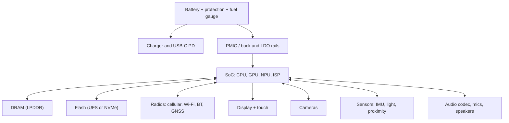

::: testing
Whether you can build a **mental block diagram of a real product** and talk about it by function rather than by part list. A smartphone or laptop is a vehicle for checking breadth: compute, memory, power, radios, sensors, human interface, and how they connect. The interviewer is listening for:

1. A sensible grouping (compute, memory, storage, power, connectivity, display and audio, sensors, thermal and mechanical).
2. Knowing which blocks are chips, which are buses between them, and where power comes from.
3. Awareness of the constraints that shape the design: battery energy, heat, size, cost, EMI between radios and everything else.
4. Whether you can zoom into one block when asked (e.g. "how does the battery get charged?").
:::

::: why
A hardware intern is placed in one corner of a product, such as the power team, RF, display or board layout, and has to understand how that corner fits the whole. Interviewers use "what's inside a phone?" because there is no single right answer; it shows how you organise a big system. It also opens the follow-up chain: power rails, buses, thermal limits, EMI, test. Good candidates tie each block to a physical consequence, for example "the radios need clean power and shielding" or "the SoC is the main heat source".
:::

::: concepts
- **System on chip (SoC)**: CPU cores, GPU, memory controllers, modem and many peripherals on one die or package..
- **Memory hierarchy**: SRAM caches, DRAM (LPDDR in phones, DDR/LPDDR in laptops), non-volatile storage (UFS or NVMe flash). See [[q0936]].
- **Power delivery**: battery, charger, PMIC or buck/LDO rails, protection. See [[q0148]] for why you don't make rails with dividers.
- **Interfaces and buses**: I2C, SPI, MIPI (camera, display), USB, PCIe, UART. See [[q0737]].
- **Radios**: cellular, Wi-Fi, Bluetooth, GNSS, NFC, each with antennas and RF front ends.
- **Sensors and I/O**: touch, IMU, ambient light, proximity, cameras, microphones, speakers.
- **Thermal and mechanical**: heat spreading, throttling (see [[q0953]]), battery swelling margin, shielding cans, flex cables.
:::

::: answer
"I'd break it into blocks. At the centre is the processor, an SoC in a phone with CPU, GPU, neural engine, image signal processor and memory controllers; in a laptop it can be an SoC too, or a CPU plus a separate GPU and chipset. Next to it is DRAM and flash storage: LPDDR and UFS in a phone, DDR or LPDDR and an NVMe SSD in a laptop.

Power is its own subsystem: a lithium-ion battery with a fuel gauge and protection, a charger IC that handles USB-C power negotiation, and a PMIC or a set of buck converters and LDOs that make the many rails the chips need, with sequencing.

Then connectivity: cellular modem in a phone, Wi-Fi and Bluetooth in both, GNSS, NFC, each with antennas and RF front-end modules.

On the human side: display with a driver and touch controller, backlight or OLED power, speakers, microphones and audio codec, cameras with MIPI links, keyboard and trackpad in a laptop. Plus sensors: IMU, light and proximity, magnetometer, temperature sensors.

Holding it together are the board, shielding, thermal path, and a lot of firmware. The constraints I'd call out are battery life, heat, size and cost, and that radios and high-speed digital have to coexist without interfering with each other."
:::

::: technical
**Block-level inventory (typical; configurations vary by product).**

| Block | Smartphone | Laptop |
|---|---|---|
| Compute | Mobile SoC: big/little CPU cores, GPU, NPU, ISP, video codec | CPU (SoC or CPU + PCH), integrated or discrete GPU |
| Memory | LPDDR in package or on board; flash (UFS or eMMC) | DDR/LPDDR DIMMs or soldered; NVMe SSD over PCIe |
| Power | Single-cell Li-ion (nominal about 3.85 V), charger IC, PMIC, fuel gauge | Multi-cell pack (often 2-4S), charger/battery management, many buck rails, embedded controller |
| Connectivity | Cellular modem, Wi-Fi, BT, GNSS, NFC, UWB | Wi-Fi, BT, Ethernet (sometimes), USB-C/Thunderbolt |
| Display and I/O | OLED/LCD with MIPI DSI, touch controller, haptics | LCD with eDP, keyboard, touchpad, USB ports |
| Audio | Codec, speakers, mics, headset detect | Codec, speakers, mic array |
| Sensors | IMU, magnetometer, barometer, light/proximity, fingerprint | Hall sensor for lid, ambient light, webcam |
| Thermal | Passive spreading (graphite, vapour chamber) | Heat pipes, fans |

**Interconnect.** High-speed links are differential and impedance-controlled: DDR interfaces to the DRAM, MIPI DSI/CSI to display and camera, PCIe to the SSD, USB to ports. Low-speed control uses I2C, SPI and UART to sensors and PMICs. See [[q0737]] for I2C, SPI and UART.

**Energy scale.** A phone battery of 4500 mAh at a nominal 3.85 V stores $4.5 \times 3.85 = 17.3$ Wh. A thin laptop battery is commonly several times larger, in the range of 40 to 70 Wh. At a sustained 5 W the phone battery lasts $17.3/5 \approx 3.5$ h; at 1 W, 17 h. That is why every block has aggressive power gating and the SoC runs from tightly regulated rails with dynamic voltage and frequency scaling.

> [!UNCERTAIN]
> Exact capacities, rail counts and chip partitions vary widely by model and year. The numbers here are representative orders of magnitude, not a specification of any product.
:::

::: short
"A phone or laptop is a processor SoC, DRAM and flash, a power subsystem (battery, charger, PMIC with many rails), radios (cellular, Wi-Fi, Bluetooth, GNSS), display and touch, audio, cameras and sensors, all connected by high-speed buses like DDR, MIPI and PCIe and low-speed ones like I2C and SPI. The design is dominated by battery life, heat, size and cost, and by keeping radios and fast digital from interfering."
:::

::: long
"I like to organise it by function. The brain is the processor. In a phone that's an SoC with CPU cores, GPU, neural engine, image signal processor, video codec and memory controllers. A laptop might use an SoC too, or a CPU with a separate GPU. Connected to it is working memory, DRAM, which is LPDDR in a phone, and long-term storage, flash over UFS or NVMe.

Second is power. There's a lithium-ion battery, a protection circuit and fuel gauge, a charger that talks USB-C power delivery, and a PMIC or multiple buck converters generating the dozen-plus rails the chips need. The SoC core rail is the hungry one and it changes voltage dynamically. A phone battery is around 17 watt-hours, so you can see why idle power matters so much.

Third is connectivity: cellular modem, Wi-Fi, Bluetooth, GNSS, NFC, each with an RF front end and antenna. Fourth is the human interface: display with its driver and backlight or OLED supply, a touch controller, speakers, microphones and an audio codec, cameras over MIPI, and a keyboard and trackpad on the laptop. Fifth are sensors: accelerometer and gyro, magnetometer, light and proximity.

These are tied together with buses: DDR and PCIe for speed, MIPI for displays and cameras, I2C and SPI for slow sensors. On top of that you have the mechanical stuff: shielding cans, thermal spreaders or fans, and flex cables.

The constraints that shape all of it are battery life, thermal limits, size and cost, and electromagnetic compatibility, because a switching regulator next to a cellular antenna is a recipe for desensitising the receiver. If you want me to zoom into one block, I'd pick power."
:::

::: terms
- **SoC (system on chip)**: one device integrating CPU, GPU, memory controllers and peripherals.
- **PMIC (power management IC)**: chip that generates and sequences multiple supply rails, often including charging and battery monitoring.
- **LPDDR**: low-power DRAM used in phones and many thin laptops.
- **UFS / NVMe**: flash storage interfaces in phones and laptops respectively.
- **MIPI DSI / CSI**: high-speed serial interfaces to displays and cameras.
- **RF front end**: filters, amplifiers and switches between antenna and radio transceiver.
- **DVFS (dynamic voltage and frequency scaling)**: adjusting supply voltage and clock to the workload to save power.
- **Fuel gauge**: IC that estimates battery state of charge.
- **Thermal throttling**: lowering clocks to keep temperature within limits.
:::

::: exceptional
**An average answer** lists parts: "CPU, RAM, battery, screen, camera, Wi-Fi".

**An exceptional answer**:
- Groups blocks by function and mentions how they connect (bus types, power rails).
- Brings in numbers: battery energy in Wh, battery life at a given power, number of rails.
- Identifies the constraints that drive the architecture: power, thermal, size, EMI, cost.
- Mentions coexistence issues (switching noise vs RF, display noise vs touch).
- Differentiates phone from laptop (single-cell vs multi-cell, passive vs active cooling, UFS vs NVMe).
- Offers to zoom into a block and picks one the interviewer is likely to care about.
:::

::: mistakes
- **Listing parts without structure.** An unordered list of 15 components doesn't show understanding; group them.
- **Forgetting power.** Many candidates describe compute and radios and omit the battery, charger and PMIC, the part hardware engineers most often own.
- **Treating the SoC as a black box that has "everything".** Say what is in it and what is deliberately outside (PMIC, RF front end, flash, sensors).
- **Ignoring thermals and mechanics.** Phones throttle; laptops need fans or heat pipes. Heat is a first-order design limit.
- **Presenting a phone and a laptop as the same.** Voltage, capacity, cooling and I/O differ.
- **Quoting precise specs from memory.** Say "around" and flag uncertainty; made-up numbers hurt credibility.
:::

::: deep
## Why a system diagram is the right first answer

Any consumer device is a solution to an energy and heat budget. Everything inside exists to serve one of four jobs: *compute* data, *store* it, *move* it (radios, buses), or *interact* with the world (sensors, display, audio). A fifth job, *power* delivery, supports all four. If you organise the answer around those jobs, you can always zoom in without losing the thread.


Figure: Power flows from the battery through the PMIC to every block; data flows between the SoC and its peripherals over different buses. Almost every question about a phone can be answered by locating the block on this diagram and then asking what rail and what bus it uses.

## Power: where the interviewer will go next

The battery is a single lithium-ion cell in a phone, with a nominal voltage of about 3.7 to 3.85 V and a usable range of roughly 3.0 V (empty) to 4.2-4.45 V (full, depending on chemistry; see your cell's datasheet). The chips need much lower and different voltages: the SoC core might run well below 1 V at high current, DRAM needs around a volt, I/O 1.8 V, and the display and radios have their own needs. So most rails are produced by buck converters (efficient step-down) with LDOs for noise-sensitive loads like RF and analog. A PMIC integrates many of these and also handles sequencing: rails must come up in a defined order and with defined timing ([[q0148]] explains why a divider can't do this job, and [[q0157]] compares buck and LDO).

Why efficiency matters: if a 3.85 V battery feeds a 0.8 V rail at 3 A (2.4 W out) through a buck converter with 90 percent efficiency, the input draw is $2.4/0.9 = 2.67$ W and the loss is 0.27 W. Through a linear regulator, the same rail would dissipate $(3.85 - 0.8) \times 3 = 9.2$ W, far beyond what a phone can dissipate. This one calculation justifies the whole power architecture.

## Energy and runtime

With 17.3 Wh of stored energy, a device averaging 1 W lasts about 17 hours, and at the 5 to 10 W a phone might draw while gaming it lasts only 2 to 3.5 hours before the battery is empty, in practice sooner because of thermal throttling and battery efficiency. Display, cellular radio and the SoC dominate in typical use. This is why modern SoCs have heterogeneous cores (small efficient cores for background tasks), power gating and DVFS: dynamic power scales roughly as $P \propto C V^2 f$, so lowering voltage together with frequency saves much more than lowering frequency alone.

## Thermal and mechanical limits

A phone has no fan. Its skin temperature must stay comfortable for touch (commonly designed to stay in the low to mid 40s Celsius at the surface; vendor-specific). The SoC's junction temperature has a separate, higher limit. Heat flows from the die through the package, into graphite or a vapour chamber, to the frame and out. When the temperature approaches the limit, firmware reduces clocks (thermal throttling). Laptops have more volume and can use heat pipes and fans, so sustained power can be 15 to 45 W or more depending on class. Mechanical choices also impose electrical constraints: flex cables between boards, board-to-board connectors, and shielding cans around RF sections.

## Coexistence and EMC

A phone is an extreme EMI environment: a cellular transmitter radiating a fraction of a watt or more next to GPS and Wi-Fi receivers that listen for signals at the level of picowatts, plus switching regulators at hundreds of kilohertz to a few megahertz, and DDR buses at gigabit rates. Designers separate sensitive and noisy blocks, use shielding cans, filter supply rails with ferrite beads and capacitors, and choose switching frequencies to avoid harmonics landing in a receive band. Spread-spectrum and careful layout of high-speed buses also help. This is why RF and power engineers talk to each other early.

## Phone vs laptop differences

| Aspect | Phone | Laptop |
|---|---|---|
| Battery | 1 cell (about 3.85 V) | 2-4 cells in series (about 7.4-15 V) |
| Cooling | Passive | Fan and heat pipe, or passive on low-power models |
| Storage interface | UFS/eMMC | NVMe SSD (PCIe) |
| Display link | MIPI DSI | eDP |
| Radios | Cellular is primary | Wi-Fi/BT primary; cellular optional |
| Upgrade path | None | Often replaceable RAM or SSD |

Higher battery voltage in the laptop reduces conduction loss for the same power (current is lower: $I = P/V$), and it lets the buck converters work at more favourable ratios for high-power CPUs.

> [!INTERVIEW]
> After you give the block diagram, ask "do you want me to zoom into one block?" It shows you know the answer is a tree and lets the interviewer steer toward the area that matches the internship.
:::

::: applications
- **Smartphone main board**: SoC and PoP DRAM, PMIC, RF front-end modules, flash, many sensors in a few square centimetres.
- **Thin-and-light laptop**: SoC or CPU with soldered LPDDR, NVMe SSD, USB-C PD controller, embedded controller for keyboard and battery.
- **Wearables and tablets**: the same block structure with smaller batteries and different displays.
- **Teardown analysis**: engineers learn architecture by identifying each block on a disassembled board.
- **Internship projects**: charger firmware, sensor bring-up, display power sequencing and thermal characterisation all live in one of these blocks.
:::

::: assumptions
- "Smartphone/laptop" is treated as a generic modern product; individual models differ (some laptops use discrete GPUs, some phones have two batteries or separate application and modem processors).
- Voltages and capacities are typical orders of magnitude, not specs of any product.
- I assume Li-ion batteries; some devices use other chemistries or form factors.
- The answer is hardware-focused; a software-focused interviewer may also want the OS, bootloader and firmware layers (boot ROM, secure enclave, drivers).
- If the interviewer asks for "components" as in discrete parts on the BOM, add passives (decoupling capacitors, inductors, ferrites), connectors and crystals.
:::

::: followups
### Why do phones use buck converters for the CPU rail instead of LDOs?
Efficiency and heat. A rail of 0.8 V at 3 A from a 3.85 V battery with an LDO dissipates $(3.85-0.8)\times 3 = 9.2$ W in the regulator, more than the load uses. A buck at 90 percent efficiency loses about 0.27 W. LDOs are still used after the buck for noise-sensitive analog and RF loads, where the small voltage drop is acceptable.

### How would you estimate battery life for a given workload?
Compute average power: $P_{avg} = \sum_i D_i P_i$ over states (screen on, idle, radio active), then divide energy by it. For a 17.3 Wh battery and 1.5 W average, runtime is $17.3/1.5 = 11.5$ h. Then derate for battery efficiency at high currents, aging, and temperature. Measure with a power analyser, because estimates miss background wakeups.

### How do the cellular radio and the switching regulators interfere?
A regulator's switching frequency and harmonics, plus its ripple on the supply, can fall into or modulate receive bands and desensitise them, while a transmitter's strong signal can couple into sensitive analog or supply lines. Mitigations: shielding cans, filter the supply with ferrite and capacitors, pick a switching frequency whose harmonics miss the band, spread-spectrum clocking, and tight layout.

### What happens electrically if the phone gets too hot?
Firmware reads temperature sensors, lowers CPU/GPU frequency and voltage (DVFS), dims the screen, throttles charging, and as a last resort shuts down. Charging generates additional heat in the charger IC and battery, so fast charging is also reduced at high temperature. Li-ion cells have strict charge-temperature limits to avoid lithium plating, so protection is also hardware-enforced.

### What would you check if the phone reboots under heavy load but is fine at idle?
Likely a supply transient: the SoC rail droops under a step in load current ($\Delta V = L\,di/dt + I\,R$ in the PDN) and trips an under-voltage reset, or the battery's internal resistance at low charge or low temperature makes the battery voltage sag below the system minimum. I'd capture the rails with a scope during a load step, check battery voltage versus state of charge, and look at decoupling and PMIC settings.
:::

::: interpretations
"What components does a smartphone/laptop have?" can mean a block-level view (processor, memory, power, radios, sensors), which is what I assume, or a bill-of-materials view with specific discrete parts. If the interviewer wants BOM level, add passives, crystals, connectors, ESD and TVS devices, and the PCB. The slash means the answer should cover both devices and note differences. For a more architectural take see [[q0975]] (design a system) and [[q0977]] (constraints by industry).
:::

::: references
- Patterson & Hennessy, *Computer Organization and Design*: overview chapter on the components of a computer and the memory hierarchy.
- Horowitz & Hill, *The Art of Electronics*, 3rd ed.: chapters on power supplies and regulators, and on digital interfaces.
- Linden & Reddy, *Handbook of Batteries*: lithium-ion cell characteristics (chapter on Li-ion).
- iFixit teardowns (public) are a good way to see real boards, though specific parts vary by model.
:::

::: rubric
- Organises components by function rather than listing parts :: Shows systems thinking and makes the answer navigable.
- Covers compute, memory, storage, power, connectivity, display/audio, sensors :: Missing a major group signals shallow knowledge.
- Describes the power subsystem (battery, charger, PMIC/regulators) :: Power is the most common intern-level area and a frequent follow-up.
- Mentions interconnects (DDR, MIPI, PCIe, I2C/SPI) :: A system is blocks plus buses.
- Names the constraints: battery, thermal, size, cost, EMI :: Explains why the architecture looks the way it does.
- Distinguishes phone from laptop :: Shows you notice voltage, cooling and I/O differences.
- Offers to zoom into a block and can do so with numbers :: Demonstrates depth behind the breadth.
:::

::: quiz
```json
[
 {"type":"mcq","level":"fundamental","q":"Which block generates and sequences the many supply rails in a phone?","options":["The fuel gauge","The PMIC (with buck converters and LDOs)","The audio codec","The touch controller"],"answer":1,"explain":"The PMIC (or a set of regulators) converts the battery voltage into the several rails the SoC, DRAM, I/O and radios need and brings them up in order."},
 {"type":"numeric","level":"fundamental","q":"A phone battery is 4500 mAh at a nominal 3.85 V. What is its energy?","answer":17.3,"tolerance":0.02,"unit":"Wh","explain":"$4.5\\,\\text{Ah} \\times 3.85\\,\\text{V} = 17.3$ Wh."},
 {"type":"numeric","level":"intermediate","q":"A 0.8 V, 3 A rail is made from a 3.85 V battery with a linear regulator. How much power is dissipated in the regulator?","answer":9.15,"tolerance":0.02,"unit":"W","explain":"$P = (V_{in}-V_{out}) I = (3.85-0.8)\\times 3 = 9.15$ W, which is far more than the 2.4 W the load uses; this is why a buck converter is used."},
 {"type":"mcq","level":"intermediate","q":"Why do high-power laptops usually use a multi-cell battery pack instead of a single cell?","options":["Single cells cannot be recharged","Higher voltage means lower current for the same power, reducing conduction losses and easing converter design","It makes the laptop lighter","It removes the need for a PMIC"],"answer":1,"explain":"For a given power, $I = P/V$. Doubling the pack voltage halves the current, so $I^2R$ loss in traces and connectors drops by four."},
 {"type":"truefalse","level":"advanced","q":"Lowering only the clock frequency of a CPU saves more dynamic power than lowering voltage together with frequency.","answer":false,"explain":"Dynamic power is $P \\approx C V^2 f$. Lowering f alone reduces power linearly, but also lowering V cuts it quadratically, which is why DVFS scales both."},
 {"type":"multi","level":"advanced","q":"Which are realistic reasons a phone might reboot under heavy load at low battery? Select all that apply.","options":["Battery voltage sags because of internal resistance at high current","SoC rail droops during a load step and triggers under-voltage reset","The display has too many pixels","Insufficient decoupling or PDN impedance"],"answer":[0,1,3],"explain":"All three involve voltage falling below a minimum during a current step ($V = V_{oc} - I R_{int}$ and PDN transients). Pixel count is not a direct cause."}
]
```
:::
