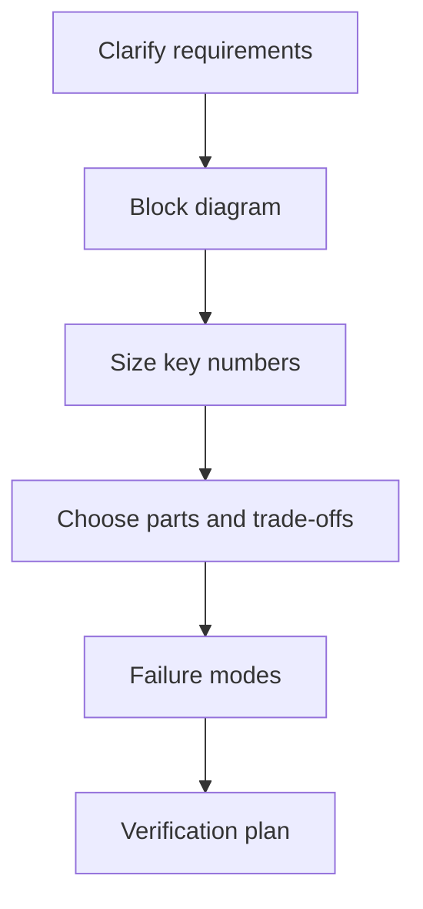
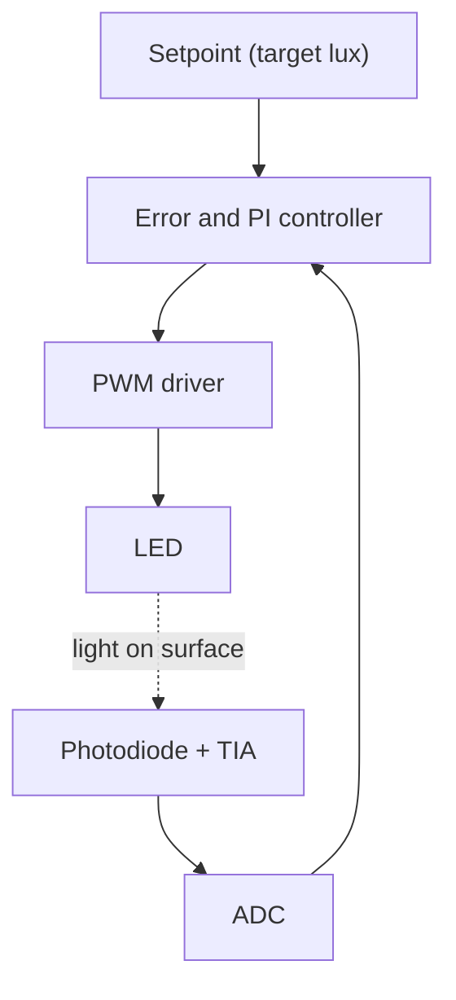
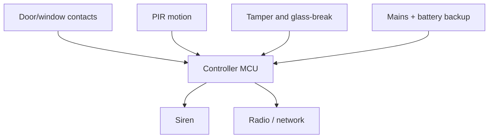
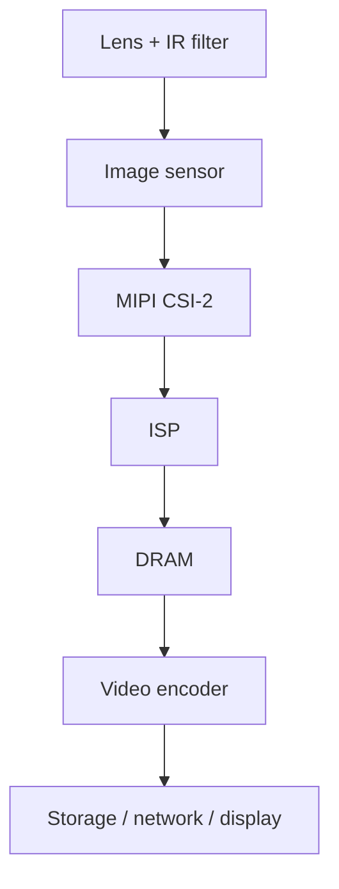
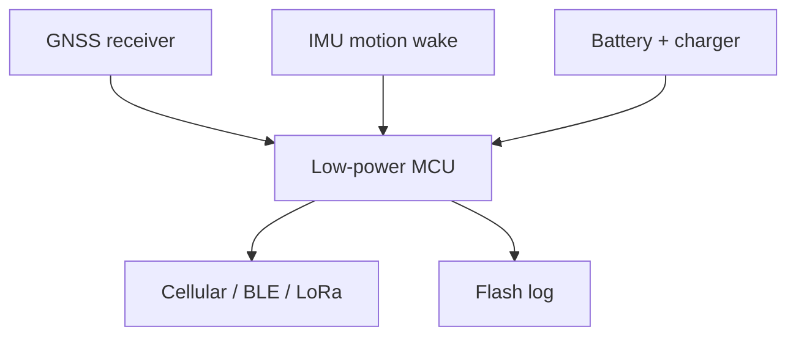
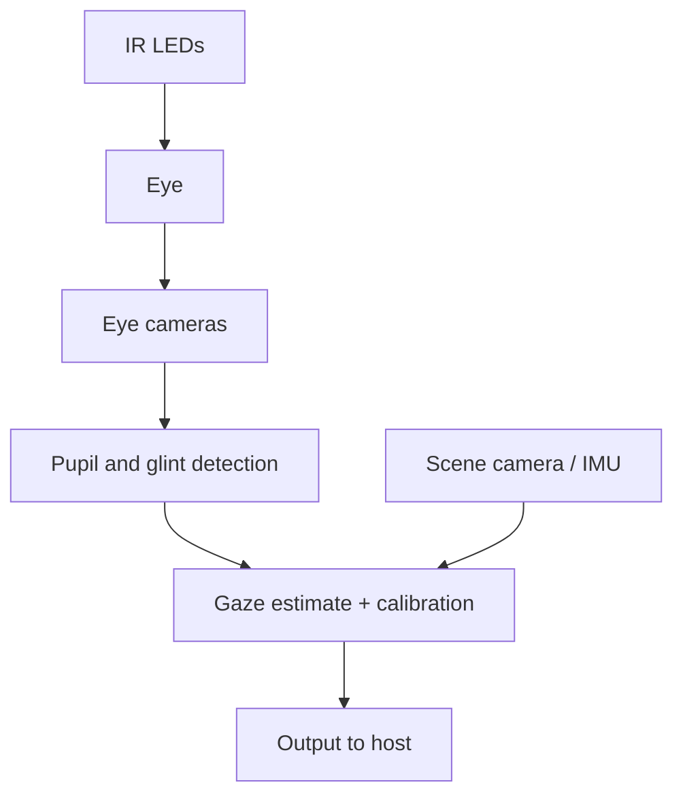

::: testing
Whether you can run a **design conversation**, not whether you remember a reference design. Six prompts, one skill: turn a one-line goal into requirements, a block diagram, a few load-bearing numbers and a verification plan. The interviewer is watching for:

1. **Clarifying questions first** (supply, size, battery or wall power, cost, accuracy, latency).
2. A block diagram with **sense, decide, act, power, communicate** all present.
3. One or two **real calculations** per system (LED resistor, PWM resolution, camera bandwidth, battery life), not hand-waving.
4. Awareness of failure modes: flicker, saturation, false alarms, drift, eye safety, brownout.
5. A sensible **order of build and test**, ending with how you would prove it works.
:::

::: why
"Design a system to do X" is the closest thing an interview has to a real day of work. Nobody hands you a spec that is complete. You are paid to ask what "bright enough" means, pick a sensor, pick an actuator, find the bottleneck and test it. The six prompts here sit on a ladder: an open-loop LED, a closed-loop LED, then four sensor-plus-processing products that stress different resources (power, bandwidth, latency, safety). If you can run the same five-step method on all six, you can run it on whatever the interviewer improvises. The other pages in this section ([[q0974]] components, [[q0976]] redundancy, [[q0977]] industry constraints) are the vocabulary you draw on here.
:::

::: concepts
- **PWM dimming**: an LED's brightness tracks its *average current*, so switching it fast and varying duty cycle dims it without shifting color. See [[q0145]].
- **Feedback control**: a closed loop measures the thing you care about (light on the target) and corrects the actuator. See [[q0126]] for gain and [[q0125]] for op-amp stages.
- **Sensing front ends**: photodiode plus transimpedance amplifier, PIR, magnetic contact, IMU, GNSS, image sensor. See [[q0854]], [[q0850]], [[q0856]].
- **ADC and sampling**: every analog sensor ends at a sampled number with finite resolution and rate. See [[q0808]], [[q0669]].
- **Power budgeting**: average current, not peak current, sets battery life.
- **Data bandwidth**: pixels per second times bits per pixel sets the interface and memory you need.
- **Verification**: for each requirement, name the measurement that proves it.
:::

::: answer
"I'd give every one of them the same treatment. First I ask what it has to do and what it's allowed to cost: wall power or battery, how bright, how fast, how accurate, how big. Then I draw sense, decide, act, plus power and communications, and put one real number on each block.

For variable LED brightness, I'd drive the LED with a low-side MOSFET from a PWM timer. Brightness follows average current, so duty cycle sets brightness. I'd run the PWM at a few kilohertz or more to avoid flicker, and because the eye is roughly logarithmic I'd use a gamma table with 12-bit or better timer resolution so the dim end doesn't step visibly.

For brightness based on ambient light, I'd add a photodiode with a transimpedance amp into an ADC and close the loop in firmware. The target is a light level on the surface, so the sensor must see the lit area and not the LED directly, and I'd use a slow integral controller so it doesn't hunt.

The security system, camera, tracking and eye-tracking glasses each get the same pattern. Security is mostly about low-power sensing, false-alarm rejection and a backup battery. The camera is a bandwidth and memory problem: 1080p at 30 fps raw is already about 620 Mb/s. The tracker is a battery problem: GNSS and cellular are the big spenders, so you duty-cycle them with the IMU deciding when to wake. Eye tracking is a latency and eye-safety problem: infrared illumination, a fast small camera and a tight pipeline. Then I'd say how I'd test each against its spec."
:::

::: technical
**Method (all six).** Requirements → block diagram → sizing calculations → component choices → failure modes → verification plan.

**1. Variable LED brightness.** $I_{LED}$ sets light output. With a 5 V rail, white LED $V_F \approx 3.0$ V, target 20 mA: $R = (5-3.0)/0.02 = 100\ \Omega$, $P_R = I^2R = 40$ mW. A low-side NMOS switched by a timer PWM output gives average current $I_{avg} = D\cdot I_{on}$. Flicker-free PWM needs a few hundred Hz at minimum for steady viewing and kHz-range for cameras and motion. Resolution: a 12-bit timer at 20 kHz needs an 82 MHz timer clock ($2^{12}\times 20\,\text{kHz}$).

**2. Ambient-compensated brightness.** Sensor: photodiode into a transimpedance amplifier, $V_{out} = I_{pd}R_f$ (1 µA with 1 MΩ gives 1 V). ADC reading $\to$ error against setpoint $\to$ PI controller $\to$ PWM duty. The loop bandwidth should be well below the sensor's and the eye's response (seconds) to avoid visible hunting. Anti-windup is needed at 0 % and 100 % duty. Reject the LED's own PWM ripple with a low-pass or by sampling in sync with the PWM.

**3. Security system.** Sensors: door/window magnetic contacts, PIR motion, glass-break microphone, tamper switches. A low-power MCU polls or wakes on interrupt; a radio (Sub-GHz, Wi-Fi, cellular) reports; a siren and a backup battery keep it alive on mains loss. Design for **supervision** (heartbeat so a dead sensor is noticed) and **false-alarm rejection** (two-sensor confirmation, entry delay).

**4. Camera system.** Image sensor → MIPI CSI-2 → ISP → DRAM → encoder/SoC → storage or network. Raw bandwidth $=W\cdot H\cdot \text{fps}\cdot\text{bits}$: 1080p30 at 10 bit is 622 Mb/s; 4K30 at 10 bit is 2.49 Gb/s. Light, lens and exposure set image quality; thermal design limits sensor noise.

**5. Tracking system.** GNSS + IMU + cellular/BLE + battery. Example: 20 s of GNSS at 30 mA and 4 s of cellular at 150 mA every 10 minutes with 10 µA sleep averages about 2.0 mA, so a 1000 mAh cell lasts about 20 days. Motion detection by IMU interrupt avoids fixes while parked.

**6. Eye-tracking glasses.** Near-IR LEDs illuminate the eye, small cameras image the pupil and corneal glints, a pipeline estimates gaze. Two 640×480 8-bit cameras at 120 fps move about 590 Mb/s; frame time is 8.3 ms, which bounds latency from below. Illumination must stay within accepted eye-safety irradiance limits.
:::

::: short
"I'd run the same method on each: clarify requirements, draw sense-decide-act with power and comms, then size the critical numbers. Variable LED is a PWM-driven MOSFET with gamma correction. Ambient-compensated adds a photodiode and a slow feedback loop. Security is low-power sensing with false-alarm rejection and backup power. A camera is a bandwidth and memory problem, a tracker is a battery problem, and eye tracking is a latency and eye-safety problem. Then I'd say how I'd verify each against the spec."
:::

::: long
"My approach is the same for all six. I start by asking questions: battery or wall power, how accurate, how fast, what's the budget. Then I draw a block diagram with a sensor, a decision block, an actuator, power and communications, and I put at least one number on each system so it's not just boxes.

Variable LED brightness is the simple one. A low-side MOSFET driven by a timer PWM, and a series resistor sized from the supply minus the LED's forward voltage. Brightness follows average current, so duty cycle sets it. I'd go well above visible flicker, and because perception is roughly logarithmic I'd map the user's slider through a gamma table with 12 bits or more.

Brightness based on ambient light is that plus a photodiode, a transimpedance amp, an ADC and a controller. The key decisions are where the sensor looks, so it measures the surface and not the LED itself, and keeping the loop slow so it doesn't oscillate.

A security system is mostly low-power sensing and trust: contacts, PIR motion, tamper switches, a radio with a heartbeat so you know a sensor died, and a backup battery for mains loss. The hard part is false alarms.

The camera is a data problem. 1080p at 30 frames is about 620 megabits a second raw, so I'd check the interface, DRAM bandwidth and heat.

The tracker is a power problem. GNSS and cellular are expensive, so I'd sleep most of the time and let an accelerometer wake the system. My example puts average current around 2 milliamps.

Eye-tracking glasses are latency, size and safety: IR illumination, fast small cameras, a tight pipeline, and keeping irradiance within safe limits. For each one I finish with a test plan against the requirement."
:::

::: terms
- **Open loop vs closed loop**: open loop sets the actuator from a command; closed loop measures the result and corrects it.
- **PWM duty cycle**: fraction of each period the switch is on; for an LED it sets average current.
- **Gamma correction**: a nonlinear map from the user's brightness setting to drive level so steps look even.
- **Transimpedance amplifier (TIA)**: converts photodiode current to voltage, $V = I R_f$.
- **Duty-cycling**: keeping a power-hungry block off most of the time to reduce average current.
- **Supervision / heartbeat**: periodic "I'm alive" messages so a failed sensor is detected.
- **Raw bandwidth**: width × height × frame rate × bits per pixel.
- **Glint**: the small bright reflection of an IR LED on the cornea, used to find gaze.
- **Latency budget**: the sum of exposure, readout, processing and display delays.
:::

::: exceptional
**An average answer** lists parts for each system: "LED, MCU, sensor, battery."

**An exceptional answer**:
- Opens with questions that change the design (supply, accuracy, battery life, safety).
- Uses one repeatable structure and says so, so the interviewer can follow six systems easily.
- Puts a **number** on each: LED resistor and PWM resolution, camera Mb/s, tracker average current and days, eye-tracker frame time.
- Names the **characteristic failure** of each: flicker or hunting, false alarms, thermal throttling, battery drain from GNSS, glare and eye safety.
- Closes the loop with **verification**: oscilloscope on the PWM, lux meter on the surface, a soak test for the tracker.
- Mentions sensible simplifications (use an off-the-shelf ISP, a GNSS module, an ambient light sensor IC) and when they would be wrong.
:::

::: mistakes
- **Dimming by lowering voltage or using a bigger series resistor.** It wastes power as heat and shifts color; PWM or constant-current dimming is the normal fix.
- **Linear brightness steps.** Eyes respond roughly logarithmically, so 8-bit linear PWM jumps visibly at the dim end. Use gamma and more bits.
- **Pointing the ambient sensor at the LED.** It then measures its own output and the loop is positive feedback or useless. Aim at the lit surface or the room and account for coupling.
- **Fast loops on a slow quantity.** A kilohertz controller reacting to a shadow makes lights flicker. Light control should be slow and smooth.
- **Sizing the tracker on peak current.** Battery life depends on average current, set by duty cycle.
- **Forgetting data movement in cameras.** Sensors are cheap, bandwidth, memory and heat are not.
- **Ignoring eye safety** for IR illumination close to the eye. It is a constraint, not an afterthought.
:::

::: deep
## A repeatable method

Interview design questions go well when you do the same things in the same order every time:

1. **Clarify.** Power source, target accuracy, response time, environment, volume and cost, safety.
2. **Block diagram.** Sense, decide, act, plus power, comms and user interface.
3. **Size.** Put numbers on the one or two constraints that dominate.
4. **Choose.** Parts and trade-offs, with one alternative each.
5. **Break it.** Failure modes, corner cases, protection.
6. **Verify.** How you would prove each requirement with a measurement.


Figure: the same six steps work for every "design a system" question. Say the structure out loud and the interviewer can follow, and rescue you if you drift.

## System 1: variable LED brightness

An LED is a current-driven device: light output is roughly proportional to forward current, while forward voltage barely moves. So the design question is "how do I control current efficiently?"

```circuit
{"elements":[
 {"t":"rail","at":[10,2],"label":"5 V","dir":"up"},
 {"t":"wire","pts":[[10,2],[10,3]]},
 {"t":"R","a":[10,3],"b":[10,8],"label":"R_1","value":"100 Ω"},
 {"t":"LED","a":[10,8],"b":[10,13],"label":"D_1"},
 {"t":"wire","pts":[[10,13],[10,14],[8,14]]},
 {"t":"nmos","at":[6,16],"label":"Q_1"},
 {"t":"wire","pts":[[8,18],[8,19]]},
 {"t":"gnd","at":[8,19]},
 {"t":"term","at":[2,16],"label":"PWM","side":"left"},
 {"t":"wire","pts":[[2,16],[6,16]]}
]}
```
Figure: low-side PWM LED driver. The resistor sets the on-state current ($(5-3.0)/100\ \Omega = 20$ mA, 40 mW in the resistor); the MOSFET just chops it. Average current is $D\times 20$ mA.

Three decisions matter:

- **Frequency.** Below roughly a hundred hertz people see flicker; a few hundred hertz can still show as flicker with motion or on camera. A few kHz to 20 kHz is common. Higher frequency costs a small amount of switching loss and needs a faster timer.
- **Resolution.** Perception follows something close to a power law (gamma about 2.2 to 2.5 is the usual display convention) or the CIE lightness curve. If you want 1 % brightness steps over a 1000:1 range you need about $\ln(1000)/\ln(1.01) \approx 694$ distinct levels, so at least 10 bits, and in practice 12 bits for margin. With 8-bit linear PWM the lowest nonzero level is $1/255 = 0.39\ \%$ of full brightness, which looks very bright when the room is dark.
- **Timer clock.** Resolution times frequency: a 12-bit timer at 20 kHz needs $4096\times 20\,000 = 81.9$ MHz. If your timer is slower you trade bits or frequency, or use dithering.

```plot
{"title":"Perceived vs linear drive (gamma 2.2)","x":{"label":"slider position","unit":"","min":0,"max":1},"y":{"label":"PWM duty","unit":"","min":0,"max":1},
 "vars":{"g":2.2},
 "series":[{"label":"linear map","fn":"x","dashed":true,"color":"muted"},{"label":"gamma map: duty = x^2.2","fn":"pow(x,g)","color":"accent"}],
 "points":[{"x":0.5,"y":"pow(0.5,2.2)","label":"slider 50% -> 22% duty"}]}
```
Figure: to make the slider feel even, half slider position must be much less than half duty (about 22 % here). The gamma curve is why dim levels need extra timer bits.

For battery products or high-power LEDs, a **constant-current** buck LED driver with a PWM or analog dimming input replaces the resistor and gives better efficiency. Analog dimming changes color slightly in many LEDs; PWM dimming keeps the color but adds EMI and flicker concerns.

```sim
{"id":"pwm-lab","duty":0.3,"f":1000,"amp":5,"view":"time"}
```
Figure: change the duty and watch the average ($D\cdot A$) and RMS values. The LED panel shows why gamma correction is needed: 30 % duty is 30 % of the luminance but looks about 62 % as bright. Switch to the RC filter view to see the averaging that, for an LED, your eye does.

## System 2: brightness from ambient light, to hit a target

Ask the question: target *what*? "Keep the desk at 500 lux" is a different system from "make the screen readable".


Figure: closed-loop lighting. The dashed arrow is the physical feedback path: the sensor sees the lit surface, so the plant is optics plus the LED. Keep the loop slow.

Sizing the front end: a photodiode producing, say, 1 µA at the brightest case into a 1 MΩ transimpedance gives 1 V, which is easy for a 3.3 V ADC. At a 12-bit ADC the step is $3.3/4096 = 0.8$ mV, so the dim end of the range needs gain or a bigger $R_f$. The photodiode simulation below shows how feedback resistance sets output and bandwidth.

```sim
{"id":"photodiode-lab","lux":500,"rf":1000000}
```
Figure: raise the feedback resistor and the output grows but the bandwidth falls. For lighting you need very little bandwidth, so a large $R_f$ and heavy filtering are fine and cut noise.

Controller design:

- Use an **integral (or PI) controller** so the steady-state error goes to zero.
- Add **anti-windup**: if the LED is already at 100 % because the room is dark, stop integrating.
- **Limit the slew rate** so the light fades rather than jumps. This also hides any loop imperfection.
- If the LED's own PWM leaks into the sensor, **average over a whole number of PWM periods** or filter heavily.
- Include **hysteresis or a deadband** so the output does not twitch from noise.

The classic gotcha: the sensor sees both ambient and LED light, so the loop tries to hold the *sum*. That is what you want if the target is total light on the surface. If the target is "LED supplements ambient", keep the sensor on the ambient side only and compute the needed LED contribution (feed-forward).

## System 3: a security system


Figure: a security system is sensors on a supervised bus, a small controller, an annunciator and a reporting path, all on backed-up power.

Design points:

- **Always-on, low power.** Sensors idle at microamps and wake the MCU on an interrupt. A PIR sensor draws tens of microamps; magnetic reed switches draw nothing until they change.
- **Supervision.** A sensor that dies silently is worse than a false alarm. Poll or require periodic heartbeats and flag a missing one. A wired loop with an end-of-line resistor distinguishes open (alarm), short (tamper) and normal.
- **False alarm rejection.** Require two events within a window, or a PIR plus a door contact. Pets, sunlight on PIRs and drafts cause false triggers.
- **Backup power.** Size the battery for the required hold-up time: $C = I_{avg}\cdot t/(\text{usable fraction})$. For 50 mA average over 24 h that is 1.2 Ah before derating.
- **Security.** Authenticate and encrypt wireless sensors against replay and jamming; protect the tamper lines.
- **Fail-safe thinking.** What happens if the power fails, the radio drops, or someone cuts a wire? See [[q0976]].

## System 4: a camera system


Figure: the camera data path. Most of the engineering is moving and processing pixels; see [[q0856]] and [[q0862]] for how the sensor and ISP work.

The key calculation is raw bandwidth. For 1080p at 30 fps and 10 bits per pixel:

$$ B = 1920\times 1080\times 30\times 10 = 622\ \text{Mb/s} $$

and 4K at 30 fps and 10 bits is $3840\times2160\times30\times10 = 2.49$ Gb/s. DRAM sees that traffic several times: write from the sensor, read and write by the ISP stages, read by the encoder. This is why cameras are limited by memory bandwidth and power, not just sensor pixels.

Other decisions: rolling vs global shutter (moving objects skew with rolling shutter), lens aperture and sensor size for low light, frame rate vs exposure time, thermal limits (hot sensors are noisy), and lighting (IR illuminators for night). See also [[q0860]] and [[q0861]].

## System 5: a tracking system


Figure: a tracker spends almost all its time asleep. The IMU decides when moving, the MCU decides when to wake GNSS, and the radio is used rarely.

Battery arithmetic: in a 10-minute cycle, GNSS acquires for 20 s at 30 mA, the cellular link is active for 4 s at 150 mA, and sleep is 10 µA for the remaining 576 s:

$$ I_{avg} = \frac{0.030\cdot 20 + 0.150\cdot 4 + 10\times10^{-6}\cdot 576}{600} \approx 2.0\ \text{mA} $$

On a 1000 mAh cell that is about 20 days before derating for temperature and aging. The levers: fewer fixes, assisted GNSS or a stored almanac to shorten acquisition, batching uploads, and IMU-based "parked" mode. Indoors GNSS fails, so a BLE or Wi-Fi scan or dead reckoning ([[q0850]]) may be the fallback. State the accuracy requirement: meter-level GNSS or a coarse cell-tower fix cost different power.

## System 6: eye-tracking glasses

Most video-based trackers use near-infrared LEDs and a small camera per eye. The pupil appears dark or bright depending on illumination geometry, and the corneal glints (reflections of the LEDs) give a reference. Gaze direction is estimated from the pupil-to-glint vector after calibration with known targets.


Figure: eye-tracking pipeline. A scene camera or IMU is used to place the gaze point in the world.

Numbers: two 640×480 8-bit cameras at 120 fps produce $2\times640\times480\times120\times8 = 590$ Mb/s, and one frame period is 8.3 ms, so latency cannot be below that plus exposure and processing. Higher rates cost power and data. Exposure should be short to avoid blur and to freeze saccades.

Constraints: **eye safety** of continuous near-IR illumination limits irradiance (use recognized eye-safety standards and stay well inside them), **thermal comfort** on the skin, **glasses slippage** (recalibrate or track the headset pose), **ambient sunlight** (IR is strong outdoors, so use a bandpass filter and modulated illumination), and **weight and power**, which push processing into a small SoC or ASIC.

> [!UNCERTAIN]
> Exact eye-safety limits for near-infrared LED illumination depend on wavelength, exposure time and the standard applied (for example IEC 62471 photobiological safety classification). Do not quote a number without checking the applicable standard for your wavelength and duty.

## Verification table

| System | Requirement | How to measure |
|---|---|---|
| LED dimmer | No visible flicker, even steps | Photodiode on scope; step through codes with a lux meter |
| Ambient loop | Hold target within a few % without hunting | Lux meter at the target; step the ambient and log |
| Security | Detection rate and false alarm rate | Walk tests, soak test, supervised-loop fault injection |
| Camera | Frame rate, noise, no dropped frames | Test charts, bandwidth counters, thermal soak |
| Tracker | Days of battery, fix success | Current logging with a power analyzer, field test |
| Eye tracker | Accuracy in degrees, latency in ms | Calibration targets, LED-flash latency test |
:::

::: applications
- **Smart bulbs and display backlights**: PWM or constant-current dimming with gamma tables, often combined with an ambient light sensor for auto-brightness on phones and laptops ([[q0974]]).
- **Auto-dimming mirrors and street lighting**: a light sensor with a slow loop and hysteresis.
- **Home alarm panels**: wired and wireless sensor loops with supervision and battery backup.
- **Dashcams and security cameras**: sensor, ISP and encoder with loop recording and IR illumination.
- **Asset trackers and pet collars**: GNSS plus IMU wake with cellular LPWAN reporting.
- **Eye-tracking glasses** for usability research, assistive communication and VR/AR foveated rendering.
:::

::: assumptions
- Assumes a **single-LED, low-power example** for the LED designs; high-power lighting would use a constant-current LED driver and a different thermal analysis.
- Assumes **LED forward voltage 3.0 V** and 5 V supply for the arithmetic; real parts vary with color, current and temperature.
- Camera bandwidth is **raw**. After ISP and compression the network bitrate is much lower (often tens of Mb/s or less), but memory still sees the raw traffic.
- Battery life ignores self-discharge, temperature and aging; derate real estimates.
- The answer changes if the interviewer asks for a **safety-critical** security system (add redundancy and certification, see [[q0976]] and [[q0977]]), for a **wired** vs wireless tracker, or for **wearables** where heat and comfort dominate.
- A valid alternative for system 2 is a **feed-forward** design using only an ambient light sensor and a lookup table, with no sensor on the lit surface. It is simpler and stable, but it does not correct for LED aging.
:::

::: followups
### How would you stop an LED from flickering on camera?
Raise the PWM frequency well above the camera's frame and line rates (many designers go to 20 kHz or more) or avoid PWM and use constant-current analog dimming. If you must use low-frequency PWM, make it synchronous with the camera exposure, or use shorter exposure than the PWM period so the pattern is repeatable.

### Why would your ambient-light loop oscillate, and how would you fix it?
Because the loop gain is too high or the sensor sees the LED strongly, so the controller overcorrects and the delay (filtering, ADC, update rate) turns it into a limit cycle. Lower the gain, use mostly integral action, slow the update rate, and add hysteresis. Check by making a step in ambient light and looking for ringing in the duty command.

### How do you size the backup battery in a security panel?
Add the average current of everything that must stay alive (controller, radio, sirens only during alarms) and multiply by the required hold-up time, then divide by the usable fraction. For 50 mA for 24 h that is 1.2 Ah, and with 70 % usable capacity after aging and temperature you need about 1.7 Ah. Siren current is a separate peak case for the battery's internal resistance.

### What limits the frame rate of the eye tracker?
Sensor readout and exposure, interface bandwidth, and processing time per frame. At 640×480×8 bits and 120 fps one eye is about 295 Mb/s, so two eyes (590 Mb/s) exceed USB 2.0's 480 Mb/s signaling rate. Moving to a global shutter, smaller region of interest, or on-board processing raises the rate.

### What if the tracker must last a year on one battery?
Average current must be about $1000\text{ mAh}/(8760\text{ h}) \approx 0.11$ mA for 1000 mAh. GNSS cannot run often: you'd move to a few fixes per day, assisted GNSS, motion-triggered reporting only, and a lower-power radio such as LoRa or NB-IoT with PSM. Sleep current becomes the dominant term, so select a part with sub-µA sleep.

### Scenario: the ambient-compensated lamp makes the room flash every time someone walks past. What do you check?
The sensor probably sees the person's shadow or reflection and the controller reacts fast. Slow the loop, add a rate limit, widen the sensor's field of view so it averages, and add a deadband. Also check that the sensor is not looking at the LED, since a changing reflection from the person would modulate the feedback.
:::

::: interpretations
"Design a system to achieve" gives you six bullet points with very different complexity. A good answer **does not give equal time to each** unless asked; it uses the first two to show the full method (requirements, block diagram, numbers, test) and then moves faster on the others, asking which the interviewer wants detailed. "A tracking system" could mean a GNSS asset tracker (assumed here), object tracking in video, or motion tracking with an IMU; ask. "Eye tracking glasses" is assumed to be video-based gaze tracking, not electro-oculography.
:::

::: references
- Horowitz & Hill, *The Art of Electronics*, 3rd ed.: LED drive and PWM, photodiode amplifiers (transimpedance), and feedback chapters.
- Franklin, Powell & Emami-Naeini, *Feedback Control of Dynamic Systems*: PI control and anti-windup topics.
- IEC 62471, *Photobiological safety of lamps and lamp systems* (eye-safety classification for LED sources).
- Holmqvist et al., *Eye Tracking: A Comprehensive Guide to Methods and Measures*: pupil/glint tracking concepts (topic level).
- MIPI Alliance, CSI-2 specification (camera serial interface): the link used between most mobile image sensors and processors.
:::

::: rubric
- Asks clarifying questions (power source, accuracy, latency, cost, safety) before designing :: Open-ended prompts have no single answer; scoping is the first engineering step.
- Gives a block diagram with sense, decide, act, power and communications for each system :: Shows you think in systems, not part lists.
- Explains PWM dimming (average current, frequency, resolution, gamma) with a resistor or driver calculation :: It is the foundation of the first two systems and tests basic electronics.
- Closes the loop for ambient brightness with a sensor, controller, anti-windup and slow response :: The loop design is the interesting part of system 2.
- Identifies each system's dominant constraint (false alarms, bandwidth, battery, latency/safety) :: Different products fail for different reasons.
- Backs a claim with a number (Mb/s, mA average, frame time) :: Numbers prove the design is feasible.
- Includes failure modes and a verification plan :: An untested design is only a guess.
:::

::: quiz
```json
[
 {"type":"numeric","level":"fundamental","q":"A white LED with $V_F = 3.0$ V is driven at 20 mA from a 5 V rail through a series resistor. What resistor value in ohms is needed?","answer":100,"tolerance":0.02,"unit":"Ω","explain":"$R = (V_{CC} - V_F)/I = (5 - 3.0)/0.020 = 100\\ \\Omega$. The resistor dissipates $I^2R = 40$ mW."},
 {"type":"mcq","level":"fundamental","q":"Why is PWM preferred over a larger series resistor for dimming an LED?","options":["PWM makes the LED run cooler than any other method","PWM controls average current by switching, wasting little power and keeping color stable","PWM lowers the LED's forward voltage","A larger resistor cannot reduce the current"],"answer":1,"explain":"A larger resistor does reduce current, but it burns the difference as heat. PWM switches full current on and off, so average current (and brightness) follows duty with small switch losses."},
 {"type":"numeric","level":"intermediate","q":"A 12-bit PWM at 20 kHz needs what timer clock frequency?","answer":81.92,"tolerance":0.02,"unit":"MHz","explain":"The counter must count $2^{12} = 4096$ steps in each 50 µs period: $4096 \\times 20\\,\\text{kHz} = 81.92$ MHz."},
 {"type":"numeric","level":"intermediate","q":"Raw 1080p video at 30 fps and 10 bits per pixel. What is the data rate?","answer":622,"tolerance":0.02,"unit":"Mb/s","explain":"$1920 \\times 1080 \\times 30 \\times 10 = 622\\times10^6$ b/s."},
 {"type": "mcq", "level": "advanced", "q": "An ambient-light-controlled lamp's photodiode sits right next to the LED and sees mostly the LED's own light. What is the likely result?", "options": ["The loop regulates the LED's own output and ignores the room, so it does not compensate for ambient light", "The lamp holds the room at the target brightness accurately", "The LED can never turn on", "The ADC reads a negative number"], "answer": 0, "explain": "The sensor measures the LED, so the loop just holds a constant LED output. It will not respond to changing ambient light as intended. Aim the sensor at the surface or ambient side."},
 {"type":"numeric","level":"advanced","q":"A tracker uses 30 mA for 20 s (GNSS) and 150 mA for 4 s (cellular) every 600 s, with 10 µA sleep for the rest. How many days does a 1000 mAh cell last (ignore derating)?","answer":20.7,"tolerance":0.03,"unit":"days","explain":"Charge per cycle $=0.030\\cdot20 + 0.150\\cdot4 + 10^{-5}\\cdot576 = 1.2058$ C, so $I_{avg}=2.01$ mA. Life $=1000/2.01 = 497$ h = 20.7 days."}
]
```
:::
