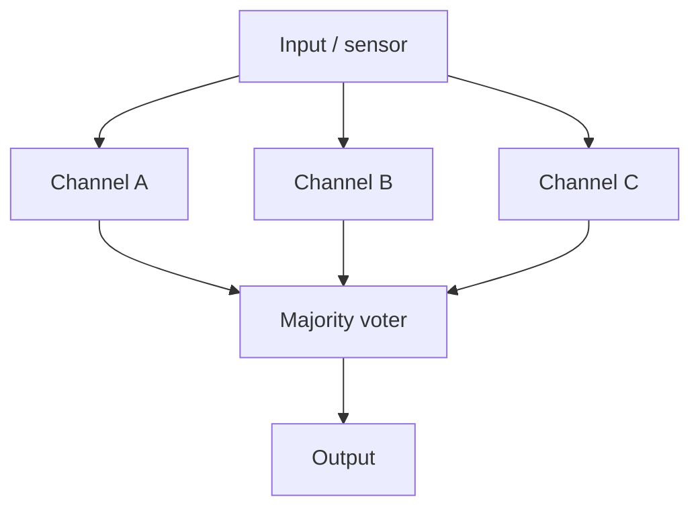

::: testing
Whether you understand redundancy as an **engineering trade-off** and not a slogan. The interviewer wants to hear: what it is (extra capability so one failure doesn't end the function), when it's worth paying for (safety, availability, unattended or unreachable systems), and *how* you build it (duplicate, vote, fail over), including the part most candidates skip: **redundancy needs failure detection, independence from common-cause faults, and a way to avoid the switch itself becoming the weak point.** Bonus signal: a quick reliability calculation and an honest statement of cost.
:::

::: why
Every product that can hurt someone or can't be reached after launch (aircraft, cars, pacemakers, satellites, data-centre power) uses redundancy. Consumer products usually don't, because the cost, size and power aren't worth it. Knowing where the line is, and what redundancy does and does not buy you, is core to system design. It also shows up at small scale: OR-ing two power inputs, a watchdog, dual sensors, a backup battery, ECC memory. Interviewers use it to see whether you think about **failure modes** at all. It pairs naturally with [[q0977]], which asks how constraints differ by industry, and with the design prompts in [[q0975]].
:::

::: concepts
- **Failure rate and reliability**: with constant failure rate $\lambda$, a part survives time $t$ with probability $R(t)=e^{-\lambda t}$. See the deep dive.
- **Series vs parallel reliability**: a chain of required parts is *less* reliable than any one part; parallel alternatives are *more* reliable.
- **Fault detection**: you cannot switch to the spare unless you know the primary failed.
- **Common-cause failure**: one event (power, heat, bug, lightning) that takes out all copies defeats redundancy.
- **Diodes and OR-ing**: how two power sources are safely combined. See [[q0073]] and [[q0079]].
- **Voting**: with three or more channels you can mask one wrong answer without knowing which one is wrong.
:::

::: answer
"Redundancy means having more than one way to do a critical function, so a single failure doesn't take the whole system down. You use it when the cost of failure is high, like safety-critical systems in cars, aircraft and medical devices, or when you can't get to the system to fix it, like a satellite, or when downtime is very expensive, like a server farm.

There are a few ways to build it. Active or parallel redundancy runs two or more units all the time. Standby redundancy keeps a spare ready and switches over when the main fails. For logic or sensors you can run three and vote, called triple modular redundancy, which masks one bad channel. At the circuit level an easy example is two power inputs combined with diodes or ideal-diode controllers, so either one can power the load.

The catches are important. You need a way to detect the failure, the switch or voter becomes a new single point of failure, and redundancy doesn't help if all copies fail for the same reason, like a shared power rail or identical software bug. So you'd add independence, such as different suppliers or even different designs, and you'd pay in cost, weight, power and complexity. If it isn't safety-critical or hard to reach, simpler and cheaper is usually the better engineering."
:::

::: technical
**Definition.** Redundancy is the deliberate addition of extra components, paths or information so that the system still performs its function after one or more failures.

**Reliability maths** (constant failure rate $\lambda$, independent failures, perfect switching):

- Single unit: $R_1(t)=e^{-\lambda t}$.
- Two in series (both needed): $R=e^{-2\lambda t}$, worse.
- Two in parallel (either works): $R_{2}=1-(1-R_1)^2$.
- Triple modular redundancy with a perfect voter (2-of-3): $R_{TMR}=3R_1^2-2R_1^3$.
- Cold standby with perfect switch: $R=e^{-\lambda t}(1+\lambda t)$.

For $\lambda=10^{-5}$ per hour and $t=1000$ h: $R_1=0.99005$, $R_2=0.99990$, $R_{TMR}=0.99970$. TMR is better than a single unit only while $R_1>0.5$: the crossover is at $t=\ln 2/\lambda\approx 69{,}300$ h in this example.

**Types.** *Hardware* (duplicate sensors, supplies, controllers), *information* (parity, ECC, CRC), *time* (retry, repeat computation), *software* (N-version, watchdog restart), and *analytical* (a model cross-checks a sensor).

**Active vs standby.** Active parallel has no switchover delay but both units age and draw power. Standby saves power, but needs a detector and a switch, and the spare might itself be dead (a latent fault) unless tested.

**Fail-safe vs fail-operational.** Two channels that disagree can *detect* a fault and go to a safe state (fail-safe). Three or more channels, or two with self-diagnosis, can keep running (fail-operational).

**Common-cause failure.** Model with a beta factor: a fraction $\beta$ of failures hit all channels. At $\lambda t=0.01$ and $\beta=5\%$ the dual-channel failure probability is about $5.9\times10^{-4}$, six times the independent-failure estimate of $10^{-4}$.

**Cost.** Extra BOM, board area, power, weight, test effort, plus the new failure modes of switches, comparators and diagnostics.
:::

::: short
"Redundancy means having more than one way to do a critical function so a single failure doesn't stop the system. I'd use it when failure is dangerous, expensive or can't be repaired, like aircraft, cars, medical devices and satellites. You can run parallel units, keep a standby, or use three-way voting. The catches are that you must detect failures, the switch can itself fail, and common-cause faults like a shared supply bypass it. It costs power, size and money, so I only use it where the risk justifies it."
:::

::: long
"Redundancy is adding extra capability so that a single failure doesn't take down the function. If I have one supply and it dies, I'm off. If I have two, I'm still on.

When is it preferred? When failure is unsafe, like brakes, flight control or an insulin pump. When you can't repair it, like a satellite. Or when downtime costs a lot, like a data centre or a telecom site. For a cheap consumer gadget it's usually not worth it, because you pay in cost, board area, power and complexity.

How do you design it? The basic styles are active parallel, where two units run at once; standby, where a spare takes over after the primary fails; and triple modular redundancy, where three channels compute the same thing and a voter picks the majority, so one wrong answer is masked. At the circuit level, the simplest example is two power sources each through a diode or ideal-diode controller into a common rail, so either can power the load, and neither can back-feed the other.

Then the important engineering is around it. You need fault detection, a monitor that notices a channel is wrong. You need to avoid single points of failure in the voter, the switch or the shared power. You need independence against common-cause failures: separate power, separate sensors, sometimes different suppliers or different software. And you need to test the spare, because a standby unit that's silently broken is worse than none.

A quick number: with a failure rate of one in a hundred thousand hours, a thousand hours gives about 99 percent survival for one unit, 99.99 percent for a dual-parallel pair."
:::

::: terms
- **Redundancy**: extra components or paths so the function survives a failure.
- **Single point of failure (SPOF)**: a part whose failure alone stops the system.
- **Active (parallel) redundancy**: all copies operate at once.
- **Standby (hot/cold) redundancy**: a spare waits and takes over on failure; hot is powered, cold is off.
- **TMR (triple modular redundancy)**: three copies and a majority voter that masks one fault.
- **Failover**: the switch from a failed unit to a spare.
- **Common-cause failure**: one root cause that disables multiple redundant channels at once.
- **Fail-safe / fail-operational**: go to a safe state on failure vs keep performing after failure.
- **MTBF, FIT**: mean time between failures; failures in time (failures per $10^9$ device-hours).
- **Latent fault**: a failure that is hidden until the spare is needed.
:::

::: exceptional
**An average answer** says "have a backup" and lists a few examples.

**An exceptional answer**:
- Distinguishes **active, standby and voting** and says what each costs.
- Gives a **number**: $R_{parallel}=1-(1-R)^2$ and a worked example, and mentions that TMR is worse than a single unit once the unit is likely to have failed.
- Raises **failure detection**, the **voter/switch as a new SPOF**, and **common-cause failures** before being asked.
- Gives a concrete hardware example: OR-ing two supplies, dual sensors with a comparator, watchdog plus independent reset, ECC.
- Talks about **independence** (separate supply, layout, supplier, software diversity).
- Closes with **when not to use it**: cost, weight, power, complexity (every extra part adds its own failure rate).
:::

::: mistakes
- **"Two is always more reliable than one."** Only if failures are independent and switchover works. A shared rail or common software bug defeats it, and complex failover logic can reduce net reliability.
- **Duplicating only the obvious part.** If the voter, power supply or connector is single, it is the weakest link.
- **Forgetting detection.** A standby that never gets tested can have failed months ago. Add self-test or periodic switching.
- **Confusing redundancy with fault tolerance by default.** Two channels detect disagreement but cannot tell which one is right; you need a third, self-checking, or a reference.
- **Ignoring added failure modes.** A diode OR-ing circuit adds leakage and drop; a relay failover adds contact failures.
- **Claiming TMR always beats a single unit.** With a perfect voter it is better only while $R_{single}>0.5$; with a real voter the voter's reliability matters.
:::

::: deep
## What redundancy is for

A single path from input to output has reliability equal to the product of every part in the chain. If any one of $n$ series parts fails, the function fails:

$$ R_{series} = \prod_i R_i $$

With 100 parts each at $R=0.9999$ over a mission, the chain is already $0.9999^{100}=0.990$. For a long mission or a high-consequence function, the only way to get significantly better is to **add alternative paths**. That is redundancy.

## Reliability math

With constant failure rate $\lambda$ per hour the reliability of one unit is $R_1(t)=e^{-\lambda t}$. The "bathtub curve" says that is only valid in the useful-life middle section (not infant mortality, not wear-out).

Take $\lambda = 10^{-5}$ per hour (MTBF 100,000 h, about 11.4 years) and a 1000-hour mission:

| Architecture | Formula | $R(1000\ \text{h})$ |
|---|---|---|
| Single | $e^{-\lambda t}$ | 0.99005 |
| Two parallel (either works) | $1-(1-R)^2$ | 0.99990 |
| TMR, perfect voter | $3R^2-2R^3$ | 0.99970 |
| Cold standby, perfect switch | $e^{-\lambda t}(1+\lambda t)$ | 0.99995 |

```plot
{"title":"Reliability vs time (λ = 10⁻⁵ per hour)","x":{"label":"mission time (thousands of hours)","unit":"","min":0,"max":200},"y":{"label":"R(t)","unit":"","min":0,"max":1.02},
 "vars":{"lam":0.01},
 "series":[
  {"label":"single","fn":"exp(-lam*x)","color":"muted"},
  {"label":"two parallel","fn":"1-pow(1-exp(-lam*x),2)","color":"accent"},
  {"label":"TMR (perfect voter)","fn":"3*exp(-2*lam*x)-2*exp(-3*lam*x)","color":"red","dashed":true}],
 "vlines":[{"at":"ln(2)/lam","label":"TMR = single (69.3k h)"}]}
```
Figure: the parallel pair is always above a single unit; TMR is better early but crosses below a single unit at $t=\ln 2/\lambda\approx 69{,}300$ h, because once the units are likely to have failed, needing two of three working is harder than needing one of one. TMR is for missions much shorter than the MTBF.

## Common-cause failures break the independence assumption

The tidy formulas assume failures are independent. In real systems a fraction $\beta$ of failures hits all channels at once: a shared power supply, the same temperature excursion, the same firmware bug, lightning, a common connector, a manufacturing batch fault. A standard first model:

$$ P_{fail,dual} \approx \big((1-\beta)\lambda t\big)^2 + \beta\lambda t $$

At $\lambda t = 0.01$ and $\beta=5\%$ this gives $(0.0095)^2 + 5\times10^{-4}\approx 5.9\times10^{-4}$. The independent-failure estimate would have been $10^{-4}$. The common-cause term dominates, so **the first step in making redundancy work is to reduce $\beta$**: independent power rails, physical separation, different component lots or suppliers, and for software, diversity or at least independent watchdogs. This is also why avionics and nuclear systems sometimes use dissimilar designs.

## Detecting failures: the part people forget

A redundant system must know a channel failed, and which one.

- **Two channels**: a comparator can tell they disagree but not which is wrong. Add self-diagnostics (range checks, plausibility, loop-back tests) or use a third.
- **Three channels (TMR)**: majority voting masks one fault and identifies the bad channel.
- **Diagnostic coverage**: the fraction of failures the system can detect. Automotive functional safety standards (ISO 26262) quantify this for safety mechanisms.
- **Latent faults**: a spare that fails silently is a trap. Test the spare, or alternate duty so both are exercised.
- **Watchdogs**: an independent timer resets the processor if the firmware stops servicing it. The watchdog itself should be independent of the thing it is watching.

## Hardware example: a redundant power input

The simplest circuit-level redundancy is OR-ing two supplies so either can feed the load.

```circuit
{"elements":[
 {"t":"V","a":[4,5],"b":[4,10],"label":"V_A","value":"5 V"},
 {"t":"V","a":[4,13],"b":[4,18],"label":"V_B","value":"5 V"},
 {"t":"gnd","at":[4,10]},
 {"t":"gnd","at":[4,18]},
 {"t":"wire","pts":[[4,5],[6,5]]},
 {"t":"wire","pts":[[4,13],[6,13]]},
 {"t":"Schottky","a":[6,5],"b":[11,5],"label":"D_1"},
 {"t":"Schottky","a":[6,13],"b":[11,13],"label":"D_2"},
 {"t":"wire","pts":[[11,5],[17,5]]},
 {"t":"wire","pts":[[11,13],[14,13],[14,5]]},
 {"t":"dot","at":[14,5]},
 {"t":"wire","pts":[[17,5],[17,7]]},
 {"t":"R","a":[17,7],"b":[17,13],"label":"Load","value":"2.5 Ω"},
 {"t":"gnd","at":[17,13]},
 {"t":"term","at":[20,5],"label":"V_{bus}","side":"right"},
 {"t":"wire","pts":[[17,5],[20,5]]},
 {"t":"dot","at":[17,5]}
]}
```
Figure: diode OR-ing. Whichever supply is higher conducts; the other diode is reverse-biased and prevents back-feeding. Notice the diodes themselves are now series elements in the power path.

Good: either supply can fail (even short to ground) and the other keeps the load alive, because the failed side's diode blocks. Bad: each diode drops about 0.3 to 0.5 V and dissipates $V_D I$, here about 0.8 W at 2 A with a 0.4 V drop. The fix is an **ideal-diode controller** with a MOSFET, which cuts the drop to $I\cdot R_{DS(on)}$ and blocks reverse current. See [[q0079]] for building an ideal diode. A single diode can also fail *short*, which defeats the isolation, so safety-critical designs sometimes use two in series or monitor reverse leakage.

## Architectures


Figure: triple modular redundancy. The voter masks any single wrong channel. Notice the voter and the input are single points of failure; real designs triplicate them too, or make them simple and very reliable.

| Style | How it works | Pros | Cons |
|---|---|---|---|
| Active parallel | Both run, outputs combined (OR-ing, load sharing) | Instant, no switchover | Both age, more power |
| Hot standby | Spare powered and tracking, takes over on detect | Fast failover | Power; needs detector and switch |
| Cold standby | Spare off until needed | Spare doesn't age or draw power | Slow failover; cold start may fail |
| TMR / voting | Three channels, majority vote | Masks a fault without detection | 3x cost; voter SPOF |
| Dual with self-check (lockstep) | Two cores run the same code, a comparator flags mismatch | Detects faults, fail-safe | Detects, doesn't mask |
| Information redundancy | Parity, ECC, CRC | Cheap | Covers data, not hardware |

Examples at the component level: ECC memory, dual-redundant flight computers, redundant brake circuits, dual temperature sensors in a battery pack ([[q0295]]), two independent over-voltage protections, and RAID in storage.

## When is it preferred?

Think in terms of **consequence × probability** and **repairability**:

1. **Safety-critical**: loss of function can hurt people (flight control, brakes, insulin pumps, ventilators).
2. **Unrepairable or hard to reach**: satellites, deep-sea or remote sensors.
3. **High cost of downtime**: servers, telecom, power grid, manufacturing lines.
4. **Regulatory**: some standards demand it for specific safety functions.

It's usually *not* preferred in cost- and size-driven consumer products, and it's counter-productive when the redundancy logic is so complicated that it introduces more failures than it prevents. Sometimes a simpler, more robust single design (derated components, better protection) beats a complicated redundant one. The comparison across industries is the subject of [[q0977]].

## Steps to design it

1. **Identify the critical function** and its failure consequence.
2. **Find single points of failure**: power, clock, connectors, sensors, software, the board.
3. **Choose the architecture** from the table based on required availability, switchover time and cost.
4. **Make channels independent**: separate supplies, layout, fusing, possibly dissimilar parts.
5. **Add detection and diagnostics**: comparators, watchdogs, built-in self-test.
6. **Define the safe state** and what each fault does (degrade, switch over, shut down).
7. **Analyse**: FMEA / fault-tree, then calculate reliability and common-cause factors.
8. **Test with fault injection**: unplug, short, kill a supply, hang the firmware, and verify it behaves as designed.

> [!INTERVIEW]
> After you describe the redundant design, volunteer the weakness yourself: "The voter is still a single point of failure and a shared supply would defeat it, so I'd separate those." Showing you attack your own design is what makes it believable.
:::

::: applications
- **Aircraft flight control computers**: multiple independent channels (often dissimilar) with voting and monitoring.
- **Automotive**: dual-channel brake and steering systems, redundant sensors for autonomous driving functions, with the redundancy level tied to the ASIL level ([[q0977]]).
- **Satellites**: redundant processors, cross-strapped units and radiation-tolerant memory with ECC.
- **Servers and data centres**: dual power supplies with OR-ing, N+1 cooling, RAID, UPS.
- **Medical**: patient-monitoring and infusion-pump alarms with independent hardware monitors.
- **Power rails**: OR-ing controllers (ideal diode) combining mains adapter and battery in laptops and PoE devices ([[q0974]]).
:::

::: assumptions
- Failure rates are treated as **constant** and failures as **independent** unless common-cause is discussed. Real parts show infant mortality and wear-out.
- Voters and switches are assumed **perfect** in the simple formulas. A real voter's reliability multiplies in; with a poor voter, TMR can be worse than one unit.
- The question is answered at **system level** with hardware examples; in software, redundancy also means N-version programming, checksums and restart supervisors.
- "Preferred" depends on the **risk acceptance of the industry**. A medical life-support device and a toy have different answers.
- Valid alternatives: instead of duplicating, **derate** components, add **protection** and design for **graceful degradation** (limp-home mode), which is often a cheaper way to meet an availability goal.
:::

::: followups
### What's the difference between redundancy and fault tolerance?
Redundancy is the means (extra parts or paths). Fault tolerance is the property you want: the system keeps delivering correct service despite faults. You can have redundancy without fault tolerance, for example two channels that disagree with nothing to decide, or a standby with no failover detection.

### Why is TMR worse than a single unit in some cases?
With a perfect voter, TMR needs 2 of 3 channels working, $R=3R_1^2-2R_1^3$. That is above $R_1$ only when $R_1>0.5$. For long missions where each unit is likely to have failed, two out of three working is *less* likely than one working. At the crossover $R_1=0.5$, both equal 0.5. Also a real voter adds its own failure probability.

### How would you make a dual power input safe if one supply shorts?
Use OR-ing diodes or ideal-diode controllers so the shorted supply's path is blocked; add a fuse or current limit on each input so a short doesn't take down the common rail; and monitor each input so you know one has failed. For high reliability, make the diode's failure mode benign (reverse-leak detection or two in series) and size each source to carry the full load alone.

### Your two redundant sensors disagree. What does the system do?
Two sensors can detect disagreement but not which one is wrong. Use plausibility checks (rate of change, range, comparison to a model or a third source), choose a safe default for the application (for example a brake system goes to a safe state), flag a fault, and, if the function is critical, add a third sensor to vote.

### Scenario: a satellite designer asks to add a second processor. What do you ask?
What is the failure rate of the processor, mission length, whether it is repairable (no), what failures matter (radiation upsets vs hardware death), power and mass budget, and how switchover would be detected. Probably a cold spare for hardware death, and ECC plus lockstep or voting for single-event upsets. I'd check that the switchover logic and power control are not single points of failure and test the failover on the ground.
:::

::: interpretations
"System with redundancy" can be asked at three levels: **electrical** (dual power, diode OR-ing), **architectural** (dual controllers, TMR) or **software/data** (ECC, checksums, replicas). A good answer picks one for depth and mentions the others. Some interviewers also use "redundancy" in the sense of **redundant information or logic** (extra gates that mask hazards), which is related but not the main meaning here.
:::

::: references
- Pradhan (ed.), *Fault-Tolerant Computer System Design*: redundancy types, voting and reliability modelling (topic level).
- Lala, *Self-Checking and Fault-Tolerant Digital Design*: TMR, self-checking logic and common-mode failures.
- ISO 26262, *Road vehicles: Functional safety* (by name): diagnostic coverage, safety mechanisms and ASIL decomposition.
- Horowitz & Hill, *The Art of Electronics*, 3rd ed.: power-supply OR-ing and protection topics.
- Billinton & Allan, *Reliability Evaluation of Engineering Systems*: series/parallel and standby models.
:::

::: rubric
- Defines redundancy as extra paths/components so a single failure doesn't stop the function :: The question starts with "What is redundancy", so the definition must be crisp.
- Names when it is preferred: safety-critical, unrepairable, high downtime cost, regulation :: Shows you weigh cost against consequence rather than always adding redundancy.
- Describes at least two architectures (active/standby/TMR/OR-ing) with trade-offs :: The question asks how to design it; one style isn't enough.
- Gives or uses the reliability formula (parallel $1-(1-R)^2$, TMR) or a numerical example :: Engineers back claims with numbers.
- Raises failure detection, voter/switch as SPOF and latent faults :: Redundancy without detection often fails when needed.
- Identifies common-cause failures and independence measures :: This is the main way redundancy fails in real systems.
- States the costs and when not to use it :: Demonstrates trade-off thinking.
:::

::: quiz
```json
[
 {"type":"mcq","level":"fundamental","q":"What is the main purpose of redundancy?","options":["To make a product cheaper","To keep a function working after a single failure","To increase the speed of the system","To reduce the number of components"],"answer":1,"explain":"Redundancy adds alternative paths so one failure doesn't stop the function. It costs more parts, power and complexity, so it is a reliability trade."},
 {"type":"numeric","level":"fundamental","q":"Two identical units in parallel each have survival probability 0.99 over a mission. What is the probability that at least one survives (independent failures, perfect switching)?","answer":0.9999,"tolerance":0.0001,"unit":"","explain":"$R=1-(1-0.99)^2 = 1-0.0001 = 0.9999$."},
 {"type":"numeric","level":"intermediate","q":"A TMR system with a perfect voter uses three units each with reliability 0.99. What is the system reliability?","answer":0.999702,"tolerance":0.00005,"unit":"","explain":"$R=3R^2-2R^3 = 3(0.9801)-2(0.970299) = 2.9403-1.940598=0.999702$."},
 {"type":"mcq","level":"intermediate","q":"Two redundant sensors disagree by a large amount. What can you conclude without additional information?","options":["Sensor A is wrong","Sensor B is wrong","At least one is wrong, but not which","Both are right"],"answer":2,"explain":"Two channels can detect disagreement but cannot identify the faulty one. You need plausibility checks, a third channel for voting, or a reference."},
 {"type":"truefalse","level":"advanced","q":"With a perfect voter, TMR is more reliable than a single unit for every value of single-unit reliability.","answer":false,"explain":"$R_{TMR}=3R^2-2R^3$ is greater than $R$ only when $R>0.5$. Below that, needing two of three working is harder than one of one."},
 {"type":"multi","level":"advanced","q":"Which of these are common-cause failure risks for two redundant controllers? Select all that apply.","options":["Both powered from the same regulator","Identical firmware with the same bug","Controllers on separate supplies in separate enclosures","Both on the same board next to one hot component"],"answer":[0,1,3],"explain":"Shared supply, identical software and shared thermal environment can take out both channels together. Separate supplies and enclosures reduce the common-cause fraction."}
]
```
:::
