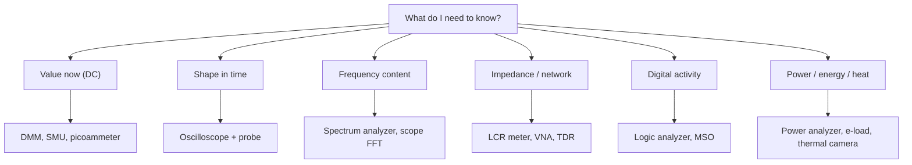

::: testing
Whether you can **match a quantity to an instrument** and explain the trade-off, rather than reciting a list of lab gear. The question is deliberately open: the best answers organize the toolbox by *what you are measuring* (DC level, waveform, frequency content, impedance, power, digital protocol, temperature) and by *accuracy vs speed vs bandwidth*. The interviewer is also checking practical habits: you know instruments load the circuit, you think about probes and grounding, and you know the limits (resolution, bandwidth, accuracy) of each tool.
:::

::: why
Debug and validation are most of a hardware engineer's job, and every debug session starts with "what should I measure this with?" A person who reaches for a scope to check a 3.3 V rail's absolute value, or a DMM to look at a 10 ns edge, wastes hours or draws wrong conclusions. Knowing the instrument menu also makes you a better designer: you add test points, current-sense options and calibration hooks because you know how the board will be measured. This page is the overview; the next questions ([[q0979]] familiarity, [[q0980]] bandwidth and sample rate, [[q0981]] how to measure a signal, [[q0982]] current, [[q0985]] R/L/C) drill into the main tools.
:::

::: concepts
- **Quantity and domain**: time domain (voltage vs time), frequency domain (spectrum, S-parameters), DC/static values, and digital state each need different tools.
- **Accuracy, resolution, bandwidth**: three different numbers. A DMM is accurate but slow; a scope is fast but less accurate. See [[q0983]].
- **Loading and invasiveness**: every instrument has input impedance and burden that changes the circuit. See [[q0986]].
- **Probes and connections**: the probe and grounding are part of the instrument. See [[q0990]].
- **Calibration and traceability**: a measurement is only as good as the reference behind it.
- **Sensing versus instrumenting**: sometimes the right tool is firmware plus an ADC on the board itself ([[q0808]]).
:::

::: answer
"I'd organize it by what I need to know.

For DC voltage, current and resistance with good accuracy, a digital multimeter. For how a signal changes in time, an oscilloscope with the right probe, whether that's rail ripple, a switching edge or a bus. For the frequency content of a signal, a spectrum analyzer, or the FFT on a scope for a quick look. For impedance and component values, an LCR meter or impedance analyzer, and at RF a vector network analyzer, which gives S-parameters like return loss and gain. For power electronics, a current probe or a shunt, an electronic load, and a power analyzer for efficiency. For digital buses, a logic analyzer or protocol decoder on a scope. For sourcing and measuring at once, like characterizing a diode or battery, a source-measure unit. And then temperature with thermocouples or a thermal camera.

Beyond that, the practical part is picking the tool with enough bandwidth and accuracy, not loading the circuit, and using a proper probe and ground connection. Often the cheapest tool is the board itself: test points, a sense resistor and an ADC readout in firmware. So the first thing I ask is: what quantity, how fast does it change, how accurately do I need it, and how much can I disturb the circuit?"
:::

::: technical
**Selection by quantity.**

| Quantity | Primary tool | Typical strengths and limits |
|---|---|---|
| DC/low-frequency V, I, R | Digital multimeter (DMM) | High accuracy (bench 6½-digit meters are in the 10 ppm range for DC volts on good ranges; handhelds around 0.1 to 1 %), slow, ~10 MΩ input |
| Waveform vs time | Oscilloscope | Bandwidth from tens of MHz to tens of GHz, 8–12 bit vertical resolution, a few % amplitude accuracy |
| Spectrum (power vs frequency) | Spectrum analyzer / scope FFT | Wide dynamic range, shows harmonics, spurs, EMI |
| Impedance, L, C, R | LCR meter, impedance analyzer | Test frequency and level selectable, gives $|Z|$, phase, $D$, $Q$ |
| RF gain, return loss, filters | Vector network analyzer (VNA) | S-parameters, calibrated reference planes, high dynamic range |
| Digital signals | Logic analyzer, protocol analyzer, MSO | Many channels, decode I²C/SPI/UART, limited analog fidelity |
| Source and measure | Source-measure unit (SMU), bench supply | V or I forced with precise readback, four quadrants for SMU |
| Power conversion | Power analyzer, electronic load, current probe | True power, efficiency, transient load steps |
| Current | Shunt + DMM or scope, current probe, clamp | See [[q0982]] |
| Temperature | Thermocouple/RTD meter, thermal camera, on-chip sensor | Contact vs non-contact, emissivity issues |
| Timing | Frequency counter, time-interval analyzer | Very high resolution on frequency and period |
| Reflections/impedance along a line | TDR (time-domain reflectometer) or VNA with time-domain mode | Locate impedance discontinuities |
| Very small currents/high resistance | Electrometer, picoammeter | fA–pA, guarded inputs |

**Choosing the instrument.** Ask four things: (1) what quantity and range; (2) how fast it changes (the signal's rise time sets the bandwidth, see [[q0980]]); (3) how accurately; (4) how much loading the circuit tolerates. Then check the instrument's input impedance and probe against the circuit's source impedance.

**Always remember**: the instrument has a specification for accuracy, resolution, bandwidth and noise floor, and the *probe and connection* often limit the result more than the instrument does.
:::

::: short
"I choose by quantity. A multimeter for accurate DC voltage, current and resistance. An oscilloscope for waveforms, edges and ripple. A spectrum analyzer or scope FFT for frequency content. An LCR meter or VNA for impedance and RF behavior. A logic analyzer for digital buses, an SMU or power supply with readback for source-and-measure, a power analyzer and electronic load for power electronics, and thermocouples or a thermal camera for temperature. Then I check bandwidth, accuracy and loading, and use a proper probe and ground."
:::

::: long
"I'd start with what I'm trying to learn, because that picks the tool.

If I need an accurate DC voltage, resistance or current, a digital multimeter: high accuracy, good resolution, slow, and about 10 megohms input so it barely loads most circuits. If I need to see how something changes in time, like ripple on a rail, a switching edge, or a serial bus, an oscilloscope, and I'd choose the bandwidth and probe for the fastest edge I care about.

If the question is frequency content, a spectrum analyzer is the right tool, or the FFT on a scope for a rough look; that's how I'd look at harmonics, clock spurs or EMI. For component values, an LCR meter gives me resistance, capacitance and inductance at a chosen frequency and test level, and for RF networks like filters and antennas, a vector network analyzer measures S-parameters, so gain and return loss against frequency.

For digital systems, a logic analyzer or a scope with protocol decode gives me many channels and timing. For power electronics, I'd add a current probe or a shunt, an electronic load for step responses, and a power analyzer to compute efficiency. When I need to force a voltage or current and measure precisely, like characterizing a diode or a battery, a source-measure unit. And for temperature, a thermocouple or a thermal camera.

Underneath all that, I'm checking the same things: is the bandwidth and accuracy enough, am I loading the circuit, and are my probe and ground connection good enough to trust the answer? And sometimes the best tool is just a test point and an ADC reading in firmware."
:::

::: terms
- **Accuracy**: how close a reading is to the true value, including offset and gain errors.
- **Resolution**: the smallest change the instrument can display or digitize (counts, bits).
- **Bandwidth**: the highest frequency the instrument passes with less than 3 dB error. See [[q0132]].
- **Input impedance**: the resistance and capacitance the instrument presents to the circuit; sets loading.
- **Burden voltage**: the voltage an ammeter drops in series with the circuit.
- **S-parameters**: reflection and transmission coefficients measured by a VNA.
- **SMU (source-measure unit)**: an instrument that sources voltage or current and measures the other.
- **Traceability**: a documented chain of calibration to a standard.
:::

::: exceptional
**An average answer** lists "multimeter, oscilloscope, function generator, power supply".

**An exceptional answer**:
- **Organizes by quantity and domain** (DC value, time waveform, frequency content, impedance, digital state, power, temperature) so the list has logic.
- Says **which one for which job and why not the others** (a DMM can't see a 10 ns glitch; a scope can't resolve 0.01 % DC).
- Names the three specs (accuracy, resolution, bandwidth) and **loading**.
- Mentions **probes and grounding** as part of the measurement.
- Adds **non-bench** tools: on-board sensing, test points, thermal cameras, firmware logging.
- Ties it to a quick example, like debugging a buck converter: DMM for output, scope for ripple and switch node, current probe for inductor current, power analyzer for efficiency.
:::

::: mistakes
- **Using the wrong tool for the signal.** A DMM averages and is slow; a scope has limited absolute accuracy. Use each in its strength.
- **Ignoring loading.** A 1 MΩ probe on a high-impedance node, or a DMM current range with a large burden voltage, can change the circuit.
- **Trusting the number without checking bandwidth.** A 100 MHz scope shows a 1 ns edge as roughly 3.6 ns and under-reports the height of narrow pulses. See [[q0980]].
- **Forgetting the probe is a circuit.** A long ground lead rings with probe capacitance and shows fake overshoot.
- **Quoting resolution as accuracy.** A 6½-digit display can still be off by hundreds of ppm if uncalibrated or the range is wrong.
- **Not considering safety.** Floating measurements with a grounded scope can short a circuit; mains and high voltages need rated probes and isolation.
:::

::: deep
## A map of the toolbox

Group instruments by the question they answer:


Figure: choose the instrument by the question. Notice that the same circuit may need four of these in one debug session.

### Time domain vs frequency domain

A scope shows voltage versus time, so you see shape, timing, glitches and edges. A spectrum analyzer shows power versus frequency, so you see harmonics, noise floors and interference far smaller than a scope could resolve. Mathematically they carry the same information, but the instruments are optimized for different things: a spectrum analyzer's swept receiver gives large dynamic range (often 80 to 100+ dB); a scope's ADC has 8 bits (about 48 dB nominal) in the time domain. A scope's FFT is handy but limited.

### Accuracy vs bandwidth

There is a rough trade-off: instruments built for accuracy are slow, and fast ones are less accurate. A 6½-digit bench DMM measures DC voltage to a few ppm to tens of ppm of reading plus range, at a few readings per second to thousands per second at reduced resolution. A 1 GHz scope with an 8-bit ADC has a DC gain accuracy on the order of a percent or two of full scale (check the datasheet), but resolves nanosecond features. This is the entire reason both exist ([[q0989]]).

> [!UNCERTAIN]
> Accuracy figures vary widely by model and price tier, and by range and temperature. Treat the numbers here as typical orders of magnitude, and always read the specification table of the actual instrument.

### Instruments load and disturb the circuit

Think of the instrument as a circuit element added to yours. Voltmeters add an input resistance (DMM ~10 MΩ, scope 1 MΩ || ~10 to 20 pF direct, about 10 MΩ || ~10 pF with a 10× probe); ammeters add series resistance (burden); probes add capacitance and inductance. For a source of Thévenin resistance $R_s$ measured by an input resistance $R_{in}$, the reading error is $R_s/(R_s+R_{in})$: a 1 MΩ source into a 10 MΩ meter reads 9.1 % low. The DMM simulation in [[q0986]] lets you try that.

### Calibration, accuracy and precision

A measurement has **bias** (systematic offset or gain error that calibration removes) and **scatter** (random noise that averaging reduces). Try it:

```sim
{"id":"sensor-calibration","offset":0.2,"gain":1.05,"nonlin":0.02,"noise":0.05}
```
Figure: take calibration points and fit a correction. Watch bias shrink with a 2-point fit, and scatter shrink with averaging; those are two separate fixes for two separate problems.

### A worked debug example: a buck converter

You suspect a 12 V to 3.3 V buck is noisy and inefficient. A sensible measurement plan:

1. **DMM** on $V_{out}$ for DC accuracy, check 3.30 V ±1 %.
2. **Scope**, 20 MHz bandwidth limit off for the switch node, with a short ground spring, to see ripple and ringing (the switch-node edge may be a few ns).
3. **Current probe** on the inductor to see the triangular ripple and peak current vs saturation.
4. **Electronic load** to step the output and **scope** to look at the transient response.
5. **Power analyzer** or two DMMs and a shunt to compute efficiency at several loads.
6. **Spectrum analyzer** or near-field probe for EMI hot spots.

Six tools, one converter; the point of the exercise is to match each tool to a different question.

### Reading an instrument specification

Every instrument's datasheet answers the same few questions, and knowing them lets you judge any tool, including one you have never touched:

- **Range and resolution.** A 60,000-count DMM (often sold as 4¾ digits) shows 0.1 mV per count on its 6 V range; the scope's 8-bit ADC divides its full screen (8 or 10 divisions) into 256 levels, so at 1 V/div over 8 divisions each level is 31 mV, while at 10 mV/div it is 0.31 mV. Resolution therefore depends on the vertical scale you pick, and a tiny ripple on a big DC level is best seen by AC coupling and zooming in.
- **Accuracy.** Quoted as ±(% of reading + % of range) or plus a number of counts, usually valid for a year after calibration and a stated temperature band. The "% of range" term dominates when you read a small value on a big range, so pick the lowest range that fits.
- **Bandwidth and rise time.** The −3 dB point, and the instrument's own rise time of about $0.35/BW$. A 100 MHz scope has about a 3.5 ns rise time and will smear a 1 ns edge.
- **Input impedance.** Resistance and capacitance at the input, which together with the probe set the loading.
- **Noise floor.** The smallest signal the instrument can distinguish, from the front-end noise (RMS volts on a scope, dBm on a spectrum analyzer).
- **Memory depth and update rate.** How long you can capture at a given sample rate, and how often a scope re-arms; a low update rate can miss rare glitches.

A good habit: before trusting a number, state which of these specs limits it.

### Beyond the bench

Many systems are measured by themselves. A sense resistor plus an ADC gives battery current logging; a thermistor on the board gives temperature; firmware counters give timing. For manufacturing, test points and boundary-scan or flying-probe testers measure boards at scale ([[q0611]]). In the field, built-in self-test and telemetry take over.

### Safety

Mains-referenced measurements need an isolated scope or a differential probe. Many scopes' ground clip is earth-grounded via the power cord, so clipping it to a live node shorts it. DMMs have CAT ratings (e.g., CAT III/IV) describing the transient energy they can safely withstand. Use rated instruments and probes for the environment.
:::

::: applications
- **Bring-up of a new board**: DMM for rails and shorts, scope for clocks, resets and power-up sequencing.
- **Switching converter characterization**: scope, current probe, electronic load, power analyzer.
- **Filter or antenna tuning**: VNA for S11/S21.
- **Component incoming inspection**: LCR meter for capacitors and inductors, DMM for resistors.
- **Battery characterization**: SMU or programmable supply and load with precise current and voltage readback ([[q0291]]).
- **Serial-bus debug**: logic analyzer or scope with I²C/SPI decode.
:::

::: assumptions
- Assumes a **typical electronics bench** (DMM, scope, supply, function generator) plus common specialty tools. A well-funded lab adds spectrum analyzers, VNAs, SMUs and power analyzers.
- Accuracy and bandwidth numbers are **typical** and vary across price tiers.
- The answer changes by field: a power engineer emphasizes current probes, electronic loads and power analyzers; an RF engineer, spectrum analyzers and VNAs; a digital engineer, logic analyzers and high-speed scopes with jitter analysis.
- For **very small signals** (nA, µV) or very high resistance, special techniques (guarding, shielding, lock-in amplifiers) become necessary.
:::

::: followups
### How do you decide between a scope and a DMM for measuring a DC rail?
A DMM for the DC value, because it's more accurate and has higher resolution. A scope for what the rail *does*: ripple, droop under load, power-up behavior. For a 3.3 V rail I'd typically use both: DMM to confirm 3.3 V, scope to confirm the ripple is within spec. See [[q0989]].

### What can go wrong when you measure a high-impedance node with a scope probe?
The probe loads it. A 10× probe presents about 10 MΩ in parallel with ~10 pF, which can disturb a node with kΩ-MΩ source impedance and tens of pF of capacitance, slowing edges and shifting bias. For very sensitive nodes use an active (FET) probe with sub-pF input capacitance, or buffer the node.

### What instrument would you use to find where an impedance mismatch is on a cable or PCB trace?
A time-domain reflectometer (TDR), or a VNA with a time-domain transform. A TDR sends a fast step and shows reflections versus time, so a discontinuity's distance and sign (higher or lower impedance) can be read directly. See [[q0711]].

### How would you measure the efficiency of a power supply accurately?
Measure input and output voltage and current simultaneously with a power analyzer or calibrated DMMs and shunts, averaging for ripple. Efficiency is $P_{out}/P_{in}$. Make sure to measure voltage at the converter terminals (Kelvin sensing) to avoid drops in leads, and measure at several loads because efficiency varies with load.

### Scenario: your DMM says 3.30 V on a rail, but the system resets randomly. What do you measure next?
A DMM averages, so it can't see brief droops. Put a scope on the rail with a proper probe, trigger on a dip below the brown-out threshold, and watch during load transients. Also look at the reset line to correlate. Then use a current probe to see what load step causes the droop and check decoupling and regulator transient response.
:::

::: interpretations
"What tools can you use to measure stuff?" is intentionally broad. Treat it as "which instruments do you know and when do you use each", then show organization. It could also mean **transducers** (thermocouples, strain gauges, Hall sensors), which are covered by the sensor questions ([[q0841]]). A good answer says "I'll focus on bench instruments, and I can also talk about sensors if you'd like."
:::

::: references
- Horowitz & Hill, *The Art of Electronics*, 3rd ed.: the chapter on measurement and test instruments and the sections on probes and noise.
- Keysight, Tektronix and Rohde & Schwarz educational primers on oscilloscope fundamentals, spectrum analysis and VNAs (manufacturer application-note libraries, by topic).
- Keithley, *Low Level Measurements Handbook*: small-current/high-resistance measurement techniques.
- Bentley, *Principles of Measurement Systems*: accuracy, resolution, loading and calibration concepts.
:::

::: rubric
- Organizes tools by what is measured (DC, time domain, frequency domain, impedance, digital, power, temperature) :: A structured answer shows you can choose rather than recall.
- Names the DMM, oscilloscope and spectrum analyzer with a one-line use case each :: These are the core tools every candidate should handle.
- Includes impedance/RF tools (LCR meter, VNA) and digital tools (logic analyzer) :: Covers the rest of the question's scope.
- Mentions SMU/power supplies/e-loads/power analyzers for power work :: Hardware interviews are often power-centric.
- States the selection criteria: bandwidth, accuracy, resolution, loading :: Shows engineering judgment about the tool's limits.
- Brings up probes, grounding and loading as part of the measurement :: This is the practical insight that separates experienced from textbook answers.
- Gives an example of using several tools on one problem :: Demonstrates a debug workflow.
:::

::: quiz
```json
[
 {"type":"mcq","level":"fundamental","q":"Which instrument is best for checking the absolute DC value of a 3.3 V rail to within 0.1 %?","options":["A 100 MHz oscilloscope","A digital multimeter","A logic analyzer","A spectrum analyzer"],"answer":1,"explain":"A DMM offers much better DC accuracy and resolution than a scope's 8-bit ADC. The scope is better for ripple and transients."},
 {"type":"mcq","level":"fundamental","q":"You need the S-parameters (return loss and insertion loss) of an RF filter. Which tool?","options":["Digital multimeter","Vector network analyzer","Electronic load","Thermal camera"],"answer":1,"explain":"A VNA measures complex reflection and transmission coefficients versus frequency, which is what S-parameters are."},
 {"type":"numeric","level":"intermediate","q":"A 1 MΩ Thevenin source is measured with a DMM of 10 MΩ input resistance. By what percentage does the reading fall below the true open-circuit voltage?","answer":9.09,"tolerance":0.02,"unit":"%","explain":"The reading is $V\\cdot\\frac{10}{10+1}=0.909V$, so it is 9.09 % low."},
 {"type":"multi","level":"intermediate","q":"Which of these can distort a measurement by loading the circuit? Select all that apply.","options":["Scope probe input capacitance","Ammeter burden voltage","DMM input resistance on a high-impedance node","The color of the test lead"],"answer":[0,1,2],"explain":"Probe capacitance, burden voltage and input resistance all change the circuit. Lead color is irrelevant."},
 {"type":"mcq","level":"advanced","q":"A rail reads a steady 3.30 V on a DMM but the system resets sporadically. Best next step?","options":["Replace the DMM","Look at the rail on a scope with a trigger set below the brown-out threshold","Measure resistance of the rail","Assume the firmware is wrong"],"answer":1,"explain":"A DMM averages and is too slow to see brief droops. A scope triggered on a dip shows transient behavior that causes resets."},
 {"type":"truefalse","level":"advanced","q":"A 6½-digit display guarantees 6½-digit accuracy.","answer":false,"explain":"Digits describe resolution. Accuracy depends on calibration, range, temperature and the specification (percent of reading plus percent of range). A meter can display many digits and still be off by hundreds of ppm."}
]
```
:::
