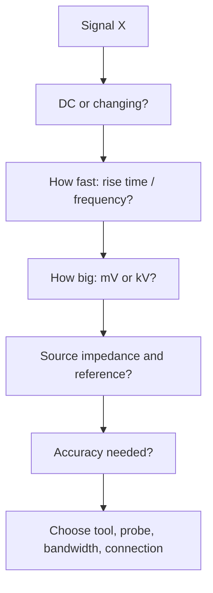

::: basics
### In plain words
"How would you measure this signal?" has no answer until you know what the signal is. So the first move is to ask: is it steady or changing, how big, how fast, and is it tied to ground or floating? Then you pick the instrument, the probe and the connection to match, and finally you check that the setup itself is not fooling you.

### Picture it
A doctor does not order the same test for every patient. She first asks where it hurts, how long, and how bad. Measuring works the same way: a steady rail, a fast edge and a mains-voltage node each need a different tool. One difference: a bad probe can also change the circuit you are measuring.

### Words you need
- **Probe**: the lead or tip that connects the instrument to the circuit.
- **Loading**: the instrument drawing current or adding capacitance, so the circuit behaves differently than it would unmeasured.
- **Reference (ground)**: the point a voltage is measured against. A scope's ground clip is wired to the building's earth (safety ground).
- **AC coupling**: blocking the steady DC part so you can zoom in on small wiggles.
- **Bandwidth**: the fastest signal the instrument can follow. See [[q0980]].

### The simplest example
Suppose X is a 3.3 V supply rail. Ask: what do I want to know? For the exact steady voltage, use a multimeter: it reads 3.30 V.

For ripple, the small wiggle on top, use a scope. With 20 mV of ripple on 3.3 V, turn on AC coupling so the 3.3 V is blocked. Then set a sensitive scale such as 5 mV per division (per grid square). Connect the probe's ground close to the measurement point.

Finally, check the setup. Touch the probe tip to ground and see how much noise remains. That noise belongs to the setup, not the circuit.

That is the whole idea. The rest of this page adds fast edges, floating and high-voltage signals, and the numbers behind probe loading.
:::

::: testing
Whether you can run a **measurement plan** for an unspecified signal. "How should I measure X?" has no answer until you ask what X is, so the interviewer wants the questions: DC or AC, how big, how fast, what impedance, referenced to what, floating or grounded, how accurately, and how much can I disturb it? Then a choice of instrument, probe and connection, and a way to check that the measurement itself is trustworthy. Hidden sub-skills: loading, bandwidth, grounding, isolation and safety, and knowing the tool's limits.
:::

::: why
Most wrong conclusions in a lab come from the measurement setup, not the circuit: a long ground lead creates ringing that isn't there, a DMM can't see the glitch that resets the processor, a 1× probe loads a sensitive node, or a grounded scope shorts a floating supply. Being deliberate about *how* to measure is what separates a quick, correct debug from a long wrong one. Interviewers use this open question because the answer reveals how you think about measurement, and the follow-ups come from the specific signal they have in mind. The overview of tools is [[q0978]]; the bandwidth sizing is [[q0980]]; current is [[q0982]].
:::

::: concepts
- **Quantity and domain**: DC level, AC amplitude, waveform shape, frequency, timing, power, impedance. See [[q0978]].
- **Bandwidth and sample rate**: sized from the signal's rise time or frequency. See [[q0980]].
- **Loading**: the measurement path's input resistance and capacitance change the circuit. See [[q0990]].
- **Reference and grounding**: scope grounds are earth-connected; floating nodes need differential or isolated measurement. See [[q0629]].
- **Signal level and noise**: gain, averaging, shielding and coupling choices to resolve small signals.
- **Safety**: voltage category, isolation and creepage when measuring above a few tens of volts.
:::

::: answer
"I'd start by asking what the signal is, because the right method depends on a handful of things: is it DC or AC, how big is it, how fast are the edges, how high is the source impedance, is it referenced to ground or floating, and how accurate do I need to be.

Then I match the tool. A steady DC value, like a rail, I'd check with a DMM. A time-varying signal like ripple, a clock or a switching node, I'd use a scope, sizing the bandwidth from the rise time, about 5 times the signal bandwidth, and using a 10x probe with a short ground spring rather than the long ground clip. For a high-impedance node I'd use an active probe so I don't load it. For a floating or high-voltage node, like a high-side switch or anything near mains, a differential probe or isolated scope, not just a grounded probe. For a tiny signal, microvolts, I'd use gain, averaging and shielding. For frequency content I'd use an FFT or spectrum analyzer, for a digital bus a logic analyzer or protocol decode, for RF a spectrum analyzer or VNA.

Then I check the measurement itself: probe compensation, correct coupling, bandwidth limit, and cross-check against another method. If the result surprises me, I suspect the setup first."
:::

::: technical
**Clarify.** Signal type (DC/AC/pulse/RF/digital), amplitude range, frequency or rise time, source impedance, reference (grounded vs floating), required accuracy, one-shot vs repetitive, safety level.

**Select instrument and settings.**

| Signal | Tool | Key choices |
|---|---|---|
| Steady DC level | DMM (or SMU) | Range, 4-wire for low R, NPLC for noise |
| Rail ripple, tens of mV | Scope, direct coax or 10× probe | AC coupling, 20 MHz limit to isolate ripple, spring ground, ≥ 1 mV/div resolution |
| Fast edges, switch node | Scope with BW ≥ 1.05 to 1.75 /$t_r$ | Spring-tip ground, 10× passive or active probe |
| High-impedance node | Active FET probe or buffer | Input C below 1 pF |
| Floating or high-voltage signal | Differential probe or isolated scope | Check CMRR, voltage rating |
| Microvolt signal | Low-noise preamp, averaging, lock-in | Shielding, bandwidth limit |
| Clock jitter/phase noise | High-BW scope with jitter analysis, phase-noise analyzer | 50 Ω terminated path |
| Digital protocol | Logic analyzer or scope decode | Threshold, sample rate |
| RF power/spectrum | Spectrum analyzer, power meter | Input attenuation, RBW |
| Impedance of a network | VNA, LCR meter | Calibration |

**Loading numbers.** A 10× probe presents ≈ 10 MΩ || ~10 pF at the tip. At 100 MHz, 10 pF is $1/(2\pi\cdot10^8\cdot10^{-11})=159\ \Omega$, so on a 50 Ω source it matters noticeably; use an active probe or a 50 Ω path for GHz work.

**Grounding.** A 15 cm ground lead is roughly 100 to 150 nH; with 10 pF it rings at $1/(2\pi\sqrt{LC})\approx130$ MHz. A short spring tip (about 10 nH) pushes that to about 500 MHz.

**Verify the measurement.** Compensate the probe, check the scope's bandwidth setting, confirm with a second instrument or a known reference, and change the setup (probe point, ground) to see if the signal changes.
:::

::: short
"I'd first ask what the signal is: DC or AC, amplitude, speed, source impedance, grounded or floating, and required accuracy. Then I pick the tool: DMM for steady DC, scope for waveforms with bandwidth from the rise time and a 10x probe with a short ground, active probe for high-impedance nodes, differential or isolated probe for floating or high voltage, spectrum analyzer for frequency content. Then I sanity-check the setup, because probes, grounding and loading cause most wrong readings."
:::

::: long
"I'd begin with questions, because X could be anything. Is it DC or AC? How big? How fast are the edges? What's the source impedance? Is it referenced to ground or floating? How accurate do I need it, and is it a one-off or repetitive?

Then I pick the tool and the connection. For a steady DC level I use a DMM, which is accurate and has about a 10 megohm input. For something that changes in time, like ripple, a clock or a switching node, I use a scope. I size the bandwidth from the rise time, around five times the signal's bandwidth, and I use a 10x probe with a short ground spring, because a long ground lead adds inductance that rings with the probe capacitance and fakes overshoot. For a rail with a few tens of millivolts of ripple, I'd use AC coupling and a small volts per division so the 8-bit scope has resolution.

If the node is high impedance, a passive probe loads it, so an active FET probe. If the node is floating or high voltage, like a high-side gate drive or anything near mains, I'd use a differential probe or an isolated scope, never just clip a grounded probe on it. For microvolt signals I'd add a low-noise preamp, averaging and shielding. For frequency content I'd use an FFT or a spectrum analyzer; for a digital bus a logic analyzer; for RF a spectrum analyzer or VNA.

Finally I question the measurement: is the probe compensated, is the bandwidth limit on, does the reading change when I move the ground? If a result surprises me, the setup is the first suspect."
:::

::: terms
- **Loading**: the change in the circuit caused by the instrument's input resistance and capacitance.
- **Reference / ground**: the node a measurement is taken relative to; scope grounds are tied to earth.
- **Differential measurement**: measuring the voltage between two nodes neither of which is ground.
- **Common-mode rejection (CMRR)**: ability of a differential probe to reject voltage common to both inputs.
- **Bandwidth limit**: a filter (e.g., 20 MHz) used to reduce noise or isolate low-frequency content.
- **Coupling (AC/DC)**: AC coupling blocks the DC component so small ripple can be magnified.
- **Active probe**: a probe with a FET buffer at the tip, giving low input capacitance.
- **Probe compensation**: adjusting a 10× probe so its attenuation is flat over frequency.
- **Kelvin / 4-wire**: separate force and sense paths to remove lead resistance.
:::

::: exceptional
**An average answer** says "use a scope" or "use a multimeter" without asking what X is.

**An exceptional answer**:
- **Asks clarifying questions first** and shows how each answer changes the method.
- Gives a **decision structure**: DC, time domain, frequency domain, impedance, digital.
- Quantifies: sizes **bandwidth** from rise time, quotes **loading** (10 MΩ || 10 pF) and **ground-lead inductance**.
- Handles **floating/high-voltage** signals correctly (differential probe, isolation, never float a scope by cutting the earth pin).
- Mentions **resolution** (8-bit scope: use small V/div with AC coupling) and **noise** (averaging, bandwidth limit).
- Builds in **verification**: compensate the probe, cross-check with another instrument, vary the setup.
- Mentions **minimizing disturbance**: test points, probing at the right place, impact on circuit.
:::

::: mistakes
- **Using the ground clip on fast signals.** The long ground lead creates ringing and slows edges; use a spring tip or short ground. See [[q0990]].
- **Measuring a small ripple at 1 V/div.** An 8-bit scope then has ~30 mV steps; use AC coupling and a small V/div.
- **Clipping a grounded probe on a floating or high-side node.** It shorts the node to earth through the scope. Use a differential probe or isolation.
- **Trusting a DMM for fast or noisy signals.** It averages and may mislead with non-sinusoidal AC if not true-RMS.
- **Loading a high-impedance node** with a low-impedance or high-capacitance probe, so the measured behavior is not the real behavior.
- **Not asking what "X" is.** The same instrument is wrong for a 10 µV sensor signal and right for a 3.3 V rail.
:::

::: deep
## Start with the questions

The same instrument can be right or wrong depending on six properties of the signal. Asking them aloud is itself a strong signal in an interview.


Figure: the questions to ask before choosing the tool. Each narrows the choice: speed sets bandwidth, size sets the range and probe attenuation, impedance sets loading, and the reference decides whether you need differential or isolated measurement.

## DC level: use the DMM, and know what it hides

For a steady DC value the DMM's accuracy and resolution far exceed a scope's. Check a 3.3 V rail on the 10 V range of a 6½-digit meter and you can resolve 10 µV (100 µV on a 5½-digit meter). But a DMM integrates over tens of milliseconds, so it reports the average of anything that happens faster, including a 1 µs droop. So: DMM for the number, scope for what the number hides ([[q0989]]).

For low resistances use 4-wire (Kelvin) mode, so lead and contact resistance don't add (see [[q0985]]). For high-impedance sources (more than about 100 kΩ), check the DMM's input resistance (10 MΩ typically) against the source: the error is $R_s/(R_s+R_{in})$.

## Ripple, noise and small signals on a big DC level

Suppose a 3.3 V rail has about 20 mV peak-to-peak ripple. On the scope at 1 V/div with 8 divisions, an 8-bit ADC gives 31 mV per level, so the ripple shows as one or two steps. The fix is **AC coupling** (blocks the 3.3 V so you can use a sensitive range) and a small V/div, say 5 mV/div: the full screen is then 40 mV and each LSB is 0.16 mV. Then:

- Set the **bandwidth limit** (20 MHz) if you want the low-frequency ripple, and remove it (or use a larger BW) when you want the switching spikes.
- Use a short ground path: a probe barrel adapter or spring tip, or even a coax directly into 50 Ω with a DC-blocking capacitor for the lowest noise.
- **Average** or use high-resolution mode to cut random noise by roughly $\sqrt{N}$.
- Look for **pickup**: touch the probe tip to the ground and see what the noise floor of your setup is. If the "noise" doesn't change, it's the setup.

For signals of microvolts, the noise of the scope's front end is no longer negligible. Use a low-noise preamplifier, differential or instrumentation-amplifier input, shielding, twisted pair and averaging, or lock-in detection where the signal frequency is known.

## Fast edges and switching nodes

A buck converter's switch node might swing 12 V in 5 ns. Size bandwidth from the rise time ([[q0980]]): at least $1.05/t_r\approx 210$ MHz for 5 % error, so a 350 MHz or higher probe-and-scope system. Then the connection matters as much as the instrument.

**Ground-lead inductance.** A 15 cm ground lead is roughly 100 to 150 nH (about 1 nH per mm of wire). With the probe's ~10 pF tip capacitance it forms a resonance at

$$ f=\frac{1}{2\pi\sqrt{LC}}=\frac{1}{2\pi\sqrt{150\ \text{nH}\cdot 10\ \text{pF}}}\approx130\ \text{MHz}. $$

That is within the spectrum of a 5 ns edge, so the trace shows a ring that is partly the probe's own. A spring tip (about 10 nH) moves the resonance to about 500 MHz, mostly outside the edge's content.

```sim
{"id":"scope-probe","view":"ground"}
```
Figure: compare the long ground lead with the spring tip. The ringing at the edge changes with the ground method, not with the circuit. If the "overshoot" changes when you move the ground, it was never in the circuit.

## Loading: your instrument is a circuit

A 10× passive probe is typically about 10 MΩ in parallel with 8 to 15 pF at the tip. At low frequency the 10 MΩ matters only for high-impedance nodes: a 100 kΩ source into 10 MΩ reads 1 % low. At high frequency the capacitance dominates. At 100 MHz, 10 pF has impedance 159 Ω, which will visibly load a 50 Ω or 1 kΩ node; at 1 GHz it is 16 Ω. If the node is sensitive, use:

- an **active probe** (sub-pF to ~1 pF input capacitance),
- a **50 Ω coax path** with the scope in 50 Ω mode for RF or high-speed lines (with its own attenuation),
- or probe at a point with lower impedance (the output of a buffer or a test point after a series resistor).

```sim
{"id":"scope-probe","view":"loading"}
```
Figure: see how a probe's input impedance versus frequency loads a source. At the default 100 kΩ source and 1 MHz, the 10× probe's 10 pF already drops the reading to about 16 %; the 1× probe's roughly 110 pF (mostly cable) is far worse, and the active FET probe's sub-pF input is best. Switch the source to 1 MΩ at low frequency and notice the active probe's 1 MΩ DC resistance now loads more than the 10× probe's 10 MΩ.

## Floating and high-voltage signals

Most scope BNC grounds connect to earth through the power cord. Clipping the ground lead to a node that is not at earth potential shorts it. For a high-side gate drive (the top FET's gate-to-source), a high-side sense resistor, or anything on mains-referenced circuitry, choose the following. (A low-voltage half-bridge switch node measured against a circuit ground that sits at earth potential is fine with an ordinary probe.)

1. **Differential probe**: measures $V_+-V_-$ with high common-mode rejection and rated for the voltage.
2. **Isolated scope or isolated probe** (optically or magnetically isolated): handles high common-mode voltage and fast transients, and keeps the instrument safe.
3. **Two single-ended probes with math (A − B)**: only for small common-mode voltages; limited CMRR at high frequency.

Never defeat the earth pin on the scope's power cord. It is a safety feature, and it does not solve the problem for fast edges anyway. Use properly rated high-voltage probes and instruments with an appropriate measurement category for mains work.

## Frequency domain, timing, digital and RF

- **Spectrum** of a noisy rail or clock: scope FFT for a quick look (limited dynamic range with 8 bits), spectrum analyzer for 80 dB or more, with an appropriate resolution bandwidth.
- **Timing between signals**: scope with matched probes (same cable and probe lengths, or deskew), trigger on one and measure the other. Skew between channels from mismatched probes can be hundreds of picoseconds.
- **Jitter and eye diagrams**: high-bandwidth scope with software analysis, or a BERT.
- **Digital protocol**: logic analyzer or scope with I²C/SPI/UART decode. Check the logic threshold and sample rate; for I²C the 100 or 400 kHz clock needs only moderate rates but the rise time of the open-drain edges depends on pull-up and bus capacitance.
- **RF**: spectrum analyzer, power meter, VNA; avoid probing with a scope above its probe's frequency and use attenuators to protect the input.

## A worked decision

*X is a 12 V-to-3.3 V buck's output.* The question is "what do I want to know?":

1. **DC value**: DMM at the output capacitor, expecting 3.30 V ±2 %.
2. **Ripple and noise**: scope, AC coupling, 5 to 10 mV/div, spring ground at the output capacitor, 20 MHz limit for ripple and again without limit for spikes.
3. **Switch node edge and ringing**: scope ≥ 350 MHz, spring ground at the switch node near the inductor, 10× probe or active.
4. **Load transient**: electronic load stepping 10 % to 90 %, scope triggered on the load step; look at droop and recovery.
5. **Efficiency**: input and output voltage and current on precision meters; see [[q0982]].

The point is that "X" turns into several measurements, each with its own method.

## Checking the measurement

- **Compensate the 10× probe** on the scope's calibration output so the square wave is flat, neither rounded nor overshooting.
- **Touch test**: ground the tip at the measurement point; the noise floor you see is your setup's.
- **Move the ground** and the probe point; real signals don't change, artifacts do.
- **Cross-check**: DMM vs scope for DC, two different probes, or compare with simulation.
- **Think about physics**: is a 1 µs, 3 V overshoot on a 12 V switch node plausible given the inductance and capacitance?

> [!INTERVIEW]
> If you get asked "how would you measure X?" and X is vague, say "can I ask a few questions about the signal?" and list them. It turns a trick question into a conversation you control.
:::

::: applications
- **Regulator validation**: DMM for accuracy, scope with AC coupling for ripple, load-step response.
- **Gate-drive debugging**: differential or isolated probe on high-side gate-to-source.
- **Sensor signals**: low-noise amplification and averaging for microvolt outputs.
- **Clock and serial links**: high-bandwidth scope, 50 Ω path, jitter and eye analysis.
- **EMC pre-compliance**: near-field probes and a spectrum analyzer.
- **Production test**: DMM or SMU on fixtures with Kelvin connections for low resistance.
:::

::: assumptions
- Assumes a **generic bench** (DMM, scope, probes, optional differential/active probes). Specialized lab instruments extend the list.
- Probe numbers are **typical**: 10× passive probes about 10 MΩ and 8–15 pF at the tip; ground-lead inductance about 1 nH/mm.
- Bandwidth rules use the 0.35/$t_r$ model ([[q0980]]) and are approximate.
- The answer changes with the domain: a power engineer emphasizes floating and high-current measurements, an RF engineer 50 Ω paths and calibration, a sensor engineer noise floors.
- If the interviewer specifies X, replace the generic table with that case, and keep the same questions.
:::

::: followups
### How would you measure a signal on a mains-referenced node?
Not with a grounded scope probe. Use a rated high-voltage differential probe, or an isolated scope or probe with the right measurement category, plus an isolation transformer where appropriate. The earth ground of a normal scope would short the node. Keep hands off live nodes, use insulated test equipment, and check the probe's voltage and CAT rating.

### Why does my probe ground lead make my waveform ring?
The lead's inductance (about 100–150 nH for 15 cm) resonates with the probe's tip capacitance (about 10 pF) at around 130 MHz, and a fast edge excites it. Use a spring-tip ground or probe-tip adapter at the measurement point. If the ring changes when you shorten the ground, it's a measurement artifact.

### How do you measure a 50 µV signal on a 5 V DC offset?
Use AC coupling if the signal is not DC, a low-noise amplifier or differential instrumentation amplifier with enough gain, shielding and twisted pair, and averaging. Alternatively use a lock-in amplifier if you can modulate the signal. A scope with an 8-bit ADC can't do it directly: at 1 mV/div one LSB is about 31 µV with only about 8 mV of full-screen span (and the 5 V offset is far beyond its offset range).

### The signal looks different when I use a different probe. Which is right?
Probably neither perfectly. Compare their input capacitance and bandwidth, compensate each, and use the one with the least loading and highest bandwidth for the signal. Check against a lower-impedance, known-good point. A difference means the probe changes the circuit or one of them is limiting bandwidth.

### Scenario: an I²C bus fails intermittently. How would you measure it?
Scope on SDA and SCL with a 2-channel setup, 10× probes, trigger on a start condition or a NACK, decode the bus on the scope, and check rise time against the spec (for 400 kHz mode, 300 ns maximum), high and low levels versus thresholds, and glitches. A logic analyzer helps with long captures. Then examine pull-up values and bus capacitance. See [[q0711]] for reflection effects on faster buses.
:::

::: interpretations
"How should I measure X signal?" has an intentionally unknown "X". Treat it as "show me your method." Ask what the signal is, then give the decision structure and one or two worked cases. Another reading is "where on the board do I measure?" (test points, probe points, near the load), which is also covered: measure at the point where the signal matters, not at the source if the load end is what counts.
:::

::: references
- Horowitz & Hill, *The Art of Electronics*, 3rd ed.: measurement and probing sections and the discussion of noise and shielding.
- Johnson & Graham, *High-Speed Digital Design*: probing, ground leads and measurement artifacts.
- Oscilloscope probe application notes from major manufacturers: probe loading, ground-lead effects and differential/active probe selection (by topic).
- Keithley (Tektronix), *Low Level Measurements Handbook*: techniques for small signals, guarding and shielding.
:::

::: rubric
- Asks what the signal is and identifies the key properties (DC/AC, size, speed, impedance, reference, accuracy) :: Without them there is no right answer, and asking shows engineering discipline.
- Chooses the tool by signal type: DMM, scope, spectrum analyzer, logic analyzer, VNA :: Basic competence.
- Sizes bandwidth from rise time and mentions probe/ground technique :: Shows understanding of why measurements lie.
- Addresses loading and high-impedance nodes (active probe) :: The instrument changes the circuit.
- Handles floating or high-voltage signals with differential or isolated probes and safety :: A correctness and safety point.
- Addresses small signals (AC coupling, resolution, averaging, shielding) :: Common practical problem.
- Verifies the measurement (compensation, cross-check, moving the ground) :: Prevents trusting artifacts.
:::

::: quiz
```json
[
 {"type":"mcq","level":"fundamental","q":"What should you do first when asked how to measure an unspecified signal X?","options":["Pick the most expensive scope","Ask about its type, size, speed, impedance and reference","Use a DMM","Assume it is a 3.3 V DC signal"],"answer":1,"explain":"The right method depends on the signal's properties. Asking is the correct first step."},
 {"type":"numeric","level":"intermediate","q":"A 15 cm probe ground lead has about 150 nH inductance and the probe tip has 10 pF. At what frequency does it resonate?","answer":130,"tolerance":0.03,"unit":"MHz","explain":"$f=1/(2\\pi\\sqrt{LC})=1/(2\\pi\\sqrt{150\\times10^{-9}\\cdot10\\times10^{-12}})\\approx 130$ MHz."},
 {"type":"numeric","level":"intermediate","q":"What is the impedance magnitude of a 10 pF probe tip capacitance at 100 MHz?","answer":159,"tolerance":0.02,"unit":"Ω","explain":"$|Z|=1/(2\\pi f C)=1/(2\\pi\\cdot10^8\\cdot10^{-11})=159\\ \\Omega$."},
 {"type":"mcq","level":"intermediate","q":"You must measure a 20 mV ripple on a 3.3 V rail with an 8-bit scope. What is the best approach?","options":["1 V/div, DC coupling","AC coupling and about 5 mV/div","Use the DMM","Turn on the 20 MHz limit and nothing else"],"answer":1,"explain":"AC coupling removes the 3.3 V DC so a sensitive vertical scale can be used, giving a small LSB (about 0.16 mV at 5 mV/div). At 1 V/div one LSB is about 31 mV."},
 {"type":"truefalse","level":"advanced","q":"It is acceptable to remove a scope's earth pin so the scope can measure a floating mains-referenced node.","answer":false,"explain":"Floating a scope defeats a safety feature, exposes the chassis and BNC shells to hazardous voltage, and still performs badly at high frequency due to capacitance to earth. Use a differential probe or an isolated measurement system."},
 {"type":"multi","level":"advanced","q":"Which are valid ways to reduce the loading of a scope probe on a sensitive high-frequency node? Select all that apply.","options":["Use an active FET probe","Use a 1× probe instead of a 10×","Probe at a lower-impedance point after a buffer","Use a short spring ground"],"answer":[0,2],"explain":"Active probes have sub-pF input capacitance and probing a lower-impedance point reduces loading. A 1× probe loads more (about 100 pF). A short ground reduces ringing artifacts but not input loading."}
]
```
:::
