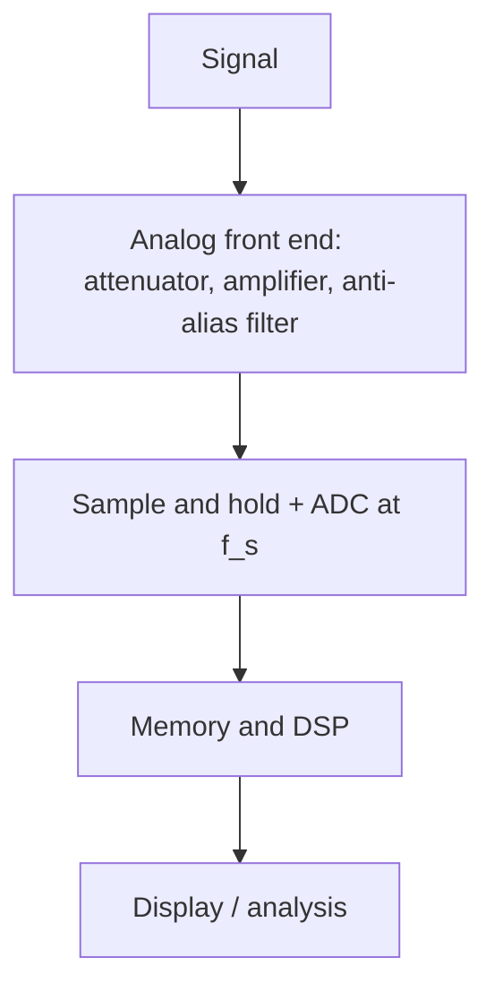

::: testing
Whether you can keep two numbers on a datasheet **separate in your head**. Bandwidth is an *analog* property: how high a frequency the front end passes before the signal is attenuated by 3 dB. Sample rate is a *digital* property: how often the ADC takes a snapshot. A strong answer states both definitions, says why neither one implies the other, explains how they must be matched (Nyquist, anti-alias filtering, 2.5 to 5× margin), and gives an example where they conflict (aliasing, bandpass sampling, interleaved channels). It is a fundamental question, but the interviewer is listening for the word *aliasing* and for whether you know the filter comes first.
:::

::: why
Every acquisition system, a scope, a DAQ card, a microcontroller ADC or an audio codec, has an analog filter in front of a sampler. Mismatching them is the source of the most confusing bugs: noise that appears at the wrong frequency, a motor vibration that shows up as a slow drift, a 1 GHz "scope" that cannot display a 400 MHz sine properly. Knowing the distinction lets you read a datasheet correctly and set up measurements ([[q0980]]) and embedded sensing chains ([[q0808]]). It is also the basis of the Nyquist and aliasing questions ([[q0669]], [[q0670]]).
:::

::: concepts
- **Analog bandwidth ($BW$)**: the frequency where the response falls to $1/\sqrt2$ (−3 dB). See [[q0132]].
- **Sample rate ($f_s$)**: samples per second the ADC takes, often in S/s, MS/s, GS/s. See [[q0813]].
- **Nyquist frequency**: $f_s/2$, the highest frequency a sampled system can represent without ambiguity. See [[q0669]].
- **Aliasing**: components above $f_s/2$ fold back to $|f-kf_s|$. See [[q0670]].
- **Anti-alias filter**: an analog low-pass before the sampler that attenuates anything above $f_s/2$.
- **Quantisation / resolution**: ADC bits are a third, independent spec (vertical resolution).
:::

::: answer
"They're two different limits in two different places.

Bandwidth is an analog spec of the front end: the frequency where the input amplitude has dropped by 3 dB. Above that, the signal is attenuated before it ever reaches the converter. Sample rate is how many times per second the ADC takes a sample, and it sets the highest frequency that can be represented unambiguously: half the sample rate, the Nyquist frequency.

They have to be matched. If the sample rate is too low for the frequencies reaching the ADC, they alias: a 900 Hz tone sampled at 1 kHz shows up as a 100 Hz tone, and you can't tell afterwards. So there's an anti-alias filter, which is basically the bandwidth, designed to kill content above half the sample rate. On a scope the sample rate is typically 2.5 to 5 times the bandwidth, which gives margin for the gentle roll-off and enough points for accurate interpolation.

So a high sample rate with low bandwidth wastes samples, because the front end has already removed the detail. A high bandwidth with a low sample rate lets high-frequency content through to alias. You need both, and each can only be as good as the lower of the two for what you see."
:::

::: technical
**Definitions.**

- **Bandwidth.** For a low-pass front end with transfer function $H(f)$, $BW$ is the frequency where $|H|=1/\sqrt2$ of the passband. For a single pole: $|H|=1/\sqrt{1+(f/BW)^2}$; at $f=BW$ the amplitude is 70.7 % (−3 dB). A scope's rise time follows $t_r\approx0.35/BW$.
- **Sample rate.** Samples per second $f_s$. By the Nyquist–Shannon theorem a signal band-limited below $f_s/2$ is uniquely determined by its samples.

**Relationship.** The ADC cannot distinguish $f$ from $|f-kf_s|$ for integer $k$. Anything above $f_s/2$ that survives the front end folds into the band $0$ to $f_s/2$. To be unambiguous, the analog path must attenuate content above $f_s/2$ enough that the aliases are below the noise floor (below about one LSB, i.e. roughly $6.02N+1.76$ dB for an $N$-bit converter).

**Margins in practice.**

- A single-pole filter rolls off at only 20 dB/decade, so a *sharp* anti-alias filter is expensive. Hence audio ADCs oversample (e.g., 48 kS/s for a 20 kHz band) or use digital filtering after oversampling.
- Scopes: $f_s\approx2.5\text{ to }5\times BW$. Example: 1 GHz bandwidth with 5 GS/s.
- To *draw* a faithful waveform you want several samples per cycle of the highest component you care about, as many as 10 to 20 per cycle for sine interpolation to look smooth, though 2.5 to 5 suffices for sin(x)/x reconstruction of band-limited signals.

**Example.** A scope with 100 MHz bandwidth (single pole) and 1 GS/s. Nyquist is 500 MHz. A 700 MHz signal is attenuated by $1/\sqrt{1+49}=0.141$ (−17 dB) and would alias to $|700-1000|=300$ MHz. A real scope's steeper front end attenuates it more, but the lesson is that the filter, not the ADC, protects you.

**Exceptions.** *Bandpass (under-)sampling* deliberately samples a high-frequency narrowband signal below its carrier, so the ADC's *analog input bandwidth* must be above the carrier while $f_s$ is far lower. *Equivalent-time sampling* reaches very high bandwidth on repetitive signals with a slow ADC.
:::

::: short
"Bandwidth is the analog front end's limit: the frequency where amplitude has dropped 3 dB. Sample rate is how often the ADC samples, and Nyquist says you can only represent frequencies below half of it. They're separate but linked: anything above half the sample rate that gets through the front end aliases down to a false lower frequency, so the bandwidth or anti-alias filter must cut it first. Scopes typically sample at 2.5 to 5 times their bandwidth, giving margin and enough points to reconstruct the waveform."
:::

::: long
"They're two different specs for two different parts of the instrument, and you need both to be right.

Bandwidth is analog. It's the frequency where the front end's response has dropped 3 dB, about 70 percent of the amplitude. Above it, the signal is attenuated before it reaches the converter. Sample rate is digital: how many samples per second the ADC takes. Nyquist says it can only represent frequencies below half the sample rate.

The link between them is aliasing. If energy above half the sample rate gets past the front end, it doesn't vanish; it folds down. Sample a 900 hertz tone at 1 kilosample per second and you get a perfectly clean 100 hertz tone that was never there, and you can't tell afterwards. So the analog bandwidth, or a dedicated anti-alias filter, has to remove everything above half the sample rate first.

That's why instruments pair them. A scope with 1 gigahertz bandwidth might sample at 5 gigasamples a second, 2.5 to 5 times the bandwidth. The margin exists because a real filter rolls off gradually, and because to draw the waveform nicely you want several samples per cycle for the interpolation. If the sample rate is too low, high-frequency content aliases. If the bandwidth is too low, the samples are plentiful but the detail is already gone, and edges look slow.

A fun exception is undersampling, where I deliberately sample a high-frequency narrowband signal slowly, so the ADC needs high analog bandwidth but a low sample rate.

So: bandwidth decides what reaches the ADC, sample rate decides how it's captured, and the weaker one limits what you see."
:::

::: terms
- **Analog bandwidth**: −3 dB frequency of the front end.
- **Sample rate**: ADC samples per second.
- **Nyquist frequency**: half the sample rate.
- **Aliasing**: false lower frequencies produced by sampling content above Nyquist.
- **Anti-alias filter**: analog low-pass placed before the ADC.
- **Oversampling**: sampling much faster than twice the signal bandwidth to relax the filter and gain resolution.
- **Undersampling / bandpass sampling**: sampling a high-frequency narrowband signal below its carrier frequency, using aliasing on purpose.
- **Interpolation (sin(x)/x)**: reconstructing the waveform between samples.
- **Equivalent-time sampling**: building a high-resolution picture from many repetitive acquisitions with slow sampling.
:::

::: exceptional
**An average answer** says "bandwidth is how fast a signal can be, sample rate is how fast you sample" and stops, or treats them as the same.

**An exceptional answer**:
- Defines each precisely and says **where** it lives (analog front end vs ADC).
- Shows **how they interact**: anti-alias filtering, Nyquist, aliasing, with an example (900 Hz at 1 kS/s).
- Gives the **practical ratio** (scope $f_s\approx2.5$–$5\times BW$) and why (finite roll-off, interpolation).
- Explains that **neither** implies the other: a fast sampler with a slow front end, and the reverse.
- Mentions exceptions: **undersampling**, **equivalent-time**, **interleaving** and **ENOB** that falls with frequency.
- Brings in a **concrete instrument** (scope, DAQ, microcontroller ADC, DMM) to show the idea is general.
:::

::: mistakes
- **Treating sample rate as bandwidth.** A "5 GS/s" scope isn't a 5 GHz scope; the datasheet bandwidth is often 1 GHz or less. The first number is on the box; the second determines what the instrument can see.
- **Saying "Nyquist means sample at twice the signal frequency" and stopping.** That assumes the signal is already band-limited below Nyquist. Real signals have noise and harmonics that must be filtered.
- **Thinking aliasing only matters for sine waves.** Noise and harmonics alias too, and raise the noise floor.
- **Believing more samples can recover lost bandwidth.** Oversampling can't restore frequency content the front end already attenuated.
- **Forgetting interleaving.** A scope's quoted sample rate may be reached only with fewer channels on.
- **Ignoring ADC resolution.** Effective bits fall with input frequency; a 12-bit converter may deliver 9 ENOB at its top frequency.
:::

::: deep
## Two filters in different places

Picture an acquisition chain:


Figure: bandwidth lives in the analog block (B), sample rate in the converter (C). Anything that gets past B is seen by C; whatever C cannot represent folds down.

The front end behaves like a low-pass filter with a −3 dB frequency $BW$. The sampler is a perfect time-domain multiplier by a train of impulses at spacing $T_s=1/f_s$. In the frequency domain, multiplication by an impulse train *replicates* the spectrum around every multiple of $f_s$. If the original spectrum extends beyond $f_s/2$, the copies overlap, which is aliasing.

## Aliasing in one equation

A sampled sinusoid at $f$ is indistinguishable from one at $|f-kf_s|$ for any integer $k$. The apparent frequency is the folded value in $[0,f_s/2]$:

$$ f_{alias}=\left|f-\operatorname{round}\!\left(\tfrac{f}{f_s}\right)f_s\right| $$

Examples: 900 Hz at $f_s=1000$ Hz gives $|900-1000|=100$ Hz; 1050 Hz gives 50 Hz. Try it:

```sim
{"id":"sampling-aliasing","f":900,"fs":1000}
```
Figure: with a 900 Hz input at 1 kS/s the reconstruction is a 100 Hz sine. Slide the sample rate up past 1800 Hz and the true frequency appears. The samples are identical in both cases: the data cannot tell you which one it was.

## What the filter must do

Because aliasing cannot be undone, content above $f_s/2$ must be removed *before* sampling. How much? Enough that the alias falls below the noise/quantisation floor. For an $N$-bit ADC the ideal signal-to-quantisation-noise is $6.02N+1.76$ dB; an 8-bit scope is about 50 dB. So for a full-scale 700 MHz input on a 1 GS/s sampler to alias below the noise, the front end would have to attenuate it by about 50 dB. A single pole at 100 MHz gives only 17 dB at 700 MHz, so real scopes use higher-order, steeper (Gaussian or brick-wall-like) responses, plus a sample rate well above 2× BW to relax the requirement.

```bode
{"systems":[{"label":"single-pole front end, BW = 100 MHz","num":[1],"den":["1/(2*pi*1e8)",1]},{"label":"2nd-order Butterworth, BW = 100 MHz","num":[1],"den":["1/(2*pi*1e8)^2","1.414/(2*pi*1e8)",1]}],"vars":{},"f":{"min":1e6,"max":3e9},"marks":[{"f":1e8,"label":"BW"},{"f":5e8,"label":"Nyquist at 1 GS/s"}],"show":"mag","magRange":[-60,5]}
```
Figure: at the 500 MHz Nyquist frequency of a 1 GS/s sampler, a single pole has only attenuated about 14 dB, and a second-order Butterworth about 28 dB. Neither is enough to push aliases below an 8-bit noise floor, which is why oversampled and higher-order filter designs are used.

## Why scopes sample at 2.5 to 5 times bandwidth

Two reasons. First, the roll-off is gradual, so some energy above the nominal bandwidth still reaches the ADC; the more margin you have between BW and $f_s/2$, the less it aliases. Second, to *display* a waveform, the scope interpolates between points. With sin(x)/x interpolation the reconstruction is accurate for band-limited signals at about 2.5 samples per period, but for a good picture of an edge with linear interpolation you want 4 to 5 samples across the rise time ([[q0980]]).

| Scope example | BW | Sample rate | $f_s/BW$ |
|---|---|---|---|
| Entry-level | 100 MHz | 1 GS/s | 10 |
| Mid-range | 1 GHz | 5 GS/s | 5 |
| High-end | 8 GHz | 20 GS/s | 2.5 |

At the high end the ratio approaches 2.5, because the front end is a very steep filter and the cost of sampling is high. The figures are typical and vary by model.

## Neither implies the other

**High sample rate, low bandwidth.** A 5 GS/s scope with a 100 MHz front end gives dense samples of a signal that has already been smoothed. You can see the details of a slow edge in great detail but you cannot see a 1 ns edge at all. The extra samples help with interpolation and noise averaging but don't add information.

**High bandwidth, low sample rate.** A 1 GHz front end with 1 GS/s sampling will pass 800 MHz signals that alias to 200 MHz. You can see a signal that isn't there. This is the dangerous case.

**A microcontroller example.** An MCU ADC samples a sensor at 10 kS/s (Nyquist 5 kHz). The sensor's own bandwidth might be 20 kHz, and a motor-noise source adds 7 kHz tone. Without an analog RC or active filter below 5 kHz, the 7 kHz tone aliases to $|7-10|=3$ kHz inside your measurement band. The fix is an anti-alias filter, not a faster firmware loop ([[q0808]]).

**A DMM example.** A bench DMM may have an AC bandwidth of 300 kHz and sample the rectified signal at a few readings per second. There the "sample rate" is the *reading rate*, and a 100 Hz DC-mode input aliases with a 5 reading/s display ([[q0988]]).

## Exceptions that prove the rule

### Undersampling (bandpass sampling)

If a signal occupies a narrow band around a high carrier, you can sample it at a rate far below the carrier and use aliasing as a free down-converter. Example: a 65 MHz IF with a few MHz of bandwidth sampled at 20 MS/s lands at $|65-3\times20|=5$ MHz. The ADC's *analog input bandwidth* (the track-and-hold) must exceed 65 MHz, even though $f_s$ is only 20 MS/s. Here the roles are clearly separate. The condition is that the signal band fits within a single Nyquist zone, and an analog bandpass filter must remove other zones.

### Equivalent-time sampling

On a repetitive signal, a sampling scope takes one sample per trigger with a slightly different delay each time, building a picture of effective sample rate in the hundreds of GS/s with a slow ADC. Bandwidth can reach tens of GHz, but it cannot capture single-shot events.

### Interleaving

A very fast scope uses several ADCs, each running at $f_s/n$, taking samples in turn. Gain, offset and timing mismatch between them creates spurs. Also, in some scopes the ADCs are shared, so the quoted rate holds only for one channel; with four channels on it might fall to a quarter: a 10 GS/s scope becomes 2.5 GS/s per channel.

## Bandwidth is not the only front-end number

The ADC also has a vertical resolution and a noise floor, and the *effective* number of bits (ENOB) falls as the input frequency rises because of jitter and the track-and-hold bandwidth. Aperture jitter $t_j$ limits SNR at high frequency: $SNR\approx-20\log_{10}(2\pi f t_j)$. For a 1 GHz signal and 1 ps RMS jitter, the limit is about 44 dB (7 ENOB). So the three specs, bandwidth, sample rate and resolution, trade against each other, and all three must be adequate for the measurement.

## A one-sentence check you can say out loud

"Bandwidth says what gets in; sample rate says what can be recorded without ambiguity; and the anti-alias filter is the handshake between them."

> [!INTERVIEW]
> If asked for an example, use the audio one: "A 48 kS/s audio ADC has Nyquist at 24 kHz, so the front end has to cut hard above about 22 kHz or 30 kHz ultrasonic noise aliases into the audio band. That's why codecs oversample and use digital filters." It is concrete, correct and short.
:::

::: applications
- **Oscilloscopes**: spec sheet lists BW (e.g., 1 GHz) and sample rate (e.g., 5 GS/s) separately, with the rate often shared across channels.
- **Audio ADC/DAC**: 20 kHz bandwidth, 44.1 or 48 kS/s, steep anti-alias or oversampling filters.
- **Microcontroller sensing**: RC anti-alias filters ahead of 10–100 kS/s SAR ADCs for vibration and motor current ([[q0810]]).
- **Software-defined radio and IF sampling**: undersampling a 70 MHz IF with a 20 to 100 MS/s ADC.
- **DMMs and power analyzers**: AC bandwidth versus reading rate defines what they can say about switching waveforms.
- **Digital storage in test automation**: choosing a DAQ card's rate and filter for a transducer's bandwidth.
:::

::: assumptions
- "Bandwidth" here means **−3 dB analog bandwidth**, as on scope specs. Other fields use bandwidth for **bit rate** or signal **occupied bandwidth** or "noise equivalent bandwidth", so check context.
- Single-pole filter numbers are for **illustration**. Real scope front ends are steeper and designed for flat gain and linear phase.
- Sample rate is the **real-time rate on one channel** unless noted; quoted maxima may require channels to be disabled.
- The 2.5–5× ratio is a **typical** design practice, not a law.
- The answer changes in **undersampling** and **equivalent-time** systems, and for **sigma-delta ADCs**, where the modulator runs very fast (MHz) but the output data rate and signal bandwidth are low (kHz).
- For **non-uniform** sampling or compressive sensing the Nyquist criterion is not the limit, but that is beyond the usual question.
:::

::: followups
### Can you have a 1 GHz scope that samples at 1 GS/s?
It would violate good practice. Nyquist is 500 MHz, so content between 500 MHz and 1 GHz would alias (the front end only attenuates by 3 dB at 1 GHz). Real 1 GHz scopes sample at least at 2.5 to 5 GS/s per channel. Some scopes advertise bandwidth that is only achieved in equivalent-time mode on repetitive signals.

### Why not just always use the highest bandwidth available?
More bandwidth admits more noise, since noise power scales with bandwidth, and more unwanted interference. It also reduces vertical resolution in practice and may expose probe-ground artefacts. Use the bandwidth you need, with a bandwidth limit (e.g., 20 MHz) to clean up slow signals.

### How does aliasing show up on a scope screen?
A stable-looking waveform at the wrong frequency, or a waveform that shifts when you change the time base, or when you change the sample rate the apparent frequency changes. A quick test: change the time/div or sample rate and see if the frequency estimate stays constant. If it changes, the display is aliased.

### What sample rate would you choose for a 1 kHz bandwidth vibration sensor?
At least 2.5 kS/s, but practically 10 kS/s with a second-order analog anti-alias filter around 1.5 to 2 kHz. That gives a factor of 5 margin so the filter's roll-off puts the alias products well below the noise floor, and keeps the filter simple. Then decimate digitally if needed.

### Scenario: a motor controller's ADC reading shows a 3 kHz ripple that isn't on the scope. What's happening?
Likely aliasing. A high-frequency component (for example 17 kHz PWM ripple or ringing) is being sampled at 10 kS/s and folding to $|17-20|=3$ kHz. The scope on a wider bandwidth shows the real 17 kHz content. Fix with an analog RC filter ahead of the ADC, synchronise sampling to the PWM, or raise the sample rate with digital decimation.
:::

::: interpretations
In some contexts "bandwidth" means **data rate** (a network or memory interface) and "sampling rate" is a bus or ADC term. Here the context is the *Measurement* section, so the meaning is analog bandwidth versus ADC sample rate of an instrument, as in a scope. If the interviewer means a data-converter system, the same logic holds with the anti-alias filter as the bandwidth. This question is the concept behind the sizing procedure in [[q0980]].
:::

::: references
- Oppenheim & Schafer, *Discrete-Time Signal Processing*: sampling, aliasing and reconstruction.
- Lyons, *Understanding Digital Signal Processing*: sampling, aliasing and bandpass sampling.
- Kester (ed.), *Data Conversion Handbook* (Analog Devices): anti-alias filtering, undersampling and ADC dynamic specifications.
- Oscilloscope fundamentals primers from the major instrument manufacturers (bandwidth, sample rate and interpolation).
:::

::: rubric
- Defines bandwidth as the analog front-end −3 dB frequency :: This is the first half of the question and often confused.
- Defines sample rate as ADC samples per second and states Nyquist ($f_s/2$) :: The second half; shows understanding of the sampling theorem.
- Explains aliasing as the interaction and gives an example :: Aliasing is what links the two numbers.
- Describes the anti-alias filter and the 2.5–5× practical ratio on scopes :: Shows how instruments are really designed.
- States that neither implies the other (high rate/low BW, high BW/low rate) :: Prevents the common "5 GS/s means 5 GHz" error.
- Mentions an exception (undersampling, equivalent-time, interleaving) :: Signals depth beyond the textbook.
- Connects to practice (embedded ADC, DMM reading rate, audio) :: Shows the idea transfers across instruments.
:::

::: quiz
```json
[
 {"type":"mcq","level":"fundamental","q":"Which statement correctly distinguishes bandwidth from sample rate?","options":["Both are the same number measured in different units","Bandwidth is the analog front end's -3 dB frequency; sample rate is how often the ADC samples","Bandwidth is the number of channels; sample rate is the memory depth","Sample rate is analog; bandwidth is digital"],"answer":1,"explain":"Bandwidth is an analog property of the front end; sample rate is a digital property of the converter. They're linked by the Nyquist limit and anti-alias filtering."},
 {"type":"numeric","level":"fundamental","q":"A 900 Hz sine is sampled at 1000 Hz. At what frequency does it appear?","answer":100,"tolerance":0.01,"unit":"Hz","explain":"$|900-1000|=100$ Hz. The samples are identical to those of a 100 Hz sine."},
 {"type":"numeric","level":"intermediate","q":"What is the Nyquist frequency of a 5 GS/s scope?","answer":2.5,"tolerance":0.01,"unit":"GHz","explain":"The Nyquist frequency is half the sample rate: $f_s/2=5/2=2.5$ GHz. Real scopes keep bandwidth well below this."},
 {"type":"numeric","level":"intermediate","q":"A 20 MS/s ADC with a high analog input bandwidth samples a 65 MHz signal. At what frequency does it alias?","answer":5,"tolerance":0.01,"unit":"MHz","explain":"The nearest multiple of 20 MHz is 60 MHz, so $|65-60|=5$ MHz."},
 {"type":"mcq","level":"intermediate","q":"A scope has 100 MHz bandwidth and a 5 GS/s sample rate. What can you conclude about its ability to see a 1 ns edge?","options":["It sees it clearly because it has many samples","It cannot show the true edge, because the front end limits rise time to about 3.5 ns","It will alias the edge","It will show the edge but with too much noise"],"answer":1,"explain":"The front-end bandwidth sets the rise time ($0.35/BW=3.5$ ns); the extra samples only describe the already-smoothed edge in finer detail."},
 {"type":"truefalse","level":"advanced","q":"Raising the sample rate after the analog front end has attenuated a high-frequency component can restore that component's amplitude.","answer":false,"explain":"Once the front end has attenuated a frequency, the information is largely lost beneath noise. A higher sample rate cannot undo analog attenuation (though it can improve interpolation and allow digital averaging)."}
]
```
:::
