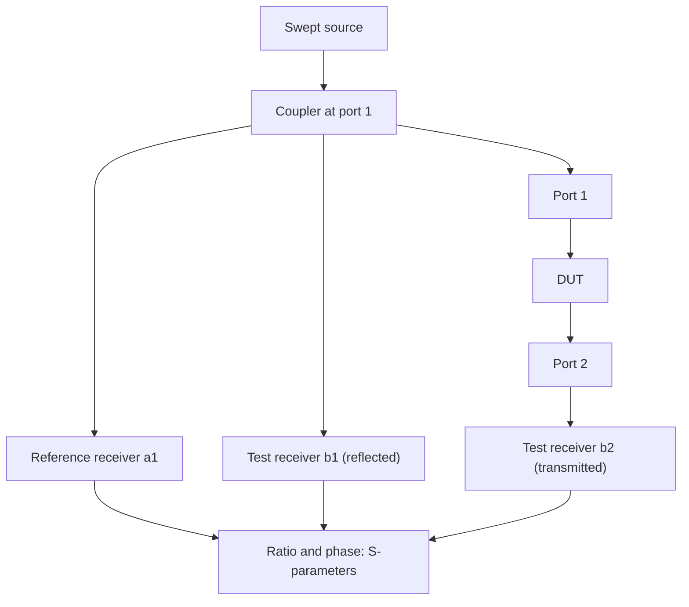

::: basics
### In plain words
A vector network analyzer, or VNA, measures how a device passes and reflects radio-frequency signals. It sends in a test signal that sweeps across a range of frequencies. It then measures how much comes back (reflected) and how much gets through (transmitted), including the timing offset, called phase. It is used on filters, amplifiers, antennas and cables.

### Picture it
Imagine shining a flashlight at a window. Some light reflects back, some passes through, and some is absorbed. A VNA does that with electrical waves. The window is your device. The reflected fraction tells you how well the device matches the line feeding it. The transmitted fraction tells you its gain or loss.

### Words you need
- **Impedance**: the opposition a circuit gives to an alternating signal, like resistance but frequency-dependent, measured in ohms. RF systems are usually 50 Ω.
- **Reflection**: when a wave meets a change in impedance, part of it bounces back. See [[q0711]].
- **S-parameters**: the measured ratios of reflected and transmitted waves to the incoming wave. $S_{11}$ is reflection at port 1 and $S_{21}$ is transmission from port 1 to port 2.
- **Return loss**: how far the reflection is below the incoming wave, in dB (decibels, a ratio scale where 20 dB means a factor of 10 in wave size). Bigger is better.
- **Calibration**: connecting known reference parts first so the VNA can remove errors from itself and its cables.

### The simplest example
Connect a 75 Ω load to a 50 Ω VNA port. The mismatch reflects a fraction $(75-50)/(75+50) = 0.2$ of the incoming wave. That is $0.2^2 = 4\%$ of the power. As return loss that is $-20\log_{10}(0.2) \approx 14$ dB.

For a filter, $S_{21}$ sits near 0 dB (everything passes) at the frequencies it should pass, and falls beyond its cutoff.

That is the whole idea. The rest of this page adds how calibration works, how a VNA differs from a spectrum analyzer, and finding a cable fault.
:::

::: testing
Whether you understand a VNA as **a ratio-measuring instrument for waves**, not "a fancy scope for RF". The interviewer wants: what it sources and measures (a swept sine and the forward, reflected and transmitted waves with magnitude and phase), what S-parameters mean ($S_{11}$ reflection, $S_{21}$ transmission), why calibration is essential, and what you'd use it for (filters, amplifiers, antennas, cables, PCB traces, impedance). Strong answers connect to reflections and impedance matching, give a return-loss or VSWR number, and contrast it with a spectrum analyzer and a scope.
:::

::: why
At RF and high-speed digital frequencies, you can't think in terms of node voltages and currents alone; you think in terms of waves traveling along transmission lines and reflecting at impedance steps. A VNA is the instrument that measures exactly that, so it is the reference tool for RF circuits, antennas, filters, connectors, cables and signal-integrity work on PCBs. Even if you never touch an RF project, impedance-controlled traces and reflections ([[q0711]]) mean you'll meet S-parameters in datasheets, simulation models and SI reports. Being able to explain what a VNA is, in plain language, shows breadth.
:::

::: concepts
- **Transmission-line view**: at high frequency, a signal is a wave with forward and reflected components. See [[q0711]].
- **Reflection coefficient**: $\Gamma=\frac{Z_L-Z_0}{Z_L+Z_0}$ relates a load to the reference impedance $Z_0$ (usually 50 Ω).
- **Impedance matching**: matching source and load avoids reflections and maximizes power. See [[q0141]].
- **S-parameters**: ratios of waves at the ports of a network, with magnitude and phase.
- **Return loss, VSWR, insertion loss**: logarithmic and ratio ways to quote reflection and transmission.
- **Calibration**: measuring known standards to remove the instrument's and cables' errors.
:::

::: answer
"A vector network analyzer measures how a device, like a filter, an amplifier, an antenna or a cable, reflects and transmits RF signals, across frequency, with both magnitude and phase.

It works by sourcing a swept sine wave into a port, and using directional couplers and coherent receivers to measure the incident wave, the wave reflected back, and the wave transmitted through to the other port. The ratios are the S-parameters. S11 is how much is reflected at port 1, so it tells you the input match: return loss and VSWR, and with the phase you can compute the impedance, which is what you see on a Smith chart. S21 is how much gets through from port 1 to port 2: gain for an amplifier, insertion loss for a filter or a cable.

The important practical point is calibration. Before measuring, you connect known standards, short, open, load and a through, so the VNA can remove the errors of its own hardware and the cables, and set the reference plane right at the device. Without that you're measuring the cables.

Compared to a spectrum analyzer, which measures the power of whatever signal is present, the VNA supplies its own stimulus and measures ratios, so it gets very high dynamic range and phase. Compared to a scope, it works in the frequency domain, and its time-domain mode can show where along a line the reflections occur."
:::

::: technical
**What it is.** A VNA is a swept, coherent network analyzer: a synthesized source, signal-separation hardware (directional couplers or bridges), and receivers that measure the amplitude and phase of waves at each port.

**Waves and S-parameters.** For a two-port, with incident waves $a_1,a_2$ and outgoing waves $b_1,b_2$ normalized to $Z_0$:

$$ \begin{pmatrix}b_1\\b_2\end{pmatrix}=\begin{pmatrix}S_{11}&S_{12}\\S_{21}&S_{22}\end{pmatrix}\begin{pmatrix}a_1\\a_2\end{pmatrix} $$

$S_{11}=b_1/a_1|_{a_2=0}$ (input reflection), $S_{21}=b_2/a_1|_{a_2=0}$ (forward transmission), and similarly $S_{22}$, $S_{12}$. $a_2=0$ means port 2 is terminated in a matched load.

**Derived quantities.**

- Reflection coefficient $\Gamma=S_{11}=\frac{Z-Z_0}{Z+Z_0}$, so $Z=Z_0\frac{1+\Gamma}{1-\Gamma}$.
- Return loss $RL=-20\log_{10}|\Gamma|$ dB; $VSWR=\frac{1+|\Gamma|}{1-|\Gamma|}$.
- Insertion loss or gain $=20\log_{10}|S_{21}|$ dB.
- Reflected power fraction $=|\Gamma|^2$; mismatch loss $=-10\log_{10}(1-|\Gamma|^2)$.

Worked example: a 75 Ω load on a 50 Ω port: $\Gamma=0.2$, $RL=13.98$ dB, $VSWR=1.5$, 4 % of power reflected, mismatch loss 0.18 dB.

**Calibration.** SOLT (short-open-load-through) measures four known standards to solve for the systematic error terms (directivity, source match, reflection tracking, load match, transmission tracking, isolation). TRL and electronic calibration modules (ECal) are alternatives, as is de-embedding of fixtures. Calibration places the **reference plane** at the connectors or probes.

**Key settings.** Frequency range and points, IF bandwidth (narrower IFBW lowers the noise floor by 10 dB per decade but slows the sweep), source power, averaging.

**Typical uses.** Filters, amplifiers, antennas (S11/VSWR), cables and connectors, PCB trace impedance and loss, matching networks, component impedance at RF, time-domain reflectometry via transform.
:::

::: short
"A VNA is a swept RF instrument that measures how a network reflects and transmits signals, with magnitude and phase, which are the S-parameters. It sources a sine, uses couplers and coherent receivers to measure incident, reflected and transmitted waves. S11 gives input match: return loss, VSWR and impedance. S21 gives gain or insertion loss. You calibrate with short, open, load and through standards so you're measuring the device rather than the cables. I'd use it for filters, amplifiers, antennas and cables."
:::

::: long
"A VNA, vector network analyzer, measures how a device reflects and transmits RF signals as a function of frequency, including phase.

It has a swept sine source and receivers that can separate the forward and reflected waves with directional couplers. For a two-port device, it measures the wave going in, the wave reflected back at that port, and the wave coming out of the other port, and the ratios are the S-parameters. S11 is reflection at port 1. If the device is perfectly matched to the 50 ohm system, S11 is zero. In practice I quote it as return loss: 20 dB means 1 percent of the power is reflected. From S11 with phase I can compute the actual impedance, and that's what the Smith chart shows. S21 is transmission from port 1 to 2: for a filter it's the passband and stopband response, for an amplifier it's the gain, and for a cable it's the loss.

The step people forget is calibration. The cables, connectors and the instrument all add errors, so you first measure known standards, short, open, load and a through, and the VNA computes and removes the error terms and puts the reference plane at the device. An uncalibrated measurement includes the cables.

I'd use a VNA for filters and amplifiers, antenna matching, cable and connector quality, PCB trace impedance and loss, and matching networks. A spectrum analyzer measures the power of whatever signal is present; the VNA supplies its own stimulus and measures ratios, so it gets over 100 dB dynamic range and phase. And with a time-domain transform it can show where along a line a mismatch is."
:::

::: terms
- **S-parameters**: scattering parameters, the ratios of outgoing to incident waves at network ports.
- **Port / reference impedance ($Z_0$)**: the impedance (typically 50 Ω) to which the waves are normalized.
- **Reflection coefficient ($\Gamma$)**: ratio of reflected to incident wave at a port.
- **Return loss**: $-20\log|\Gamma|$ in dB; higher means better match.
- **VSWR**: voltage standing-wave ratio, $(1+|\Gamma|)/(1-|\Gamma|)$.
- **Insertion loss / gain**: $|S_{21}|$ in dB.
- **Calibration (SOLT, TRL, ECal)**: removing systematic errors using known standards.
- **Reference plane**: the physical plane where the calibrated measurement is referenced.
- **IF bandwidth (IFBW)**: receiver filter bandwidth; trades noise floor for sweep speed.
- **Smith chart**: a chart of $\Gamma$ (or normalized impedance) on a polar plot.
:::

::: exceptional
**An average answer** says "a VNA is an RF test instrument that measures S-parameters."

**An exceptional answer**:
- Explains **what it measures physically** (incident, reflected and transmitted waves, ratio and phase) and why that is the right way to characterize RF networks.
- Explains **S11 and S21** with units and a meaning for each, and converts to **return loss, VSWR and impedance**.
- Gives a **number**: a 75 Ω load on 50 Ω gives Γ = 0.2, 14 dB return loss, VSWR 1.5.
- Describes **calibration** and the reference plane, and why uncalibrated results mislead.
- Contrasts with the **spectrum analyzer** (no stimulus, power only) and **scope**.
- Names typical **pitfalls**: cable movement, connector torque and repeatability, dynamic range vs IFBW, power levels (compression).
- Mentions **time-domain** mode and **PCB/signal-integrity** uses beyond classic RF.
:::

::: mistakes
- **"It's just a spectrum analyzer with a source."** A spectrum analyzer measures absolute power; a VNA measures complex ratios with phase and uses a calibrated, coherent receiver.
- **Skipping calibration or using stale calibration.** Cable flexing and temperature drift change the error terms.
- **Confusing return loss sign.** Return loss is quoted as a positive number of dB (larger is better) when defined as $-20\log|\Gamma|$, while $S_{11}$ in dB is negative. Check which convention the plot uses.
- **Too much source power.** An amplifier under test will compress; use a low power or power sweep to find the linear region.
- **Measuring a floating or DC-biased device without bias tees or blocks.** DC can damage the VNA's ports.
- **Believing 50 Ω is universal.** $Z_0$ can be 75 Ω (video) or differential 100 Ω; S-parameters depend on the reference impedance chosen.
:::

::: deep
## Why we need a different instrument at RF

At low frequency, a circuit is described by voltages and currents at its terminals and measured with a voltmeter or a scope. When the dimensions of the circuit are comparable to the wavelength (rule of thumb: the line is longer than about one tenth of the wavelength, or its one-way delay is more than roughly a sixth of the signal's rise time; texts quote slightly different fractions), the voltage and current depend on position. A signal traveling down a line meets an impedance step and part of it reflects back. Voltage and current measured at one place become a mix of forward and reflected waves; you can't separate them with a single probe, and you can't connect a high-impedance probe without perturbing a 50 Ω system.

The VNA solves this by working directly with waves. It injects a known incident wave and measures, with directional couplers and *coherent* receivers, what comes back and what goes through.

```sim
{"id":"tline-lab","z0":50,"rs":50,"rl":75,"td":1e-9,"tr":100e-12,"term":"none"}
```
Figure: a 75 Ω load at the end of a 50 Ω line reflects part of the incident step; the reflection coefficient is $\Gamma_L=(75-50)/(75+50)=0.2$, so the 500 mV launched step becomes 600 mV at the load and a +100 mV reflection arrives back at the (matched) source at 2 ns. A VNA's $S_{11}$ is the frequency-domain equivalent of this reflection, with phase.

## Block diagram of a VNA


Figure: the source drives port 1; a coupler samples the incident wave (reference channel) and the reflected wave; port 2's receiver measures the transmitted wave. The instrument displays the ratios, so source power drift cancels. Real instruments add a switch so the source can drive either port.

Key idea: the receivers are *tuned* (heterodyne) and measure complex (I/Q) amplitude. That gives phase and a very narrow noise bandwidth, so dynamic range reaches 100 dB or more at the receiver, compared to about 50 dB for an 8-bit scope.

## S-parameters, concretely

For a two-port with 50 Ω reference:

- **$S_{11}$**: reflection at port 1 with port 2 terminated. Perfect match: $S_{11}=0$ (−∞ dB). Open or short: $|S_{11}|=1$ (0 dB).
- **$S_{21}$**: transmission 1→2. A through line: $S_{21}\approx1$ (0 dB). An amplifier with 20 dB gain: $|S_{21}|=10$. A filter stopband: −60 dB.
- **$S_{22}$** and **$S_{12}$**: the reverse equivalents. For a passive reciprocal device $S_{12}=S_{21}$.

Relationship between return loss and mismatch:

| Load on 50 Ω | $\Gamma$ | Return loss | VSWR | Power reflected |
|---|---|---|---|---|
| 50 Ω | 0 | ∞ | 1.0 | 0 |
| 75 Ω | 0.2 | 13.98 dB | 1.5 | 4 % |
| 100 Ω | 0.333 | 9.54 dB | 2.0 | 11 % |
| 150 Ω | 0.5 | 6.02 dB | 3.0 | 25 % |
| Open / short | 1 | 0 dB | ∞ | 100 % |

A common specification, "return loss better than 10 dB", means $|\Gamma|<0.316$ and VSWR below about 1.92; "better than 20 dB" means VSWR below 1.22.

Using the phase of $S_{11}$ you can compute the actual impedance: $Z=Z_0\frac{1+\Gamma}{1-\Gamma}$. For $\Gamma=0.2\angle0^\circ$ this gives 75 Ω. The Smith chart is the plot of this relationship.

```svg
<svg viewBox="0 0 400 320" xmlns="http://www.w3.org/2000/svg" font-family="Inter, sans-serif" font-size="12">
  <defs><clipPath id="sc"><circle cx="200" cy="160" r="120"/></clipPath></defs>
  <circle cx="200" cy="160" r="120" fill="var(--d-box)" stroke="var(--d-ink)" stroke-width="1.5"/>
  <line x1="80" y1="160" x2="320" y2="160" stroke="var(--d-ink)" stroke-width="1"/>
  <g clip-path="url(#sc)" fill="none" stroke="var(--d-muted)" stroke-width="1">
    <circle cx="260" cy="160" r="60"/>
    <circle cx="230" cy="160" r="90"/>
    <circle cx="290" cy="160" r="30"/>
    <circle cx="320" cy="40" r="120" stroke="var(--d-blue)"/>
    <circle cx="320" cy="280" r="120" stroke="var(--d-orange)"/>
  </g>
  <circle cx="80" cy="160" r="4" fill="var(--d-red)"/>
  <circle cx="320" cy="160" r="4" fill="var(--d-red)"/>
  <circle cx="200" cy="160" r="4" fill="var(--d-green)"/>
  <text x="70" y="182" text-anchor="end" fill="var(--d-ink)">short (Z = 0)</text>
  <text x="330" y="182" fill="var(--d-ink)">open (Z = ∞)</text>
  <text x="200" y="182" text-anchor="middle" fill="var(--d-ink)">match (Z = Z0)</text>
  <text x="200" y="30" text-anchor="middle" fill="var(--d-blue)">upper half: inductive (+jX)</text>
  <text x="200" y="305" text-anchor="middle" fill="var(--d-orange)">lower half: capacitive (-jX)</text>
</svg>
```
Figure: the Smith chart maps the reflection coefficient plane. The center is a perfect match, the left end a short, the right end an open. Moving up is inductive, down is capacitive; the circle through the center is $r=1$ (resistance equal to $Z_0$). A VNA can plot $S_{11}$ directly on this chart.

## Calibration: the part that makes numbers real

Everything between the instrument's reference receivers and your device (internal couplers, cables, adapters, fixtures) imperfectly transmits, reflects and leaks. These systematic errors are stable and repeatable, so they can be measured and removed. In the one-port case, three error terms matter: **directivity** (leakage of the incident wave into the reflection receiver), **source match** (re-reflection at the instrument port), and **reflection tracking** (frequency response). To find them, measure three known standards: **short, open and load**. For two ports, add a **through** and isolation measurements (SOLT, 12-term model).

Effect: an uncalibrated measurement of a perfect 50 Ω load may look like 15 dB return loss because of connector and cable errors; calibrated, the same load can show 40 dB or better, limited by the load standard's quality. The calibration sets the **reference plane** at the connector faces; to measure a part on a PCB, use a fixture and **de-embed** or calibrate at the fixture's reference plane with on-board standards.

Practical cautions: use a torque wrench on connectors, avoid flexing cables after calibration, let the instrument warm up, and re-check calibration with a known verification device.

## Dynamic range, IF bandwidth and power

The noise floor of the receiver depends on IF bandwidth: narrowing it by 10× (say 1 kHz to 100 Hz) lowers the noise floor by 10 dB, at the cost of a sweep 10× slower. Measuring a deep filter stopband (−80 to −100 dB) needs narrow IFBW and sometimes averaging. At the other end, too much source power compresses an amplifier DUT or overloads the receiver; choose the power so the DUT is linear (or run a power sweep to find the 1 dB compression point).

> [!UNCERTAIN]
> Dynamic range figures (80–120+ dB) and frequency coverage (kHz to tens or hundreds of GHz with extenders) vary widely by instrument class and price. Check the specifications of the model you will use.

## What a filter sweep looks like

A third-order Butterworth low-pass with 100 MHz cutoff in a 50 Ω system can be built with $C_1=C_3=1/(R\omega_c)=31.8$ pF and $L=2R/\omega_c=159$ nH. Its $S_{21}$:

```bode
{"systems":[{"label":"S21 of 3rd-order Butterworth LPF, fc = 100 MHz","num":[1],"den":["1/wc^3","2/wc^2","2/wc",1]}],"vars":{"wc":"2*pi*1e8"},"f":{"min":1e7,"max":1e9},"marks":[{"f":1e8,"label":"f_c (−3 dB)"},{"f":2e8,"label":"2 f_c: −18 dB"}],"show":"mag","magRange":[-60,5]}
```
Figure: this is exactly the kind of trace a VNA's S21 channel displays: flat passband, −3 dB at the cutoff, and a steep −60 dB/decade roll-off (18 dB at one octave above cutoff). Overlay it with the measured trace to check the build.

## Beyond classic RF

- **Impedance measurement**: a one-port S11 converts to complex impedance. VNAs are used from a few kHz up, but at low frequencies and for very low or very high impedances other methods (impedance analyzers, LCR meters, see [[q0985]]) are more accurate; for small impedances a shunt-through ($S_{21}$) method is used.
- **PCB and connector signal integrity**: S-parameters of traces, vias and connectors (insertion loss, return loss, crosstalk via S-parameters between ports) feed channel simulations for serial links.
- **Time-domain reflectometry (TDR)**: an inverse transform of the S11 sweep shows impedance versus distance, locating a mismatch along a cable or trace.
- **Power-integrity**: low-impedance PDN measurements with a two-port shunt-through technique.
- **Materials**: dielectric constant and loss measurement with fixtures.

> [!INTERVIEW]
> One memorable summary: "A scope looks at the signal; a spectrum analyzer looks at what signals are present; a VNA looks at how a device treats a signal I give it." It places the VNA correctly in the toolbox and shows you know why it exists.
:::

::: applications
- **Filter design and tuning**: S21 pass/stop-band response and S11 match.
- **Antenna matching**: S11, VSWR and bandwidth of an antenna in its installed environment.
- **Amplifier characterization**: S21 gain, S11/S22 matching, reverse isolation S12.
- **Cable and connector testing**: insertion loss and return loss, fault location with time-domain mode.
- **PCB trace and via characterization**: impedance and loss of high-speed channels; de-embedded S-parameters for simulation ([[q0711]]).
- **Component RF behavior**: capacitor and inductor self-resonance and impedance vs frequency ([[q0031]]).
:::

::: assumptions
- Assumes a **50 Ω** system and a **linear, time-invariant** DUT measured at small signal. Large-signal behavior requires power sweeps or nonlinear VNA options.
- Return loss is defined as the **positive** number $-20\log_{10}|\Gamma|$; some displays show $S_{11}$ in dB as a negative number.
- Two-port S-parameters assume the **other port terminated** in $Z_0$.
- The answer changes for **mixed-mode (differential) S-parameters**, **multi-port VNAs**, and **frequency-converting devices**, which need additional setups.
- For very low impedances or very high ones, **VNA accuracy falls off**; impedance analyzers or specialized fixtures do better.
:::

::: followups
### What does S21 = −3 dB mean?
Half the incident power arrives at port 2 ($10^{-0.3}=0.5$), or 70.7 % of the voltage amplitude. In a low-pass filter, that is the cutoff frequency definition. For a cable, it means 3 dB of loss at that frequency.

### Why can't you just measure RF with a scope and a probe?
A probe loads the circuit (its capacitance, about 10 pF, is only 159 Ω at 100 MHz), the scope has limited dynamic range and no phase reference, and in a transmission-line system you can't separate forward and reflected waves with a single voltage measurement. A VNA uses a matched 50 Ω environment and measures waves directly.

### What is the difference between a VNA and a spectrum analyzer?
A spectrum analyzer is a receiver: it measures the power at each frequency of whatever signal is applied, scalar and with no stimulus. A VNA supplies a swept stimulus and measures ratios of complex waves, which gives phase and S-parameters. A spectrum analyzer with a tracking generator can measure scalar insertion loss but not phase or reflection accurately.

### My uncalibrated S11 for a 50 Ω load is −12 dB. Is the load bad?
Probably not. Without calibration, cable and connector errors (poor directivity and source match) dominate. Perform SOLT calibration at the cable end and re-measure; a good 50 Ω load should show 30 dB or more return loss. If it still looks bad, check the connector and the standard's quality.

### Scenario: how would you find a broken cable run with a VNA?
Measure $S_{11}$ over a wide band, then apply the time-domain (inverse Fourier) transform. A mismatch or break appears as a peak at the delay of the fault; distance $=\frac{v_p\,t}{2}$ with the cable's velocity factor. An open appears as a positive reflection, a short as negative.
:::

::: interpretations
"What is a VNA?" asks for an explanation, not a data sheet. In a hardware interview the context may be RF, signal integrity or component characterization; a good answer states the idea (wave ratios with phase), the output (S-parameters), the key practice (calibration) and one or two uses. "Vector" refers to measuring phase as well as magnitude; a *scalar* network analyzer measured magnitude only. This sits with the instrument-familiarity prompt [[q0979]] and the impedance-measurement prompt [[q0985]].
:::

::: references
- Pozar, *Microwave Engineering*: network analysis and scattering parameters; transmission lines and the Smith chart.
- Bogatin, *Signal and Power Integrity: Simplified*: S-parameters, return loss and insertion loss for interconnects.
- Network-analyzer error-model and calibration tutorials in manufacturers' application-note libraries (topic level: 12-term error model, SOLT and TRL).
- Vector network analyzer fundamentals and calibration primers from major test-equipment manufacturers.
:::

::: rubric
- Defines a VNA as measuring magnitude and phase of reflected and transmitted waves versus frequency :: The core definition.
- States S11 (reflection/match) and S21 (transmission/gain or loss) and what they mean :: S-parameters are the output of the instrument.
- Converts to return loss, VSWR or impedance with at least one number :: Shows you can use the results.
- Explains calibration and the reference plane (short, open, load, through) :: Calibration is what makes VNA data meaningful.
- Distinguishes it from a spectrum analyzer and scope :: Locates the instrument in the toolbox.
- Names typical uses: filters, amplifiers, antennas, cables, PCB traces :: Shows practical understanding.
- Mentions limits and pitfalls (power level, IFBW/dynamic range, connector repeatability) :: Signals real experience.
:::

::: quiz
```json
[
 {"type":"mcq","level":"fundamental","q":"What does S21 of a filter represent?","options":["Reflected power at port 1","Transmission from port 1 to port 2 (insertion loss or gain)","Impedance of port 2","DC resistance"],"answer":1,"explain":"$S_{21}$ is the ratio of the wave leaving port 2 to the wave incident on port 1 (with port 2 matched): insertion loss for a passive filter, gain for an amplifier."},
 {"type":"numeric","level":"intermediate","q":"A 100 Ω load is measured in a 50 Ω system. What is the return loss?","answer":9.54,"tolerance":0.02,"unit":"dB","explain":"$\\Gamma=(100-50)/(100+50)=0.333$, so $RL=-20\\log_{10}0.333=9.54$ dB."},
 {"type":"numeric","level":"intermediate","q":"What VSWR corresponds to a reflection coefficient magnitude of 0.2?","answer":1.5,"tolerance":0.02,"unit":"","explain":"$VSWR=(1+0.2)/(1-0.2)=1.2/0.8=1.5$."},
 {"type":"mcq","level":"intermediate","q":"Why is a VNA calibrated with short, open, load and through standards?","options":["To make the display brighter","To measure and remove systematic errors of the instrument, cables and adapters, and set the reference plane at the DUT","To increase the source power","To change the reference impedance to 75 Ω"],"answer":1,"explain":"Calibration solves for the error terms (directivity, source match, tracking and others) using known standards, so the measurement reflects the DUT rather than the test setup."},
 {"type":"numeric","level":"advanced","q":"A 3rd-order Butterworth low-pass filter has $|S_{21}|^2=1/(1+(f/f_c)^6)$. What is $|S_{21}|$ in dB at $f=2f_c$?","answer":-18.1,"tolerance":0.02,"unit":"dB","explain":"$|S_{21}|^2=1/(1+64)=1/65$, so $20\\log_{10}|S_{21}|=-10\\log_{10}65=-18.1$ dB."},
 {"type":"truefalse","level":"advanced","q":"Narrowing the VNA's IF bandwidth from 1 kHz to 100 Hz lowers the noise floor by about 10 dB but makes the sweep slower.","answer":true,"explain":"Noise power scales with receiver bandwidth, so a 10× narrower IFBW gives 10 dB lower noise floor, and the sweep takes roughly 10× longer."}
]
```
:::
