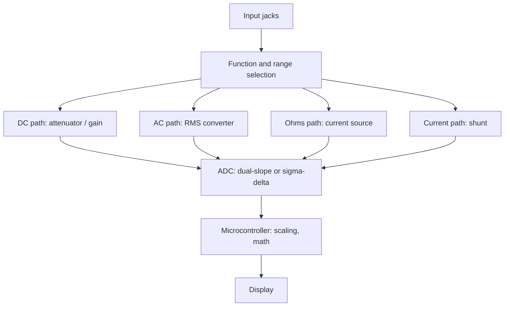

::: basics
### In plain words
A digital multimeter, or DMM, is a handheld or bench instrument that measures voltage, current and resistance and shows the answer as a number. Inside, it is a converter that turns a voltage into a number, with circuits in front that turn current or resistance into a voltage. It is accurate and steady for slow measurements, but it averages, so it misses fast events.

### Picture it
A DMM is like a very fine tape measure. The number of digits is how many tiny tick marks it has. That is resolution. Accuracy is whether the tape is stretched. A tape with millimeter ticks can still be wrong by a centimeter. Also, a meter can disturb the circuit it measures, like a tape bending a delicate object.

### Words you need
- **Resolution**: the smallest change the display can show. A 3½-digit meter shows up to 1999.
- **Accuracy**: how close the reading is to the true value. It is not the same as resolution.
- **Input impedance**: the resistance the meter puts across the circuit, typically 10 MΩ on voltage ranges.
- **Shunt**: a very small resistor the meter uses to turn current into a voltage.
- **Burden voltage**: the voltage that shunt takes from your circuit in current mode.

### The simplest example
On a 3½-digit meter's 2 V range, the largest count is 1999, so one count is $2/2000 = 1$ mV. A reading of 1.234 V is shown to the nearest millivolt.

Now measure the midpoint of two equal 1 MΩ resistors across 10 V. The true answer is 5 V. The meter's 10 MΩ input sits in parallel with the lower resistor, making it about 0.91 MΩ. The meter then reads about 4.76 V, which is 4.8% low. The meter changed the circuit it was measuring.

That is the whole idea. The rest of this page adds how each function works inside, how to read an accuracy spec like "percent of reading plus counts", and why current mode needs a fuse and care.
:::

::: testing
Whether you know a DMM as **an ADC with a front end and a display**, and not as a magic box. The interviewer wants a clear definition, the main blocks (range and attenuator, AC converter, ohms current source, ADC, display), the vocabulary (digits, counts, resolution vs accuracy, input impedance, burden voltage, CAT rating) and a few practical limits (it averages, it loads, it is slow). A good answer shows you can explain *why* a DMM is accurate and *where* it can mislead.
:::

::: why
The multimeter is the first instrument every hardware engineer uses and the most commonly misused. Reading a number off it is easy; knowing whether to believe it is the skill. Resolution is not accuracy, 10 MΩ input is not infinite, the current range is a short circuit with a fuse, and an average-responding meter lies about non-sinusoidal waveforms. These are classic interview probes because they separate people who have used a meter from people who understand one. This page is the foundation for the rest of the DMM questions ([[q0987]] what it measures, [[q0988]] sample rate, [[q0989]] DMM versus scope).
:::

::: concepts
- **Analog-to-digital conversion**: a DMM is an ADC (dual-slope, SAR or sigma-delta) with conditioning. See [[q0808]].
- **Ohm's law**: resistance and current ranges are built on $V=IR$. See [[q0001]].
- **Input impedance and loading**: the meter forms a divider with the source. See [[q0008]].
- **Burden voltage**: voltage the current range drops in the circuit.
- **Resolution, accuracy, precision**: counts and digits vs calibration error vs repeatability.
- **Averaging and mains rejection**: integrating converters reject line-frequency noise.
:::

::: answer
"A digital multimeter is a handheld or bench instrument that measures voltage, current and resistance, and usually more, and shows the result as a number. Internally it's basically an analog-to-digital converter with signal conditioning in front of it: for voltage, a selectable attenuator so a wide range of inputs fits the ADC's range; for resistance, a known current source so it can measure the voltage across the unknown; for current, a shunt resistor so it can turn current into voltage; and for AC, a converter that gets the RMS value. Then the ADC, often a dual-slope or sigma-delta type that integrates over a few power-line cycles to reject mains noise, and a display.

The key specs are the number of digits, like 3½ or 6½, which is resolution; the accuracy, quoted as a percentage of reading plus a few counts; and the input impedance, typically 10 megohms on voltage ranges. In current mode it has a burden voltage because of the shunt.

What it's great at is accurate, stable, low-speed measurements: DC voltages, resistances, continuity, current averages. What it's not for is anything fast, since it averages over tens of milliseconds, and it can load high-impedance circuits."
:::

::: technical
**Definition.** A digital multimeter (DMM) is a multi-function instrument that measures DC and AC voltage, DC and AC current and resistance, and typically also continuity, diode forward drop, capacitance, frequency, and temperature, displaying the result digitally.

**Architecture.**

1. **Input selection and range**: a precision resistive attenuator (e.g., 100:1, 1000:1) scales high voltages down; an amplifier scales small ones up so the ADC always sees a full-scale-ish input.
2. **Function conversion**: DC volts direct; AC volts through an RMS converter; current through a shunt ($V=IR_{shunt}$); resistance with a known current source (2-wire or 4-wire).
3. **ADC**: commonly dual-slope integrating converters (many handhelds), multi-slope integrating converters in precision bench meters, and sigma-delta in many modern designs.
4. **Processing and display**: counts to engineering units, with averaging, math (min/max, dB, relative).

**Specifications.**

- **Digits and counts**: "3½ digit" displays up to 1999 (max count 1999), "4½" up to 19,999, "6½" up to 1,999,999. Resolution on a range is range ÷ counts (e.g., a 2 V range on 3½ digits is 1 mV).
- **Accuracy**: ±(% of reading + % of range) or ±(% of reading + counts). Example: ±(0.05 % + 3 counts) on the 6 V range of a 60,000-count handheld (0.1 mV per count) reading 5.000 V: $0.0005\times5+3\times0.0001=2.8$ mV.
- **Input impedance**: ≈ 10 MΩ on voltage ranges, with a much higher impedance on the lowest ranges for some meters.
- **Burden voltage**: drop across the shunt on current ranges.
- **Safety rating**: IEC 61010 measurement categories (CAT II, III, IV) and maximum voltage, describing the transient energy the meter is designed to survive.
- **Reading rate**: from a few readings per second on handhelds to thousands on bench meters at reduced resolution.
:::

::: short
"A DMM measures voltage, current and resistance and displays a number. Internally it's an ADC with conditioning: attenuators for volts, a shunt for current, a current source for resistance, an RMS converter for AC. Key specs are digits or counts for resolution, accuracy as percent of reading plus counts, input impedance around 10 megohms, and burden voltage in current mode. It's great for accurate, slow measurements but it averages, so it can't see fast events, and it can load high-impedance nodes."
:::

::: long
"A digital multimeter is a general-purpose instrument for measuring voltage, current and resistance, usually with continuity, diode test, capacitance, frequency and sometimes temperature too.

Inside, it's an analog-to-digital converter with a front end that depends on the function. For voltage it has a precision attenuator so a wide range of inputs maps into the ADC's range. For resistance it forces a known current and measures the voltage across the unknown. For current it has a shunt resistor in series and measures the voltage across it. For AC it has an RMS converter. The ADC is often a dual-slope or sigma-delta type that integrates the input over a whole number of power-line cycles, so 50 or 60 hertz noise averages out. That makes it very accurate and stable, but slow.

The specs I watch are: digits, which is resolution, so 3½ digits is up to 1999 counts and 6½ is nearly two million; accuracy, which is quoted as a percent of the reading plus some counts, and is not the same as resolution; and input impedance, typically 10 megohms on voltage ranges, so it forms a divider with a high-impedance source and reads low. On current ranges it adds a burden voltage. And for safety I check the CAT rating.

So a DMM is the right tool for accurate DC values, resistance and continuity. It's the wrong tool for fast signals, because it averages over tens of milliseconds, and I have to watch for loading and for the average-versus-RMS issue on AC."
:::

::: terms
- **Counts**: the maximum integer the display can show; a 3½-digit meter has 1999 counts, 4½ has 19,999.
- **Digits (e.g., 6½)**: number of full digits plus a half digit that can only be 0 or 1; indicates resolution.
- **Accuracy specification**: ±(% reading + % range) or ±(% reading + counts); includes offset and gain errors.
- **Input impedance**: resistance (and capacitance) the meter presents; typically 10 MΩ for volts.
- **Burden voltage**: voltage drop across the meter in current mode.
- **True-RMS**: AC measurement computing the true root-mean-square of the waveform.
- **NPLC**: number of power-line cycles over which the ADC integrates; sets noise rejection and speed.
- **CAT rating (IEC 61010)**: measurement category (I–IV) indicating where in the electrical installation the meter is safe to use.
- **Autoranging**: the meter selects the range automatically.
:::

::: exceptional
**An average answer** says "it measures voltage, current and resistance."

**An exceptional answer**:
- Describes the **architecture** (conditioning → ADC → display) and what each function does inside.
- Distinguishes **resolution** (digits, counts) from **accuracy** (percent + counts) and computes an error example.
- Quantifies **loading**: 10 MΩ input is a divider with the source; gives an example error.
- Mentions **burden voltage** and the fuse in current mode.
- Names the **ADC types and the NPLC/mains-rejection idea**.
- States the **limits**: slow, averaging, AC bandwidth, true-RMS vs average-responding, and the **CAT safety rating**.
- Says when you would pick something else (scope, SMU, LCR meter).
:::

::: mistakes
- **Confusing digits with accuracy.** A 6½-digit display on an uncalibrated meter, or on a noisy range, is not accurate to 6½ digits.
- **Assuming infinite input impedance.** 10 MΩ across a 10 MΩ source halves the reading.
- **Measuring voltage with the leads in the current jack.** That puts the (very low) shunt across the source, which blows the fuse or damages the circuit.
- **Using a DMM current range on a low-voltage rail** without checking burden voltage.
- **Reading AC on a non-sine signal with an average-responding meter.** Use true-RMS and check the crest factor rating.
- **Ignoring the CAT rating.** A hobby-grade meter can fail violently on a mains or high-energy transient.
:::

::: deep
## A DMM is an ADC in a box

The conceptual block diagram is the same for almost every DMM:


Figure: every function converts to a DC voltage in the ADC's range. The accuracy of the meter is dominated by the reference and the attenuator and shunt resistors, which is why bench DMMs use ultra-stable references and matched resistor networks.

Each function is just Ohm's law:

- **DC volts**: attenuate to fit the ADC range. A 100:1 divider turns 600 V into 6 V.
- **Resistance**: force $I_{test}$ (say 1 mA on a 1 kΩ range) and measure $V=I_{test}R_x$.
- **Current**: pass current through a shunt $R_{sh}$ and measure $V=IR_{sh}$. This is why the current range is nearly a short circuit.
- **AC**: convert to an equivalent DC (the RMS) before the ADC.

## Resolution: digits and counts

A "3½-digit" meter has three full digits (0–9) and a leading half digit that can only be 0 or 1, so its maximum reading is 1999. On a 2 V range the resolution is $2/2000=1$ mV. A "6½-digit" meter reads up to 1,999,999 counts; on its 10 V range it displays 10.00000 V, so one count is $10/10^6=10\ \mu$V. In general:

$$ \text{resolution}=\frac{\text{range}}{\text{counts at full range}}. $$

Higher resolution needs a better ADC, a quieter front end and more integration time. A 24-bit ADC would nominally resolve $10\ \text{V}/2^{24}=0.6\ \mu$V, but noise, thermal EMF and drift usually limit the useful digits.

## Accuracy is a separate specification

Accuracy tells you how close the reading is to the true value. It has a gain term (percent of reading) and an offset term (percent of range or counts):

$$ \text{error}\le\pm\big(a\%\times\text{reading}+b\%\times\text{range}\big)\ \ \text{or}\ \ \pm(a\%\times\text{reading}+n\ \text{counts}). $$

Example, a 60,000-count handheld with ±(0.05 % + 3 counts) on its 6 V range (resolution 0.1 mV) reading 5.000 V: error $=0.0005\times5+3\times0.0001=2.5+0.3=2.8$ mV, so the true value is within 4.9972 to 5.0028 V.

A bench 6½-digit DMM on its 10 V range might be specified at ±(0.003 % of reading + 0.0005 % of range) (an illustrative figure for a good meter; check the specific datasheet), giving $5\times3\times10^{-5}+10\times5\times10^{-6}=0.2$ mV, roughly 14 times better. Specs are usually valid for 24 hours, 90 days or a year after calibration, over a stated temperature range, so older meters or wider temperature widen the error.

> [!UNCERTAIN]
> The accuracy values here are illustrative of the style and orders of magnitude of DMM specifications. Actual figures vary a lot between models and calibration intervals; always use the specific datasheet.

## Input impedance and loading

A DMM on a voltage range presents about 10 MΩ (many meters also offer >10 GΩ on the lowest DC ranges). Together with the source resistance it forms a divider:

$$ V_{read}=V_{true}\frac{R_{in}}{R_s+R_{in}}. $$

Measuring the midpoint of a 1 MΩ / 1 MΩ divider across 10 V (true 5.000 V): the meter's 10 MΩ appears in parallel with the lower 1 MΩ, giving 0.909 MΩ, so $V=10\times0.909/(1+0.909)=4.76$ V, which is 4.8 % low. With 100 kΩ resistors the error is 0.5 %; with 10 MΩ resistors, the meter reads 3.33 V, a 33 % error. A scope with a 1 MΩ input does worse. This is the same loading idea as for the divider in [[q0008]].

```sim
{"id":"dmm-lab","view":"loading"}
```
Figure: at the default 1 MΩ source the 10 MΩ meter reads 4.55 V instead of 5 V (9.1 % low). Raise the source resistance and watch the reading fall further below the true value. When $R_s$ equals the meter's input resistance the reading is exactly half.

## Current mode: a shunt and a fuse

In current mode the meter puts a low-value shunt in series with your circuit. Burden voltage $=I\times R_{shunt}$, quoted by range (for example a few hundred mV at full scale on small ranges, less on the amp range; check the manual). The input is fused. Two classic errors:

1. Leads left in the current jacks while measuring voltage: the shunt shorts the source.
2. Using the mA range on a circuit that draws more than the range: the fuse blows (a good reason to start on the highest current range).

See [[q0982]] for current-measurement trade-offs.

## How the ADC works: dual-slope and why 50/60 Hz matters

Many high-accuracy meters use a **dual-slope** converter: an integrator ramps up from the unknown input for a fixed time $T_1$, then ramps back down using a reference of opposite polarity until it returns to zero, taking $T_2$. The input voltage follows from the time ratio:

$$ V_{in}=V_{ref}\frac{T_2}{T_1}. $$

```plot
{"title":"Dual-slope integration (normalized)","x":{"label":"time (units of T1)","unit":"","min":0,"max":2},"y":{"label":"integrator output","unit":"","min":0,"max":1.1},
 "vars":{"t1":1,"vref":1},
 "series":[{"label":"Vin = 0.5 Vref","fn":"max(0,ite(x<t1,0.5*x,0.5*t1-vref*(x-t1)))","color":"accent"},{"label":"Vin = 0.25 Vref","fn":"max(0,ite(x<t1,0.25*x,0.25*t1-vref*(x-t1)))","color":"red","dashed":true}],
 "vlines":[{"at":"t1","label":"end of input phase (T1)"}],
 "points":[{"x":1.5,"y":0,"label":"T2 = 0.5 T1"},{"x":1.25,"y":0,"label":"T2 = 0.25 T1"}]}
```
Figure: the integrator ramps up for a fixed $T_1$ at a slope proportional to the input, then ramps down at a fixed slope until it returns to zero. The time it takes to come back is proportional to the input voltage. Notice that the exact value of the integrator's RC cancels out.

Because the input is integrated over $T_1$, any interference whose period divides $T_1$ cancels. Choosing $T_1$ as a whole number of power-line cycles (1, 10, 100 NPLC; 16.67 ms per cycle at 60 Hz, 20 ms at 50 Hz) rejects mains-frequency noise. The cost is speed: at 1 NPLC, a reading takes at least 16.7 ms (60 Hz). More on this in [[q0988]].

## What the number means: precision, accuracy, resolution

Three different things:

- **Resolution**: the smallest step the display can show.
- **Precision (repeatability)**: scatter between repeated readings of the same input; set by noise and averaging.
- **Accuracy**: closeness to the true value; set by calibration, reference drift and temperature.

You can have a meter with great resolution and repeatability that is inaccurate (a calibration offset). That is why traceable calibration matters and why an inexpensive meter's last digits are not information.

## Safety: CAT ratings

IEC 61010 defines measurement categories by where in the electrical installation you are working, which determines the transient energy available: **CAT II** (outlets, appliances), **CAT III** (distribution boards, fixed installations), **CAT IV** (service entrance, utility supply). A meter rated CAT III 600 V is designed to survive the transients expected in a CAT III installation up to 600 V. The voltage alone is not the rating; the category matters. For hobby and bench low-voltage work it isn't critical, but for any mains measurement, use a meter with a suitable rating, intact leads and fuses of the specified type.

## What a DMM is not

It is not fast: reading rates are Hz to kHz. It is not a waveform instrument: it reports one number per reading. It is not a high-frequency instrument: AC bandwidth is typically tens of kHz to a few hundred kHz. For those, use a scope ([[q0989]]), spectrum analyzer or a dedicated instrument ([[q0978]]).
:::

::: applications
- **Checking power rails** on a board during bring-up: voltage with 10 MΩ input.
- **Continuity and short checking** with the beeper and diode test.
- **Resistance checks** of components and traces; four-wire for low values.
- **Battery voltage and current draw** measurements ([[q0294]]).
- **Calibrating or verifying** other instruments and references on the bench.
- **Production test**: DMMs in automated test systems for DC parameters.
:::

::: assumptions
- Assumes a **typical handheld or benchtop DMM**; specialized meters (picoammeters, nanovoltmeters, power meters) differ.
- Accuracy and burden figures are **illustrative**; read the specific meter's specification.
- "Counts" and "digits" conventions vary slightly by manufacturer (e.g., 3¾ digits = 3999 counts, 4¾ = 39,999, and 50,000- or 60,000-count meters are marketed as 4½ or 4¾ digits depending on the vendor), so quoting counts is less ambiguous.
- The dual-slope converter is described as a **classic** architecture; modern meters often use sigma-delta or multi-slope variants.
- Input impedance of 10 MΩ is typical for volts; some meters are higher (>10 GΩ on low ranges), and AC ranges have lower impedance (about 1 MΩ with tens of pF).
:::

::: followups
### Why does a DMM read lower than expected on a high-resistance divider?
Its 10 MΩ input resistance loads the source. In parallel with the lower resistor it reduces the effective resistance and drops the voltage. For a 1 MΩ/1 MΩ divider across 10 V, the reading is 4.76 V instead of 5.00 V. Use smaller divider resistors, a meter with >10 GΩ input (low-range DC), or a buffer.

### What's the difference between 3½ digits and 6½ digits?
Resolution: 3½ digits shows up to 1999 counts (e.g., 1.999 V, 1 mV resolution on a 2 V range) and 6½ shows up to 1,999,999 counts (e.g., 10 µV per count on its 10 V range, which shows 10.00000 V). More digits mean a more demanding ADC, reference and noise performance. Accuracy specifications must also improve for those digits to be meaningful.

### Why does a dual-slope ADC reject 50/60 Hz noise?
It integrates the input for a fixed time. If that time is a whole number of mains cycles, a sinusoidal 50 or 60 Hz interference integrates to zero. A reading of 1 NPLC (16.67 ms at 60 Hz) gives about 60 dB or more of normal-mode rejection at the line frequency, at the cost of speed.

### How does a DMM measure resistance?
It forces a known current through the unknown resistor and measures the voltage across it, $R=V/I$. In 2-wire mode the same leads carry current and sense voltage, so lead resistance adds. In 4-wire mode separate sense leads measure the voltage directly at the resistor.

### Scenario: your meter reads 0.000 A on the current range, but the circuit is clearly working. What's wrong?
Most likely a blown meter fuse (common after measuring current across a source) or the leads are still in the voltage jacks. The meter is open-circuit in current mode, so it breaks the circuit; if the circuit still works, the meter isn't in the path. Check the fuse's continuity, move the lead to the current jack, and start on the highest range.
:::

::: interpretations
"What is a DMM?" is a definition question, but in a hardware interview the follow-ups will test loading, accuracy and the shunt. Give the definition, the architecture in one sentence, the main specs, and one limit. It's the first of a set that continues with what a DMM can measure ([[q0987]]), its sample rate ([[q0988]]) and DMM versus scope ([[q0989]]).
:::

::: references
- Keysight and Fluke multimeter primers and application notes: DMM architecture, accuracy specifications and measurement categories (manufacturer documentation, by topic).
- Horowitz & Hill, *The Art of Electronics*, 3rd ed.: measurement chapter, including meter loading and A/D conversion.
- IEC 61010-1, *Safety requirements for electrical equipment for measurement, control and laboratory use*, for measurement categories (by name).
- Keithley (Tektronix), *Low Level Measurements Handbook*: DMM and nanovoltmeter techniques.
:::

::: rubric
- Defines a DMM as a multi-function instrument for V, I, R (plus others) with a digital display :: The core definition.
- Describes it as conditioning plus an ADC and display, with the function conversions :: Shows you know what is inside.
- Distinguishes resolution (digits/counts) from accuracy (% reading + counts) :: A classic misconception.
- Mentions input impedance (~10 MΩ) and loading with a quantified example :: Practical limit of every voltmeter.
- Mentions burden voltage, the shunt and the fuse in current mode :: Practical limit of ammeters.
- Mentions averaging/integration, NPLC and slowness :: Sets up the scope-vs-DMM discussion.
- Mentions true-RMS and safety CAT ratings :: Shows breadth and safety awareness.
:::

::: quiz
```json
[
 {"type":"numeric","level":"fundamental","q":"A 3½-digit DMM on its 2 V range has a maximum reading of 1.999 V. What is its resolution?","answer":1,"tolerance":0.02,"unit":"mV","explain":"Resolution $=\\text{range}/\\text{counts}=2\\ \\text{V}/2000=1$ mV."},
 {"type":"mcq","level":"fundamental","q":"What is the main reason a DMM's current range has a burden voltage?","options":["It uses a battery","It has a low-value shunt resistor in series with the circuit","It is measuring AC","It has a display"],"answer":1,"explain":"The meter converts current to voltage using a shunt; the shunt's voltage drop ($IR_{sh}$) appears across the meter in series with your circuit."},
 {"type":"numeric","level":"intermediate","q":"A 60,000-count meter on its 6 V range (0.1 mV per count) reads 5.000 V with a spec of ±(0.05 % of reading + 3 counts). What is the maximum error?","answer":2.8,"tolerance":0.02,"unit":"mV","explain":"$0.0005\\times5\\ \\text{V}=2.5$ mV and 3 counts $=0.3$ mV, so the total is 2.8 mV."},
 {"type":"numeric","level":"intermediate","q":"A DMM with 10 MΩ input resistance measures the midpoint of a 1 MΩ / 1 MΩ divider connected across 10 V. What does it read?","answer":4.76,"tolerance":0.02,"unit":"V","explain":"The lower resistor becomes $1\\parallel10=0.909$ MΩ, so $V=10\\times0.909/(1+0.909)=4.76$ V."},
 {"type":"mcq","level":"intermediate","q":"Why does a dual-slope ADC reject 50/60 Hz interference when integrating over a whole number of line cycles?","options":["It filters with a notch","Sinusoidal interference averages to zero over an integer number of its periods","It increases the reference voltage","It samples faster than the mains"],"answer":1,"explain":"Integration over $T_1$ equal to an integer multiple of the interference period yields zero net contribution from a sinusoid at that frequency."},
 {"type":"truefalse","level":"advanced","q":"A meter with more display digits is necessarily more accurate.","answer":false,"explain":"Digits describe resolution. Accuracy depends on reference stability, calibration and the spec of the ranges. A high-resolution meter can still be off by hundreds of ppm."}
]
```
:::
