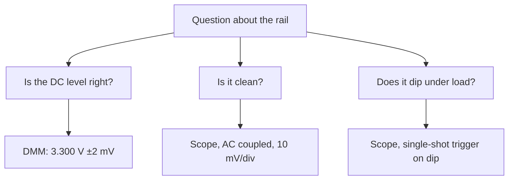

::: basics
### In plain words
Use a multimeter (DMM) when you need an accurate number, and a scope when you need to see what the signal is doing over time. A DMM gives one precise, averaged value. A scope shows the whole waveform, fast, but with coarser accuracy. For one power rail you often use both.

### Picture it
Think of weather data. The day's average temperature says 20 degrees, which is a precise single number. But it hides a freezing hour at 4 a.m. that killed the plants. The hourly chart shows that freeze, but each point on it is rougher. The daily average is the DMM, and the hourly chart is the scope.

### Words you need
- **Accuracy**: how close the reading is to the true value.
- **Resolution**: the size of the smallest step the display can show.
- **Averaging**: a DMM combines the input over tens of milliseconds into one number, so short events vanish.
- **Trigger**: a rule that tells a scope when to capture, such as "when the voltage falls below 3.1 V".
- **Single-shot**: capturing one occurrence of an event, then stopping.

### The simplest example
A 3.3 V rail powers a microcontroller. A radio burst now and then dips it by 200 mV for 200 µs, and the chip resets.

The DMM reads 3.30 V, good to about 2 mV, which confirms the regulator is set correctly. The dip changes the average by only about 4 mV. The meter cannot show it.

On a scope, set to 500 mV per division, one display step is about 16 mV. The scope's DC value is rougher, but with single-shot capture triggered when the voltage falls below 3.1 V, it catches the 200 mV dip. So the DMM answers "is the value right?" and the scope answers "what does it do?"

That is the whole idea. The rest of this page adds numbers on accuracy and speed, and one more difference: a scope's ground is tied to the building's earth, while a DMM's inputs are not.
:::

::: testing
Whether you can **choose the right instrument by what the measurement needs**, not by habit. The core contrast: a DMM gives one very accurate number per reading (slow, averaged, high resolution, isolated); a scope shows the waveform (fast, time-resolved, limited accuracy and resolution, grounded). The interviewer wants a rule (value → DMM, behavior → scope), the reasons in numbers (accuracy, resolution, bandwidth, loading), the practical differences (floating vs grounded, probes, triggering), and the habit of using both together.
:::

::: why
Reaching for the wrong tool is a common lab mistake with expensive consequences: believing a rail is fine because the DMM says 3.30 V while it dips below the brown-out threshold for 200 µs, or believing a rail is 3.25 V because the scope shows it when the scope's DC accuracy is a few percent. Fast, correct instrument choice is a daily skill in debug and validation. It also demonstrates that you understand the underlying differences (integrating ADC vs fast ADC, 10 MΩ vs probe loading, floating vs earth-referenced) rather than quoting folklore. The pages [[q0986]] to [[q0988]] give the DMM side; [[q0990]] introduces the scope side.
:::

::: concepts
- **Integrating (slow, accurate) vs fast (low-resolution) conversion**: DMM versus scope ADC. See [[q0988]], [[q0808]].
- **Resolution vs accuracy**: bits and counts versus calibration error.
- **Bandwidth and sample rate**: what a scope can see that a DMM can't. See [[q0983]].
- **Loading**: DMM 10 MΩ input versus scope 1 MΩ with a probe. See [[q0990]].
- **Triggering**: capturing events relative to a condition. See [[q0992]].
- **Reference / isolation**: a DMM floats; a scope's ground is tied to earth. See [[q0981]].
:::

::: answer
"I use the DMM when I need a number and the scope when I need to see what the signal is doing.

A DMM gives me one very accurate value: DC voltage to a fraction of a percent or better, resistance, current, continuity. It integrates over tens of milliseconds or more, so it's quiet and rejects mains noise, and it's isolated, so I can measure floating nodes safely. The downside is that it averages. It can't show shape, ripple, a glitch or a transient, and its AC bandwidth is limited.

A scope shows voltage versus time, with bandwidth from tens of megahertz to gigahertz, triggers, and captures that let me see ripple, edges, ringing, glitches, timing between signals and bus traffic. But it's less accurate: 8-bit vertical resolution and a DC accuracy of a couple of percent of full scale, and its ground is tied to earth, so I have to be careful with floating nodes.

So: is the rail the right value? DMM. Is the rail clean, does it dip on a load step, do the edges ring? Scope. For a rail I'd typically use both: the DMM for the exact DC value, the scope for ripple and transients. If something is intermittent, the DMM will average it out, so the scope with a trigger is the tool."
:::

::: technical
| Property | DMM | Oscilloscope |
|---|---|---|
| Output | One number per reading | Waveform (voltage vs time) |
| DC accuracy | Bench 6½-digit: tens of ppm; handheld: ~0.05 to 1 % | Typically 1 to 3 % of full scale (8-bit) |
| Resolution | 3½ to 8½ digits (up to ~ppm) | 8 bits (256 levels); 10 to 12 bits on some models, more with averaging |
| Speed | 2 readings/s to ~1000/s | Up to GS/s, MHz to GHz bandwidth |
| Bandwidth (AC) | kHz to hundreds of kHz | 20 MHz to tens of GHz |
| Input | ≈ 10 MΩ (volts); shunt (current) | 1 MΩ ∥ ~13 pF, or 50 Ω; 10× probe ≈ 10 MΩ ∥ ~10 pF |
| Reference | Floating, isolated (battery) | Earth-referenced (BNC shell tied to ground) |
| Triggering/capture | None (min/max/hold only) | Edge, pulse, bus, runt, single-shot |
| Mains/noise handling | Integration rejects line noise | Shows noise; averaging helps |
| Other functions | Resistance, continuity, capacitance, temperature | FFT, protocol decode, math |
| Cost/effort | Low, instant | Higher, needs setup and probing |

**Worked comparison.** A 3.3 V rail with 40 mV p-p triangular ripple at 100 kHz.

- **DMM**, DC mode: 3.300 V, accuracy about ±(0.05 % + 3 counts) → ±2 mV. AC mode (within bandwidth): triangle RMS $=20\ \text{mV}/\sqrt3=11.5$ mV, which says nothing about shape or spikes.
- **Scope** at 500 mV/div (4 V full span, 8-bit): one LSB is 15.6 mV, DC accuracy of ±1.5 % of full scale is ±60 mV, so 3.3 V is known to ±60 mV; the ripple is barely visible. At 10 mV/div with AC coupling the LSB is 0.31 mV and the 40 mV ripple is clear.
- Best practice: DMM for the 3.300 V, scope with AC coupling and sensitive range for the ripple and spikes.

**Short events.** A 1 µs, 1 V spike every 100 ms contributes $1\ \mu\text{s}/100\ \text{ms}\times1\ \text{V}=0.01$ mV to a 100 ms average. A DMM can't see it; a scope triggered on it shows it clearly.
:::

::: short
"The DMM is for a number, the scope is for a picture. A DMM gives accurate, quiet, high-resolution DC, resistance and current, and it's isolated, but it averages over tens of milliseconds so it can't show ripple, glitches or timing. A scope shows voltage over time with high bandwidth and triggering, but has only about 8 bits and a percent or two of DC accuracy, and its ground is tied to earth. So I use the DMM to check the DC value and the scope to check ripple, transients, edges and timing, and often both on the same rail."
:::

::: long
"My rule is: DMM for the value, scope for the behavior.

A DMM gives me one number, and it's accurate. A bench DMM measures DC voltage to tens of parts per million, a handheld to maybe a tenth of a percent. It integrates over tens or hundreds of milliseconds, so it's quiet and it rejects 50 or 60 hertz pickup. It's battery-powered and floating, so it's safe on circuits that aren't referenced to ground. And it does resistance, continuity, diode test, current. The limit is that it averages. A glitch, ripple, a transient on a load step, all disappear into the average.

A scope shows voltage as a function of time. It has bandwidth from tens of megahertz to gigahertz and it can trigger on an event, so I can see ripple, edges, ringing, overshoot, a droop, the timing between two signals, or decode a bus. What it gives up is accuracy and resolution: about 8 bits, so a couple of percent of full scale on DC. At 500 millivolts per division, 3.3 volts is only known to about plus or minus 60 millivolts, where the DMM would give a couple of millivolts. Also the scope's ground clip is tied to earth, so I have to use a differential probe or isolation for floating nodes.

For a power rail I'd do both. DMM to confirm it's 3.30 volts, then the scope on AC coupling and a sensitive range to see ripple and a single-shot trigger to catch droops on a load step. If a system resets randomly while the DMM says the rail is fine, that's the classic case where the DMM averaged away the dip and the scope finds it."
:::

::: terms
- **Resolution**: smallest step the instrument can distinguish (counts or ADC levels).
- **Accuracy**: closeness to the true value, including gain and offset errors.
- **Averaging / integration**: combining readings over time; makes a DMM quiet but slow.
- **Bandwidth**: highest frequency the instrument passes with small error. See [[q0980]].
- **Trigger**: a condition that starts a capture so a repetitive or single event is displayed stably.
- **Single-shot capture**: recording one occurrence of an event.
- **AC coupling**: blocking DC to magnify small variations.
- **Floating measurement**: measuring between two nodes neither of which is earth ground.
- **Loading**: the effect of the instrument's input impedance on the circuit.
:::

::: exceptional
**An average answer** says "DMM for DC values, scope for waveforms".

**An exceptional answer**:
- States the rule and then gives the **reasons in numbers**: accuracy (ppm to 0.05 % vs 1–3 % of full scale), resolution (digits vs 8 bits), speed (ms vs ns), bandwidth.
- Works the **same rail with both instruments** and shows what each hides.
- Explains **why the DMM misses transients** (integration) and **how to catch them** (single-shot trigger).
- Mentions **floating vs earth-referenced** and **loading and probes**.
- Notes **combined practice**: use the DMM to calibrate or sanity-check the scope's DC level.
- Mentions the gray area: **high-resolution scopes (12-bit+), digitizing DMMs, DAQ/SMUs**.
- Adds the **practical** angle: DMM is faster to set up; scope needs probe, compensation and grounding care.
:::

::: mistakes
- **Trusting a DMM reading for dynamic behavior.** "The rail is 3.30 V" does not mean it never dips.
- **Trusting the scope's absolute DC value.** A few-percent error and coarse resolution at large V/div; check against a DMM.
- **Using a DMM to measure PWM or switching ripple** in AC mode and believing the RMS number represents the switching waveform.
- **Clipping a grounded scope probe on a floating node.** The DMM's floating input is the safe choice for simple voltage checks of non-ground-referenced points.
- **Ignoring probe loading** (10× probe at 10 MΩ ∥ 10 pF) on sensitive nodes where a DMM's 10 MΩ is fine.
- **Believing "the scope is always better."** For accurate DC values, resistance, current or continuity, the DMM wins; speed and capture are only needed when the signal changes.
:::

::: deep
## The same signal, two instruments

Consider a 3.3 V logic rail powering a microcontroller. The rail has 40 mV peak-to-peak triangular ripple at the converter's 100 kHz switching frequency, some 1 µs spikes at the switch edges, and a 200 mV droop lasting 200 µs each time a radio burst turns on. The system resets occasionally.


Figure: three questions about one rail and the instrument that answers each. Only the first is a DMM question.

**What the DMM says.** DC mode: 3.300 V, with error about ±(0.05 % of reading + 3 counts) = ±(1.65 + 0.3) mV ≈ ±2 mV. That's a great answer to "is the regulator set correctly?" AC mode (if within bandwidth): about 11.5 mV RMS, the RMS of the 40 mV p-p triangle ($20\ \text{mV}/\sqrt3$), possibly more if spikes are inside the meter's bandwidth. The 200 µs droop is invisible: if it happens 100 times per second, 200 µs of 200 mV droop over a 10 ms window shifts the average by $200\ \text{mV}\times0.2\ \text{ms}/10\ \text{ms}=4$ mV: the display reads about 3.296 V, which nobody would recognize as a 200 mV dip.

**What the scope says.** Set to 500 mV/div with the trace centered, the scope sees the rail at 3.3 V ± 60 mV (accuracy $\pm1.5\ \%$ of the 4 V full span, typical for an 8-bit scope; check the datasheet) and the ripple is a wobble of about 2.5 ADC levels. Switch to AC coupling and 10 mV/div: now the 8-bit LSB is $0.08\ \text{V}/256=0.31$ mV, the ripple is four divisions tall and the spikes appear. Trigger on a falling edge below 3.1 V, single-shot, and the 200 µs droop shows up, with the radio burst timing alongside on a second channel. That's the likely reset cause.

| Question | DMM result | Scope result |
|---|---|---|
| DC level | 3.300 V ± 2 mV | 3.30 V ± 60 mV |
| Ripple | RMS only (11.5 mV), no shape | 40 mV p-p triangle visible |
| 1 µs spikes | Invisible | Visible, amplitude measurable |
| 200 µs droop | Not visible as a dip (average shifts only ~4 mV) | Captured with trigger |
| Timing vs other signals | None | Two-channel view |

## Accuracy and resolution, in numbers

**DMM.** A 6½-digit bench meter on its 10 V range can resolve 10 µV and have DC accuracy of order tens of ppm of reading. A handheld at ±(0.05 % + 3 counts) is still good. The ADC integrates, so the effective noise is very small.

**Scope.** An 8-bit ADC gives 256 levels over the vertical span (typically 8 or 10 divisions). The resolution at each V/div is span/256:

| Setting | Full span (8 div) | LSB |
|---|---|---|
| 500 mV/div | 4 V | 15.6 mV |
| 50 mV/div | 0.4 V | 1.56 mV |
| 10 mV/div | 80 mV | 0.31 mV |

DC gain accuracy for many general-purpose scopes is a few percent of the full vertical span plus an offset term, so reading 3.3 V at 500 mV/div is uncertain by tens of millivolts. High-resolution scopes (12 bits or more) and averaging improve resolution, but accuracy is still scope-class. If you need accuracy better than about 1 %, use the DMM or at least verify the scope's DC level against a DMM.

> [!UNCERTAIN]
> Scope DC accuracy is specified per model (often as a percentage of full scale, plus offset terms that depend on V/div). The 1 to 3 % range is typical for general-purpose scopes, not universal.

## Speed and bandwidth

The DMM's reading takes 16.7 ms or more per reading at 1 NPLC ([[q0988]]) and its AC bandwidth is tens to hundreds of kHz. A scope captures at MS/s to GS/s with bandwidth from tens of MHz to GHz. If the interesting thing happens in less than a few tens of milliseconds, the DMM can't resolve it.

```sim
{"id":"scope-trigger","level":0.5,"slope":"rising"}
```
Figure: untick *Trigger enabled* and the trace rolls. Re-enable it: with the default noise and no hysteresis, noise causes occasional false triggers and a doubled image, so raise *Noise reject* a little and the waveform locks. Then pick the *glitch* signal and the *glitch* trigger type to catch the rare event. The DMM has no equivalent: it can't say "show me what happens when the rail drops below 3.1 V."

## Reference, isolation and safety

A handheld DMM is battery-powered and floating: its two inputs have no connection to earth, so it can measure the voltage between any two nodes (within its rating), including floating or mains-referenced ones, with the appropriate CAT rating. A bench scope's input BNC shells are tied together and to earth via the power cord. Connecting the ground clip to a node not at earth potential shorts it through the scope ([[q0981]]).

So for a *simple voltage check on an unknown or floating circuit*, the DMM is the safe first choice. For fast signals on ground-referenced circuits, the scope is natural. For fast signals on floating circuits, use a differential or isolated probe, never the earth-referenced ground clip.

## Input loading

A DMM presents about 10 MΩ; a 10× passive scope probe presents about 10 MΩ ∥ ~10 pF; a 1× probe 1 MΩ ∥ ~100 pF. At DC they are similar, at high frequency the probe capacitance dominates. For a 10 MΩ-source node, either instrument reads about half the true voltage. For high-impedance fast nodes, neither is ideal; use an active probe or a buffer ([[q0990]]).

## Combined techniques

- **Calibrate the scope's DC level** by reading the same node with a DMM.
- **Use the DMM for current averages and the scope (shunt or current probe) for current waveforms.**
- **Use the DMM's min/max mode** for slow changes, and the scope for fast ones.
- **Log with the DMM** for long durations (battery discharge hours) and trigger the scope on rare events within.
- **Use a digitizing DMM, a DAQ or an SMU** when you need both precision and moderate speed (kS/s), or a high-resolution scope (12–16 bits) when you need waveform shape with better resolution.

## A decision table

| Situation | Choose |
|---|---|
| Is the rail the right voltage? | DMM |
| Measure resistance, continuity, diode, capacitance | DMM |
| Check supply current draw (average) | DMM current range or shunt |
| See ripple, noise, spikes | Scope |
| Catch a glitch or brown-out | Scope, single-shot trigger |
| Measure an edge, overshoot, ringing | Scope with adequate bandwidth |
| Timing between two signals | Scope, 2+ channels |
| Decode I²C/SPI/UART | Scope with decode or logic analyzer |
| Floating or mains-referenced voltage | DMM (rated) or differential/isolated scope |
| Precise DC value, ppm level | Bench DMM |
| Long-term slow logging | DMM or data logger |

> [!INTERVIEW]
> Tell the rail story. "DMM says 3.30 V, the system still resets: the DMM averaged the 200 µs droop. I'd put the scope on it, single-shot, trigger below 3.1 V." It shows you know both tools' blind spots in one example.
:::

::: applications
- **Power-rail validation**: DMM for the DC value, scope for ripple, transient and power-up behavior.
- **Battery-powered device debug**: DMM average current vs scope or profiler for burst current.
- **Bring-up**: DMM continuity and voltage checks first, then scope for clocks, resets and buses.
- **Calibration and incoming inspection**: bench DMM for accuracy of references and resistors.
- **Motor drives and switching converters**: scope with differential probe for floating switch nodes; DMM for DC bus voltage.
- **Production test**: DMM or SMU for precise DC parameters, scope or digitizer for waveform checks.
:::

::: assumptions
- Assumes a **typical bench**: a general-purpose 8-bit scope and a handheld or 6½-digit DMM. High-resolution scopes (12–16 bits), digitizing DMMs and SMUs blur the boundary.
- Accuracy numbers (0.05 %, 1.5 %, etc.) are **typical** and vary by model and range.
- Assumes **ground-referenced** circuits for scope measurements unless noted.
- The ripple, droop and spike values in the example are **illustrative**.
- In some contexts the answer is "both": the question "when to use X vs Y" often expects the rule plus the combined workflow.
- For **power measurements** (efficiency, power factor) a power analyzer is better than either.
:::

::: followups
### A DMM reads 3.30 V but my MCU resets randomly. What now?
Put the scope on the supply pin of the MCU near its decoupling, trigger single-shot on a falling edge below the brown-out threshold (for example 3.0 V), use AC or DC coupling with the offset set to see the dip, and correlate with other signals (radio TX, motor start) on a second channel. The DMM averaged the brief droop away.

### Which instrument is more accurate for measuring a 5 V reference, and why?
The DMM, by a large margin: an integrating ADC with a precise reference and stable divider gives tens of ppm on a bench meter, while an 8-bit scope has ±1 to 3 % of full-scale and coarse resolution. The scope's strength is time resolution, not absolute amplitude.

### Can you measure ripple with a DMM?
Only its RMS in AC mode and only if the ripple is within the meter's bandwidth. It tells you nothing about the shape, peaks or spikes, and a switching spike beyond the meter's bandwidth will be missed or under-read. A scope with AC coupling and a short ground is the right tool.

### Why is a DMM safer for measuring a floating voltage?
Its inputs are floating (isolated from earth), and the meter has a rated overvoltage category. A scope's ground lead connects to earth through the mains cord, so it shorts a floating node to earth at the clip. For floating signals with a scope, use a differential or isolated probe.

### Scenario: you must verify a 12-bit ADC's 3.3 V reference to 0.1 % and also check its ripple. What do you use?
The DMM for the DC value, since 0.1 % of 3.3 V is 3.3 mV, beyond what an 8-bit scope at a sensible V/div guarantees. The scope with AC coupling for ripple, at 1–10 mV/div with a bandwidth limit and a short ground, to see whether it is below the ADC's LSB (0.8 mV). Both are needed because they answer different questions.
:::

::: interpretations
"When to use DMM vs scope?" is a **decision question**: the answer is a rule plus reasons plus an example. Don't present them as competing tools; the strongest answer shows the workflow of using both. Some interviewers push on exceptions (high-resolution scopes, digitizing DMMs, data loggers): acknowledge the gray area and keep the rule, which is *value vs behavior*.
:::

::: references
- Horowitz & Hill, *The Art of Electronics*, 3rd ed.: measurement chapter on meters and oscilloscopes.
- Oscilloscope fundamentals primers and DMM application notes from the major manufacturers (resolution, accuracy and bandwidth specifications, by topic).
- Keithley (Tektronix), *Low Level Measurements Handbook*: DMM and precision measurement techniques.
- Bogatin, *Signal and Power Integrity: Simplified*: probing and measurement-bandwidth topics.
:::

::: rubric
- States the core rule: DMM for accurate values, scope for waveform/behavior :: The central takeaway and the natural opening line.
- Compares accuracy and resolution (ppm or 0.05 % vs 1–3 % and 8 bits) with numbers :: Backs the rule with engineering facts.
- Explains speed and bandwidth: DMM averages over ms; scope sees ns to µs :: Explains why a DMM misses transients.
- Mentions triggering and single-shot capture for glitches :: The scope's unique capability.
- Mentions floating vs earth-referenced inputs and safety :: Practical and safety-relevant difference.
- Mentions loading and probes :: Both instruments affect the circuit differently.
- Gives a combined example (rail: DMM for DC, scope for ripple and droop) :: Demonstrates the real workflow.
:::

::: quiz
```json
[
 {"type":"mcq","level":"fundamental","q":"Which instrument is better for checking the exact DC value of a 3.3 V rail to within a few millivolts?","options":["Oscilloscope at 500 mV/div","Digital multimeter","Logic analyzer","Spectrum analyzer"],"answer":1,"explain":"A DMM offers much better DC accuracy and resolution than an 8-bit scope at a coarse vertical scale."},
 {"type":"mcq","level":"fundamental","q":"Which instrument can capture a single 5 µs voltage droop?","options":["DMM at 1 NPLC","Oscilloscope with a single-shot trigger","DMM in diode-test mode","Capacitance meter"],"answer":1,"explain":"The DMM averages over tens of milliseconds and cannot resolve a 5 µs event. A triggered scope captures it."},
 {"type":"numeric","level":"intermediate","q":"At 500 mV/div (8 divisions) on an 8-bit scope, what is the voltage of one ADC level (LSB)?","answer":15.6,"tolerance":0.03,"unit":"mV","explain":"The span is $0.5\\times8=4$ V; $4/256=15.6$ mV per level."},
 {"type":"numeric","level":"intermediate","q":"A 1 µs, 1 V spike occurs once every 100 ms. By how much does it change a 100 ms average reading, in microvolts?","answer":10,"tolerance":0.03,"unit":"µV","explain":"Contribution $=1\\ \\text{V}\\times1\\ \\mu\\text{s}/100\\ \\text{ms}=10^{-5}$ V = 10 µV: negligible on a DMM."},
 {"type":"multi","level":"intermediate","q":"Which are advantages of a handheld DMM over a bench scope? Select all that apply.","options":["Floating, isolated inputs","Higher DC accuracy","GHz-class bandwidth","Integration rejects mains noise"],"answer":[0,1,3],"explain":"A DMM is floating, much more accurate at DC, and its integration rejects line noise. Bandwidth is the scope's advantage."},
 {"type":"truefalse","level":"advanced","q":"If a DMM reads a steady 3.30 V on a supply rail, you can conclude the rail never dips below 3.0 V.","answer":false,"explain":"A DMM averages over tens of ms or more, so short dips of microseconds or even a few milliseconds barely change the reading. Use a scope with a trigger to check."}
]
```
:::
