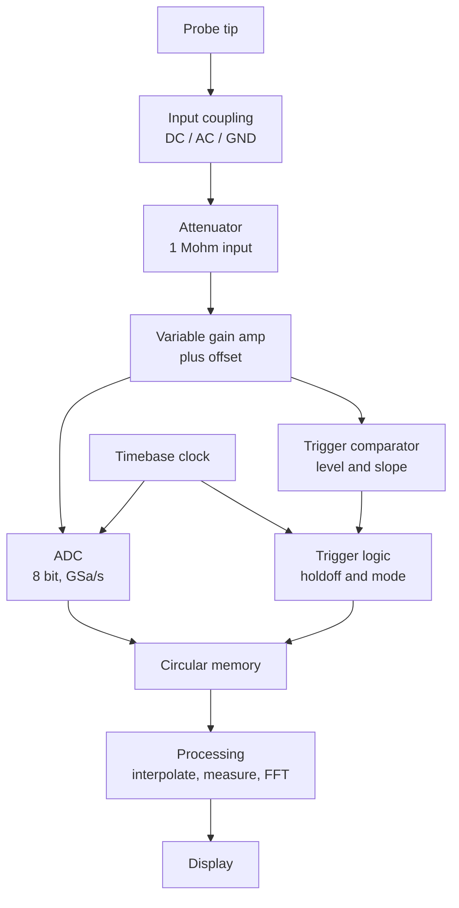

::: testing
Whether you can trace a signal through the instrument from probe tip to pixel and explain what each stage does *and what it can get wrong*. The interviewer wants a block diagram in your head: input coupling and attenuator, amplifier, ADC, memory, trigger, timebase, display. Hidden sub-skills: sampling theory (Nyquist, aliasing, interpolation), how trigger and acquisition memory combine to give pre-trigger history, and why bandwidth, sample rate and memory depth are three different limits.
:::

::: why
If you only know a scope as a black box with knobs, you cannot reason about why it lies. Knowing the signal chain explains why a fast glitch disappears at slow time/div, why the display "rolls" without a trigger, why 8 bits is limiting, and why bandwidth and sample rate are separate specs. In interviews it separates "has pushed buttons on a scope" from "understands the instrument." In the lab it helps you choose settings that give a faithful picture of a circuit.
:::

::: concepts
- **Signal conditioning**: coupling, attenuation and gain bring the input into the ADC's range with minimal distortion. Related: voltage dividers, [[q0008]].
- **Sampling and Nyquist**: the ADC takes snapshots at $f_s$; frequencies above $f_s/2$ alias. See [[q0983]].
- **Quantization**: an N-bit ADC has $2^N$ levels; resolution is full scale over $2^N$.
- **Trigger**: a comparator-based circuit that defines "time zero" for each capture. See [[q0992]].
- **Acquisition memory**: a circular buffer that continuously holds the most recent samples, enabling pre-trigger viewing.
- **Interpolation and decimation**: reconstructing between samples (sin(x)/x) and reducing samples to fit the screen.
- **Bandwidth of the analog front end**: sets the lowest-level limit regardless of sample rate. See [[q0990]].
:::

::: answer
"A digital scope is basically a fast data-acquisition system with a clever trigger. The probe feeds an input stage: coupling, an attenuator and a variable-gain amplifier that scale the signal to fit the ADC's range, set by the volts-per-division knob. Then a very fast ADC samples it continuously, say a gigasample a second at 8 bits, and writes the samples into a circular memory.

In parallel, the trigger circuit watches the analog signal with a comparator against a level I set. When the trigger condition happens, it marks that moment as time zero, the scope keeps capturing for the post-trigger time, and then stops filling. Because the memory was already running, I also get samples from before the trigger, so I can see what led up to the event.

The processor then takes that record, interpolates between samples so the waveform looks continuous, decimates it to fit the screen, runs measurements or FFT math on it, and draws it. The timebase just sets how fast the sampling clock runs and how long the window is.

The limits come from each stage: the front-end bandwidth rolls off high frequencies, the sample rate has to be high enough to avoid aliasing, the 8-bit ADC limits the smallest voltage step, and the memory depth limits how long I can capture at a given sample rate."
:::

::: technical
**Signal chain (real-time DSO)**
1. **Input coupling and attenuator.** Selects DC, AC (series blocking capacitor) or ground. A 1 MΩ input network with switched, frequency-compensated dividers (the same $R_1C_1=R_2C_2$ idea as a probe) extends the range to tens of volts.
2. **Variable-gain amplifier and offset.** Gain steps match V/div; an offset DAC positions the trace. This stage sets the analog bandwidth and the noise floor. A bandwidth-limit filter (often 20 MHz) can be inserted.
3. **ADC.** Typically 8 bits at 1–100+ GSa/s. The very fastest rates are achieved by **time-interleaving** several slower ADCs, which introduces gain/offset/timing mismatch spurs that are calibrated out.
4. **Acquisition memory.** The ADC writes into a circular buffer continuously. Depth $N$ and rate $f_s$ give a window $T=N/f_s$.
5. **Trigger path.** A separate comparator/threshold circuit on a (often less-processed) copy of the signal produces a trigger event; logic applies holdoff and mode (auto/normal/single). After the event, the scope fills the remaining post-trigger fraction and halts.
6. **Timebase.** A stable crystal-derived clock; time/div sets decimation or sample-rate selection.
7. **Processing and display.** Interpolation, decimation (sample, peak detect, high-resolution, average), measurements, FFT, and rendering. The trigger point is placed at the horizontal position (delay) you choose.

**Key relations**
- Resolution: one LSB $=\dfrac{V_{FS}}{2^N}$, so 8 divisions at 1 V/div and 8 bits gives 31.25 mV.
- Window: $T = N/f_s$. 10 Mpts at 100 MSa/s covers 100 ms.
- Max alias-free frequency: $f_s/2$, and edge fidelity needs ~4–5 samples per rise time.
- Pre-trigger: if the trigger position is at 20% of the record, 20% of the samples are "before."
- Averaging $M$ uncorrelated acquisitions improves noise by $\sqrt M$; high-resolution mode trades bandwidth for bits (each 4× oversampling adds ~1 effective bit for noise-dominated signals).

**Other architectures.** Equivalent-time (sequential/random) sampling reconstructs a *repetitive* signal from many triggers with a much higher effective rate, but cannot capture single events. Analog scopes have no ADC; the signal deflects a CRT beam directly.
:::

::: short
"A digital scope conditions the input with coupling, an attenuator and an amplifier, then a fast ADC samples it into a circular memory. A separate trigger comparator decides which moment is time zero, so the scope can stop after enough post-trigger samples and show the history before it too. The processor interpolates, decimates and draws the waveform. So bandwidth, sample rate, ADC bits and memory depth each limit the picture in their own way."
:::

::: long
"I think of a digital scope as a data-acquisition system plus a trigger. Starting at the probe, the signal enters an input stage with coupling, DC or AC, then a switched attenuator and a variable-gain amplifier. That is what the volts per division knob controls: it scales the signal so it fills the ADC's range. This analog stage sets the bandwidth, so if it rolls off at 200 megahertz, nothing past that can be recovered later no matter how fast the ADC is.

Next is the ADC, typically eight bits and running at somewhere between one and a few tens of gigasamples a second. It runs continuously and writes into a circular buffer. That is the neat trick behind triggering: the buffer is always full of the most recent history, so when the trigger fires I can show what happened before it.

The trigger itself is a comparator watching the signal against a threshold and slope that I set. When it sees the event, it marks time zero, the scope captures the remaining post-trigger samples, then freezes the record. Holdoff and auto, normal or single mode just control when it re-arms.

The timebase controls how long the window is. The window equals memory depth divided by sample rate. So if I zoom out to 100 milliseconds per division, a ten megasample memory has to drop to about ten megasamples per second, and a fast glitch can fall between samples. Peak-detect mode exists for that.

Finally, a processor interpolates between samples, decimates to fit the screen, calculates measurements or an FFT, and draws it. So in my head: bandwidth is the analog limit, sample rate and Nyquist the digital limit, eight bits the amplitude limit, and memory depth the time limit."
:::

::: terms
- **Attenuator**: switched resistive/capacitive divider at the input that scales large signals down.
- **Time-interleaved ADC**: several ADCs sampling at staggered phases to reach a higher combined rate.
- **Circular (ring) buffer**: memory that continuously overwrites its oldest samples; the basis of pre-trigger capture.
- **Pre-trigger / post-trigger**: samples captured before and after the trigger event.
- **Decimation**: discarding or combining samples to fit a shorter display or lower rate.
- **Peak-detect**: acquisition mode that keeps the min and max in each sample interval so narrow glitches survive.
- **sin(x)/x interpolation**: reconstructs points between samples assuming a band-limited signal.
- **Equivalent-time sampling**: builds a repetitive waveform from many triggers at slightly different delays.
- **Dead time**: the interval after a capture where the scope processes and is blind to new events.
:::

::: exceptional
**An average answer** lists "input, ADC, memory, display."

**An exceptional answer**:
- Explains the circular buffer and how pre-trigger viewing falls out of it.
- Says the trigger is a separate comparator path, not computed after the fact from the ADC samples (on most scopes), and why that matters for jitter.
- Quantifies $T=N/f_s$ with an example and explains why the sample rate falls when you zoom out.
- Separates the analog bandwidth limit from the sampling limit and gives the 4–5 samples per edge rule.
- Mentions peak detect or segmented memory as the way to find glitches.
- Notes interleaved-ADC mismatch and 8-bit quantization as real-world limits.
:::

::: mistakes
- **"The ADC bandwidth is the sample rate."** Bandwidth is the analog front-end's −3 dB point; sample rate is separate. A 100 MHz scope at 1 GSa/s is normal.
- **Thinking the scope only records after the trigger.** The buffer runs continuously, which is why the trigger point can sit mid-screen or at the right edge.
- **Assuming sample rate is always the headline number.** It's the maximum, available only at fast time bases. Zoom out and the actual rate drops.
- **Forgetting aliasing.** A slow time base can fold a fast signal into a false slow one. Check the displayed rate.
- **Believing interpolation adds information.** sin(x)/x only draws a plausible curve between samples for a band-limited signal; it cannot restore content above Nyquist.
- **Ignoring dead time** and assuming the scope sees every event. On a busy signal it can miss rare glitches between acquisitions.
:::

::: deep
## The block diagram


Figure: The signal runs top to bottom through conditioning, ADC and memory to the display. The trigger takes a branch off the amplifier output and tells the memory when to stop writing. The timebase clock drives both the ADC and the trigger timing.

## Input stage: getting the signal into range

The ADC has a fixed input range, say ±0.4 V. The signal might be 5 V or 5 mV, so the front end scales it. The attenuator divides large signals, and the amplifier boosts small ones. A 1 MΩ input resistance is common (high impedance so the probe doesn't load the circuit much), but any amplifier input has capacitance to ground, so the attenuator needs **compensation**: a capacitor across the top resistor so that $R_1C_1=R_2C_2$ and the division ratio is flat in frequency rather than rolling off. This is exactly the structure of a 10× probe; the next level of the chain does the same trick again ([[q0997]]).

The amplifier has finite bandwidth. It determines the −3 dB point and, along with the probe, the rise time you can display. For a first-order response, $f_{-3dB}=0.35/t_r$. A bandwidth-limit switch inserts a low-pass (commonly 20 MHz) to cut noise when you only care about slow signals.

## The ADC: sampling and quantization

The ADC measures the amplified voltage every $T_s=1/f_s$. Two facts follow:

- **Quantization.** With $N=8$ bits there are 256 levels. Over an 8-division screen, an LSB is 1/32 of a division. At 1 V/div, that is 31.25 mV. Quantization noise is roughly $\text{LSB}/\sqrt{12}$ RMS, which is ~9 mV in that setting, but you move down to a 10 mV/div range and an LSB becomes 0.31 mV. This is why you should always scale the signal to fill the screen.
- **Nyquist.** A signal at frequency $f$ sampled at $f_s$ with $f>f_s/2$ appears at $|f-kf_s|$ for the nearest integer $k$. A 900 Hz sine sampled at 1 kHz looks like 100 Hz. Scope designers specify bandwidth well below $f_s/2$ (a 1 GHz scope typically samples at 5 GSa/s or more) so that real signals don't alias.

```sim
{"id":"sampling-aliasing","f":900,"fs":1000}
```
Figure: With the signal at 900 Hz and fs at 1 kHz, the reconstructed waveform is a false 100 Hz tone. Raise fs above 1.8 kHz and the true frequency appears. A scope's anti-alias protection is its analog bandwidth: it must roll off before Nyquist.

To reach multi-GSa/s, scopes **time-interleave** several ADCs. Four ADCs at 1.25 GSa/s staggered by 200 ps give 5 GSa/s. Mismatch in gain, offset and timing between the ADCs creates spurs and distortion, which the scope calibrates out; this is why scopes need a periodic self-calibration.

## Memory and the timebase

The ADC writes into memory continuously. The record holds $N$ points. The screen shows 10 divisions of time, so the time base fixes the window you want, and the scope picks the highest sample rate that fits it:

$$f_s=\min\left(f_{s,max},\ \frac{N}{10\cdot\text{time/div}}\right)$$

Worked example: memory $N=10$ Mpts, maximum rate 1 GSa/s.

| Time/div | Window (10 div) | Required for 1 GSa/s | Actual $f_s$ |
|---|---|---|---|
| 1 µs | 10 µs | 10 kpts | 1 GSa/s |
| 1 ms | 10 ms | 10 Mpts | 1 GSa/s |
| 10 ms | 100 ms | 100 Mpts | 100 MSa/s |
| 100 ms | 1 s | 1 Gpts | 10 MSa/s |

At 100 ms/div the sample interval is 100 ns; a 20 ns glitch can slip between samples. That is why peak-detect, segmented memory and deep memory exist.

## Triggering and pre-trigger history

The trigger comparator watches the signal. When its condition is met, it emits an event. Meanwhile the ADC has been writing into the ring buffer the whole time, so the scope can say: "stop filling after $(1-p)N$ more samples," where $p$ is the fraction of the record you want before the trigger. If $p=20\%$, 20% of the screen is history. That is how you see the glitch that *caused* the reset, not just what happened afterwards.

```timing
{"signals":[{"name":"Input","wave":"0...1...0.......","color":"accent"},{"name":"Trigger event","wave":"0...10..........","color":"red"},{"name":"ADC writing","wave":"1.......0.......","color":"green"},{"name":"Stored record","wave":"x=.........x....","data":["window"]}],"marks":[{"t":4,"label":"trig"}]}
```
Figure: The ADC writes continuously until the trigger event plus the post-trigger interval. The stored window straddles the trigger point: samples to the left are the pre-trigger history that only a free-running buffer can supply.

Because the trigger comparator is analog and the ADC samples are discrete, the trigger rarely lines up exactly with a sample. Good scopes measure the fractional-sample offset between trigger and sample clock and shift each record accordingly (interpolation), which is what keeps repeated acquisitions overlaid without visible jitter.

## Processing and display

- **Interpolation.** With $\ge4$–5 samples per period of the highest content, sin(x)/x interpolation reconstructs a smooth curve. With fewer, linear interpolation is used, and the waveform looks jagged or the wrong shape.
- **Decimation.** The screen has about 1000 pixels across. A 10 Mpts record has 10,000 points per pixel column. The scope can show every N-th sample, the min/max (peak detect), averages, or a color-graded persistence display.
- **Acquisition modes.** *Sample* (default), *peak detect* (min/max kept, catches glitches), *average* (reduces uncorrelated noise by $\sqrt M$), *hi-res* (oversample and average inside one acquisition, each 4× adds ~1 effective bit but reduces bandwidth).
- **Measurements and math.** Rise time, RMS, frequency, FFT and channel math come from the stored record.

> [!NOTE]
> Update rate matters. A scope that draws 100 waveforms per second spends most of its time blind, while one that draws 1,000,000 per second shows rare events as faint traces in a persistence display. Dead time between captures is the "blind" fraction.

## Real hardware behavior

- **Self-calibration.** Interleaved ADCs, offsets and the attenuator drift with temperature. A scope should warm up (typically 20–30 minutes) and self-calibrate with nothing connected.
- **Bandwidth is not flat.** Different scopes have Gaussian (slow, well-behaved) or sharper responses with ringing in the step response. A Gaussian response gives about $0.35/BW$; flatter ones give $0.4$–$0.45/BW$.
- **ENOB.** The effective number of bits at high frequency is less than 8, roughly 5–6.5 at full bandwidth for many scopes. Vertical accuracy specs are typically of the order of 1–3% of full scale.
- **Trigger path differences.** On many scopes the trigger path has its own bandwidth and noise, which is why a noisy signal can trigger poorly even when the displayed trace looks fine; trigger sensitivity is specified separately.

> [!UNCERTAIN]
> Exact architectures (how many interleaved ADCs, whether the trigger path is analog or digital, ENOB values) vary by manufacturer and generation. The structure above is the common textbook organization; vendors' fundamentals primers describe their own implementations.
:::

::: applications
- **Choosing a scope**: matching bandwidth, sample rate and memory to the signals in a design (a 100 MHz MCU clock needs far more than a 100 MHz scope).
- **Catching intermittent glitches** with peak detect, segmented memory and persistence display.
- **Pre-trigger analysis**: seeing the voltage droop that precedes a brownout reset.
- **Power integrity measurements**: deep memory plus AC coupling and low V/div to see mV-level ripple and spikes at the same time as slow load steps.
- **Serial decode on MSOs**: the memory holds thousands of bits, and the processing stage decodes them.
- **Eye diagram or jitter analysis**: scopes with deep memory and equivalent-time options reconstruct high-speed serial signals.
:::

::: assumptions
- Describes a **real-time digital storage oscilloscope**. Equivalent-time sampling scopes and analog scopes use different mechanisms.
- Assumes **8-bit** acquisition for the worked numbers; higher-resolution scopes shift the LSB figures.
- The $f_s=\min(\cdot)$ memory relation assumes the scope chooses sample rate automatically (the default). Some scopes let you lock sample rate or limit memory.
- The 10-divisions-across assumption is typical; some displays differ (12 divisions) which scales the window slightly.
- Bandwidth/rise-time constants depend on the filter shape; see Q990.
:::

::: followups
### Why does the sample rate drop when I slow down the time base?
Because memory is finite. The window is $T=N/f_s$, so to cover a longer time with the same number of points, the scope has to spread the samples out. 10 Mpts across a 1 s window gives 10 MSa/s. Fast glitches can then fall between samples, so I use peak detect, or increase memory, or use segmented memory.

### How does a scope show me what happened before the trigger?
The ADC writes into a circular buffer that never stops until the trigger arrives. When the trigger fires, the scope keeps filling for the post-trigger portion and then freezes. The oldest samples in the buffer are the pre-trigger history. The horizontal position knob chooses the split.

### What is peak-detect mode and when would I use it?
Peak detect keeps the min and max sample seen in each decimation interval (the ADC runs at full rate behind the scenes). It's what I'd use at a slow time base to catch a narrow glitch, say a 50 ns runt pulse while looking at a 100 ms window. The downside is that it shows noise peaks as bigger than they are, so it's not for measuring amplitude cleanly.

### What limits the vertical accuracy of a scope?
The 8-bit quantization (LSB = $V_{FS}/256$), gain and offset error in the front end, ADC non-linearity and noise, and the probe attenuation tolerance. Typical DC gain accuracy is a few percent of full scale, which is why a scope is not a substitute for a DMM on DC levels.

### What if two instruments disagree on rise time, one at 3 ns and one at 2.2 ns?
The slower one probably has lower bandwidth; its measured rise time is $\sqrt{t_{sig}^2+t_{scope}^2}$. If the 3 ns scope has $t_{scope}=2$ ns, the true edge is $\sqrt{9-4}=2.2$ ns, which agrees with the faster instrument. This subtracting-in-quadrature trick is only valid when the responses are roughly Gaussian.
:::

::: interpretations
"How does an oscilloscope work?" could mean the **user-level** answer (what the knobs do) or the **internal architecture** (what happens in the box). This page answers the architecture question, while keeping the user-level connection explicit. The user-level definition, specs and when to use it are in [[q0990]]; trigger use is in [[q0992]]. If the interviewer is old-school, they may want the analog CRT explanation: a horizontal sweep ramp deflects the beam left to right, the vertical amplifier deflects it up and down, and a trigger starts the ramp. Mention that briefly as the historical version.
:::

::: references
- Horowitz & Hill, *The Art of Electronics*, 3rd ed.: oscilloscope and probes discussion in the instrumentation/measurement chapter.
- Tektronix, "XYZs of Oscilloscopes" primer (check current edition) and similar fundamentals primers from Keysight and Rohde & Schwarz.
- Oppenheim & Schafer, *Discrete-Time Signal Processing*: sampling theorem and reconstruction (for Nyquist, aliasing and sin(x)/x interpolation).
- Johnson & Graham, *High-Speed Digital Design*: measurement bandwidth and rise-time relationships.
:::

::: rubric
- Describes the chain: coupling/attenuator/amp, ADC, memory, trigger, processing, display :: Shows you can reason about where a distortion or limit enters.
- Explains that the ADC runs continuously into a circular buffer :: This is the key to pre-trigger viewing and shows real understanding.
- Explains the trigger as a comparator on level/slope that sets time zero :: Triggering is what makes the display usable.
- Gives $T=N/f_s$ and explains why sample rate falls at slow time bases :: Memory depth is the commonly missed constraint.
- Separates bandwidth (analog) from sample rate (digital) and mentions Nyquist/aliasing :: Mixing them up is a classic red flag.
- Mentions quantization (8 bits) and scaling to fill the screen :: Connects theory to everyday scope use.
- Mentions peak detect, interpolation, or interleaved ADCs as real-world details :: Signals depth beyond a block diagram.
:::

::: quiz
```json
[
 {"type":"mcq","level":"fundamental","q":"In a digital oscilloscope, what is the purpose of the circular acquisition buffer?","options":["It stores the waveform only after the trigger occurs","It continuously holds the most recent samples so pre-trigger history is available","It filters noise from the input","It sets the probe attenuation"],"answer":1,"explain":"The ADC writes constantly; when the trigger fires, the scope fills the post-trigger portion and stops. The samples already in the buffer are the pre-trigger history."},
 {"type":"numeric","level":"intermediate","q":"A scope has 10 Mpts of memory and a 10-division screen. At 100 ms/div (1 s window), what is the maximum sample rate it can sustain?","answer":10,"tolerance":0.02,"unit":"MSa/s","explain":"$f_s=N/T=10\\times10^6/1\\,\\text{s}=10$ MSa/s. The sample interval is 100 ns."},
 {"type":"numeric","level":"intermediate","q":"An 8-bit scope at 500 mV/div with 8 vertical divisions. What is one LSB in mV?","answer":15.6,"tolerance":0.02,"unit":"mV","explain":"Full scale = 8 × 0.5 V = 4 V; 4 V / 256 = 15.6 mV."},
 {"type":"mcq","level":"intermediate","q":"A 900 Hz sine is sampled at 1 kHz with no anti-alias filter. What frequency appears?","options":["900 Hz","1900 Hz","100 Hz","450 Hz"],"answer":2,"explain":"Aliased frequency = |f - k·fs| with k=1: |900-1000| = 100 Hz."},
 {"type":"truefalse","level":"advanced","q":"Sin(x)/x interpolation lets a scope accurately show signal content above half the sample rate.","answer":false,"explain":"Interpolation only reconstructs a band-limited signal between samples. Content above fs/2 has already aliased at the ADC and cannot be recovered."},
 {"type":"multi","level":"advanced","q":"Which of these help catch a 20 ns glitch while viewing a 1 s window? Select all that apply.","options":["Peak-detect acquisition","Deeper acquisition memory","Higher vertical resolution","Segmented memory with a glitch trigger"],"answer":[0,1,3],"explain":"Peak detect keeps min/max per interval, deeper memory raises fs for a given window, and segmented memory triggered on the glitch records only the interesting moments. More bits doesn't help timing."}
]
```
:::
