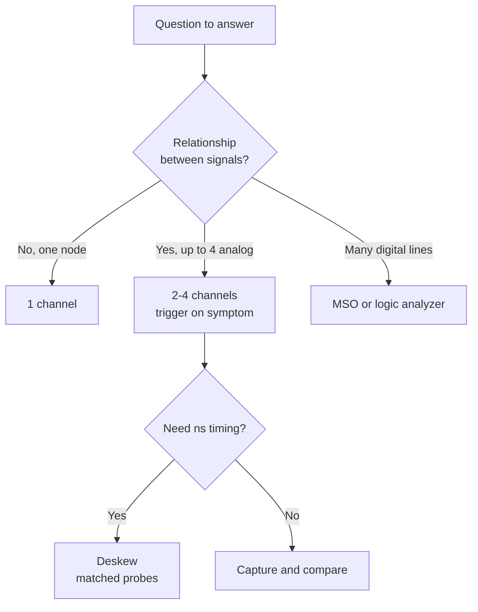

::: basics
### In plain words
A scope with several channels shows how signals relate to each other in time. One channel tells you what one signal does. Two or four channels tell you which signal moved first, how much later the other followed, and by how much. Most hardware bugs are about exactly that kind of cause and effect.

### Picture it
A detective with one witness hears one story. With four witnesses who each noted the time, the detective builds a timeline and sees who saw what first. All channels of a scope share one clock, so they are witnesses on the same timeline. One catch: probes and cables of different lengths add different delays.

### Words you need
- **Channel**: one input on the scope, with its own probe and vertical scale.
- **Trigger on the symptom**: starting the capture when the problem appears, such as a reset line falling. See [[q0992]].
- **Pre-trigger history**: samples recorded before the trigger, so you can see what led up to it.
- **Shared ground**: all channels' ground connections are tied together inside the scope, so every probe ground must go to the same voltage. See [[q0629]].
- **Skew**: a timing offset between channels caused by different cable or probe delays.
- **Math channel**: a computed trace such as CH1 minus CH2, or CH1 times CH2.

### The simplest example
A microcontroller resets at random. You connect the reset line to channel 1 and the supply rail to channel 2. Trigger on the reset line falling, in single mode, with the trigger point near the right side of the screen. The screen then shows mostly history. If the rail dipped just before the reset, the cause is power. If it is clean, look elsewhere.

For timing, a signal travels about 5 ns per meter of cable. Two cables that differ by 30 cm are 1.5 ns apart, enough to spoil a 2 ns measurement.

That is the whole idea. The rest of this page adds power math, probe deskewing, and when to switch to a logic analyzer.
:::

::: testing
Whether you understand that a scope's real power is **comparing signals against each other in time**, and not just displaying one voltage. The interviewer wants concrete cases: cause and effect (reset versus supply droop), timing relationships (setup/hold, clock to data, power sequencing), computed quantities (power = V x I, differential = A − B), and protocols with several lines. Hidden sub-skills: knowing the channel-count trade-offs (shared sample rate, matched probes and skew, one common ground) and the difference between an analog multichannel scope and a logic analyzer.
:::

::: why
Hardware bugs are almost always about *relationships*: this signal did that because that other signal moved first. With one channel you can only see what a node does. With two or four you see what caused it, how long after, and by how much. It is also a practical limit: knowing when four channels are not enough (use a logic analyzer or a mixed-signal scope), and that all channels share one ground, so you cannot just clip them anywhere on a circuit.
:::

::: concepts
- **Time correlation**: all channels are sampled on the same timebase, so horizontal position is directly comparable. See [[q0991]].
- **Triggering on one channel, viewing others**: the trigger source defines t = 0 and the rest show what came before and after ([[q0992]]).
- **Math channels**: add, subtract, multiply or divide channels in real time.
- **Common ground**: scope channel grounds are connected to each other and to earth, so each probe ground must be at the same potential ([[q0629]]).
- **Channel skew / deskew**: different probes and cables have different delays, which matter at ns timescales.
- **Sample-rate sharing**: on many scopes the ADC is shared, so enabling more channels can lower the per-channel sample rate.
:::

::: answer
"I need more than one channel whenever the question is about *relationships* between signals. A simple one: the micro keeps resetting, and I want to know whether the supply drooped first. I put the reset line on channel one as the trigger and the rail on channel two, and now I can see the rail sag a few hundred microseconds before the reset, so I know it's a power problem, not firmware.

Other cases: measuring delay between two edges, like clock to data or enable to power-good; checking power-up sequencing with three or four rails on the screen at once; looking at a four-wire SPI transaction; or using math, like subtracting two channels for a differential signal, or multiplying voltage and current channels to get power. A buck converter is a classic: switch node, inductor current, output ripple and the gate drive together.

The caveats are that channels share a ground, so I have to be careful where I clip the probe grounds, that probes need to be deskewed if I care about nanoseconds, and that sometimes using more channels halves the sample rate. If I need eight or sixteen digital lines, I'd use a mixed-signal scope or logic analyzer."
:::

::: technical
**Cases where more than one channel is required.**
1. *Cause and effect*: trigger on the symptom (reset, fault, glitch) while capturing the suspected cause on another channel, using pre-trigger history ([[q0992]]).
2. *Timing between two signals*: delay, skew, setup/hold margin, propagation delay $t_{pd}$ through a gate or isolator, dead time between high-side and low-side gate drives (typically tens to hundreds of ns).
3. *Sequencing*: 3-4 rails and their power-good/enable signals against time, checking the order and ramp times.
4. *Computed measurements*: instantaneous power $p(t)=v(t)\,i(t)$ from CH1 (voltage) and CH2 (current probe or sense-resistor voltage divided by R); differential voltage CH1−CH2; ratio for gain/transfer function (input vs output).
5. *Multi-line protocols*: SPI (SCK, MOSI, MISO, CS = 4 channels), I²C (2), parallel bus; serial decode needs all lines.
6. *Multi-phase systems*: three motor phases, interleaved buck phases, 3-phase mains.

**Constraints.**
- A channel is *not* floating: all BNC grounds are tied together, so connecting two probe grounds to nodes at different potential makes a short through the scope.
- **Skew**: with ~5 ns per meter of cable, a 30 cm length difference is about 1.5 ns, enough to ruin a 1 ns setup measurement. Use identical probes or the scope's deskew function.
- **Resolution/Rate**: scopes with shared ADCs often halve the sample rate when two channels in a pair are on. Check the data sheet ("per channel at 4 channels enabled").
- **Memory depth and bandwidth** are split in the same way on some designs.
:::

::: short
"I use multiple channels whenever the debug question is about how signals relate in time. For example trigger on a reset on one channel and watch the supply on another to see if it drooped first. They're also used for sequencing several rails, delay between clock and data, multi-wire buses like SPI, and math like volts times amps for power. I watch for shared grounds, probe skew, and that some scopes drop sample rate when more channels are on."
:::

::: long
"A single channel tells me what one node does. More channels tell me how nodes affect each other, which is most of debugging.

The most common use is cause and effect. If a microcontroller resets randomly, I trigger on the reset line, set the trigger position far right so I have lots of pre-trigger history, and put the supply rail on another channel. If I see the rail dip below the brown-out threshold just before the reset, I know it is a power problem, not software.

Second is timing between signals: the delay from a clock edge to data valid to check setup and hold margins, the dead time between the high-side and low-side gate drive in a half-bridge, or how long after the enable the power-good asserts. Third is sequencing: a modern SoC has several rails that must come up in order, and four channels let me see all of them at once.

Fourth, math between channels. Voltage on one channel and current on another gives me instantaneous power with a multiply function. Two probes subtracted gives a floating or differential measurement, although a proper differential probe is better.

Fifth, buses. SPI is four lines, I²C two, and the scope's protocol decode wants all of them.

There are limits. All scope channels share a common ground, so I need the probe grounds at the same potential. Different cables and probes have different delays, so for nanosecond work I deskew. Some scopes lower the sample rate when I enable more channels. And if I need more than four to eight signals, such as a 16-bit parallel bus, I would use a mixed-signal scope or a logic analyzer."
:::

::: terms
- **Channel**: one independent vertical input with its own scale, offset, coupling and bandwidth limit.
- **Trigger source**: the channel (or external input) whose event defines time zero.
- **Pre-trigger / post-trigger**: samples before and after the trigger event; pre-trigger shows the cause.
- **Skew / deskew**: time-offset between channels caused by probes and cables; deskew compensates it.
- **Math channel**: a derived waveform such as A−B, A×B or A/B.
- **Mixed-signal oscilloscope (MSO)**: a scope with extra digital channels, typically 8 or 16.
- **Logic analyzer**: a multi-channel digital-only instrument with deep memory and protocol decode.
- **Cross-talk (channel isolation)**: signal leaking between adjacent channels, specified in dB.
:::

::: exceptional
**An average answer** says "to compare two signals."

**An exceptional answer**:
- Gives at least three distinct use-cases (cause/effect, timing, computed measurements, buses) with a real example for each.
- Explains **triggering on one channel and viewing history on others** as a debugging method.
- Mentions practical limits: shared ground, skew with a number, shared sample rate, and when to move to an MSO or logic analyzer.
- Gives one numeric example (e.g. 1.5 ns skew for a 30 cm cable difference, or $P=V\times I$).
- Knows channels are not isolated from each other, so probe grounding must be planned.
:::

::: mistakes
- **Clipping two probe grounds to different nodes.** All channel grounds are connected inside the scope. If the nodes differ by a few volts you create a current path and may damage the board or probe.
- **Assuming identical probes means zero skew.** Cable length, probe type and attenuation (a passive 10x and an active probe) have different delays.
- **Comparing signals at different scales without checking the probe attenuation settings.** A 1x probe and a 10x probe on two channels with the same setting gives a 10x error.
- **Believing "4 channels at 4 GSa/s".** The headline sample rate often applies to one channel or pair; check the per-channel rate with all channels on.
- **Not using enough channels** and guessing: "it's probably power" when one more probe would show it.
- **Using the scope's bus decode when the analog signal is the problem.** Decode sees only 0s and 1s, not slow edges or glitches, so look at the analog first.
:::

::: deep
## A scope is a time-correlation instrument

Every channel is digitized on the same clock and stored against the same time axis, with a **single trigger** that defines t = 0. That is why a four-channel capture is more than four separate measurements: horizontal position directly tells you "A happened 3.2 µs before B."

Consider a 3.3 V board that resets about once per hour. One channel on the supply tells you nothing unless you catch the event. Trigger on the reset (or use a normal-mode trigger on the supply crossing a threshold) and look at what was happening. A fast rail dip below a brownout threshold (say 2.9 V for 50 µs) proves a power cause; a clean rail means looking at firmware or noise on the reset pin instead. That diagnostic fork requires two channels.

## Timing relationships

For clock-to-data, you place CLK on CH1, DATA on CH2 and measure the offset between the clock edge and the data edge. Typical checks:

- **Setup/hold**: data must be stable $t_{su}$ before and $t_h$ after the clock edge.
- **Dead time** in a half-bridge: both gates must be low for a time $t_{dead}$ (e.g. 50 ns) between transitions so the two FETs never conduct together.
- **Propagation delay**: input vs output of an isolator or gate driver, where the difference of edge crossing at 50% levels is $t_{pd}$.
- **Enable → PG**: delay between an enable pin and the power-good output of a regulator.

At nanosecond scales, probe skew matters. A signal travels about 5 ns per meter in typical coax (velocity factor about 0.66). Two probes whose cables differ by 30 cm produce $0.3\times5 = 1.5$ ns relative delay. To measure a 2 ns propagation delay, that is a 75% error. Solution: use matched probes, or place both probes on the **same signal** and adjust the scope's deskew until the edges overlap, then measure the real signals.

## Multi-channel power measurement

If you have a voltage probe on CH1 and a current probe on CH2 ([[q0998]]), then the scope's math function $p(t)=\text{CH1}\times\text{CH2}$ gives instantaneous power. Integrate over a switching cycle and you have energy per cycle and average power. This is the standard way of measuring switching loss in a MOSFET: $E_{sw}=\int v_{DS}\,i_D\,dt$ over the transition. Example: a switching edge where $V_{DS}=48$ V falls while $I_D$ rises to 10 A over 20 ns with linear overlapping ramps gives $E\approx\tfrac16VIt=\tfrac16\cdot48\cdot10\cdot20\text{ ns}=1.6\ \mu\text{J}$ per transition. At 200 kHz that is about 0.32 W for that edge type. The scope does the arithmetic if the two channels are deskewed; a 5 ns error in alignment between $v$ and $i$ changes the computed loss by a big fraction, because the edges overlap exactly where the product is largest.

```timing
{"signals":[{"name":"EN","wave":"0.1............."},{"name":"V_3V3","wave":"0..1............"},{"name":"V_1V8","wave":"0....1.........."},{"name":"V_1V0","wave":"0.......1......."},{"name":"PG","wave":"0..........1...."}],"hscale":1.1}
```
Figure: Four channels give you the power-up order at a glance. Compare the gaps between enable and each rail and the PG assertion with the sequencing rule in the datasheet. A single channel would give you only one of these rows and none of the ordering.

## Differential and math

CH1−CH2 can make a pseudo-differential measurement: for example the voltage across a floating resistor (two probes, each referenced to the board ground, subtracted by the scope). It works when the signal is large compared with the common-mode mismatch. With a 12 V common-mode and a 1% gain mismatch, the error is 120 mV, which is useless for a 10 mV sense signal. A real differential probe ([[q0995]]) has a CMRR spec for that reason.

## How to set up a good multi-channel capture

A short routine saves a lot of confusion:

1. **Name the question first.** "Does the rail sag before reset?" tells you which channel triggers and which one is history.
2. **Set each channel separately.** Different volts/div, offset and coupling per channel, and confirm every probe's attenuation setting matches its switch (1x or 10x). A 10x probe read as 1x is a factor-of-ten lie.
3. **Separate the traces vertically** with offsets so they do not overlap, or use the split-screen display if the scope has one, and give each channel a label and color that matches the probe tip.
4. **Pick the timebase for the slowest and fastest thing you care about.** If a 10 µs droop and a 5 ns edge are both interesting, one capture cannot show both well. Take a long capture for the context and a zoomed one (or use deep memory and zoom) for the edge.
5. **Ground each probe at its own tip** with the shortest lead, all to the same reference node, so you do not create ground loops between channels ([[q0630]]).
6. **Check the acquisition info** (sample rate, record length) after enabling all channels.

## What multi-channel scopes cannot do

- **Floating grounds**: the channels are not isolated from each other. Never connect two probe grounds to nodes at different voltages ([[q0629]]).
- **Many digital lines**: 4 analog channels cannot see a 16-bit address bus. A mixed-signal scope adds 8 or 16 logic inputs with limited voltage resolution; a logic analyzer gives 32-100+ channels and deep memory but sees only logic levels.
- **Sample rate sharing**: if a scope has a 2 GSa/s ADC pair shared by channels 1+2, using both gives 1 GSa/s each. With a 500 MHz probe's rise time of ~0.7 ns, 1 GSa/s gives only 1-2 points per edge ([[q0983]]).


Figure: A quick decision path. The branch to remember is that analog detail and few channels point to a scope; many digital lines at logic levels point to an MSO or logic analyzer.

## Experiment with it

```sim
{"id":"scope-trigger","level":0.5,"slope":"rising"}
```
Figure: This simulator shows a single channel, but the principle carries over: the trigger edge defines time zero and everything on screen is positioned relative to it. Untick the trigger and the trace rolls; re-enable it and it locks. On a multi-channel scope every other channel is drawn against that same time zero, which is why one channel can show what preceded or followed the event on another.
:::

::: applications
- **Brownout debugging**: reset or fault line as trigger, supply rail and a decoupling-cap node on other channels.
- **Half-bridge gate-drive dead time**: high-side and low-side gate signals (using a differential probe for the floating high-side).
- **FPGA/SoC bring-up**: core, I/O and DDR rails plus PG and reset to check order and ramp.
- **Switching-loss measurement**: voltage and current with math to compute energy per edge.
- **SPI sensor bring-up**: SCK, MOSI, MISO and CS to decode and verify mode and timing.
- **Three-phase motor drives**: phase voltages and a phase-current probe together.
:::

::: assumptions
- The scope has 2 or 4 analog channels, which is typical on a bench; high-end scopes have more.
- Probes are matched and the scope's attenuation settings are correct.
- The nodes can share a ground: if they cannot (e.g. high-side floating), I need differential or isolated probes.
- The signals are within the scope's vertical range and bandwidth; otherwise the problem becomes bandwidth ([[q0980]]) rather than channel count.

An equally valid answer: "when I need a logic analyzer instead", for many digital lines or long captures. Another valid angle: two channels is enough for most analog debugging, and the key skill is picking which two signals.
:::

::: followups
### I have a 4-channel scope, but the 16-bit bus has 16 lines. What do I do?
A mixed-signal scope (8 or 16 digital inputs) or a logic analyzer. A logic analyzer has deep memory and decode but only logic thresholds. If I need analog detail on one line (a glitch or slow edge) I put that line on an analog channel and trigger from the logic analyzer's output, or use the scope's MSO inputs.

### Two probes, same signal, edges don't line up by 2 ns. What's wrong?
Probe or cable delay mismatch, or different probe types. Use the scope's deskew to align them on a common signal (or a deskew fixture). At 5 ns/m, a 40 cm cable difference alone gives 2 ns.

### How would you measure the dead time of a half-bridge?
Gate-source of the low side with a normal probe, and high-side Vgs with a differential or isolated probe. Compare when each gate crosses its threshold (~2-3 V, not 50% of the swing) on the falling and rising edges. Expect 20-200 ns depending on the design. Check with deskewed probes because dead time is comparable to probe delay differences.

### Can I use two channels to measure a floating signal?
Yes, with subtract math, but only if common-mode is small relative to the signal and probes are matched. A 12 V common-mode on a 10 mV signal needs about 10^-4 matching, which two passive probes cannot achieve. Use a differential probe ([[q0995]]) or an isolated one. Do not "float" the scope by removing its ground, because that is a shock hazard.

### Enabling channel 3 and 4 makes the waveform look blocky. Why?
Sample rate and memory likely dropped because channels share the ADC. At lower sample rate fewer points land on each edge. Check the acquisition info on screen and either turn off unused channels or reduce the time base so you still have enough samples per rise time.
:::

::: interpretations
The question is very short. In the **Scopes** section it means analog channels on a scope. A broader reading includes the logic analyzer and mixed-signal channels, which I mention. Some interviewers also mean "why four channels instead of one" to see if you know the usual four cases (symptom and cause, delay, buses, math).
:::

::: references
- Tektronix, "XYZs of Oscilloscopes": channels, triggering and acquisition (check the current edition).
- Keysight and Rohde & Schwarz oscilloscope fundamentals application notes: probe deskew and channel specifications (check the current editions).
- Horowitz & Hill, *The Art of Electronics*, 3rd ed.: oscilloscope measurement sections.
- Johnson & Graham, *High-Speed Digital Design*: measurement skew and timing margin concepts.
:::

::: rubric
- Says multiple channels let you see relationships and timing between signals :: This is the central idea; everything else is an example.
- Gives cause-and-effect with a trigger on the symptom :: The most useful debug workflow on a scope.
- Gives a timing, sequencing or bus example :: Shows you have actually used multichannel setups.
- Mentions math (A−B, A×B) for differential or power :: Computed measurements are a major reason for extra channels.
- Mentions shared ground and not clipping grounds at different potentials :: A safety and accuracy point that interviewers watch for.
- Mentions skew/deskew and sample-rate sharing :: Practical limits that make results trustworthy.
- Knows when to switch to MSO/logic analyzer :: Choosing the right tool is part of the skill.
:::

::: quiz
```json
[
 {"type":"mcq","level":"fundamental","q":"Your board resets randomly. Which setup best shows whether the supply drooped first?","options":["One channel on the supply, auto trigger","Trigger on the reset line, supply on a second channel with lots of pre-trigger time","Two channels on the supply","A DMM on the supply"],"answer":1,"explain":"Triggering on the symptom with history on another channel shows what the supply did before the reset. A DMM averages away a microsecond dip."},
 {"type":"truefalse","level":"fundamental","q":"The ground clips of two scope probes can safely be attached to two circuit nodes at different DC voltages.","answer":false,"explain":"All channel grounds are connected inside the scope (and to earth), so you would short the two nodes together through the scope."},
 {"type":"numeric","level":"intermediate","q":"Two cables differ in length by 40 cm. Using 5 ns per meter, what relative delay do the channels have? Give it in ns.","answer":2,"tolerance":0.02,"unit":"ns","explain":"$0.4\\text{ m}\\times5\\text{ ns/m}=2$ ns. That is large when measuring a 5 ns propagation delay."},
 {"type":"mcq","level":"intermediate","q":"Which measurement requires at least two channels?","options":["Peak-to-peak voltage of a sine","Frequency of a clock","Instantaneous power using a voltage probe and a current probe","Rise time of one edge"],"answer":2,"explain":"Power is the product of two quantities, voltage and current, measured on separate channels and multiplied with a math function. The others are single-signal measurements."},
 {"type":"mcq","level":"advanced","q":"You subtract two single-ended probes to measure 10 mV across a shunt at 12 V common-mode. The probes' gains differ by 1%. About what error does this add?","options":["0.1 mV","1 mV","12 mV","120 mV"],"answer":3,"explain":"A 1% mismatch on 12 V common-mode leaves $0.01\\times12=0.12$ V = 120 mV of residual common-mode, larger than the 10 mV signal."},
 {"type":"numeric","level":"advanced","q":"A MOSFET turn-off has V_DS rising linearly to 48 V while I_D falls linearly from 10 A over 20 ns (overlapping the same 20 ns). Using $E\\approx\\tfrac{1}{6}VIt$ for the overlapping linear ramps, what is the switching energy in µJ?","answer":1.6,"tolerance":0.03,"unit":"µJ","explain":"For opposite linear ramps the product $v\\,i$ is $VI\\,u(1-u)$, whose integral over time $t$ is $VIt/6$. $48\\times10\\times20\\text{ ns}/6=1.6\\ \\mu$J."}
]
```
:::
