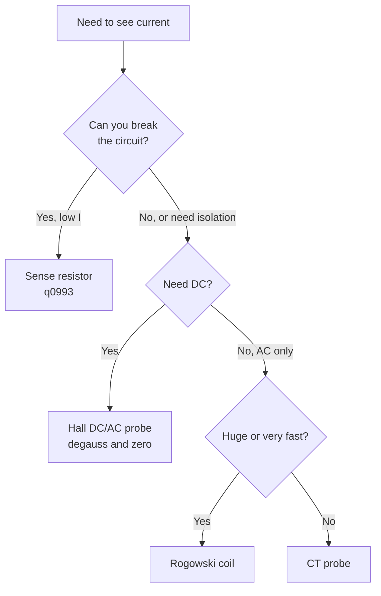

::: basics
### In plain words
A current probe measures the current in a wire without cutting it. You clamp the probe around the wire, and it senses the magnetic field the current creates. It sends the scope a voltage proportional to the current, such as 10 mV per amp. There is no resistor in the circuit, and the probe has no electrical connection to it.

### Picture it
A compass needle near a wire swings because current makes a magnetic field around it. More current, bigger swing. A current probe is a precise compass wrapped around the wire, measuring the field instead of the current itself. One catch: around two wires carrying equal and opposite currents, the fields cancel.

### Words you need
- **Magnetic field**: the invisible influence around a current-carrying wire. Its strength is proportional to the current.
- **Sensitivity**: the output per amp, in mV/A.
- **Transformer-type (AC) probe**: reads only changing current, not steady DC.
- **Hall-effect probe**: uses a small sensor that responds to a steady field, so it can read DC as well as AC.
- **Noise floor**: the smallest current the probe can show above its own noise.

### The simplest example
A probe has a sensitivity of 10 mV per amp. You clamp it around one wire of a motor cable, and the scope shows a waveform peaking at 50 mV. The current peaks at $50/10 = 5$ A.

Now suppose you clamp around both the supply and return wires. The currents are equal and opposite, so the net current inside the clamp is zero, and the probe reads about 0 A. Clamp one wire only.

For DC, such as a battery current, you need a Hall-effect probe, and you must zero it before use. A transformer-type probe cannot see a steady current.

That is the whole idea. The rest of this page adds the Rogowski coil for huge, fast currents, a small-current trick, and when a sense resistor is better.
:::

::: testing
Whether you know how to see **current waveforms without breaking the circuit or adding a series resistor**, and whether you can explain the physics: a clamp that senses the magnetic field around a conductor. The interviewer wants the types (AC current transformer, Hall-effect DC/AC, Rogowski coil), what each can and cannot see (DC, low frequency, high di/dt), the main specs (bandwidth, sensitivity, maximum current, saturation, insertion impedance, noise floor) and practical techniques (degauss/zero, direction arrow, extra turns for small currents). It also tests when you would choose it over a sense resistor ([[q0993]]).
:::

::: why
A series sense resistor needs you to cut the circuit, drops voltage, and picks up L di/dt. In power electronics, motor drives and battery systems you often need the current waveform of a conductor you cannot (or must not) break: an inductor current in a buck, a phase current in a motor, an inrush into a bulk capacitor. A current probe gives isolation from the circuit and very low insertion impedance, so it is the standard instrument for switching-loss and ripple-current measurements. Knowing its limits (saturation, bandwidth, DC drift) is what separates a plausible waveform from a wrong one.
:::

::: concepts
- **Ampère's law**: current in a conductor creates a magnetic field $B$ around it, so measuring the field measures the current. See [[q0441]].
- **Transformer action**: a clamp core with a secondary winding turns the primary current into a smaller proportional current: $I_s=I_p N_p/N_s$.
- **Hall effect**: a semiconductor element in the core gap produces a voltage proportional to field, including at DC.
- **Faraday's law / $di/dt$**: a Rogowski coil gives $v=M\,di/dt$, which an integrator turns into $i$.
- **Core saturation**: too much DC or too large an amp-turn product saturates the core and distorts the output.
- **Probe sensitivity** (mV/A or V/A) and **bandwidth**, as for voltage probes ([[q0990]]).
:::

::: answer
"A current probe measures the current in a wire by sensing the magnetic field around it, without breaking the circuit. You clamp it around the conductor, and it gives a voltage to the scope proportional to the current, for example 10 millivolts per amp.

There are a few types. A simple AC current probe is a transformer: the wire is a one-turn primary and the clamp has a secondary winding into a termination, so it works from about tens of hertz up, but not at DC. A Hall-effect probe adds a Hall element in the core gap, which measures the field itself, so it can see DC and low frequencies; commercial DC-capable probes often combine Hall for the low end with a transformer for the high end. A Rogowski coil is an air-cored flexible loop, with no saturation, that outputs the derivative of current, which is integrated to get the waveform; it's great for very large and fast AC currents but cannot read DC.

I'd use one when I can't or don't want to put a resistor in the circuit: inductor current in a switcher, motor phase currents, inrush. The things to watch are bandwidth, the noise floor for small currents, core saturation, zeroing or degaussing before measuring DC, putting the arrow in the direction of the current, and that for tiny currents I can wind multiple turns through the clamp."
:::

::: technical
**Types.**
1. **AC current transformer (CT) probe**: a clamp core with secondary winding of $N_s$ turns into a terminating resistor $R_T$. $I_s=I_p/N_s$ (primary one turn), output $v=I_pR_T/N_s$. Low-frequency cutoff $f_L=R_T/(2\pi L_s)$, where $L_s$ is the secondary inductance; the output "droops" on a long pulse by the ratio $t_{pulse}/\tau$ with $\tau=L_s/R_T$. No DC response. Bandwidth up to hundreds of MHz on specialized probes.
2. **Hall-effect (DC/AC) probe**: a Hall element in the core gap senses flux, giving DC to a few MHz or higher; usually combined with a transformer channel for the high-frequency end. Needs a **degauss and DC-offset zero** step before measurement because the core retains magnetization and the Hall element drifts.
3. **Rogowski coil**: a flexible air-cored coil; output $v=M\,di/dt$, with mutual inductance $M$ set by geometry. An integrator (often in the probe/scope electronics) recovers $i(t)$. No saturation, linear to very high current, but no DC response and the integrator limits low-frequency accuracy.

**Key specs.** Bandwidth (and rise time), sensitivity (V/A), maximum continuous and peak current, maximum amp-seconds (for CT), noise floor (mA rms), insertion impedance (usually small, in the mΩ to tens-of-mΩ range plus a little inductance, check datasheet), accuracy (typically a percent or few), and conductor size.

**Operation.** Clamp around a single conductor (not a pair, because currents of opposite sense cancel), match the arrow to conventional current direction, degauss/zero for DC-capable models, select the range, and enter the probe's scale in the scope (A/V).

> [!UNCERTAIN]
> Bandwidth, noise floor and insertion impedance vary enormously between models (from tens of kHz Rogowski/flex coils to hundreds of MHz specialized CT/Hall probes). Quote them as ranges and check the datasheet of the actual probe.
:::

::: short
"A current probe senses the magnetic field around a wire so I can see current without breaking the circuit or adding a series resistor. An AC probe is a clamp-on transformer, a Hall-effect probe adds DC capability, and a Rogowski coil is an air-cored coil giving di/dt that is integrated. I zero or degauss it, clamp one conductor with the arrow along the current, and watch bandwidth, saturation and noise floor. For tiny currents I wind extra turns through the clamp."
:::

::: long
"A current probe lets me see the current waveform in a conductor without cutting it or putting a sense resistor in the path. It works by sensing the magnetic field around the wire, since Ampère's law ties field to current, and it gives the scope a voltage proportional to the current, like 10 millivolts per amp.

There are three common kinds. The first is a clamp-on current transformer. The wire is a single-turn primary, the clamp core has a secondary winding into a termination resistor, and the output is the primary current divided by the turns ratio. It handles AC from maybe tens of hertz up to high frequencies, but not DC, because a transformer can't pass DC, and a long pulse droops. The second is the Hall-effect probe: there's a Hall element in a gap in the core that responds to the static magnetic field, so it measures DC and low frequencies. Most DC-capable probes combine that with a transformer for the high end. They need to be zeroed and degaussed before use. The third is a Rogowski coil, a flexible air-cored loop whose output is proportional to the rate of change of current, so an integrator recovers the current. It never saturates, it's good for big, fast AC currents like in power converters, and it's flexible enough to wrap around big busbars, but it has no DC response.

I choose the probe by bandwidth, current range and noise floor. For small currents, say tens of milliamps, I can pass the wire through the clamp several times to multiply the signal by the number of turns. And I always make sure only one conductor goes through, with the arrow in the direction of the current. Compared with a sense resistor it has almost no insertion drop and is isolated, but it costs more, has a noise floor, and can saturate."
:::

::: terms
- **Current probe**: a probe that measures current by sensing its magnetic field, usually a clamp.
- **Current transformer (CT)**: the clamp core with a secondary winding; passes AC only.
- **Hall-effect sensor**: a semiconductor whose output voltage is proportional to the magnetic field; allows DC measurement.
- **Rogowski coil**: air-cored toroidal coil; output $v=M\,di/dt$.
- **Degauss**: demagnetizing the core to remove residual flux that causes offset.
- **Droop**: a decaying flat top on long pulses from a CT-type probe's low-frequency cutoff.
- **Insertion impedance**: the small series impedance the probe adds to the circuit.
- **Amp-second (A·s) rating**: the maximum current-time product before a CT saturates.
:::

::: exceptional
**An average answer** says "it clamps around a wire and measures current."

**An exceptional answer**:
- Explains the physics (Ampère, Faraday, Hall) and ties each type to what it can see: DC, AC, di/dt.
- Gives the low-frequency droop condition of a CT: $f_L=R/(2\pi L)$ and the droop on a pulse.
- Names practical steps: degauss and zero, one conductor, arrow direction, scale entered in scope.
- Quantifies a trick: N turns through the clamp multiply sensitivity by N (and the inserted inductance by N²).
- Contrasts it with a shunt (no insertion drop, isolation, but noise floor, bandwidth and saturation) and picks one for a stated situation.
- Mentions saturation limits and that Rogowski coils need integration and cannot read DC.
:::

::: mistakes
- **Clamping around both conductors** of a pair (supply and return). Their fields cancel and the probe reads about zero.
- **Forgetting to degauss/zero a DC probe**, so a 50 mA offset appears as "current" or drifts.
- **Expecting a CT-type or Rogowski probe to read DC.** They only respond to change.
- **Using it on a signal larger than rated**, saturating the core; the waveform flattens and a residual flux may remain.
- **Ignoring the loop's inductance** at high di/dt: the wire through the clamp adds series inductance that can change fast circuits.
- **Ignoring the noise floor.** A probe with a 5 mA noise floor cannot measure a 10 mA sleep current; use a shunt/SMU or multiple turns.
- **Putting the arrow the wrong way**, which inverts the displayed current, a problem when computing power.
:::

::: deep
## Sensing a current by its field

A current in a long straight wire creates a magnetic field circling it. Ampère's law gives the line integral of the field around any closed loop that encloses the wire:

$$\oint \mathbf{B}\cdot d\mathbf{l}=\mu_0 I_{enc}$$

That is the reason a clamp around **one** conductor works and a clamp around a pair of conductors with equal and opposite currents reads zero ($I_{enc}=0$). All current-probe types measure the field integral in some way. They differ in how.

## Type 1: the clamp-on current transformer

A ferrite or iron core clamps around the wire. The wire is a one-turn primary and the core carries a secondary winding of $N_s$ turns, terminated in $R_T$ (often the 50 Ω or 1 MΩ scope input through a defined resistor). Ideal transformer action:

$$I_s=\frac{I_p}{N_s},\qquad v_{out}=I_sR_T=\frac{R_T}{N_s}I_p$$

Example: $N_s=100$, $R_T=1$ Ω gives 10 mV/A. A 20 A peak current produces 200 mV.

A transformer cannot pass DC, and the real one has a finite magnetizing inductance $L_s$ on the secondary. This yields a high-pass response with corner $f_L=R_T/(2\pi L_s)$. A long pulse sags (droops) exponentially with time constant $\tau=L_s/R_T$. With $L_s=10$ mH and $R_T=5$ Ω, $\tau=2$ ms and $f_L\approx80$ Hz. A 1 ms pulse would droop by $1-e^{-1/2}\approx39\%$ by its end, a big error for long pulses, which is why CT probes are specified with a lower-frequency limit and a pulse droop figure.

```bode
{"systems":[{"label":"CT probe (high-pass)","num":["l","0"],"den":["l","r"]}],"vars":{"l":0.01,"r":5},"f":{"min":1,"max":100000},"marks":[{"f":"r/(2*pi*l)","label":"f_L"}],"show":"mag","magRange":[-40,5],"params":[{"name":"l","label":"Magnetizing inductance L","min":0.001,"max":0.5,"value":0.01,"unit":"H","log":true},{"name":"r","label":"Burden resistance R","min":0.5,"max":50,"value":5,"unit":"Ω","log":true}],"readouts":[{"label":"Low corner f_L = R/(2πL)","expr":"r/(2*pi*l)","unit":"Hz"},{"label":"Droop time constant L/R","expr":"l/r","unit":"s"}]}
```
Figure: A current transformer works like a high-pass filter. Above f_L the output follows the current; below it the response falls 20 dB/decade, so DC is lost and slow pulses droop. This is why a pure CT probe cannot see DC offset or the flat top of a long pulse. Drag L up to 0.5 H and f_L falls to about 1.6 Hz, so long pulses droop far less; a 50 Ω burden with the default 10 mH pushes f_L up to about 800 Hz.

The core also saturates when the **ampere-seconds** (the integral of current over time) in one direction exceed the core's limit. A big DC component in the wire will saturate it. Specifications list a maximum amp-second product.

## Type 2: Hall-effect DC probes

Put a Hall element in a gap of the core. The Hall voltage is proportional to the flux density in the gap, so it responds at DC. A feedback circuit usually drives a secondary winding so the net flux is nulled (a "zero-flux" or closed-loop design), which improves linearity and extends the bandwidth. High-end DC-capable probes combine a Hall channel for DC to low frequency with a transformer channel for the AC part and splice them with a crossover, giving something like DC to tens or even over a hundred MHz in specialized models (check the datasheet; ranges vary by product).

Operational detail: the Hall element and core have offset and remanent magnetization. Each measurement session begins with **degauss** (the probe applies a decaying AC field to demagnetize the core) and **zero** (remove electrical offset) with the clamp open or around no current. Skipping this leaves a persistent error of tens of mA that confuses low-current measurements.

## Type 3: Rogowski coil

A flexible coil of many turns wound evenly on a non-magnetic former, closed around the conductor. By Faraday's law the induced voltage is

$$v(t)=M\frac{di}{dt}$$

with $M$ a small mutual inductance, such as 10 nH. For $di/dt=50$ A/µs the output is $10\text{ nH}\times50\times10^6=0.5$ V. The signal is then integrated (analog integrator or scope math) to give $i(t)=\frac{1}{M}\int v\,dt$.

Advantages: no core to saturate, so it handles very high currents; light and flexible for big conductors; very low insertion impedance; wide bandwidth for the AC part. Limits: no DC (the integrator is high-pass at low frequency and drifts); lower sensitivity at low frequency; position sensitivity of the conductor in the loop (a few percent).

## Which type for which job?

| Application | Probe type | Why |
|---|---|---|
| DC to few-MHz motor phase current, battery | Hall DC/AC probe | Needs DC and low-frequency content |
| Switching current in a converter (hundreds of kHz to MHz, AC) | CT or combined probe | Bandwidth and ripple accuracy |
| 1 kA pulse in a busbar, fast edges | Rogowski | No saturation, flexible |
| Sleep-current profile of a battery device | Not a clamp probe: shunt, SMU or dedicated meter | Noise floor of clamp probes is too high |


Figure: A decision path through the probe types. Anything needing DC rules out CT and Rogowski; anything with a very high current or di/dt favors the Rogowski coil.

## The small-current trick

Sensitivity is proportional to the number of times the conductor passes through the clamp. If the probe gives 10 mV/A with one pass and a noise floor of 2 mA, 5 turns give 50 mV/A and an effective noise floor of 0.4 mA. The cost is **N² times the series inductance** added to the circuit, so it is only suitable at low frequencies, and the saturation limit counts amp-turns ($N\times I$).

## Practical measurement checks

- Put the arrow in the direction of conventional current. Reversing it inverts the waveform, which matters for power calculations ([[q0994]]).
- Clamp **one** conductor. If you must measure a pair, clamp each separately.
- Keep the conductor centered in the clamp; position sensitivity of a percent or two is normal.
- Check **both** the bandwidth and the derating at high frequency: some probes lose maximum current rating at high frequency.
- For **deskew**, a current probe has a different propagation delay from a voltage probe (it can be tens of ns). Deskew them if you compute power from $v(t)i(t)$.
- Keep the probe away from large magnetic sources (inductors, transformers), which couple stray flux into the core.
:::

::: applications
- **Buck/boost converter inductor current** to see ripple, DCM/CCM and saturation.
- **Motor phase currents** (three-phase drives) and stall/start currents.
- **Inrush and hot-swap**: capture the peak charging current into bulk capacitors.
- **Switching-loss analysis**: $v_{DS}\times i_D$ product with a voltage probe and current probe.
- **Battery pack and EV charging**: DC current profiles with a Hall probe.
- **Power-line and EMC debugging**: common-mode current on a cable with an RF current probe (clamp around the whole cable).
:::

::: assumptions
- The conductor is a single wire passing through the clamp center, and the probe's frequency range covers the signal.
- Probe specifications are taken as typical ranges. Models vary a great deal.
- For DC-capable probes, degauss and zero have been done at the start.
- For the high-frequency edge, it is assumed the loop of wire through the clamp does not add significant inductance to the circuit. For very fast loops, a surface-mount coaxial shunt or a purpose-built low-inductance shunt might be preferred ([[q0993]]).

An alternative: for permanent, on-board measurement, a Hall-effect current sensor IC or a current-sense amplifier plus shunt is the design answer ([[q0441]], [[q0442]]). This question is about the *instrument*.
:::

::: followups
### What is the difference between an AC current probe and a DC current probe?
The AC probe is a transformer, which responds only to change and cannot read DC. The DC-capable probe adds a Hall element (and usually feedback) so it measures static flux. The DC probe has to be degaussed and zeroed before each use, because the Hall element and core have an offset and remanence.

### I see a flat 0 A reading while 5 A flows on a two-wire cable. What did I do wrong?
I clamped around both conductors of the cable. Supply and return currents are equal and opposite, so the net enclosed current is zero. Clamp a single conductor (separate them if needed).

### How do I measure 20 mA with a probe that has a 5 mA noise floor?
Pass the wire through the clamp several times; with 10 turns the signal is 200 mA-equivalent against the same noise floor. Or use a sense resistor, or a bench meter or SMU. Be aware that extra turns add N² inductance and may saturate at lower current.

### Why would a Rogowski coil be a better choice than a CT for a 2 kA pulse?
No magnetic core to saturate, so no amp-second limit. It also is flexible for large conductors and has a wide bandwidth. The price is no DC measurement, a small signal that needs integration, and a few percent position sensitivity.

### The probe's output seems to lag the voltage probe by 15 ns. Is that real?
Probably the probe delay: current probes typically have a different propagation delay than voltage probes. If you multiply v and i for power, a 15 ns misalignment on a 20 ns edge gives a big error in the computed switching loss. Deskew them with a common test signal before computing power.
:::

::: interpretations
"What is a current probe?" is a short definition question. In the Scope Probes section it assumes you are measuring with a scope, so the answer is the clamp-on instrument (rather than a "probe" such as a tip contact). The follow-on in an interview is usually "when would you use it instead of a sense resistor?", covered in [[q0993]].
:::

::: references
- Tektronix, "ABCs of Probes" primer (check the current edition): current probe sections.
- Horowitz & Hill, *The Art of Electronics*, 3rd ed.: current transformers and Hall-effect sensing in the measurement and power chapters.
- Rogowski coil theory: any electromagnetics text, e.g. Hayt & Buck, *Engineering Electromagnetics*, on Ampère's and Faraday's laws.
- Manufacturers' current-probe datasheets and application notes (Tektronix, Keysight, Pearson Electronics, PEM): check current documents for specs.
:::

::: rubric
- Says it measures current via the magnetic field without breaking the circuit :: The defining idea and its main advantage.
- Names at least CT, Hall and Rogowski and what each can measure (AC, DC, di/dt) :: Shows you know the types and their limits.
- Mentions DC capability and the need to degauss/zero :: The key practical detail for Hall probes.
- Mentions key specs: bandwidth, range, noise floor, saturation :: Needed to pick and trust the probe.
- Clamps a single conductor and uses the arrow correctly :: Avoids classic errors.
- Contrasts with a sense resistor and picks one for a situation :: Judgment in choosing a measurement method.
- Mentions multiple turns for small current or deskew for power :: Advanced practical technique.
:::

::: quiz
```json
[
 {"type":"mcq","level":"fundamental","q":"You clamp a current probe around a two-wire power cable (supply and return) carrying 5 A. What does it read?","options":["5 A","10 A","About 0 A","2.5 A"],"answer":2,"explain":"The two currents are equal and opposite so the net enclosed current is zero. Clamp one conductor."},
 {"type":"mcq","level":"fundamental","q":"Which probe type cannot measure DC?","options":["Hall-effect probe","Rogowski coil","Zero-flux DC/AC probe","Hall plus transformer combination"],"answer":1,"explain":"A Rogowski coil outputs $M\\,di/dt$, which is zero for constant current. The Hall-based probes sense the static field."},
 {"type":"numeric","level":"intermediate","q":"A CT probe has a 10 mH secondary inductance and 5 Ω termination. What is its low-frequency corner? Give it in Hz.","answer":79.6,"tolerance":0.03,"unit":"Hz","explain":"$f_L=R/(2\\pi L)=5/(2\\pi\\cdot0.01)=79.6$ Hz."},
 {"type":"numeric","level":"intermediate","q":"With the same probe ($\\tau=L/R=2$ ms), by what percent does the top of a 1 ms flat pulse droop by its end?","answer":39,"tolerance":0.05,"unit":"%","explain":"Droop $=1-e^{-t/\\tau}=1-e^{-0.5}=0.393$, about 39%."},
 {"type":"numeric","level":"advanced","q":"A Rogowski coil has M = 10 nH. What is the output for di/dt = 50 A/µs? Give it in volts.","answer":0.5,"tolerance":0.02,"unit":"V","explain":"$v=M\\,di/dt=10\\text{ nH}\\times50\\times10^6\\text{ A/s}=0.5$ V."},
 {"type":"truefalse","level":"advanced","q":"Passing a wire through a clamp probe 5 times multiplies the sensitivity by 5 and also the inserted inductance by 5.","answer":false,"explain":"Sensitivity scales with N but inductance scales with $N^2$, so the inserted inductance becomes 25 times larger."}
]
```
:::
