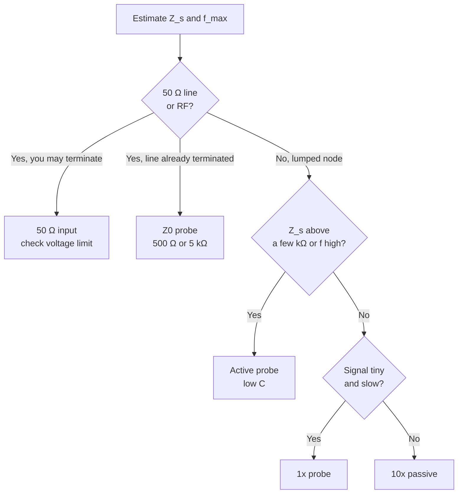

::: basics
### In plain words
The default probe, a 10x or 1 MΩ input, is right for most circuit nodes. But some jobs need a different impedance. A 50 Ω transmission line (a cable built to carry fast signals as waves, such as coax) needs a 50 Ω input so the signal is absorbed instead of bouncing back. A sensitive node needs a high-impedance, low-capacitance active probe. Pick by source impedance, speed and voltage.

### Picture it
Send a wave down a rope. If the far end is tied to a wall, the wave bounces back. If a person catches the rope end gently, the wave is absorbed. A 50 Ω input is the gentle catcher for a 50 Ω line. A 1 MΩ input acts like the wall. The catch: a 50 Ω catcher on an ordinary circuit would load it heavily.

### Words you need
- **Characteristic impedance ($Z_0$)**: the impedance a transmission line presents to a wave, often 50 Ω.
- **Termination**: a load equal to $Z_0$ at the line's end, so the wave is absorbed.
- **Reflection**: part of a wave bouncing back from an impedance mismatch. See [[q0999]].
- **50 Ω input mode**: a scope setting that terminates the line. It has a low voltage limit, about 5 V.
- **Z0 probe**: a low-impedance resistive probe, such as 500 Ω for 10:1, with little capacitance.

### The simplest example
Connect a cable from a 50 Ω generator into the scope. With the scope on its 1 MΩ input, the open end reflects the wave and the voltage there is about double what it should be. With the 50 Ω input, the line is terminated and the reading is correct.

Now the opposite mistake: a 1 kΩ source that makes 5 V with nothing attached, connected to the 50 Ω input. The voltage divider gives $5 \times 50/1050 \approx 0.24$ V. The input has loaded the source about twenty-fold.

That is the whole idea. The rest of this page adds Z0 probes and the 50 Ω voltage limit.
:::

::: testing
Whether you can choose a measurement *interface* for the situation instead of reciting "high impedance is good". The expected map: 1 MΩ (and 10x) for general circuit nodes, 50 Ω input for matched transmission lines and RF, low-impedance (Z0) probes for very fast signals on 50 Ω environments, active high-impedance probes for sensitive or very high-impedance nodes, and 1x for tiny low-frequency signals. You should justify each with loading, reflections, bandwidth, noise and voltage limits, and show numbers.
:::

::: why
The default 10x passive probe is wrong for a surprising number of real jobs: a 1 MΩ input on a 50 Ω coax gives reflections and wrong amplitude, a 50 Ω input on a logic pin kills the signal, and a passive probe on a 10 GHz serial lane is useless. Picking the right impedance is how you decide whether a measurement can be trusted, and which instrument to borrow or buy.
:::

::: concepts
- **Loading and divider**: as in [[q0999]], $V_{meas}=V_{src}Z_{in}/(Z_s+Z_{in})$.
- **Transmission lines and termination**: a line of characteristic impedance $Z_0$ wants a $Z_0$ load to avoid reflection $\Gamma=(Z_L-Z_0)/(Z_L+Z_0)$.
- **Shunt tap on a line**: a probe loading a point in a line has $\Gamma\approx -Z_0/(2Z_p+Z_0)$.
- **Capacitance and bandwidth**: low $C_{in}$ is the route to high bandwidth ([[q0996]]).
- **Noise and pickup**: high-impedance nodes pick up interference; low impedance resists it.
- **Voltage limits of 50 Ω inputs**: the scope's 50 Ω termination is rated only for a few volts (check the manual).
:::

::: answer
"I match the probe impedance to what I'm measuring. For most circuit nodes, that's the standard high impedance: 10x passive, 10 megaohms and about 10 picofarads, or a 1 megaohm scope input. But there are cases where I want something different.

First, 50 ohm systems: coax from a generator, an RF path, or a controlled-impedance trace with a connector. There I want the scope's 50 ohm input, or a 50 ohm probe, so the line is properly terminated and I don't get reflections. The cost is that it's a heavy load on anything that isn't 50 ohms, and it has a low voltage limit.

Second, very fast signals where even 1 pF is too much, I might use a low-impedance resistive divider probe, a Z0 probe, such as 500 ohms for 10 to 1. It has tiny capacitance and gigahertz bandwidth, but loads the node with 500 ohms.

Third, high-impedance or sensitive nodes, an oscillator, a high-megaohm sensor: I'd want an active probe, FET-input or electrometer-style, with very little capacitance and very high resistance. And fourth, if the signal is tiny and slow I might use 1x for sensitivity. So the answer depends on source impedance, frequency, and whether the line needs termination."
:::

::: technical
**Decision variables:** source impedance $Z_s$ (and whether it is a terminated line of known $Z_0$), highest frequency/edge rate, amplitude, and sensitivity needed.

**1. 1 MΩ/10x (default).** $Z_{in}\approx$ 10 MΩ ∥ 10-15 pF (10x). Use when $Z_s$ is below a few kΩ and the signal is below about 100-500 MHz, or for power rails. Drawback: capacitance at high frequency ([[q0999]]).

**2. 50 Ω input / 50 Ω probe.** Terminates a 50 Ω line: $\Gamma=(50-Z_0)/(50+Z_0)=0$ for $Z_0=50$ Ω. Used for RF, coax, serial links with 50 Ω fixtures. Maximum input is usually about 5 V rms (and a power limit, e.g. $25/50=0.5$ W at 5 V rms). Using a 50 Ω input on a 1 kΩ source attenuates by $50/1050$ (−26 dB).

**3. Low-Z (Z0) resistive-divider probe.** A tip resistor $R_t$ in series with the scope's 50 Ω input gives a divide ratio $(R_t+50)/50$: 450 Ω → 10:1 (500 Ω input), 4.95 kΩ → 100:1 (5 kΩ input). Capacitance is very low (a fraction of a pF), so bandwidth reaches multiple GHz with a passive probe. A 500 Ω shunt on a 50 Ω line reflects $\Gamma\approx-50/(2\cdot500+50)=-4.8\%$; with 5 kΩ it is −0.5%. Limited to low-impedance nodes, and with the same 50 Ω input voltage limits ahead of the divider.

**4. High-Z active probe.** About 1 MΩ or more with about 1 pF or less ([[q0996]]) for sensitive nodes, oscillators, and high-impedance outputs.

**5. 1x.** 1 MΩ ∥ ~100 pF for low-frequency, low-amplitude signals where the 10x loses sensitivity.

> [!UNCERTAIN]
> Exact input resistance/capacitance of Z0 and active probes, and the maximum voltage of 50 Ω inputs, are model-dependent. Always read the scope and probe specs before connecting.
:::

::: short
"I choose probe impedance by what I'm measuring. For normal nodes, 10x or 1 MΩ high impedance. For 50 ohm lines and RF, the scope's 50 ohm input so the line is terminated without reflections. For very fast signals on low-impedance nodes, a low-Z resistive divider probe like 500 ohms for 10 to 1, which has tiny capacitance. For sensitive high-impedance nodes, an active probe with about 1 pF. And 1x for tiny slow signals. I check source impedance, frequency and the voltage limits."
:::

::: long
"The probe impedance is a choice I make for each measurement, based on the source impedance, the frequency and whether the signal is on a terminated line.

For general circuit nodes, I use the default: a 10x passive probe, which is 10 megaohms in parallel with about 10 to 15 picofarads. That's fine up to a few tens of MHz for kilohm-level nodes and for power rails.

If I'm measuring a 50 ohm system, like a coaxial output from a generator or an RF path, I switch the scope's input to 50 ohms. That terminates the line correctly so there are no reflections and the amplitude reads right, with the full bandwidth of the scope. The downsides are that it loads anything that isn't 50 ohms, so a 1 kilohm source would be knocked down by a factor of twenty, and the input has a low voltage limit, typically around 5 volts rms, so I check before connecting.

For very fast signals on low-impedance nodes, there are Z0 probes, which are resistive dividers with a 50 ohm cable: a 450 ohm tip resistor gives 10 to 1 with a 500 ohm input resistance and a fraction of a picofarad of capacitance, so gigahertz bandwidth for a passive probe. On a 50 ohm line, a 500 ohm shunt reflects about 5%, which is small. You wouldn't use it on a high-impedance node, though.

And for high-impedance or sensitive nodes, like an oscillator input or a megaohm sensor, I'd use an active probe with about 1 picofarad or less, or probe a buffered point. If the signal is tiny and slow, the 1x setting gives ten times more sensitivity at the cost of loading.

So the process is: estimate source impedance, find the highest frequency, check the voltage level, and pick the probe whose impedance doesn't disturb the circuit."
:::

::: terms
- **Characteristic impedance ($Z_0$)**: the ratio of voltage to current on a transmission line; 50 Ω in most RF and many digital systems.
- **Termination**: a load equal to $Z_0$ at the end of a line to prevent reflections.
- **Reflection coefficient ($\Gamma$)**: $(Z_L-Z_0)/(Z_L+Z_0)$.
- **Z0 probe**: resistive-divider probe designed to be terminated into the scope's 50 Ω input.
- **Shunt loading**: a probe's impedance in parallel with the line at the measurement point.
- **High-Z / electrometer input**: extremely high input resistance (tens of MΩ to GΩ+) for high-impedance sources.
- **Maximum input voltage (50 Ω mode)**: limit set by the termination's power rating.
- **Input mode**: the scope's 1 MΩ/50 Ω selection.
:::

::: exceptional
**An average answer** says "50 Ω for RF, 1 MΩ otherwise."

**An exceptional answer**:
- Frames the choice as matching probe impedance to source impedance and line environment, with the factors: $Z_s$, frequency, amplitude.
- Gives the 50 Ω case and reflection reasoning (Γ for 1 MΩ on 50 Ω ≈ 1: open, and for 50 Ω on a high-Z node a big attenuation).
- Describes Z0 probes with numbers: 450 Ω → 10:1, 500 Ω input; shunt reflection about −4.8%.
- Mentions voltage limits of 50 Ω inputs and the risk of damage.
- Mentions high-Z active probes, electrometer inputs and 1x for low-signal sensitivity.
- Closes with a rule: estimate $Z_s$ and $f_{max}$ first, then compare $|Z_{probe}(f)|$ against the 10x rule.
:::

::: mistakes
- **Using the 1 MΩ input on a 50 Ω line** and finding the amplitude doubled or reflections present: an open end reflects the full wave ($\Gamma\approx+1$).
- **Using 50 Ω input on a normal circuit node**, attenuating it, overloading the driver or exceeding the 50 Ω input's voltage rating.
- **Forgetting that a Z0 probe still has a 500 Ω (or 5 kΩ) DC load.** It is a fine instrument on 50 Ω lines and a terrible one on a 10 kΩ bias node.
- **Applying 50 Ω inputs to DC rails** (e.g. a 12 V rail): the 50 Ω termination cannot dissipate it.
- **Using a long ordinary coax with 1 MΩ input for a fast edge**, forming a transmission line with mismatch at both ends. You see ringing from the cable.
- **Believing a higher-impedance probe is always better.** For noise-prone environments and for a matched line, impedance matching or low impedance is better.
:::

::: deep
## The first question: is it a transmission line or a lumped node?

An electrical signal on a conductor behaves as a **lumped node** when the edge time is much longer than the propagation time across the conductor; otherwise it is a **transmission line**, where voltage and current are waves, and the load impedance determines reflections. A rough threshold is that the line should be treated as a transmission line when its one-way delay exceeds about a sixth of the edge time. For a 1 ns edge, that is a trace longer than about 2.5 cm in FR-4 (using ~6.7 ps/mm, a typical figure). For a coax from a generator it is any length.

For a lumped node, the question is *loading*: choose a probe with $|Z_{in}|\ge10\,|Z_s|$ at the frequencies of interest ([[q0999]]). For a transmission line, the question is *termination and tapping*: what does the probe do to the wave.

## 50 Ω input on a 50 Ω line

If the line has $Z_0=50$ Ω and you terminate it at the scope end with 50 Ω:

$$\Gamma_L=\frac{50-50}{50+50}=0$$

so all the wave energy is absorbed in the scope input. The scope sees the actual wave amplitude (if the generator has 50 Ω source impedance and drives the 50 Ω load, the voltage at the load is half the generator's open-circuit setting, a familiar generator calibration pitfall). With a 1 MΩ input instead:

$$\Gamma_L=\frac{10^6-50}{10^6+50}\approx+1$$

The wave reflects fully with the same polarity: the voltage at the scope input doubles (the incident plus reflected), and the reflected wave bounces back to the source and returns, giving ringing if the source is also mismatched. The 1 MΩ input with a long coax is simply the wrong instrument unless the line is terminated at the scope with a feed-through 50 Ω terminator.

The 50 Ω input has two limits: it loads the circuit with 50 Ω and has a restricted maximum voltage and power. A typical limit is about 5 V rms; a 5 V rms signal into 50 Ω is $V^2/R=0.5$ W. A 12 V DC rail across 50 Ω would dissipate 2.9 W and probably damage the input. Check your scope's limit before connecting.

## Tapping a line: the Z0 probe

You often cannot terminate in the instrument because the line is already terminated elsewhere (a point-to-point link whose receiver is the termination). You want to tap the line without disturbing it. A **Z0 probe** is a passive resistive divider: a tip resistor $R_t$ in series with the scope's 50 Ω input.

```circuit
{"caption":"Z0 probe: a tip resistor plus the scope's 50 Ω input","elements":[
 {"t":"term","at":[0,2],"label":"tip","side":"left"},
 {"t":"wire","pts":[[0,2],[2,2]]},
 {"t":"R","a":[2,2],"b":[7,2],"label":"R_t","value":"450 Ω"},
 {"t":"wire","pts":[[7,2],[9,2]]},{"t":"dot","at":[9,2]},
 {"t":"R","a":[9,2],"b":[9,6],"label":"R_in","value":"50 Ω\n(scope)"},
 {"t":"wire","pts":[[9,6],[9,7]]},{"t":"gnd","at":[9,7]},
 {"t":"wire","pts":[[9,2],[12,2]]},{"t":"text","at":[12.3,2.3],"text":"V_out = V_tip / 10","anchor":"start","color":"accent"},
 {"t":"text","at":[0,6.5],"text":"Z_in = 450 + 50 = 500 Ω","anchor":"start","muted":true}
]}
```
Figure: The divider ratio is (450 + 50)/50 = 10:1 and the load the probe presents to the circuit is 500 Ω at all frequencies (up to the point where the tiny tip capacitance matters). A 4.95 kΩ tip resistor would give 100:1 and a 5 kΩ load.

The key feature is the **very low input capacitance** (a fraction of a picofarad is typical; check the datasheet), so the probe is almost purely resistive for GHz. A pure 500 Ω has the same impedance at 10 GHz as at DC, which is far better than 12 pF (about 1.3 Ω at 10 GHz). Compare reactances:

| Frequency | 12 pF (10x passive) | 0.25 pF (Z0-style tip, illustrative) | Z0 resistance |
|---|---|---|---|
| 100 MHz | 133 Ω | 6.4 kΩ | 500 Ω |
| 1 GHz | 13 Ω | 640 Ω | 500 Ω |
| 10 GHz | 1.3 Ω | 64 Ω | 500 Ω |

At 1 GHz the 10x probe has become a ~13 Ω short, while the Z0 probe still presents about 500 Ω (in parallel with a 640 Ω capacitive path, roughly 390 Ω in magnitude, still far better).

**What does a shunt tap do to a line?** A shunt impedance $Z_p$ across a point in a line of impedance $Z_0$ creates a reflection

$$\Gamma=-\frac{Z_0}{2Z_p+Z_0}$$

```plot
{"title":"Reflection from a shunt probe on a 50 Ω line","x":{"label":"Probe shunt impedance Z_p","unit":"Ω","min":50,"max":1000000,"log":true},"y":{"label":"|Γ|","unit":"","min":0,"max":0.4},
 "series":[{"label":"|Γ| = Z0/(2 Zp + Z0)","fn":"50/(2*x+50)"}],
 "points":[{"x":500,"y":0.0476,"label":"Z0 probe 500 Ω: 4.8%"},{"x":5000,"y":0.005,"label":"5 kΩ: 0.5%"}],
 "hlines":[{"at":0.05,"label":"5% reflection","color":"muted"}]}
```
Figure: A 500 Ω Z0 probe reflects about 4.8% of an incident edge; a 5 kΩ one 0.5%. A 50 Ω shunt (no probe-like load) would reflect 33%. The reflection shrinks as the shunt impedance grows, so use the highest divide ratio you can for the amplitude.

## High-impedance nodes: when you want more than 10 MΩ

If the source is a piezo sensor, a pH electrode, a high-megaohm bias node, or a photodiode transimpedance front end, even 10 MΩ with 12 pF can be a load, and the cable capacitance changes the response. The right instrument is a buffer with very high DC resistance (an electrometer-type input, or a unity-gain FET buffer placed close to the source) and low capacitance. A good rule is to place the high-impedance stage at the node, and let it drive the cable.

For slower measurements, a DMM with greater than 10 GΩ input, or a dedicated electrometer, is the instrument and the scope is not.

## Low impedance for noise rejection

A high-impedance node picks up interference through stray capacitance: a displacement current $I=C\,dV/dt$ into a high impedance gives large voltage. If you cannot reduce the node impedance, you can reduce pickup by shielding and short leads; or measure at a lower-impedance point such as the driver output. The 50 Ω/Z0 approach also reduces susceptibility, since the loop is low impedance.

## 1x for tiny, slow signals

If the signal is millivolts and under a few MHz, the 1x position of a switchable probe has 10 times more sensitivity (no divider), and its 1 MΩ and ~100 pF are acceptable when $Z_s$ is below a few kΩ. This is common for sensor signals and ripple at low frequency. Remember the bandwidth drops to a few MHz at 1x.

## Choosing: a decision path


Figure: The first split is whether you are on a 50 Ω line. If so, you either terminate (50 Ω input) or tap (Z0 probe). If not, loading rules decide between active, 1x and 10x.

## Experiment with it

```sim
{"id":"scope-probe","view":"loading"}
```
Figure: Try each probe type against 50 Ω, 1 kΩ and 100 kΩ sources and note where each loses amplitude. The 50 Ω and high-Z regimes are opposite ends: no single probe is best for both.
:::

::: applications
- **RF and microwave bench**: scope 50 Ω input from a generator or amplifier output.
- **High-speed serial lanes** (SerDes, USB 3, DDR): Z0 or specialized differential probes tapped at test points, or SMA fixtures into 50 Ω inputs.
- **TDR measurements**: a 50 Ω source and 50 Ω scope input to measure line impedance and discontinuities.
- **Oscillators and PLL feedback nodes**: active high-Z probes or probing at a buffer.
- **Sensor front ends** (piezo, electrometer): very-high-impedance buffers.
- **Power rails**: 10x passive or a dedicated low-impedance rail probe.
:::

::: assumptions
- The line impedance is near 50 Ω and nearly lossless; the real world has loss and fixture mismatch.
- The probe parasitics are lumped; at multi-GHz the tip geometry matters.
- The source impedance can be estimated; if not, test with a second probe type.
- Values for the Z0 capacitance and maximum input voltages are examples; use the actual datasheet.

If asked simply "when would I want a different impedance?", the shortest correct answer is: "50 Ω for transmission lines and RF to avoid reflections, and a high-impedance low-capacitance (active) probe for high-impedance or very fast nodes. Otherwise use 10x."
:::

::: followups
### You need to look at a 5 Gbps signal on a 50 Ω PCB trace with test points. What do you do?
A 10x passive is useless: 12 pF is only about 5 Ω at the 2.5 GHz fundamental, effectively a short. Use a Z0 or a low-capacitance active/differential probe at the test point, or route the signal to an SMA connector into the 50 Ω scope input in a proper fixture. Check the scope and probe bandwidth against the edge ($0.35/t_r$) and keep ground leads very short.

### Why does the scope say 5 V max in 50 Ω mode?
The 50 Ω termination resistor and input stage can only dissipate limited power: 5 V rms is $0.5$ W, and a DC level of 12 V would be 2.9 W. Exceeding it can burn the termination. Use a 1 MΩ mode for DC rails, or a 10x probe, or a DC block plus attenuator if you must look at a high-power 50 Ω signal.

### You see a signal 2x larger than expected on a 1 MΩ-input scope fed by 2 m of coax from a 50 Ω generator. Why?
The coax is unterminated at the scope end, so the wave reflects with $\Gamma\approx+1$ and the voltage at the open end doubles. Fix with a feed-through 50 Ω terminator at the scope input, or use the 50 Ω input mode. Then the amplitude equals half the generator's open-circuit setting if it was calibrated for high-Z.

### What is the downside of a Z0 probe?
It loads the node with 500 Ω (for the 10:1 version), so it is suitable only for low-impedance nodes and 50 Ω lines; the output is attenuated, so noise is relatively larger; and the 50 Ω input limits the voltage at its end. It has excellent bandwidth for a passive probe.

### How would you measure a node with 10 MΩ source impedance and a few pF?
Not with a passive probe: even the 10x's 10 MΩ and 12 pF halves the DC level and kills AC. Use an electrometer-grade or FET-input buffer placed right at the node (sub-pF, >10 GΩ), then measure the buffer's low-impedance output with a normal probe.
:::

::: interpretations
The phrase "different probe impedance" means different from the default (1 MΩ or the standard 10x). It could refer to switching the scope input to 50 Ω, to using a different probe type (active, Z0, low-Z), or to different values of the probe's input impedance. The page covers all three and gives the decision variables. It follows [[q0999]] (what the impedance should be and why) and uses [[q0996]] for active probes.
:::

::: references
- Tektronix, "ABCs of Probes" primer (check the current edition): sections on Z0 and active probes.
- Johnson & Graham, *High-Speed Digital Design*: transmission-line reflections and measurement.
- Pozar, *Microwave Engineering*: reflection coefficient and terminations.
- Scope and probe manufacturer manuals and datasheets for the 50 Ω input power/voltage limits and Z0 probe specs (Keysight, Rohde & Schwarz, Tektronix).
:::

::: rubric
- Says default is high impedance (10x, 1 MΩ) for general nodes :: Baseline correct answer.
- Gives 50 Ω for transmission lines/RF and explains termination/reflection :: The classic and most important exception.
- Mentions the voltage/power limit of 50 Ω inputs :: A practical safety point.
- Mentions Z0 or low-impedance resistive probes with the divide-ratio calculation :: Shows deeper probe knowledge.
- Mentions active or very high-impedance probes for sensitive nodes :: The opposite extreme.
- Quantifies a reflection or loading effect :: Shows you can compute the trade-off.
- Describes how to choose: estimate $Z_s$ and $f_{max}$, compare probe impedance :: A reusable method.
:::

::: quiz
```json
[
 {"type":"mcq","level":"fundamental","q":"You connect a long coax from a 50 Ω generator to a scope input set to 1 MΩ with no terminator. What happens?","options":["The line is matched","The wave reflects from the open end, giving about double the voltage and possible ringing","The signal is attenuated by 20","Nothing, coax is lossless and invisible"],"answer":1,"explain":"With $\\Gamma\\approx+1$ at the scope end the incident wave reflects fully. At the scope input the incident and reflected voltages add, so the displayed amplitude is about double."},
 {"type":"numeric","level":"fundamental","q":"A Z0 probe has a 450 Ω tip resistor and the scope's 50 Ω input. What is its divide ratio (N:1)?","answer":10,"tolerance":0.01,"unit":"","explain":"$(450+50)/50=10$. The probe's input resistance is 500 Ω."},
 {"type":"numeric","level":"intermediate","q":"A 500 Ω shunt probe is placed across the middle of a 50 Ω line. What is the magnitude of the reflection coefficient, as a percent?","answer":4.76,"tolerance":0.03,"unit":"%","explain":"$|\\Gamma|=Z_0/(2Z_p+Z_0)=50/1050=0.0476$, 4.8%."},
 {"type":"mcq","level":"intermediate","q":"Which situation is best served by the scope's 50 Ω input?","options":["A 3.3 V logic pin with 10 kΩ pull-up","A 12 V power rail","A 50 Ω coax from a signal generator at 100 MHz","A high-megaohm piezo sensor"],"answer":2,"explain":"The 50 Ω input terminates the line correctly. The others are high-impedance or high-voltage nodes that a 50 Ω load would attenuate or damage."},
 {"type":"numeric","level":"advanced","q":"A 1 kΩ source with 5 V open-circuit is connected to the scope's 50 Ω input. What voltage does the scope read? Give it in volts.","answer":0.238,"tolerance":0.03,"unit":"V","explain":"$5\\times50/(1000+50)=0.238$ V."},
 {"type":"truefalse","level":"advanced","q":"A 12 V DC rail can safely be measured with the scope in 50 Ω mode as long as the display is set to 5 V/div.","answer":false,"explain":"The 50 Ω termination would dissipate $12^2/50=2.9$ W and the input rating (often about 5 V rms) would be exceeded, which can damage the scope regardless of the vertical scale."}
]
```
:::
