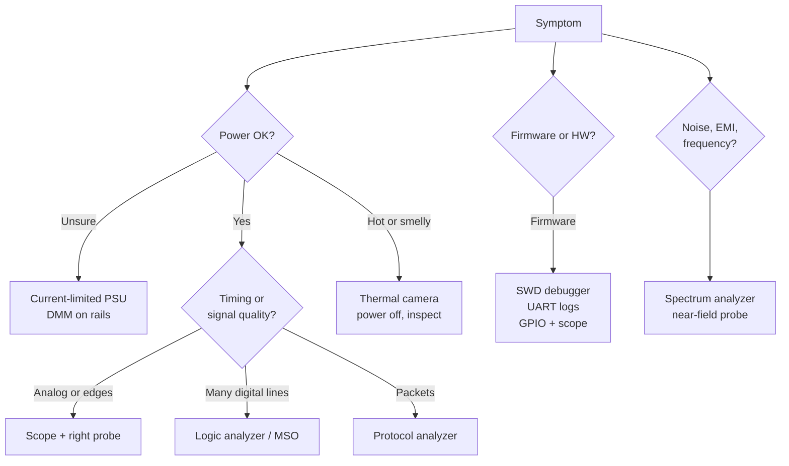

::: testing
Whether you know the **toolbox and, more importantly, which tool answers which question**. A list of instrument names is the minimum. The interviewer wants to hear that you map symptom to tool (is the rail there? use a DMM or scope; is the bus decoding right? logic or protocol analyzer; is it hot? thermal camera), that you start with cheap and simple tools, that you know what each tool *cannot* see, and that you include non-bench tools: simulation, logs, version control, test automation and environmental chambers.
:::

::: why
Most debug time is lost not by lack of cleverness but by using the wrong instrument: a DMM to chase a microsecond glitch, a scope with too little bandwidth for the edge, printf in an ISR that changes the timing. The tools also differ for debug (find the cause of a failure), test (does this unit meet spec) and validation (does the design meet requirements across conditions), and interviewers like candidates who separate those three.
:::

::: concepts
- **Debug, test, validation**: find a fault; check a unit against limits; prove the design meets requirements across conditions. See [[q1002]].
- **Voltage/current/resistance tools**: DMM ([[q0986]]), bench supply with current limit, electronic load, SMU.
- **Time-domain tools**: scopes and probes ([[q0990]]), logic analyzers, protocol analyzers.
- **Frequency-domain tools**: spectrum analyzer, VNA ([[q0984]]), TDR.
- **Embedded debug**: UART console, SWD/JTAG debugger ([[q0832]]), GPIO toggling.
- **Environment and physical inspection**: thermal chamber, thermal camera, microscope, X-ray.
:::

::: answer
"I think about tools by the question I'm trying to answer. For is the power right, a multimeter for DC levels and continuity, and a bench supply with current limit so a short doesn't cook the board, plus an electronic load to check regulation. For what are the signals doing in time, an oscilloscope with probes appropriate to the signal, and a current probe if I need current waveforms. For digital buses, a logic analyzer or the scope's protocol decode, and for something like USB or I2C, a protocol analyzer. For frequency-domain problems like EMI or noise, a spectrum analyzer, and a VNA or TDR for impedance and cable and trace issues.

For heat, a thermal camera is incredible for finding a hot component fast. For visual and mechanical problems a microscope, and X-ray for BGAs. On the firmware side: a debugger over SWD or JTAG, a UART log, GPIO toggles that I can watch on the scope. And then the non-bench tools: simulation to predict what I should see, version control and git bisect, automated test scripts, and environmental chambers for temperature and voltage corners.

The real skill is starting simple, a DMM or a visual check, before I reach for the expensive tool, and knowing the limits of each: a scope won't show you a firmware race, and a DMM average hides a glitch."
:::

::: technical
**By question asked.**

| Question | Tool | Notes |
|---|---|---|
| Is a rail present, short, correct? | DMM, bench PSU with current limit | A DMM reads average; 10 MΩ input ([[q0986]]); current limit protects against shorts |
| What does it do in time, glitches, sequencing? | Scope + right probe | Bandwidth about 3-5x signal's $0.35/t_r$; trigger on the symptom ([[q0992]]) |
| Current waveform | Current probe or sense resistor ([[q0998]], [[q0993]]) | Know bandwidth and noise floor |
| Digital bus content, many channels | Logic analyzer / MSO | Sample rate several times signal rate for timing; decode |
| Protocol compliance (USB, CAN, I²C) | Protocol analyzer or scope decode | Sees packets, not analog quality |
| Spectrum, EMI, noise, harmonics | Spectrum analyzer, near-field probes | Pre-compliance scans |
| Impedance, S-parameters, cables | VNA, TDR, LCR meter | [[q0984]], [[q0985]] |
| Power draw, efficiency | Power analyzer, SMU, shunt + DMM | Include burden |
| Hot spots, shorts | Thermal camera, freeze spray, heat gun | Fast localization |
| Physical defects (solder, BGAs) | Microscope, X-ray, flying probe/boundary scan | |
| Firmware | SWD/JTAG debugger, UART log, GPIO toggle + scope | [[q0832]] |
| Condition coverage | Thermal chamber, programmable supply, environmental test | Corners: voltage, temperature, load |

**Debug vs test vs validation.** Debug: find root cause with the best resolution tool. Test: repeatable pass/fail against limits, usually automated (production or bench scripts). Validation: broad characterization against requirements across voltage, temperature, process and aging, with test automation and data analysis.

**Rule of thumb for sampling instruments.** Scope bandwidth $\ge 3\text{-}5\times f_{max}$ with $f_{max}\approx0.35/t_r$ (a 10 ns edge: 35 MHz knee, so 100-200 MHz scope); logic analyzer timing-mode sample rate $\ge 4\text{-}10\times$ the fastest edge or clock.
:::

::: short
"I choose the tool by the question. A DMM and a current-limited supply for power, a scope with a proper probe for signals in time, a logic or protocol analyzer for buses, a spectrum analyzer or VNA for frequency-domain and impedance, a thermal camera for hot spots, a microscope or X-ray for physical issues, and a debugger plus UART logs and GPIO toggles for firmware. I also use simulation, version control and automated tests, and I start with the simplest tool."
:::

::: long
"I organize the tools by the question I'm trying to answer, because that stops me reaching for the scope when a multimeter would do.

For power: a bench supply with current limiting, so a short doesn't destroy the board, and I can see the current at power-up as a first clue. A multimeter checks rails and continuity, and an electronic load checks regulation and transients.

For signals in time: the oscilloscope, with the right probe: a 10x passive for most things, an active probe for fast edges, a differential probe for floating signals, and a current probe or sense resistor for current. For digital buses with many lines, a logic analyzer, or the scope's decode; for USB or CAN, a protocol analyzer.

For frequency and impedance: a spectrum analyzer for EMI and noise, a VNA for filters, cables and impedance, a TDR for finding discontinuities in a line, an LCR meter for components.

For physical issues: a thermal camera is one of the fastest tools I know for finding a short or a hot part; a microscope for solder bridges; X-ray for BGAs; a flying probe or boundary scan for testing connectivity.

For firmware: a debugger over SWD or JTAG, UART logging, and toggling a GPIO that I watch on the scope to measure timing.

And outside the bench: simulation for what I should expect, version control with bisect to find which commit broke it, scripted automated tests for repeatability, and chambers and programmable supplies to test at corners.

I always start with the cheapest tool that can answer the question, and I'm aware of limits: a multimeter averages away glitches, a scope can't see a race, and any tool I attach changes the circuit a little."
:::

::: terms
- **Debug**: locating and fixing the root cause of a failure.
- **Test**: checking a unit against limits, usually pass/fail and repeatable.
- **Validation**: showing a design meets requirements across conditions (voltage, temperature, process, aging).
- **Logic analyzer**: many-channel digital capture with deep memory and decode.
- **MSO**: mixed-signal oscilloscope, analog plus digital channels.
- **SMU**: source-measure unit; sources voltage or current and measures the other.
- **TDR**: time-domain reflectometry, finds impedance changes along a line.
- **Boundary scan (JTAG)**: testing interconnects through scan cells in ICs.
- **Corner testing**: running at the extremes of supply, temperature and load.
:::

::: exceptional
**An average answer** lists "multimeter, oscilloscope, logic analyzer."

**An exceptional answer**:
- Organizes by *question* or by domain (power, time, frequency, digital, thermal, physical, firmware), not a flat list.
- Names limits: DMM averages, scope bandwidth and probe loading, logic analyzer sees only thresholds, thermal camera sees surface temperature.
- Includes **non-bench tools**: simulation, logs, git bisect, automation scripts, chambers, programmable supplies.
- Separates debug, test and validation and what tool class each uses.
- Mentions the cheap first steps: visual inspection, current-limited power-up, continuity.
- Mentions that every tool perturbs the circuit (probe loading, printf timing).
:::

::: mistakes
- **Starting with the most expensive tool.** A visual check, current-limited power-up and a DMM find a surprising share of problems in minutes.
- **Powering a new board from an unlimited supply.** A short with 5 A available destroys traces; set the current limit first.
- **Using a scope with too little bandwidth or the wrong probe** and concluding the signal is slow ([[q0997]], [[q0983]]).
- **Trusting a DMM for a transient.** It averages; a 1 µs droop is invisible.
- **Only listing instruments** and not mentioning how you choose or what limits each.
- **Forgetting automation.** For validation across 100 conditions, manual bench work is not repeatable.
- **Ignoring tool perturbation.** Probes, printf and breakpoints change timing and loading.
:::

::: deep
## Match the tool to the question

A fast way to get good at debug is to ask "what quantity do I need to know, with what resolution in time, voltage and frequency?" and then choose the instrument whose specs cover it. Four axes matter:

- **Amplitude**: microvolts to kilovolts, microamps to hundreds of amps. This sets the instrument range and probe type.
- **Time scale**: DC, slow (seconds to hours, log it), or fast (ns). This chooses DMM/logger/scope.
- **Frequency content**: for a 1 ns edge, content to about $0.35/1\text{ ns}=350$ MHz.
- **Number of signals and the relationships between them**: multi-channel needs ([[q0994]]).


Figure: A rough map from symptom to instrument. Power comes first because many "mystery" failures are a sagging rail; hot or smelly branches go to the thermal camera with the power off first.

## The cheap tools first

1. **Visual inspection** with a magnifier or microscope: missing or rotated components, solder bridges, cracked parts, flux residue.
2. **Continuity and resistance to ground** with the board off: a power rail with a few ohms to ground is a short.
3. **Current-limited power-up**: set the bench supply to, say, 100 mA on the first power-up of a board that should draw 30 mA. If it hits the limit, the voltage collapses and you know there is a short. Also watch the current behavior: steady, rising, or pulsing (a reset loop).
4. **Rail voltages with a DMM**, then the scope for ripple and sequencing.

Only after these do you reach for fancier gear. Each has a time cost, and the cheap ones eliminate a large fraction of causes.

## Worked example: a board that draws 600 mA instead of 40 mA

A new 3.3 V board should draw about 40 mA at power-up. On the current-limited supply (limit 700 mA) it pulls 600 mA and the board feels warm. Using the tool order above:

1. **Power off, resistance to ground** on the 3.3 V rail: 5.5 Ω. That matches the observed current, $3.3\text{ V}/0.6\text{ A}=5.5$ Ω, so something is a resistive partial short, not a firmware loop. A good rail would read tens of kΩ or more.
2. **Dissipation estimate:** $P=3.3\times0.6\approx2$ W concentrated in one place. That is plenty for a thermal camera to localize, since a small part at 2 W heats up by tens of degrees within seconds.
3. **Thermal camera** on a 1 s current-limited power-up at a reduced limit (say 300 mA, so $I^2R=0.3^2\times5.5\approx0.5$ W): a ceramic capacitor near the regulator glows. Freeze spray would show the same spot evaporating first.
4. **Confirm** by removing the capacitor (hot air or a soldering iron) and re-measuring the resistance to ground. If it returns to tens of kΩ, the capacitor was shorted (a cracked MLCC is the classic cause). Then ask the root-cause question: why did it fail? (A batch problem, board flex, or an overvoltage during assembly.)

The whole chain used a bench supply, a DMM and a thermal camera. A scope would have shown only a flat, slightly low rail, which says nothing about where the short is. That is the point of choosing the tool by the question.

## Instrument limits to know

- **DMM**: 10 MΩ input ([[q0986]]), averages, sample rate of a few readings per second for high-resolution modes ([[q0988]]).
- **Scope**: finite bandwidth, 8-bit resolution on most, limited memory, ground-referenced channels, probe loading ([[q0999]]).
- **Logic analyzer**: sees thresholds only, no analog detail; timing mode needs a sample rate several times the fastest edge. A 100 MHz bus with a 10 ns resolution needs at least 100 MS/s, more like 500 MS/s to see 2 ns skew.
- **Spectrum analyzer**: swept (RBW sets noise floor and speed) so a rare transient may be missed unless in real-time/zero-span mode.
- **Thermal camera**: sees surface emissivity-dependent temperature; shiny metal reads wrong; no internal temperatures.
- **Debugger**: halting the CPU stops the world, so it can hide real-time bugs; the peripheral and timers may behave differently while halted.

## Tools beyond the bench

- **Simulation** (SPICE, MATLAB, behavioral models): predict what you should see so a discrepancy tells you something. It can't find a layout or assembly fault.
- **Version control** (git bisect, tags): isolate which commit broke a build ([[q1004]]).
- **Automation** (Python with PyVISA, test frameworks): turn a manual sequence into a repeatable script and log the results.
- **Environmental equipment**: thermal chamber, humidity, vibration table, programmable supply for voltage margining.
- **Production test** tools: flying probe ([[q0611]]), bed-of-nails ([[q0612]]), boundary scan, functional test fixtures.
- **Logging and monitoring**: data loggers, remote dashboards for long tests ([[q1005]]).

## Debug versus test versus validation

| | Goal | Typical tools | Output |
|---|---|---|---|
| Debug | Find root cause of a known failure | Highest-resolution instrument you can use; invasive | An explanation and a fix |
| Test | Is this unit good? | Automated, fast, limited coverage | Pass/fail per unit |
| Validation | Does the design meet requirements everywhere? | Automation + chambers + statistics | Margin and distributions |

The tools overlap, but the mindset differs. A good engineer will often build a debug method into a test (e.g. record a scope capture on failure) and promote a validation method into production tests.

## Experiment with it

```sim
{"id":"measurement-bw","tr":1e-9,"bw":200e6,"fs":1e9}
```
Figure: Set the signal rise time to 1 ns and compare scope bandwidths and sample rates. A 200 MHz scope (own rise time about 1.75 ns) makes a 1 ns edge look about 2 ns long, since $\sqrt{1^2+1.75^2}\approx2.0$ ns, and too few samples per edge makes it blocky. The tool's specs, not the circuit, may be limiting what you see.
:::

::: applications
- **New board bring-up**: current-limited supply, DMM, scope on each rail, then SWD to the MCU.
- **Intermittent resets**: scope triggered on reset, supply and clock on other channels ([[q0994]]).
- **Communications failures**: logic analyzer or protocol analyzer on I²C/SPI/UART; scope for signal integrity.
- **EMI pre-compliance**: near-field probes and a spectrum analyzer.
- **Thermal issues**: thermal camera under load, then a thermocouple on the suspect part.
- **Production test**: flying probe or bed-of-nails plus a functional test with automated measurement.
:::

::: assumptions
- A typical electronics lab with a bench supply, DMM, scope, and a few specialty instruments.
- The question is general, so the answer is a map rather than a procedure; the procedure is in [[q1002]] and [[q1003]].
- Specific instrument choices depend on the domain (RF and power electronics need different gear).
- "Validate" is taken as design validation (requirements and corners), not only checking one unit.

Alternative framing that is also acceptable: listing by domain (analog, digital, power, RF, mechanical, software). The key is to show you know why each tool exists.
:::

::: followups
### You have only a DMM and a bench supply. What can you debug?
Quite a lot: current-limited power-up, rails, continuity and resistance to ground (shorts), diode checks of ICs' protection diodes, checking pull-ups, enable levels and resistor values, and the current draw as a health indicator. You cannot see timing, glitches or noise, so for those you would borrow a scope.

### How would you find a short between a 3.3 V rail and ground?
Power off. Measure resistance to ground at the rail test point; if it's near 0 Ω it's a short. Feed it a few hundred mA from a current-limited, low-voltage supply (to avoid damage) and use a thermal camera or freeze spray to find the hot part, or probe along the rail with a milliohm meter for the lowest-resistance location. Then remove components (zero-ohm links, caps) to isolate.

### Which tool for a glitch that happens once an hour?
A scope in normal or single mode with a suitable trigger (pulse width, runt, or edge on the symptom line) and deep memory, or a logic analyzer with a long record. For long durations, a data logger with threshold alarms. The key is to trigger on the symptom, not wait for the glitch to land in a window.

### How do you decide the scope bandwidth?
From the edge rate. $f_{knee}\approx0.35/t_r$; a 5 ns edge has about 70 MHz knee content, so a 200-350 MHz scope is a comfortable choice (3-5x). Include the probe bandwidth and the sample rate (several samples per edge).

### What is a tool you would not trust, and why?
A thermal camera on shiny metal (emissivity makes it read low), a DMM average on a switching waveform, or a scope at 1x probe on a fast edge. Any measurement with the wrong tool or setup gives a confident wrong number; I try to verify with a second method on anything important.
:::

::: interpretations
"Debug/test/validate stuff" is intentionally generic. The page answers at the level of the toolbox. Embedded software debug has its own question ([[q1004]]), and the section notes say individual sections (power, PCB, embedded) have their own debug and testing questions, for example [[q0266]] (buck converter debug) and [[q0831]] (microcontroller debug).
:::

::: references
- Horowitz & Hill, *The Art of Electronics*, 3rd ed.: laboratory instruments and measurement chapters.
- Tektronix "XYZs of Oscilloscopes" and Keysight/Rohde & Schwarz instrument primers (check current editions).
- Agans, *Debugging: The 9 Indispensable Rules for Finding Even the Most Elusive Software and Hardware Problems*: general debug process.
- Manufacturer manuals for the specific DMMs, scopes and analyzers you use.
:::

::: rubric
- Organizes tools by question or domain rather than a flat list :: Shows you choose tools deliberately.
- Covers power tools: current-limited supply, DMM, load :: Most failures start with power.
- Covers time-domain and digital tools: scope with right probe, logic/protocol analyzer :: The core of hardware debug.
- Covers frequency/impedance tools and thermal/physical tools :: Shows breadth.
- Covers firmware tools: debugger, UART, GPIO toggle :: Embedded systems need both sides.
- Mentions non-bench tools: simulation, version control, automation, chambers :: Real validation depends on them.
- States limits of tools and a "start simple" principle :: Judgment, which is what interviewers want.
:::

::: quiz
```json
[
 {"type":"mcq","level":"fundamental","q":"You are bringing up a new board for the first time. Which first step is best?","options":["Connect a scope probe to every net","Power it from a current-limited bench supply and watch the current","Apply full power from a high-current supply","Flash firmware first"],"answer":1,"explain":"A current limit protects against assembly shorts and the current draw is an immediate health signal. High-current supplies can destroy traces; firmware cannot run on a shorted rail."},
 {"type":"mcq","level":"fundamental","q":"Which tool is best for finding a hot component fast on a powered board?","options":["DMM","Thermal camera","Logic analyzer","Spectrum analyzer"],"answer":1,"explain":"A thermal camera shows surface temperature across the board at once. The others measure electrical quantities at points or in frequency."},
 {"type":"numeric","level":"intermediate","q":"A signal has a 5 ns rise time. Using $f=0.35/t_r$ for the knee, what scope bandwidth would you want with a 3x margin? Give it in MHz.","answer":210,"tolerance":0.05,"unit":"MHz","explain":"$f_{knee}=0.35/5\\text{ ns}=70$ MHz; $3\\times70=210$ MHz, so a 200-350 MHz scope."},
 {"type":"mcq","level":"intermediate","q":"A DMM shows 3.30 V on a rail that is resetting an MCU every few minutes. What is the best next step?","options":["Conclude the rail is fine","Trigger a scope on the reset line with the rail on another channel","Replace the MCU","Use a thermal camera"],"answer":1,"explain":"A DMM averages and cannot show a microsecond droop. A triggered scope with pre-trigger history on the rail catches it."},
 {"type":"truefalse","level":"advanced","q":"A logic analyzer can tell you whether a slow rising edge on an I²C line is degrading signal integrity.","answer":false,"explain":"A logic analyzer only reports whether the signal is above or below a threshold at each sample, so analog quality such as rise time, overshoot or droop needs a scope."},
 {"type":"mcq","level":"advanced","q":"Which statement best distinguishes validation from test?","options":["Validation is faster","Validation shows the design meets requirements across voltage, temperature and process; test checks each unit against limits","Test requires a scope and validation does not","They are the same"],"answer":1,"explain":"Validation is broad characterization of the design across conditions with margin and statistics. Test is a repeatable per-unit pass/fail, typically a subset of the conditions."}
]
```
:::
