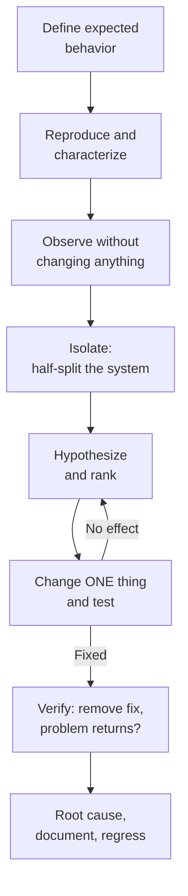

::: testing
Whether you have a **repeatable method**, not just a bag of tricks. Interviewers listen for: define what "working" means; reproduce the problem; gather evidence before changing anything; isolate by dividing the system (half-splitting); change one variable at a time; form and test hypotheses ordered by likelihood and cost; verify the fix and check for regressions; find the root cause; and write it down. For *validation* they want to hear requirements, test plan, corners and margin. It is partly a behavioral question, so a short real example from your projects helps, but you must not invent one.
:::

::: why
Anyone can poke at a board for hours. Teams value the engineer who reaches the root cause in a predictable number of steps and leaves a record that others can reuse. The same discipline (observe, hypothesize, test one change) applies to analog circuits, firmware, manufacturing yield problems and system integration. A method also protects you from the classic traps: fixing a symptom, changing three things at once, and "it works now, I don't know why."
:::

::: concepts
- **Specification as ground truth**: you can only debug against a clear statement of expected behavior. See [[q1001]].
- **Reproducibility**: a failure you can trigger on demand can be debugged; an intermittent one needs instrumentation and statistics.
- **Divide and conquer (half-split)**: halve the search space each step: $\lceil\log_2N\rceil$ steps for $N$ candidates.
- **One variable at a time**: otherwise you cannot attribute cause and effect.
- **Root cause versus symptom**: ask why repeatedly until the answer is a mechanism you can fix and verify.
- **Validation margins and corners**: demonstrate behavior over voltage, temperature, load and unit-to-unit variation.
:::

::: answer
"I use the same loop every time. First, I define what correct looks like, from the spec or from a known-good unit. Then I reproduce the problem and write down exactly how, because I can't debug what I can't trigger. Next I gather evidence without changing anything: power rails, clocks, resets, currents, the simplest possible measurements, and I compare against a known-good board if I have one.

Then I narrow it down by splitting the system. If a signal chain has eight stages, I check the middle one; the problem is upstream or downstream, so I've halved the search. I form a hypothesis, rank them by likelihood and how cheap they are to test, and test one thing at a time. If I change two things and it gets better, I don't know which one mattered.

When something fixes it, I don't stop there. I ask whether I understand why. I verify by removing the fix and seeing the problem return, I check for side effects, and I write up the cause so the next person doesn't repeat it.

For validation it's the same mindset but proactive: start from requirements, build a test plan that covers voltage, temperature, load and unit variation, include margins and some stress cases, automate it so it's repeatable, and review the data for outliers instead of just pass or fail."
:::

::: technical
**Debug loop.**
1. **Define the expected behavior** (spec, schematic, simulation, known-good unit).
2. **Characterize and reproduce**: conditions, frequency of occurrence, which units; try to make it deterministic (temperature, load, input pattern).
3. **Observe without disturbing**: visual inspection, current-limited power-up, rails, clocks, resets, then targeted measurement. Record the data.
4. **Isolate**: half-split the signal chain or the system (hardware/firmware; power/signal; module A/B). With $N$ candidates, $\lceil\log_2N\rceil$ tests, e.g. 64 nets need 6 splits.
5. **Hypothesize and rank** by probability × (1/cost): a 30% chance with a 1-minute test beats a 5% chance with a 1-day test.
6. **Test one change at a time**; revert if it doesn't help.
7. **Verify**: reproduce the fix and its removal; check neighboring behavior; run the regression set.
8. **Root-cause and document**: five whys, then corrective action (design change, test coverage, process).

**Validation / test approach.**
- Derive tests from **requirements** with traceability.
- Choose conditions: nominal plus corners (supply ±5-10%, temperature range, load extremes, input range), and **margin tests** beyond spec.
- Include stress and abuse: power cycling, brownouts, hot-plug, ESD (as applicable).
- **Automate** with scripted instruments for repeatability, and log all data.
- Use **multiple units** (statistics, lot variation) and report distributions, not only pass/fail.
- Review **failures and near-misses** and add regression tests.

> [!INTERVIEW]
> If asked "describe a time you debugged something" ([[q0956]]-style), use situation → symptom → how you isolated → root cause → fix → what you learned. Use only real examples; if you have limited experience, describe a lab or course project honestly and focus on the method.
:::

::: short
"My approach is a loop: define what correct looks like, reproduce the failure, gather evidence without changing things, then split the system in half to isolate it. I rank hypotheses by likelihood and cost, test one variable at a time, and once something fixes it I verify I understand why and check for side effects. I document the root cause. For validation I start from requirements, test corners and margin, automate it and look at the data distribution."
:::

::: long
"I follow roughly the same loop every time.

First, define correct behavior. Without a spec, a schematic, a simulation, or a known-good unit, I can't tell broken from working. Second, reproduce: I want to know exactly when it fails, how often, and on which units. If it's intermittent, I try to make it more frequent with temperature, load or input pattern, and otherwise set up instrumentation to catch it, like a scope in single mode or a logger.

Third, observe before touching. Visual inspection, a current-limited power-up, rails, clocks, reset: the cheap checks. I write the readings down and compare them to a good board.

Fourth, isolate by splitting the system. If a signal passes through eight stages, I measure at stage four: if it's good there, the problem is downstream, if it's bad, upstream. That halves the search each time, so even sixty-four candidates take six measurements. For hardware versus firmware, I might run a minimal firmware or a known-good image on the board.

Fifth, form hypotheses and rank them by how likely they are and how cheap they are to test. Sixth, change one thing at a time. If I change two and it improves, I've learned nothing.

Then verify: remove the fix to see the problem return, check side effects, and run the regression tests. And write down the root cause so the next engineer doesn't redo it.

For validation, I do this in advance: start from the requirements, build a test plan covering nominal and corner conditions, voltage, temperature, load and units, add margin and stress tests, automate it with scripts so it's repeatable, and analyze the data distributions, not just pass or fail."
:::

::: terms
- **Root cause**: the underlying mechanism of a failure, not just the symptom.
- **Half-splitting (bisection)**: choosing a test that divides the remaining candidates in half.
- **Known-good unit / golden board**: a reference that works, for comparison.
- **Regression test**: a test run after a fix to ensure old behavior still works.
- **Corner testing**: tests at the extremes of operating conditions.
- **Margin**: the headroom between measured performance and the spec limit.
- **Five whys**: asking "why" repeatedly to reach a root cause.
- **Heisenbug**: a bug that changes when you try to observe it.
:::

::: exceptional
**An average answer** says "I check things one at a time until I find the problem."

**An exceptional answer**:
- Defines success first, and reproduces before measuring.
- Uses **half-splitting** with the $\log_2N$ argument and a concrete system-level example.
- Ranks hypotheses by probability and cost and describes changing **one variable at a time**.
- Insists on **verifying the fix** (remove it and the problem returns) and **root cause**, not symptom relief.
- Documents the finding and adds a regression test.
- Describes validation as requirements-driven, with corners, margin, automation and statistics.
- Admits uncertainty honestly and mentions tool perturbation (probes, printf).
:::

::: mistakes
- **Changing several things at once.** You can't attribute the effect, and you may mask the real fault.
- **Measuring before knowing what to expect.** A number with no reference tells you nothing.
- **Fixing the symptom** (adding a capacitor, a delay, a retry) without understanding why. The failure returns in another form.
- **Skipping the cheap checks.** Power, clocks, reset and connections explain a large fraction of failures.
- **Not writing things down.** Over a long debug you will forget what you already tested.
- **Blaming the tool or the part first.** Assume your own design or setup before the vendor's IC, but confirm with evidence.
- **Validating only at nominal.** Margin and corners are where design flaws show.
- **Claiming "it works now" without a repeat.** Intermittent faults can disappear and return.
:::

::: deep
## The loop in one picture


Figure: The debug loop. The back-arrow from "change one thing" to "hypothesize" is where most time is spent. The only exit is a fix you can switch on and off.

## Step 1: know what correct looks like

Debug is a comparison between expected and observed. For a hardware board the expected values come from the schematic and datasheets: rail voltages ($3.3\text{ V}\pm5\%$ means 3.135-3.465 V), sequencing, clock frequency and reset timing. If the board does not meet these, you have a hardware fault; if everything is right but the behavior is wrong, it points to firmware or configuration. A **known-good unit** gives a direct comparison: swap parts or measure both boards at the same points. Simulation gives the expected waveform of an analog stage, so you can see how the measurement deviates.

## Step 2: reproduce and characterize

Ask: is it **deterministic** or intermittent? Does it depend on temperature (a hair dryer or freeze spray test), on supply voltage (vary ±10%), on load, on a specific input or firmware path, or on a specific unit? These statements shape the hypothesis list. For an intermittent fault, increase the observation rate, for example logging all rails and the reset line continuously, or running a loop that stresses the suspected condition, so a 1-in-10000 event happens in minutes instead of days.

## Step 3: half-split

If the problem lies somewhere among $N$ equally likely places, a test that tells you which half it lies in finds it in $\lceil\log_2N\rceil$ steps. Take a pipeline of 64 stages: 6 tests rather than up to 64. For a board: is the problem before or after the regulator? Before or after the level shifter? In the signal chain "sensor → amplifier → filter → ADC → MCU → UART", check the ADC input: if the signal there is good the problem is digital or firmware; if not it's analog.

Splitting is not always even. If the connector is the most likely cause (30%) and a 1-minute check, test it first. The efficient order maximizes probability per unit cost:

| Candidate | Probability | Test cost (min) | Priority (p / cost) |
|---|---|---|---|
| Connector seating | 0.30 | 1 | 0.30 |
| Regulator output | 0.25 | 5 | 0.05 |
| MCU firmware | 0.05 | 30 | 0.0017 |

That reasoning is why the cheap, likely checks go first, and expensive speculative ones go last.

## Step 4: one change at a time

A change that has an effect is data; a change that doesn't is also data. With three simultaneous changes (new capacitor, new firmware, a re-seated cable) you cannot tell which one helped. Count the consequence: with two possible causes and both changed, you have a 50% chance of not knowing which. With a sequence, you know. After each trial, **revert** if it didn't help, so the system returns to a known state.

## Step 5: verify and root-cause

A fix is only a hypothesis until proven. Check:

1. **Remove the fix** and confirm the failure returns (necessity).
2. **Apply the fix** and confirm the failure stays gone across the conditions that triggered it (sufficiency).
3. **Ask why** again. "Adding a 100 nF cap fixed the reset" leads to "why was the rail dipping?" which leads to "the regulator's transient response with the new load" and then to "the design needs a larger output capacitor or a load-step test". The first answer treats the symptom; the last fixes the design and the test plan.
4. **Regress**: run the test set to check nothing else broke.
5. **Document**: symptom, evidence, cause, fix, how to detect it in future (a new test limit or a production test).

## Validation: the proactive version

Debug starts with a failure; validation tries to find failures before the customer does.

- **Requirements to tests.** Each requirement ("output 3.3 V ±3% from 4.5-5.5 V in, 0-1 A") maps to one or more tests with defined pass limits and a traceable ID.
- **Test matrix.** Nominal plus corners. For 3 supply voltages × 3 temperatures × 3 loads, a full factorial matrix has $3^3=27$ conditions; where that is too many, use a reduced set (corners plus center, or design-of-experiments).
- **Margin.** Rather than "pass at spec", find where it fails: sweep the supply down until the output drops out, and report the margin. A design with 5% margin tells you more than one that "passes".
- **Stress and abuse.** Power cycling, brownouts, hot plug, ESD, vibration as applicable to the product.
- **Statistics.** Test multiple units from different lots. Report mean and standard deviation or capability (Cpk) rather than a single number.
- **Automation.** Script the instruments and logging so results are repeatable and comparable between revisions ([[q1003]]).

## A worked example, abstractly

*Symptom:* an MCU board resets "randomly", once every few minutes, only when a motor is running.

1. *Expected:* no resets; 3.3 V rail within ±5%.
2. *Reproduce:* happens when the motor starts under load, never when idle. Deterministic enough.
3. *Observe:* a scope with the reset line as trigger and the 3.3 V rail on another channel shows the rail dipping to 2.6 V for about 30 µs just before reset ([[q0994]]).
4. *Isolate:* is the dip from the source (the motor supply sag) or the regulator? Probe the 5 V input: it sags 0.8 V at motor start. The regulator drops out.
5. *Hypotheses:* the motor inrush pulls the 5 V down through the shared wire resistance; fix by a bulk capacitor, separate wiring, or a soft-start on the motor.
6. *Change one thing:* add 470 µF at the board input. Dip reduces to 3.1 V: no reset. Remove it: the reset returns, confirming cause.
7. *Root cause:* shared supply wire resistance and no bulk capacitance at the load; add a motor soft-start and a brownout margin test to the validation plan.

The method is the point; the numbers are illustrative of how to present such an example.

## Experiment with it

```sim
{"id":"power-sequencing","preset":"soc"}
```
Figure: Sequencing bugs are classic debug cases. Try the SoC preset and find which rule is violated when an enable delay is changed. Practice: make one change, predict the effect, then check.
:::

::: applications
- **Board bring-up**: power, clocks, reset, programming interface, then functionality.
- **Intermittent field failures**: reproduce under stress, log, correlate.
- **Design validation**: DVT-style corner and margin testing before release ([[q0588]]).
- **Manufacturing yield problems**: distribution analysis and half-splitting by station or lot.
- **Firmware bugs**: bisection by commit and by code path ([[q1004]]).
- **Field returns**: failure analysis and root cause with a documented corrective action.
:::

::: assumptions
- The system is accessible and measurable; some failures (inside a sealed IC) need indirect evidence.
- Failures are caused by a mechanism that can be found; random cosmic-ray upsets or marginal components exist and need statistical treatment.
- Time and cost matter: "rank by probability and cost" assumes you have a rough sense of both.
- For safety-critical products, validation also includes formal standards, which are beyond this answer.

Variations: in software, "bisect the commits" replaces "half-split the hardware"; in manufacturing, "split by lot, station and time"; the loop is the same.
:::

::: followups
### Tell me about a time you debugged something hard.
Use real experience: *[your project]*. Situation and symptom, what you expected, how you reproduced it, how you isolated it (what you split), the hypothesis you tested, the root cause, the fix, and what you changed to prevent it. If you lack work experience, a course lab or a personal project is fine; interviewers care about the method and honesty. Don't embellish.

### The problem is intermittent and happens once a day. What do you do?
Increase observability and shorten time to failure: log relevant signals continuously (rails, reset, temperature) with timestamps, use triggers on the symptom, stress conditions (heat, supply margin, load pattern) to speed up occurrence, and automate monitoring so I capture the event. Compare failing and non-failing units. I avoid changing things until I have data.

### You've changed a component and the problem went away. Are you done?
No. I'd revert it to confirm the problem returns, then ask why that component mattered: marginal part, a tolerance, or a bad solder joint that reflow fixed? Then I'd check other units and conditions. If I can't explain it, I'd treat it as a probable intermittent issue rather than fixed.

### How many tests to find a fault among 100 nets by half-splitting?
$\lceil\log_2100\rceil=7$ tests in the ideal case. In practice splits aren't perfect, and some nets are more likely than others, so use probabilities to order the tests, but 7 is the ideal bound.

### How would you validate a new 5 V to 3.3 V regulator board?
From requirements: line (4.5-5.5 V), load (0 to max), temperature (hot and cold), transient steps, startup and shutdown, short-circuit and thermal behavior, ripple and noise, efficiency, plus margin beyond spec and multiple units. Script the sweep with a programmable supply, electronic load and DMM/scope, log everything, and review distributions.
:::

::: interpretations
This is a "what is your approach" question, so it is part behavioral: the interviewer wants your method, ideally illustrated by real experience. Do not invent experience; describe the method and use a real project or lab as the example. Debug, test and validation are three related activities, and the answer covers both the reactive (debug) and proactive (test/validation) sides. Specific debug questions in other sections ([[q0266]] buck converter, [[q0834]] microcontroller not booting, [[q0588]] PCB testing) apply this loop to a domain.
:::

::: references
- Agans, *Debugging: The 9 Indispensable Rules for Finding Even the Most Elusive Software and Hardware Problems*: understand the system, make it fail, quit thinking and look, divide and conquer, change one thing at a time, keep an audit trail.
- Horowitz & Hill, *The Art of Electronics*, 3rd ed.: practical debugging and testing discussions in the construction and measurement chapters.
- Kernighan & Pike, *The Practice of Programming*: debugging chapter, for the software view.
- JEDEC and IPC standards for the test methods relevant to your product class (cite the specific standard for your domain).
:::

::: rubric
- Starts by defining expected behavior and reproducing the failure :: You cannot debug what you cannot define or trigger.
- Gathers evidence with simple measurements before changing anything :: Prevents wasted effort and masking of the fault.
- Isolates by splitting the system (half-split/bisect) :: A systematic way to narrow the search.
- Ranks hypotheses by likelihood and cost and tests one change at a time :: Efficient and attributable.
- Verifies the fix (remove and re-apply) and finds the root cause :: A fix you don't understand is a future failure.
- Documents and adds regression coverage :: Teams depend on the record.
- Describes validation: requirements, corners, margin, automation, multiple units :: Shows the proactive side of the question.
:::

::: quiz
```json
[
 {"type":"mcq","level":"fundamental","q":"You change a capacitor, update the firmware and re-seat a cable, and the fault disappears. What is the main problem with this approach?","options":["Nothing, the fault is fixed","You cannot tell which change mattered, so you don't understand the cause","It takes too long","Firmware should never be updated while debugging"],"answer":1,"explain":"With multiple simultaneous changes you cannot attribute the effect. Change one variable at a time and revert if it does not help."},
 {"type":"numeric","level":"fundamental","q":"A signal chain has 64 stages and the fault is in one of them. What is the maximum number of half-split measurements needed?","answer":6,"tolerance":0,"unit":"","explain":"$\\lceil\\log_2 64\\rceil=6$."},
 {"type":"numeric","level":"intermediate","q":"A rail is 3.3 V ±5%. What is the lowest acceptable voltage in volts?","answer":3.135,"tolerance":0.005,"unit":"V","explain":"$3.3\\times0.95=3.135$ V."},
 {"type":"mcq","level":"intermediate","q":"Candidate A: 30% likely, 1-minute test. Candidate B: 25% likely, 5-minute test. Candidate C: 5% likely, 30-minute test. Which order is most efficient?","options":["C, B, A","A, B, C","B, A, C","A, C, B"],"answer":1,"explain":"Probability per minute: A 0.30, B 0.05, C 0.0017. Test in decreasing order of that ratio."},
 {"type":"truefalse","level":"advanced","q":"If adding a capacitor makes an intermittent reset stop, the root cause has been identified.","answer":false,"explain":"The capacitor may only mask the symptom. You need to explain why the rail dipped, verify that removing the capacitor brings the reset back, and check margin across corners."},
 {"type":"numeric","level":"advanced","q":"A validation matrix uses 3 supply voltages, 3 temperatures and 3 load levels, fully crossed. How many conditions are there?","answer":27,"tolerance":0,"unit":"","explain":"$3\\times3\\times3=27$. Where that is too many, use corners plus center or a designed experiment."}
]
```
:::
