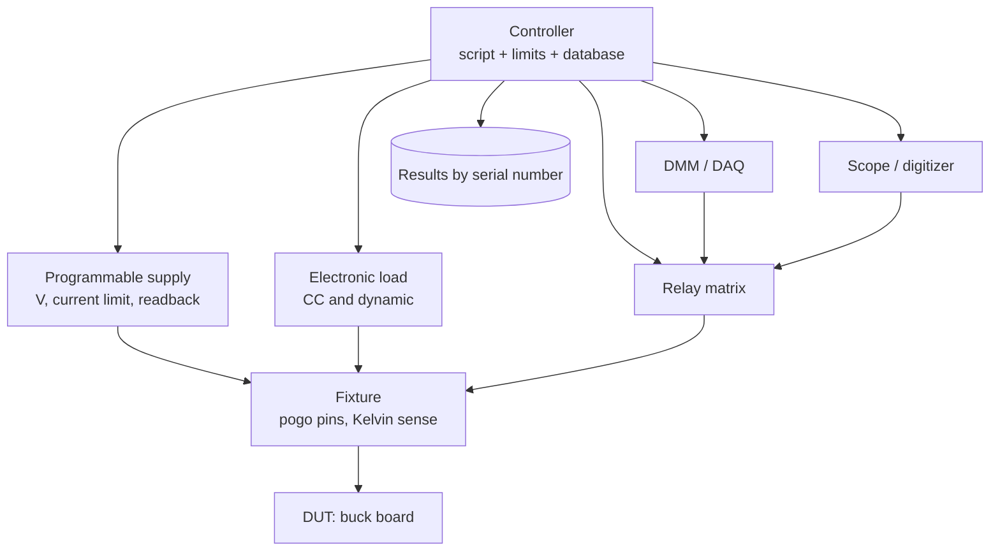

::: basics
### In plain words
"Design a system to test X" has no answer until you ask what X is and what the test must prove. So begin with questions: how many units, how fast, how accurate, and where it runs. Then turn the spec into a list of measurements with pass limits. Build a setup that applies stimulus, measures, logs results, and can itself be checked.

### Picture it
Think of a driving test. The examiner follows a fixed checklist with clear pass limits. Every candidate gets the same route and the same conditions, and each result is recorded. If the examiner's rules were vague, or the route changed every day, passing would mean nothing. A hardware test system works like that. It must be repeatable, fast enough for the line, and trustworthy. The difference is that the "examiner" here is a set of instruments and a script.

### Words you need
- **DUT**: device under test, the product being checked.
- **Fixture**: the plate with spring-loaded pins that connects the DUT to the instruments.
- **Kelvin (4-wire) sensing**: separate pins for forcing current and for measuring voltage, so contact resistance does not corrupt the reading.
- **Guard band**: test limits tightened by the measurement uncertainty, so a passing unit really is in spec.
- **Throughput**: how many units per hour the station can test.
- **Golden unit**: a known-good DUT used to check the tester itself.

### The simplest example
Test a 3.3 V board with a limit of ±3%, which is ±99 mV. Pogo pins can add about 50 mΩ of contact resistance. At 1 A that drops $0.05 \times 1 = 50$ mV. That is half the allowed window, so use Kelvin sensing.

Time budget: 15 test points at 0.8 s each, plus 6 s of handling, is 18 s per board. That is $3600/18 = 200$ boards per hour.

A script runs the tests, compares each result to limits in a file, and logs it by serial number. Check the tester with a golden unit that must pass and a known-bad unit that must fail.

That is the whole idea. The rest of this page adds the architecture, accuracy ratios, safe states and data use.
:::

::: testing
Whether you can run an **open-ended design conversation**. "Test X" has no requirements until you ask for them, so the first thing interviewers look for is clarifying questions: what is X, what must be proven (function, spec compliance, reliability), at what volume, how fast, how accurate, by whom, and where (lab, production, field). Then a clean architecture (fixture, stimulus, measurement, control, data), the key calculations (accuracy, limits with guard bands, throughput), failure handling, and how you would verify the tester itself.
:::

::: why
Test systems decide whether a product ships with the right quality, how fast the line runs, and how quickly engineers find problems. A tester that is too slow limits production, one that is too loose lets bad units out, and one that is too tight throws away good ones. Interview-wise, this question reveals whether you think in systems: requirements, interfaces, uncertainty, automation, and cost, not just which instrument to buy.
:::

::: concepts
- **Requirements first**: the spec of X turns into measurable test parameters with limits. See [[q1002]].
- **Instrument selection and accuracy**: instruments must be several times more accurate than the limit they check (test accuracy ratio, TAR).
- **Fixturing and contact**: how the DUT is connected, including contact resistance and 4-wire (Kelvin) sensing ([[q0986]]).
- **Automation and control**: scripting instruments (SCPI over USB/LAN/GPIB), sequencing and logging.
- **Limits and guard bands**: test limits set tighter than the spec by the measurement uncertainty.
- **Throughput and coverage**: test time per unit versus fault coverage, and where in the process to test ([[q0612]], [[q0611]]).
:::

::: answer
"First I'd ask what X is and what the test has to prove, because that changes everything. Let's pick an example so I can be concrete: a 12 volt to 3.3 volt buck converter board, tested in production at maybe a few hundred units a day.

Requirements: what must be checked? Output voltage within ±3%, load regulation, ripple, efficiency at a couple of loads, startup, current limit and no short at the input. Time budget, say under 20 seconds per board. Accuracy: instruments at least four times better than the limit.

Architecture: a fixture, pogo pins on a bed-of-nails style plate so the board drops in, with separate force and sense contacts for the output so contact resistance doesn't corrupt the voltage reading. A programmable supply for the input with current limit and current readback, an electronic load for the output, a DMM or a data acquisition unit for the voltages, and a scope or digitizer for ripple. A relay or switch matrix to route things. A PC or embedded controller runs a script, sequencing the tests, applying the limits, logging results with a serial number to a database.

Safety and robustness: current limits everywhere, interlocks on the fixture, discharge after each test. And I'd validate the tester itself with a golden unit and known-bad units, calibrate the instruments on a schedule, and track the gauge repeatability so I know the tester isn't the source of the variation."
:::

::: technical
**Step 0: clarify.** DUT type and interfaces; spec and test list; volume and cycle-time budget; required accuracy and confidence; environment; operator skill; reporting and traceability; budget; whether it is for validation (broad, slow, accurate) or production (fast, targeted, cheap) or both.

**Architecture.**
```
Controller (PC/PLC) -- SCPI/USB/LAN --> supplies, loads, DMM/DAQ, scope, signal gen
             |                                   |
         database/logs                   switch matrix / relay board
                                                 |
                                       fixture (pogo pins, Kelvin sense) --> DUT
```
- **Stimulus:** programmable DC supply (voltage, current limit), electronic load (CC/CV/dynamic), signal generator, communications to DUT (UART/I²C) for test modes.
- **Measurement:** DMM or DAQ for DC, scope/digitizer for ripple and transients, current via shunt or supply readback.
- **Fixture:** pogo pins (contact resistance on the order of tens of mΩ, check the pin datasheet), 4-wire sense on critical nets, ESD protection, interlock.
- **Software:** test sequencer with limits from a file, retry rules, logging with serial number and timestamps; fail-safe default state.

**Limits with guard bands.** If the spec is 3.3 V ±3% (±99 mV) and the instrument's measurement uncertainty is $u$, set the production limit at $\pm(99\text{ mV}-u)$ to avoid shipping marginal units, or accept more false rejects with a different policy. Instrument accuracy (TAR) should be at least about 4:1: for a 3% tolerance the instrument should be better than about 0.75%.

**Throughput.** $N$ test points × (settle + measure) + overhead. Example: 15 points × 0.8 s + 6 s overhead = 18 s, so about 200 boards/hour per station.

**Test-system verification.** Golden/known-bad units, calibration schedule, gauge repeatability and reproducibility (GR&R), periodic checks of limits.

> [!UNCERTAIN]
> Test accuracy ratios (4:1 or 10:1) and pass-limit policies vary by industry and standard; state the convention you assume.
:::

::: short
"I'd start by asking what X is and what the test must prove, volume, cycle time and accuracy. Then I'd define the tests and limits from the spec, and build a fixture with Kelvin contacts, programmable supply and load, a DMM and scope controlled by a script that sequences the tests, applies limits and logs results by serial number. I'd choose instruments about four times more accurate than the limits, set guard bands, and validate the tester with golden and known-bad units."
:::

::: long
"My first step is clarifying questions: what is X, what does the test need to prove, how many units, how fast, how accurate, and where does it run, a lab or a production line. Without those, I'm designing in the dark. For concreteness, say X is a 12 volt to 3.3 volt buck converter board.

From the spec I'd list the tests: output voltage within ±3%, load regulation, ripple, efficiency at two loads, startup behavior, current limit, and input short or reverse protection. I'd set a time budget, say under 20 seconds a board, and decide instrument accuracy: at least four times better than the tolerance I'm checking.

Architecture: a fixture with pogo pins so the board drops in, using separate force and sense contacts on the output so contact resistance doesn't create an error. A programmable supply with current limit feeds the input; an electronic load takes the output current; a DMM measures voltages; a scope or digitizer captures ripple; a relay board routes signals. A PC controls all of it over USB or LAN with a script, using standard instrument commands. The script runs the sequence, compares each result to limits from a file, and logs data and a pass/fail per serial number to a database.

Calculations: I'd count test points, 3 input voltages times 5 loads is 15, at maybe 0.8 seconds each, about 12 seconds plus overhead. I'd set test limits tighter than the spec by the measurement uncertainty, so a unit that passes really is within spec.

Robustness and safety: current limits on every source, a fixture interlock, discharge between units, and a safe default state on error. Finally I'd verify the tester itself: a golden unit that should always pass, deliberately bad units that should fail, a calibration schedule, and a repeatability study. I'd also review fail data for trends, which is useful feedback for design and the line."
:::

::: terms
- **DUT (device under test)**: the product being tested.
- **Fixture**: mechanical and electrical interface to the DUT, e.g. bed-of-nails with pogo pins.
- **Kelvin (4-wire) sensing**: separate force and sense paths so lead and contact resistance do not affect the voltage reading.
- **SCPI**: standard commands for programmable instruments.
- **Test accuracy ratio (TAR)**: instrument accuracy compared with the tolerance being tested, often ≥4:1.
- **Guard band**: tightened limits to account for measurement uncertainty.
- **GR&R**: gauge repeatability and reproducibility, how much variation comes from the test system.
- **Golden unit**: a known-good DUT used to check the tester.
- **Throughput**: units tested per hour.
:::

::: exceptional
**An average answer** says "use a power supply, a multimeter and a script."

**An exceptional answer**:
- Begins with clarifying questions and states assumptions, then picks a concrete example for X.
- Converts spec to a **test list with limits**, including guard bands from measurement uncertainty.
- Draws a clear architecture: stimulus, measurement, switching, fixture, controller, data.
- Covers fixturing details: Kelvin sensing, contact resistance, ESD and safety interlocks.
- Does the numbers: accuracy ratio, throughput and number of test points.
- Describes **verifying the tester**: golden/bad units, calibration, GR&R.
- Discusses failure handling and data use: serial-number traceability, yield trends, retests.
:::

::: mistakes
- **Starting with equipment before requirements.** The tests and accuracy determine the instruments, not the other way around.
- **Testing at the spec limit with an instrument of similar accuracy.** The measurement error can make pass/fail random.
- **Forgetting contact resistance.** 50 mΩ at 1 A is 50 mV, half of a ±99 mV window. Use Kelvin sensing.
- **No safe state.** If the script crashes with the load on, parts can be damaged. Default outputs off, limits on.
- **Never testing the tester.** A tester that always passes is a very common failure mode. Use known-bad units.
- **Ignoring test time.** A perfect test that takes 10 minutes per unit stops the line.
- **No data strategy.** Without serial-number logs and yield statistics you cannot learn from failures.
:::

::: deep
## Step 0: requirements are the design

"Design a system to test X" is deliberately underspecified. Before drawing anything, ask:

1. **What is X** and what are its interfaces (power, signals, connectors, communications)?
2. **What must the test prove**: functionality (does it work), parametric compliance (within spec), safety, reliability, or all of these?
3. **Where in the lifecycle**: design validation (many conditions, high accuracy, slow), production (limited test list, fast, low cost), field service, incoming inspection?
4. **Volume and time budget**: 10 units a week or 10,000 a day? Cycle time per unit?
5. **Accuracy and confidence**: spec limits, required measurement uncertainty, acceptable false-pass and false-reject rates.
6. **Constraints**: cost, operator skill, footprint, safety, traceability and regulatory requirements.

Write down assumptions. In an interview, say: "I'll assume it's a buck converter board in production; the structure holds for other X."

## Example: a 12 V to 3.3 V, 1 A buck converter board

**Spec-derived tests** (illustrative):

| Test | Condition | Limit |
|---|---|---|
| Input current at no load | $V_{in}=12$ V | < 5 mA |
| Output voltage | $V_{in}=10.8/12/13.2$ V, loads 0/0.5/1 A | 3.3 V ±3% |
| Ripple | 1 A load, 20 MHz BW | < 30 mVpp |
| Efficiency | 12 V in, 0.5 A and 1 A | > 85% |
| Soft start | enable to 90% output | 1-5 ms |
| Current limit | ramp load | 1.3-2.0 A |
| Short-circuit hiccup | short output | recovers when released |

The numbers above are examples of the structure; the real limits come from the product's spec.

## The architecture


Figure: The controller drives every instrument. Stimulus (supply, load) and measurement (DMM, scope through the relay matrix) meet at the fixture. Results are logged against the DUT serial number, so failures can be traced and yield tracked.

## Fixture design and contact resistance

The fixture is the part that breaks. Pogo pins have a contact resistance often tens of milliohms and it degrades with wear. For the 3.3 V output at 1 A, a 50 mΩ contact drops $0.05\times1=50$ mV, half the ±99 mV tolerance window. The remedy is **Kelvin sensing**: two pins per critical net, one forcing current and one sensing voltage at the DUT pad, so no current flows in the sense path and its drop is negligible ([[q0986]]). Other fixture concerns: guide pins for alignment, ESD protection and grounding, a cover interlock so high-energy tests only run when closed, access for rework, and a maintenance schedule (pin replacement counts).

## Accuracy, guard bands and TAR

Suppose the DMM has an accuracy of 0.003% of reading + 0.001% of range, on a 10 V range at 3.3 V: $3.3\times3\times10^{-5}+10\times10^{-5}=0.2$ mV, which is 0.006% of the reading. That is far below the 3% window, a TAR of about 500:1, so the DMM is not the limiting factor; contact resistance, load transient settling and thermal drift are. For efficiency, which needs four measurements ($V_{in},I_{in},V_{out},I_{out}$), each with, say, 0.1% uncertainty, the combined uncertainty in $\eta=V_{out}I_{out}/(V_{in}I_{in})$ is about $\sqrt{4\times0.1^2}=0.2\%$ (root-sum-square, assuming independence). With $V_{in}=12$ V, $I_{in}=0.30$ A, $V_{out}=3.3$ V, $I_{out}=0.95$ A, efficiency is $\eta=87.1\%$, and the 0.2% (relative) uncertainty is about ±0.17 percentage points, so a limit of 85% has lots of margin.

**Guard banding:** if a limit is 3.3 V ±99 mV and the total test uncertainty is 2 mV, set the test limit at ±97 mV. Units measuring between 97 and 99 mV are rejected even though they're nominally in spec, which prevents shipping a unit that might be out of spec by the true value. The policy trades false rejects against false passes; decide it with quality engineering.

## Throughput

Test time per unit $= \sum(\text{settle}+\text{measure})+\text{handling}$. For 3 input voltages × 5 loads = 15 points at 0.5 s settle + 0.3 s measure = 0.8 s each: 12 s. Add 6 s for insertion, power-up, discharge and logging: 18 s, so $3600/18=200$ units per hour on one station. If the factory needs 800/hour, either run four stations or cut the test list, for example by reducing to corner points and only doing efficiency on a sample. This is the trade between coverage and cost: choose tests based on historical failure modes (Pareto), not completeness.

```sim
{"id":"yield-coverage","Y":0.95,"aoi":0,"ict":0,"fct":0.9,"fieldCost":200}
```
Figure: A functional-test-only line at 95% process yield and 90% test coverage, the trade between coverage and cost: the escapes that slip through become field failures at 200 USD each. Switch on AOI and ICT coverage to see escapes fall and what it costs per board, then raise the field-failure cost.

## Software and data

- **Sequencer**: a script (Python with PyVISA and SCPI, or LabVIEW/TestStand) with a test list, limits in a config file (not hard-coded), and per-step timeouts.
- **Safe states**: on any error or abort, load off, supply off, relays open. Default all outputs disabled at start.
- **Logging**: serial number, test name, measured value, limit, pass/fail, timestamps, station ID, software and fixture version, in a database.
- **Retest policy**: automatic retest once for contact problems, then flag.
- **Statistics**: monitor mean and spread of each parameter per lot and station; a drift indicates a fixture or process problem before the failures begin. A capability index $C_{pk}=\min(USL-\mu,\mu-LSL)/(3\sigma)$: with $\mu=3.300$ V, $\sigma=12$ mV and limits 3.201-3.399 V, $C_{pk}=0.099/0.036=2.75$.

## Verify the tester

A test system is a measuring instrument; give it the same scrutiny:

1. **Golden unit**: a known-good unit that must pass every time, run at the start of each shift.
2. **Known-bad units** (with deliberate faults: wrong resistor, missing capacitor, shorts) that must fail the relevant tests, proving the test can detect that fault (fault coverage).
3. **Calibration** of the instruments on a schedule, with records.
4. **GR&R**: measure the same units repeatedly (and on different stations) to separate tester variation from unit variation.
5. **Fixture wear monitoring**: track contact resistance or pin counts.

## Variants: other X

The same skeleton applies. A **temperature sensor** needs a stable temperature source (chamber or reference block) and a reference thermometer; an **ADC** needs a precision source and a histogram or sine-fit test; a **motor controller** needs a dynamometer or load motor, current/voltage measurement and thermal monitoring; a **wireless module** needs RF instruments and a shielded enclosure. Define requirements, stimulus, measurement, fixture, software, verification, and numbers.

## Experiment with it

```sim
{"id":"dmm-lab","view":"4wire"}
```
Figure: Compare 2-wire and 4-wire measurement while increasing lead resistance. In the 2-wire case the reading drifts with lead resistance; with 4-wire the lead resistance drops out. That is exactly why a test fixture uses Kelvin sense pins.
:::

::: applications
- **Production test of PCB assemblies**: functional test on a fixture after in-circuit test ([[q0612]]).
- **Design validation rigs**: automated corner sweeps with a thermal chamber, programmable supplies and loads.
- **Battery pack and charger testing**: charge/discharge cycling with SMUs and safety limits ([[q1005]] for long runs).
- **Sensor calibration lines**: reference source, DUT array and data fitting.
- **Motor and drive test benches**: dynamometer plus power analyzer.
- **Incoming inspection and field service testers.**
:::

::: assumptions
- X is a board-level electronic product; the numbers use a 3.3 V, 1 A buck converter as an example.
- Instrument accuracy figures are illustrative; real values come from the specific instrument's datasheet.
- Production-level volume; for a one-off validation, you would trade throughput for breadth.
- Independent errors for the root-sum-square combination; correlated errors require a different treatment.
- Cost, regulation and safety standards (e.g. high voltage or medical) would add requirements not covered here.
:::

::: followups
### How would you test X if X is an ADC?
Apply a precision DC source with known steps, take many samples at each code to average noise and compute offset, gain, DNL and INL; use a pure sine at several frequencies and fit it to get SNR/SINAD and ENOB. The source and reference must be several bits better than the ADC. Use coherent sampling to avoid leakage. Control temperature and the reference.

### The tester passes everything. How do you know it's working?
Run known-bad units: deliberately faulty boards, such as a missing capacitor or a wrong resistor value, each should fail the corresponding test. Also check that the limits are meaningful: measure the distribution, which should show variation and not be pinned at the instrument limits. A tester that never fails is as suspect as one that always fails.

### Test time per unit is too long. What do you do?
Profile the steps. Overlap settling with other work (parallelize instruments or test multiple units per station), reduce settle times with proper dynamic load control, reduce test points to those with historical failures, sample rather than test 100% for stable parameters, or add stations. Never reduce time by cutting margin without checking coverage.

### How do you handle a high-voltage or high-power DUT?
Add safety: interlocked enclosure, current and voltage limiting, discharge paths, emergency stop, and trained operators. Power limits protect the DUT and the tester. Use isolated measurement and rated components, and think about what happens on a fault.

### How do you pick limits when you only have a few prototype units?
Start from the spec and instrument uncertainty; gather data from early builds and use statistics (mean and sigma) to propose limits that account for lot variation. Keep limits conservative initially, then tighten or relax with yield data and engineering review.
:::

::: interpretations
"Design a system to test x" has a placeholder for X, so the interviewer is judging your process. The page uses a buck converter board as the worked example and states how the structure generalizes. If they name X (for example "a battery", "a motor driver", "a sensor"), keep the same skeleton: clarify, requirements to tests, architecture, fixture, software, accuracy and throughput, verification of the tester. Compare with [[q1002]] (general approach) and [[q1005]] (long-duration tests).
:::

::: references
- Horowitz & Hill, *The Art of Electronics*, 3rd ed.: measurement and instrumentation sections.
- Keysight and Tektronix/Keithley application notes on automated test systems, Kelvin sensing and measurement uncertainty (look up current titles).
- IPC and JEDEC standards relevant to PCB assembly test and reliability (cite the specific standard for your product).
- AIAG, *Measurement Systems Analysis (MSA)*: gauge R&R methodology.
:::

::: rubric
- Starts with clarifying questions (what is X, volume, time, accuracy, location) :: Open-ended design needs requirements before architecture.
- Converts the spec to a test list with limits :: Tests must trace to requirements.
- Presents a clear architecture: stimulus, measurement, switching, fixture, controller, logging :: Shows system-level thinking.
- Addresses fixture contact resistance and Kelvin sensing :: A common real-world accuracy killer.
- Quantifies accuracy (TAR), guard bands or uncertainty :: Shows you know a measurement has error.
- Estimates throughput and discusses coverage versus time :: Production tests are a cost trade-off.
- Describes verifying the tester (golden/bad units, calibration, GR&R) :: A tester is an instrument too.
:::

::: quiz
```json
[
 {"type":"mcq","level":"fundamental","q":"What should you do first when asked to design a test system for X?","options":["Pick instruments","Ask what X is and what the test must prove, plus volume, time and accuracy","Write the software","Order a fixture"],"answer":1,"explain":"The requirements determine the tests, accuracy and architecture. Choosing instruments first is working backwards."},
 {"type":"numeric","level":"fundamental","q":"A pogo pin has 50 mΩ contact resistance and carries 1 A in a 2-wire measurement. What voltage error does it add in mV?","answer":50,"tolerance":0.01,"unit":"mV","explain":"$V=IR=1\\times0.05=0.05$ V = 50 mV, which is large against a ±99 mV window. Kelvin sensing removes it."},
 {"type":"numeric","level":"intermediate","q":"The DUT tolerance is ±3%. With a 4:1 test accuracy ratio, what accuracy should the instrument have, in percent?","answer":0.75,"tolerance":0.01,"unit":"%","explain":"A 4:1 ratio means the instrument error is a quarter of the tolerance being checked: $3\\%/4=0.75\\%$. A 10:1 ratio would need 0.3%."},
 {"type":"numeric","level":"intermediate","q":"A test has 15 points at 0.8 s each plus 6 s overhead. How many units per hour can one station test?","answer":200,"tolerance":0.01,"unit":"units/h","explain":"Cycle time $=15\\times0.8+6=18$ s; $3600/18=200$."},
 {"type":"numeric","level":"advanced","q":"Four independent measurements each have 0.1% uncertainty and the efficiency is $\\eta=V_{out}I_{out}/(V_{in}I_{in})$. What is the combined relative uncertainty in percent (root-sum-square)?","answer":0.2,"tolerance":0.02,"unit":"%","explain":"Relative errors add in quadrature for products and quotients: $\\sqrt{4\\times0.1^2}=0.2\\%$."},
 {"type":"truefalse","level":"advanced","q":"A tester that has passed every unit for a month is evidence that the production process is perfect.","answer":false,"explain":"It may equally mean the tester cannot detect faults. Verify with known-bad units and check the data distributions."}
]
```
:::
