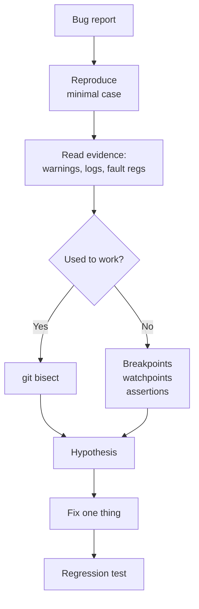

::: testing
Whether the hardware candidate can also **debug code like an engineer**: reproduce, localize and prove, instead of randomly editing. The interviewer expects the generic toolkit (reading error messages, logs, debugger breakpoints and watchpoints, assertions, unit tests, version-control bisect, sanitizers and static analysis) plus the embedded flavor: SWD/JTAG, hard-fault analysis, GPIO toggling and a scope, ISR and race conditions, stack overflow, volatile and memory issues, and the way instrumentation (printf, breakpoints) can change timing.
:::

::: why
In an embedded product, many "hardware" bugs are firmware bugs and vice versa: the board resets because the watchdog wasn't kicked, the sensor reads wrong because of an I²C timing assumption, the motor jerks because an ISR overran. A hardware engineer who can localize across the boundary saves days. Interviewers also use this question to see whether you debug by method (the same loop as [[q1002]]) or by guessing.
:::

::: concepts
- **Reproduce and isolate**: a minimal failing case and a bisect over commits or code paths. See [[q1002]].
- **Observability**: logs, breakpoints, watchpoints, trace, GPIO toggles; each has a cost in timing.
- **Debugger access**: SWD/JTAG, halting, memory/register inspection ([[q0832]], [[q0831]]).
- **Concurrency**: interrupts, shared variables, atomicity, `volatile`, priorities ([[q0838]] area).
- **Memory errors**: stack overflow, buffer overrun, uninitialized variables, dangling pointers.
- **Heisenbugs**: failures that change or vanish when you observe them, because of timing or memory layout.
:::

::: answer
"I debug software with the same loop as hardware: reproduce it, observe, split, test one change at a time. First I get a reliable way to make it fail, ideally a minimal example, and I read what the system is already telling me: compiler warnings, error codes, logs, a stack trace or fault registers.

Then I localize. With a debugger over SWD or JTAG I can set breakpoints, step, and use watchpoints to find who writes a variable. If it used to work, I use git bisect: a thousand commits is about ten builds. I add assertions to check my assumptions, and unit tests to pin down the behavior.

On an embedded target there are extra tricks. If I need timing, I toggle a GPIO at the start and end of a function or ISR and watch it on a scope, which measures the real duration without stopping the CPU. A hard fault gives me the stacked program counter, which tells me where it died. I check classic causes: stack overflow, uninitialized or out-of-bounds data, non-atomic access to a variable shared with an ISR, a missing volatile, and the watchdog.

And I'm careful about observer effects. A printf at 115200 baud takes milliseconds and can hide a race condition, and a breakpoint stops the timers. When a bug vanishes under the debugger, that itself is a clue. After the fix, I add a test so it can't come back."
:::

::: technical
**General workflow.**
1. **Reproduce**: minimal input, fixed seed/timing, document steps; make intermittent bugs frequent via stress.
2. **Read the evidence**: compiler warnings (`-Wall -Wextra`), error codes, logs, core dump or hard-fault registers.
3. **Localize**: breakpoints, stepping, watchpoints (data breakpoints), call-stack inspection; bisect commits (`git bisect`: $\lceil\log_2N\rceil$ builds, 10 for 1000 commits) or bisect code by disabling halves.
4. **Hypothesize and test one change**; keep a log.
5. **Fix, add a regression test, review for the same bug class** elsewhere.

**Tools.** Debugger (GDB, IDE) with SWD/JTAG probe; UART/RTT logging; ITM/SWO or ETM trace (if available); logic analyzer/scope with GPIO markers; static analyzers and linters; sanitizers (AddressSanitizer, UBSan) for host builds; unit tests on the host with mocked hardware; simulators/emulators.

**Embedded-specific checks.**
- **Hard fault** (Cortex-M): read the stacked registers (PC, LR) and the fault status registers (CFSR, etc.) to find the faulting instruction and cause (null pointer, unaligned access, illegal instruction, bus error).
- **Stack overflow**: fill the stack with a pattern and check high-water marks; check RTOS task stacks.
- **ISR/shared data**: variables shared with ISRs must be `volatile` and accessed atomically; a 16-bit counter read in two 8-bit halves can tear (reading $0x00FF$, ISR increments to $0x0100$, then reading high byte gives $0x01FF$).
- **Timing**: toggle a pin; ISR duration × rate = CPU load, e.g. 12 µs × 1 kHz = 1.2%.
- **Peripheral config**: clocks enabled, pins muxed, bits in the right registers: check by reading registers back.
- **Watchdog/reset cause**: read the reset-cause register to know if it was brownout, watchdog or software.

**Observer effect.** A 40-character `printf` at 115200 baud is $40\times10/115200=3.5$ ms of blocking time, enough to hide a race or miss an interrupt deadline; use buffered logging, a DMA UART, or GPIO markers.
:::

::: short
"I use the same loop as hardware: reproduce the bug, read the evidence like logs and fault registers, then localize with a debugger, watchpoints, assertions and git bisect. On an embedded target I toggle a GPIO and watch it on a scope for timing, decode hard faults from the stacked PC, and check stack overflow, ISR races and volatile. I watch for observer effects like printf changing the timing, and I add a regression test after the fix."
:::

::: long
"My approach to software is the same discipline as hardware: reproduce, observe, narrow it down, change one thing at a time.

First I make it fail on demand, ideally with a small test case, because an intermittent bug is mostly an observability problem. Then I read the evidence the system already gives me: compiler warnings, return codes, logs, a stack trace, and on a microcontroller, the fault registers and reset cause.

To localize, I use a debugger over SWD or JTAG: breakpoints to see state, stepping through suspicious code, and watchpoints to find who changed a variable. If it used to work, git bisect finds the commit: with a thousand commits that's only about ten test builds. I add assertions for my assumptions, because the first failed assertion is usually closer to the cause than the crash.

For embedded targets there are tools that don't stop the processor. I toggle a GPIO at the start and end of an ISR or function and look at it on a scope or logic analyzer: that gives real timing and CPU load, like 12 microseconds at 1 kilohertz is about 1.2 percent. A hard fault tells me where it died through the stacked program counter. Then I check the usual suspects: stack overflow, uninitialized data, out-of-bounds writes, variables shared with an ISR that need volatile and atomic access, the watchdog, and the clock or pin configuration.

I'm careful about observer effects. A printf at 115200 baud can block for milliseconds, hiding a race, and stopping at a breakpoint halts timers and the outside world. If a bug disappears under the debugger, that points to timing.

Finally, once I understand the root cause, I fix it, add a test so it doesn't regress, and look for the same mistake in other places."
:::

::: terms
- **Breakpoint / watchpoint**: stop at a code location / stop when a memory location is accessed.
- **SWD / JTAG**: debug interfaces that let a probe halt and inspect a microcontroller.
- **Hard fault**: a processor exception from a serious error such as a bad memory access.
- **Bisect**: finding the first bad commit (or code region) by repeatedly halving the range.
- **Race condition**: result depends on the timing of concurrent events (such as an ISR and main loop).
- **`volatile`**: tells the compiler a variable can change outside the program's flow, so it must be re-read.
- **Atomic access**: an operation that cannot be interrupted partway.
- **Heisenbug**: a bug that changes when observed.
- **Watchdog**: a timer that resets the system if it is not serviced.
:::

::: exceptional
**An average answer** says "use print statements and a debugger."

**An exceptional answer**:
- Frames debug as a method (reproduce, observe, split, one change, verify) and links it to the hardware loop.
- Names concrete tools and what each costs: breakpoints (halt), printf (timing), GPIO marker (non-intrusive), trace (hardware needed).
- Uses **bisect** with the number: 1000 commits ≈ 10 builds.
- Knows embedded failure classes: stack overflow, hard fault decoding, ISR-shared data, volatile, clocks/pin mux, watchdog.
- Brings up **observer effects** with numbers (printf time).
- Cross-checks the hardware/firmware boundary with a scope or logic analyzer.
- Adds tests, assertions and sanitizers to prevent recurrence.
:::

::: mistakes
- **Randomly changing code until it works.** You get a fix you can't explain.
- **printf everywhere in timing-critical code.** It changes the timing and can hide the bug.
- **Assuming the compiler is wrong first.** It's rarely the compiler; it is usually undefined behavior, a missing `volatile`, or a wrong assumption.
- **Ignoring warnings.** Many hard bugs are flagged by `-Wall -Wextra` or a static analyzer.
- **Debugging the symptom in the wrong layer.** The "software" bug may be a hardware glitch (a noisy reset, supply droop) that you can see on a scope.
- **Not checking the reset cause.** A brownout looks identical to a watchdog reset until you read the register.
- **No regression test after the fix.** The bug returns in a later refactor.
:::

::: deep
## The same loop, different instruments

Software debug follows the loop in [[q1002]]: expected behavior, reproduce, observe, isolate, one change, verify, document. What changes is the instrumentation. Hardware gives you voltages; software gives you program state. The art is choosing the observation that is least intrusive for the question at hand.


Figure: The software loop. Bisect applies when a known-good version exists; otherwise you localize by state inspection. The end is always a regression test.

## Reproduce, then shrink

A bug that happens once an hour needs to become a bug that happens every minute. Run the code in a loop, increase the event rate (faster inputs, tighter timing), stress memory or CPU load, change the compiler optimization level (some bugs appear only at -O2, a sign of undefined behavior or a missing `volatile`), and vary the temperature or supply if there's a hardware component. Then **shrink** the failing case: remove modules until the smallest program still fails. The shrunken case usually points at the cause.

## Evidence the system already gives you

- **Compiler and static analysis warnings**: uninitialized variables, signed/unsigned mismatches, missing returns.
- **Return codes and error flags** of driver calls: check them instead of ignoring them.
- **Logs** with timestamps and context.
- **Fault registers and reset-cause registers.** On a Cortex-M a hard fault stores the faulting instruction's address in the stacked PC; reading it and mapping it to the source with the map file or disassembly tells you where it failed. Typical causes: null or wild pointer dereference, unaligned access, executing from a bad address (a corrupted return address or function pointer), stack overflow into other data.

```c
// Sketch: capture the stacked registers in a hard-fault handler
// naked: no compiler prologue, so SP and LR still describe the exception frame
__attribute__((naked)) void HardFault_Handler(void) {
    __asm volatile ("tst lr, #4 \n ite eq \n mrseq r0, msp \n mrsne r0, psp \n b fault_c");
}
void fault_c(uint32_t *stack) {
    volatile uint32_t pc = stack[6];   // stacked program counter
    volatile uint32_t lr = stack[5];   // stacked link register
    (void)pc; (void)lr;                // inspect in the debugger: where did it die?
    for (;;) {}
}
```
This is a sketch for a Cortex-M-style core (the stack frame layout is architecture-defined). Adapt it to the specific toolchain and core.

## Debugger features worth knowing

- **Breakpoints** stop at a line; **conditional breakpoints** stop only when an expression is true (e.g. `i == 1000`).
- **Watchpoints** (data breakpoints) stop when a variable is read or written: the best tool for "who corrupts this variable?". Microcontrollers have a few hardware comparators for them.
- **Call stack and locals** show the path to the failure.
- **Memory and register views** let you read peripheral registers to check that the hardware is configured as you think.
- **Trace (ITM/SWO, ETM)** records execution without halting, if your chip and probe support it.

A debugger **halts the CPU**, but the rest of the world keeps going: timers may stop or not (check the freeze-in-debug settings), communication partners time out, and motor drivers keep driving. For a motor application never halt with the PWM outputs live without a safe state.

## Timing with a GPIO and a scope

When you care about real-time behavior, put a marker on a spare pin:

```c
GPIO_SET(DEBUG_PIN);     // at ISR entry
/* ... work ... */
GPIO_CLEAR(DEBUG_PIN);   // at ISR exit
```

Then read the pulse on a scope or logic analyzer ([[q0994]]): its width is the ISR duration, its period is the interrupt rate, the gap to the next marker is the latency. With a 12 µs pulse every 1 ms, CPU load is $12\ \mu\text{s}/1\text{ ms}=1.2\%$.

```timing
{"signals":[{"name":"IRQ line","wave":"0.1.0.....1.0..."},{"name":"ISR marker","wave":"0..1.0.....1.0.."},{"name":"main loop marker","wave":"1..0.1.....0.1.."}],"hscale":1.3}
```
Figure: A debug-pin picture of a main loop and an ISR. The IRQ rising edge is followed after a small latency by the ISR marker going high; the main loop marker drops while the ISR runs. The ISR marker's width is the ISR duration; the gap between the IRQ and ISR marker is the latency.

## Classic embedded bug classes

| Symptom | Likely causes | How to confirm |
|---|---|---|
| Random resets | Watchdog not serviced, brownout, stack overflow, hard fault | Read reset-cause register; scope the rail ([[q0994]]) |
| Variable changes "by itself" | Out-of-bounds write, pointer bug, DMA overwriting | Watchpoint on the variable |
| Works at -O0 and fails at -O2 | Missing `volatile`, undefined behavior, timing assumption | Compare disassembly; add `volatile`; use sanitizers on a host build |
| Rare wrong values | Race with an ISR, non-atomic multi-byte access | Disable interrupts around access; check atomicity |
| Peripheral does nothing | Clock not enabled, pin mux wrong, wrong register bit | Read registers back; scope the pin |
| Hang | Infinite loop waiting for a flag, deadlock, priority inversion | Break in the debugger and read the call stack |
| Timing misses | ISR too long, nested interrupts, blocking `printf` | GPIO markers, trace |

**Atomicity example.** On an 8-bit MCU a 16-bit counter `cnt` updated in an ISR is read as two bytes. If `cnt = 0x00FF` and the main code reads the low byte (0xFF), then the ISR increments to `0x0100`, then the high byte is read (0x01), main sees `0x01FF`, off by 255. Fix: disable interrupts while reading, read twice and compare, or use an atomic type.

**Stack overflow detection.** Fill the stack with a pattern (e.g. `0xA5A5A5A5`) at startup and periodically check how much remains unchanged (the high-water mark). A canary word at the end of the stack catches overflow. RTOS tasks each have their own stack; check each.

## The observer effect, with numbers

`printf` on a UART at 115200 baud sends 10 bits per character (start + 8 data + stop). A 40-character line takes $40\times10/115200=3.47$ ms, blocking if the driver is synchronous. If your control loop runs every 1 ms, that one print misses three deadlines. Options: log to a RAM ring buffer and dump later; use DMA/interrupt-driven UART; use SWO/RTT for fast logging; or use a GPIO marker (about 1 cycle). Breakpoints stop everything, so they hide timing bugs; trace doesn't.

## Bisecting commits and code

If the bug is a regression, `git bisect` automates the search: mark a good and a bad commit, build and test the midpoint, and repeat. With $N$ commits the number of steps is $\lceil\log_2N\rceil$: 1000 commits need 10 builds; with a scripted test (`git bisect run ./test.sh`) it is automatic. For code without history, bisect by disabling half the features or modules (stub out half the tasks) and see if the bug persists.

## Preventing the next bug

- Turn on **warnings as errors** for new code and run a static analyzer in CI.
- Add **assertions** for invariants (pre/post-conditions, buffer sizes). In embedded builds, assertions can log the file and line and reset into a safe state.
- **Unit tests on the host** with mocked hardware, and hardware-in-the-loop tests for integration.
- **Code review** on interrupt and shared-data code specifically.
- **Defensive design**: timeouts on every wait loop, bounded buffers, watchdog with proper conditions (not kicked in an ISR unconditionally).

## Experiment with it

```sim
{"id":"interrupt-lab","nesting":false}
```
Figure: Lengthen an ISR until a lower-priority event is missed, then enable nesting and see what changes. That is the kind of timing bug that a printf would hide and a GPIO marker would reveal.
:::

::: applications
- **Board bring-up**: bring up UART first, then toggle LEDs, then peripherals with the debugger reading registers.
- **Motor control firmware**: ISR timing and PWM updates validated with GPIO markers and a scope.
- **Sensor drivers**: I²C/SPI transactions checked against a logic analyzer trace and the sensor datasheet.
- **RTOS applications**: stack high-water marks, priority inversion, task timing traces.
- **Field-returned units**: fault logs, reset-cause and saved crash info (registers in non-volatile memory).
- **Regression hunting** across firmware releases with bisect.
:::

::: assumptions
- An embedded, C-based microcontroller context. For desktop or web software, the tools differ (profilers, sanitizers, debuggers) but the method is identical.
- A debug interface (SWD/JTAG) exists. If not, logging, GPIO markers and a bootloader-based approach are used ([[q0833]]).
- The bug is reproducible or can be made so; truly random hardware upsets (radiation, marginal parts) need statistics.
- The register and stack-frame examples are Cortex-M-style; other architectures differ.

Alternative answer for a pure software role: add profilers, core dumps, sanitizers, and record/replay debuggers; the structure (reproduce, minimize, bisect) is the same.
:::

::: followups
### The bug disappears when you attach the debugger. What does that tell you?
Usually a timing or memory-layout dependence: the debugger changes timing (halting, slower execution, different optimization if you build for debug) or initializes memory differently. I'd suspect a race condition, a missing `volatile`, uninitialized variables or stack usage. Switch to non-intrusive observation: GPIO markers, trace, or a ring-buffer log, and build the same optimization level as the failing one.

### Your MCU resets randomly. How do you find out why?
Read the reset-cause register: watchdog, brownout, software, pin. If brownout, scope the rail with the reset trigger ([[q0994]]). If watchdog, find what blocks the kick (a long wait, ISR starvation, a deadlock). If it's a hard fault, capture the stacked PC in a handler and locate the faulting instruction. Check stack high-water marks too.

### How would you find which commit introduced a bug among 1000 commits?
Use `git bisect`: mark one good and one bad commit, test the midpoint, and repeat; about 10 steps. Automate with `git bisect run` and a script that returns pass/fail. The test must be reliable; if it's flaky, bisect lies.

### Why might a variable updated in an ISR not change as seen by the main loop at -O2?
The compiler may cache it in a register because it sees no writes in the loop. Declaring it `volatile` forces a re-read each time. Beyond that, multi-byte values need atomic access (disable interrupts or use atomics), because `volatile` doesn't guarantee atomicity.

### How do you debug something with no debugger access?
Use LEDs or a spare GPIO as state markers read on a scope or logic analyzer, UART/RTT logging with a buffered driver, a minimal test image to isolate hardware from firmware, a bootloader that can dump memory, and read crash data saved in non-volatile memory on reset. Also review the hardware side: power, clock, reset and boot pins ([[q0834]]).
:::

::: interpretations
"How do you debug software?" sits in the general section of a hardware list, so the expected answer is the engineer's method plus embedded tools, not a deep CS answer. Related pages cover microcontroller-specific debug ([[q0831]], [[q0832]], [[q0833]], [[q0834]]); this page is the general method. If the interviewer is from a software team, expect questions on profilers, concurrency bugs and unit testing.
:::

::: references
- Agans, *Debugging: The 9 Indispensable Rules*: general rules that apply to software and hardware.
- Yiu, *The Definitive Guide to ARM Cortex-M3/M4 Processors* (or the equivalent for your core): fault exceptions and debug features.
- Kernighan & Pike, *The Practice of Programming*: debugging and testing chapters.
- Pro Git (Chacon & Straub), the `git bisect` section; the GDB manual for breakpoints and watchpoints.
:::

::: rubric
- Reproduces and minimizes the failure before changing code :: Debugging without a repeatable failure is guessing.
- Reads existing evidence (warnings, logs, fault and reset registers) :: Cheap, high-value information.
- Localizes with breakpoints, watchpoints, assertions and bisect :: Systematic narrowing of the search.
- Uses GPIO markers and a scope for real-time behavior :: The hardware-software bridge an engineer should have.
- Names embedded bug classes: stack overflow, ISR races, volatile, config, watchdog :: Shows domain knowledge.
- Mentions observer effects and non-intrusive methods :: Maturity about measurement perturbing the system.
- Adds regression tests/assertions after the fix :: Closes the loop.
:::

::: quiz
```json
[
 {"type":"mcq","level":"fundamental","q":"A variable is being overwritten by unknown code. Which debugger feature finds the culprit most directly?","options":["A breakpoint at main","A data watchpoint on the variable","Stepping through all code","A printf in main"],"answer":1,"explain":"A watchpoint stops the CPU at the instruction that accesses the variable, so you see who changes it and the call stack."},
 {"type":"numeric","level":"fundamental","q":"About how many builds does git bisect need to find the first bad commit among 1000 commits?","answer":10,"tolerance":0,"unit":"builds","explain":"$\\lceil\\log_2 1000\\rceil=10$ because each test halves the range."},
 {"type":"numeric","level":"intermediate","q":"An ISR runs for 12 µs and fires every 1 ms. What fraction of CPU time does it use? Give it in percent.","answer":1.2,"tolerance":0.02,"unit":"%","explain":"$12\\ \\mu s/1\\text{ ms}=0.012=1.2\\%$."},
 {"type":"numeric","level":"intermediate","q":"How long does a 40-character printf take at 115200 baud (10 bits per character), in ms?","answer":3.47,"tolerance":0.02,"unit":"ms","explain":"$40\\times10/115200=3.47$ ms of blocking time, enough to miss several 1 ms control deadlines."},
 {"type":"mcq","level":"advanced","q":"A flag set in an ISR works at -O0 but the main loop never sees it at -O2. The most likely fix is:","options":["Lower the clock speed","Declare the flag volatile","Add a delay in the loop","Disable interrupts permanently"],"answer":1,"explain":"At -O2 the compiler may keep the flag in a register since the loop does not write it. `volatile` forces a memory read each iteration. (Multi-byte shared data also needs atomic access.)"},
 {"type":"truefalse","level":"advanced","q":"A bug that disappears when you attach the debugger probably means the code is correct.","answer":false,"explain":"It usually means timing or memory-layout dependence, such as a race condition or uninitialized data. Use non-intrusive observation like GPIO markers or trace."}
]
```
:::
