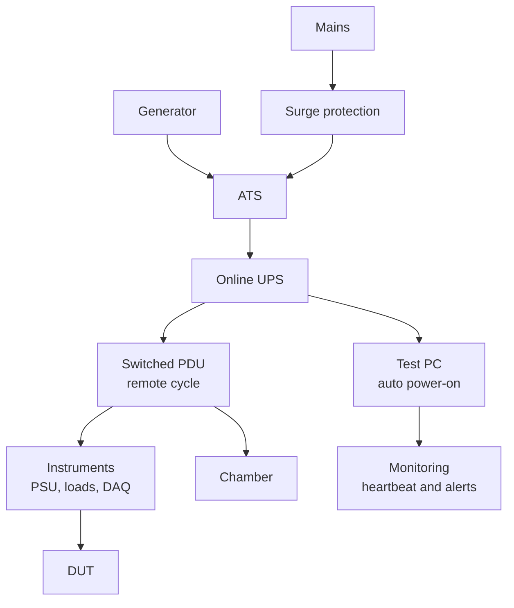

::: basics
### In plain words
A test that runs for weeks must survive power cuts, crashes and full disks, or all the data may be lost. The answer is layers: backup power to ride through short outages, automatic recovery so the setup restarts by itself and resumes where it stopped, and monitoring so a human learns fast if something fails.

### Picture it
A hospital cannot go dark. It has a battery system for the first moments, a generator for long outages, and staff who know the restart steps. It also has alarms so someone notices a failure at 3 a.m. A 24/7 test setup needs the same layers. One difference: a test may be allowed to pause, as long as the gap is recorded.

### Words you need
- **UPS**: uninterruptible power supply, a battery plus an inverter (which turns battery power into mains-style AC) that bridges short outages. Its energy is limited.
- **Graceful shutdown**: saving work and closing the computer cleanly before the battery runs out.
- **Checkpoint**: saved test progress, so a restart resumes instead of starting over.
- **Heartbeat / watchdog**: a regular "I'm alive" signal, and a timer that restarts the system if it stops.

### The simplest example
A small UPS has two 12 V, 9 Ah batteries (9 amp-hours: 9 A for one hour), so $2 \times 12 \times 9 = 216$ Wh. With 85% inverter efficiency and 80% usable charge, a 300 W load gets $216 \times 0.85 \times 0.8/300 \approx 0.49$ h, about 29 minutes.

That covers short outages and a clean shutdown. For an 8 hour outage at 300 W you would need 2400 Wh delivered, from a battery over 3500 Wh. So long outages need a generator, or a controlled shutdown plus automatic restart.

After power returns, the computer should power on by itself, start the test, read its checkpoint, and log the gap. An alert should go out.

That is the whole idea. The rest of this page adds the failure list and safe logging.
:::

::: testing
Whether you can think about **long-duration reliability of the test setup itself**, not just the device under test. The interviewer wants to hear layers of protection: clean power with a UPS (and what it can and cannot do), a generator or a second feed for long outages, safe shutdown and automatic restart, a test script that survives interruptions (checkpoints, resume, atomic logging), watchdogs and heartbeats, remote monitoring and alerts, environmental and resource safeguards (disk, temperature, cooling), and a way to prove afterward that the data is valid. Quantitative sizing of the UPS and availability is a strong plus.
:::

::: why
Reliability, burn-in, battery cycling, soak and life tests run for days to months, and an interruption can invalidate the entire run: weeks of data lost, a thermal profile broken, or a DUT left in an unsafe state. The instruments and the PC are part of the experiment. The question is also a proxy for system-level thinking: single points of failure, graceful degradation, observability and recovery, which apply to product design as well as test.
:::

::: concepts
- **Single points of failure**: mains feed, PC, instrument, network, disk; each can end the test. See [[q0976]].
- **UPS (uninterruptible power supply)**: battery backup that bridges short outages and allows a graceful shutdown. Capacity is energy-limited.
- **Availability**: the fraction of time the system is up: $A=\text{uptime}/\text{total}$; "three nines" is 99.9%.
- **Checkpoint and resume**: store test state so a restart continues rather than restarts.
- **Watchdog / heartbeat**: automatic detection and recovery when software or hardware hangs.
- **Monitoring and alerting**: a human or system notices a failure fast.
- **Data integrity**: logs written atomically, timestamped, with gaps recorded.
:::

::: answer
"I'd treat it as a reliability problem for the test setup, with layers. For the power: a UPS on the PC, instruments and anything controlling the test, ideally an online double-conversion one, which also cleans up the line. I'd size it by the load: for 300 watts a small UPS with about 200 watt-hours gives maybe half an hour, which is plenty for short outages and for a clean shutdown, but not for days. For longer outages, a generator with an automatic transfer switch, or at least a plan for what the system does when the battery runs out.

The second layer is making the system recover by itself. The PC's BIOS set to power on after AC returns, instruments with a defined power-on state, and a test script that stores its state to disk so it resumes where it left off, writing logs in an append-only, flushed way so a power cut doesn't corrupt the data. I'd add a watchdog and heartbeat so a hung PC or process restarts, and a remote power switch to cycle a stuck piece of equipment.

Third, monitoring: automatic alerts by email or text if the heartbeat stops, the temperature goes out of range, or the disk is nearly full. And the physical stuff: fans, a thermal chamber with an over-temperature cutout, disk space, no automatic OS updates or sleep. And I'd record outages in the data so I know whether the test conditions stayed valid, and decide in advance whether a power loss voids the run."
:::

::: technical
**Failure modes to cover.** Mains loss or brownout; PC or OS crash/reboot (including OS updates); instrument lock-up; network loss; disk full or corruption; DUT failure that endangers the setup (fire, overcurrent); environmental failures (chamber, cooling, HVAC); operator error; software leaks or drift over weeks.

**Power layers.**
1. **Surge protection and filtering.**
2. **UPS**: sized for load and runtime. Runtime $\approx \dfrac{E_{batt}\,\eta_{inv}\,DoD}{P_{load}}$. Example: two 12 V 9 Ah batteries = 216 Wh; with 85% inverter efficiency and 80% usable depth of discharge, 300 W gives $216\times0.85\times0.8/300\approx0.49$ h ≈ 29 min. Online (double-conversion) UPS gives zero transfer time and isolates the load from line disturbances; line-interactive/standby types have a short transfer time (a few ms) and are cheaper.
3. **Generator + automatic transfer switch (ATS)** for hours-to-days outages; starts typically in seconds to tens of seconds, bridged by the UPS.
4. **Redundant feeds** (A/B power, dual-supply equipment) where the facility offers it.
5. **Graceful shutdown**: UPS signals the PC (USB/SNMP, e.g. NUT or the vendor's agent) to save state and shut down before the battery is exhausted.

**Restart and recovery.** BIOS "power on after AC loss"; services start at boot; instruments with a defined safe power-on state (outputs off, or set by the controller); DUT power sequencing handled by the script, not by the mains returning.

**Software resilience.** State machine persisted to disk (checkpoints every $N$ minutes and at every state change); append-only logs with periodic flush (`fsync`) or a database with transactions; unique run ID; record every restart and gap; idempotent steps; watchdog timers (hardware or OS service) and a heartbeat file/message.

**Observability.** Remote dashboard; heartbeat monitoring from another machine; alerts (email/SMS/chat) on missed heartbeat, out-of-range temperature, disk below a threshold, and instrument errors; periodic summary reports.

**Availability numbers.** 99.9% over a 30-day month allows 43.2 min of downtime; 99.99% allows 4.3 min.

> [!UNCERTAIN]
> Outage frequency, generator start time and UPS behavior depend on the site and the equipment chosen. The numbers above are examples; use the vendor's runtime charts and your facility's data.
:::

::: short
"I'd layer it. A UPS, ideally online, on the PC and instruments sized by load: about 29 minutes for 300 watts from a small battery, which covers short outages and a graceful shutdown. A generator with an automatic transfer switch for long ones. Then make it self-recovering: power-on-after-AC-loss, a test script that checkpoints its state and logs atomically, and a watchdog. Add remote monitoring and alerts, plus checks on disk, temperature and cooling, and record any gaps in the data."
:::

::: long
"I'd treat the test setup as a system that needs to be reliable, and think in layers: prevent the failure, ride through it, recover from it, and notice it.

Prevent and ride through: put the PC, instruments and anything controlling the test on a UPS, preferably online double-conversion, which also cleans the supply. Size it from the load: say 300 watts and a battery of about 216 watt-hours, with inverter losses and a usable depth of discharge, gives roughly half an hour. That's enough for dips and short outages, and to shut down gracefully. For outages longer than that, a generator and an automatic transfer switch, with the UPS bridging the gap while the generator starts, or dual feeds if the facility has them. I also have to decide what the device under test needs: does it have to keep running through an outage, in which case it also needs backup, or is a power cut part of the stress profile.

Recover: the PC should power on after AC returns, the test software should start as a service, and the script should store its state: which step it's on, the cycle count, the elapsed time. So after a restart it resumes instead of starting over. Instruments should have a defined safe power-on state. Logs are written append-only and flushed, so a power cut can't corrupt earlier data, and each restart is recorded as an event. A watchdog and a heartbeat restart a hung process, and a switchable power strip lets me cycle a stuck instrument remotely.

Notice: remote monitoring and alerts for a missed heartbeat, temperature out of range, disk nearly full, or instrument errors. A 1 kilohertz log of 8-byte samples for 30 days is about 21 gigabytes, so disk space is a real issue; I'd decimate or compress.

And I'd write down in advance what counts as a valid run, so if there's a gap, I know whether to continue, annotate or restart."
:::

::: terms
- **UPS**: uninterruptible power supply; battery plus inverter that bridges outages.
- **Online (double-conversion) UPS**: always powers the load from the inverter; zero transfer time, clean output.
- **ATS**: automatic transfer switch that moves the load from mains to a generator.
- **Graceful shutdown**: saving state and closing the OS before power is lost.
- **Checkpoint**: saved test state allowing resume.
- **Watchdog**: a timer that triggers a reset when not periodically serviced.
- **Heartbeat**: a periodic "I'm alive" signal monitored elsewhere.
- **Availability**: fraction of time the system is operational.
- **Burn-in / soak test**: a long-duration operation to expose early failures or aging.
:::

::: exceptional
**An average answer** says "use a UPS."

**An exceptional answer**:
- Frames it as eliminating **single points of failure** across power, PC, instruments, software, disk and environment.
- Sizes the UPS with numbers (216 Wh, 85% inverter, 80% DoD, 300 W gives about 29 min) and states what it **cannot** do (days), so adds a generator/ATS or redundant feeds.
- Designs **recovery**: auto-restart, defined instrument states, checkpoint/resume, atomic logging.
- Adds **watchdog, heartbeat, remote monitoring and alerts**.
- Addresses the **DUT** (does it need power through the outage? is a power cut part of the test?) and safety shutdowns.
- Defines **data validity** rules for gaps ahead of time, and timestamps and run IDs.
- Mentions practical killers: OS updates, sleep, full disks, thermal limits, time drift.
:::

::: mistakes
- **Thinking a UPS means "never goes down".** It is energy-limited; a 29-minute UPS does nothing for a 6-hour outage unless it triggers a clean shutdown and the system restarts.
- **Protecting the PC but not the instruments** (or the network switch, or the chamber controller). Any unprotected link breaks the chain.
- **No auto-restart.** After a long outage the system sits powered off until someone notices.
- **Restart from zero.** A script without checkpoints loses all progress; or worse, it restarts and silently overwrites logs.
- **Unflushed logs.** Data in the OS cache disappears on a power cut or crash; write in append mode and flush at a sensible interval.
- **Ignoring non-power failures**: disk fills up, OS auto-updates reboot the PC, screensaver/sleep, memory leaks, a DUT overheating.
- **No alerting.** A test can sit failed for days before anyone looks.
- **Not recording the event.** Later you cannot tell whether a data gap was an outage or a measurement.
:::

::: deep
## Think in failure modes, then layers

A 90-day test is long enough that rare events become likely. If power outages occur at a rate of, say, 4 per year at a site (a made-up example; use your site's data), the probability of at least one during 90 days is $1-e^{-4\times90/365}=63\%$. The sensible question is not "will something fail?" but "what will the setup do when it does?".

List the possible interruptions and give each a mitigation:

| Failure | Mitigation |
|---|---|
| Brownout/short outage (seconds) | UPS (online type bridges with no gap) |
| Long outage (hours) | Generator + ATS, or controlled shutdown and automatic resume |
| PC crash/hang | Watchdog, service auto-restart, remote reboot |
| OS update/sleep | Disable auto-updates and sleep; schedule maintenance windows |
| Instrument lock-up | Remote power switch, command timeouts, re-initialize routine |
| Disk full | Monitoring, log rotation, decimation, separate data disk |
| Network loss | Local logging first, upload later; buffered |
| DUT failure (overcurrent/thermal) | Hardware current limits, thermal cutouts, fuses; fail-safe outputs |
| Chamber/cooling failure | Over-temperature protection independent of the controller, alarms |
| Operator error | Locks, labeling, restricted access, procedures |


Figure: The power path and the monitoring path. Everything the test needs sits behind the UPS, with a switched PDU so a single stuck instrument can be power-cycled remotely. The generator and ATS extend the ride-through time beyond the battery.

## Sizing the UPS

A UPS stores energy. The runtime is

$$t=\frac{E_{batt}\,\eta_{inv}\,DoD}{P_{load}}$$

With $E_{batt}=2\times12\text{ V}\times9\text{ Ah}=216$ Wh, $\eta_{inv}=0.85$, $DoD=0.8$, $P_{load}=300$ W:

$$t=\frac{216\times0.85\times0.8}{300}=0.49\text{ h}\approx29\text{ min}$$

Real UPS runtime charts show non-linear behavior (batteries deliver less energy at high discharge rates, and capacity falls with age and temperature), so use the vendor's runtime chart. Also check the **VA and watt ratings**: a load of 300 W at power factor 0.9 is 333 VA, so you need a unit rated above that with margin (e.g. 50% headroom).

```plot
{"title":"UPS runtime vs load (default 216 Wh battery, 85% inverter, 80% usable)","x":{"label":"Load","unit":"W","min":50,"max":1000},"y":{"label":"Runtime","unit":"min","min":0,"max":300},"vars":{"e":216,"eta":0.85,"dod":0.8},"series":[{"label":"runtime (ideal, constant efficiency)","fn":"60*e*eta*dod/x"}],"points":[{"x":300,"y":"60*e*eta*dod/300","label":"300 W"}],"params":[{"name":"e","label":"Battery rating (nameplate)","min":100,"max":600,"value":216,"unit":"Wh","step":1},{"name":"eta","label":"Inverter efficiency","min":0.7,"max":0.95,"value":0.85,"step":0.01},{"name":"dod","label":"Usable depth of discharge","min":0.5,"max":1,"value":0.8,"step":0.05}],"readouts":[{"label":"Runtime at 300 W","expr":"60*e*eta*dod/300","unit":"min"},{"label":"Energy delivered to the load (E·η·DoD)","expr":"e*eta*dod","unit":"Wh"},{"label":"Battery rating needed to deliver 2400 Wh (8 h at 300 W)","expr":"2400/(eta*dod)","unit":"Wh"}]}
```
Figure: Runtime falls as 1/load. This idealized curve is optimistic at high load because real batteries lose capacity at high discharge rates (check the vendor chart). To ride through 8 h at 300 W the load needs 2400 Wh delivered; at 85% inverter efficiency and 80% depth of discharge that takes a battery rated about 3530 Wh, more than 16 times this 216 Wh battery, which is why long outages need a generator or a controlled shutdown and restart. Drag the battery up to 600 Wh: runtime at 300 W reaches about 82 minutes. Drag the usable depth of discharge down to 50% and this 216 Wh unit drops to about 18 minutes.

**What the UPS is for.** (a) Ride through dips and short outages without the test noticing. (b) Give the PC time to save state and shut down cleanly (with the UPS signaling over USB or the network; software agents such as vendor tools or NUT can do this). (c) Condition the supply. For long outages, the system either keeps running on a generator or comes back by itself afterward.

## The DUT question

Ask what the device under test should do in an outage. If the test is a continuous operation test (a server, a battery pack under load cycling) the DUT may need to keep running, so its supply and loads need backup too, or you accept the interruption and plan how to resume. If the stress profile includes power cycling (as in a reliability test of power-up behavior), a controlled cycling is part of the test and uncontrolled outages are noise. Decide and document it: a power loss either (a) voids the run, (b) pauses and resumes with a recorded gap, or (c) is irrelevant.

Also protect the setup **from** the DUT: current limits on supplies, fuses, thermal cutouts that act independently of the PC (a hardware thermostat on a chamber or hot plate), so that if the controller dies the DUT is not left cooking.

## Software that survives interruptions

- **State machine on disk.** Keep the test as explicit states (initialize, step $k$ of $N$, cool-down), with the current state, cycle count and elapsed time written after every transition. On start, read it and resume.
- **Idempotent steps.** Re-running a step after a crash must not corrupt results: use unique run and sample IDs, and write results to a new row/file, not overwriting.
- **Atomic logging.** Append-only logs with flush (and `fsync` at a sensible interval); a database with transactions, or write a temp file and rename. Corrupted last lines on power loss are expected: the reader should ignore a partial line.
- **Timestamps and time sync** (NTP, or a GPS-disciplined source for long tests). A 20 ppm clock drifts $20\times10^{-6}\times86400=1.7$ s per day if left unsynced.
- **Watchdog.** A hardware watchdog or OS service restarts the process or the machine when a heartbeat stops. Keep the heartbeat logic tied to real progress (the measurement loop), not a separate thread that runs even when the work has stopped.
- **Timeouts on every instrument call**, and a re-initialization routine for a hung instrument (close and reopen the session, or power-cycle via the switched PDU).
- **Resource hygiene.** Watch memory growth, file handles, and disk usage over weeks; rotate logs; avoid unbounded buffers.
- **Disable the OS's surprises**: automatic restarts for updates, sleep/hibernate, screen lock requiring a login for the test service, driver auto-updates.

## Data volume and storage

A 1 kHz channel logging 8 bytes per sample for 30 days produces $8\times1000\times86400\times30\approx20.7$ GB per channel, before overhead. Decide what resolution you need: log summaries (min/max/mean per second), store raw only around events, compress, and use a data disk with space for the full test plus margin (and a threshold alert at 80%). Back up to another machine periodically so a disk failure doesn't take the whole run.

## Monitoring and alerting

A test that fails silently for days is almost as bad as one that never ran. Provide:

- **A heartbeat** the monitor expects every minute; a missed heartbeat sends a message.
- **Threshold alarms**: temperatures, supply currents, error counters, disk space, UPS on-battery status.
- **Daily summaries** (a plot or a table) to a person, so drift is noticed.
- **An independent monitor.** The thing that watches the test must not depend on the same PC or power feed; a small separate device or a cloud service can detect "the whole rack is down."

## Availability arithmetic

If you want 99.9% availability over a 30-day (43,200-minute) test, you can tolerate $0.001\times43{,}200=43.2$ minutes of total interruption; 99.99% allows 4.3 minutes. These numbers are useful for deciding whether a plan that needs 20 minutes of reboot and re-warm-up per outage meets the requirement. If the test depends on thermal stability, a 20-minute outage may invalidate a segment of data even if "uptime" is high.

## Experiment with it

```sim
{"id":"power-sequencing","preset":"soc"}
```
Figure: Restart after an outage is also a power-sequencing problem. In the SoC preset, pick VDD_IO and set its enable source to Master EN with zero delay, which mimics everything coming back at once when mains returns, and watch the ordering rules fail: a DUT or instrument rack that all returns at once when mains returns can violate sequencing or cause an inrush, so the script, not the mains, should control the power-up order.
:::

::: applications
- **Battery cycling and aging tests** lasting weeks with programmable loads and chargers.
- **Burn-in and HTOL-style reliability tests** on chips and boards in chambers.
- **Environmental soak tests** (temperature/humidity) with continuous monitoring.
- **Long-term sensor drift and calibration studies.**
- **Endurance tests of motors, relays or connectors** with cycle counts in the millions.
- **Server or network equipment stability tests** (days of stress traffic).
:::

::: assumptions
- A lab or facility with mains power, a modest rack of equipment (a few hundred watts) and a PC-based test controller.
- Outage statistics, UPS efficiencies and generator behavior are illustrative; real sites differ.
- The DUT does not require its own backup unless stated; the policy for outages is a requirement decision.
- Safety regulations and fire codes (e.g. for generators, battery rooms, unattended chambers) apply and are not covered in detail.
- Cloud or off-site monitoring is permitted.

Alternative: for tests where an interruption is acceptable, a simpler approach (checkpoint/resume with no UPS) can be sufficient; for safety- or mission-critical qualification, redundant feeds and independent monitoring are expected.
:::

::: followups
### How long should the UPS last?
It depends on the requirement. Size it for the time needed to bridge until the generator takes over (typically seconds to a few minutes) plus the time for a graceful shutdown (a few minutes), with margin for battery aging (capacity falls over the years, so assume 70-80%). If there's no generator and the test must continue through hours-long outages, a UPS alone is not economical: you'd choose resume-after-restart instead, or a generator.

### The power is back after a 3-hour outage. What should happen automatically?
The PC powers on (BIOS setting), the OS boots, the test service starts, reads its checkpoint, re-initializes the instruments (they've lost their settings), re-establishes the DUT's state according to the sequence (not all at once), logs a "restart" event with the gap, checks conditions (chamber temperature back in range), and resumes or flags the run as needing review. An alert goes out saying it happened.

### How do you know the test didn't silently stop?
A heartbeat monitored by an independent system. The script updates a heartbeat (and some data counters) regularly; a separate monitor alarms if it's stale. Also daily reports showing the sample count: if the count doesn't increase, something's wrong.

### What if the DUT must keep running during the outage?
Then the DUT and its loads need their own backup, which may mean a larger UPS, a battery bank with DC feed, or a generator with ATS. If the DUT draws kilowatts, a UPS is impractical beyond minutes, so a generator is the main answer. Alternatively, define the test so that outages are logged and accepted.

### A UPS in your test rack keeps tripping on overload at power-up. Why?
Inrush. Switching supplies and chamber heaters or compressors can draw many times their running current at start-up. Stagger the power-up (sequencing through a controllable PDU), use inrush-limited equipment, and size the UPS for peak, not just running, load. Also check the UPS's VA versus watt rating and power factor.
:::

::: interpretations
The wording "ensure these tests run smoothly 24/7" covers the setup (power, PC, instruments, software, monitoring) and the DUT. "Protect against power outages" is the second, narrower question; the page answers it with UPS and generator sizing and with recovery and resume, because ride-through alone isn't enough for long outages. The same ideas appear in [[q0976]] (redundancy) and the test-system design in [[q1003]].
:::

::: references
- IEEE and manufacturer documentation on UPS topologies (offline/standby, line-interactive, online double-conversion): vendor application notes (APC/Schneider Electric, Eaton, Vertiv) describe the types; check current documents.
- NUT (Network UPS Tools) project documentation for UPS monitoring and graceful shutdown.
- JEDEC standards on reliability testing (e.g. high-temperature operating life) for the test-duration context, cited by name for your product class.
- Beyer et al., *Site Reliability Engineering* (Google): chapters on monitoring and eliminating single points of failure, as a software parallel.
:::

::: rubric
- Identifies single points of failure across power, PC, instruments, software and environment :: Shows system-level reliability thinking.
- Uses a UPS and sizes it with numbers, noting its limits :: A concrete, quantified power answer.
- Adds a generator/ATS or redundant feed for long outages :: A UPS alone cannot cover hours or days.
- Makes the system self-recovering: auto power-on, defined instrument state, checkpoint/resume :: Outages will happen; recovery must be automatic.
- Logs atomically, with timestamps and recorded gaps :: Data integrity and validity after interruption.
- Uses watchdog/heartbeat and remote alerts :: Silent failures are the worst failure.
- Protects the DUT and setup with independent hardware safeguards and decides the run-validity policy :: Safety and meaningful results.
:::

::: quiz
```json
[
 {"type":"mcq","level":"fundamental","q":"Which UPS type provides zero transfer time and isolates the load from line disturbances?","options":["Standby (offline)","Line-interactive","Online double-conversion","A surge protector"],"answer":2,"explain":"An online double-conversion UPS always powers the load from its inverter, so there is no transfer and the load sees a clean supply. Standby and line-interactive types switch over in a few milliseconds."},
 {"type":"numeric","level":"fundamental","q":"A UPS has 216 Wh of battery, 85% inverter efficiency and 80% usable depth of discharge. How many minutes does it run a 300 W load?","answer":29.4,"tolerance":0.03,"unit":"min","explain":"$t=216\\times0.85\\times0.8/300=0.49$ h $=29.4$ min."},
 {"type":"numeric","level":"intermediate","q":"For 99.9% availability over a 30-day test, how many minutes of total downtime are allowed?","answer":43.2,"tolerance":0.01,"unit":"min","explain":"$30\\times24\\times60=43{,}200$ min; $0.1\\%$ of that is 43.2 min."},
 {"type":"mcq","level":"intermediate","q":"After a power outage your test PC stays off until someone presses the power button. What is the best fix?","options":["Buy a larger UPS","Set the BIOS to power on after AC restores, and start the test as a service that resumes from a checkpoint","Disable the watchdog","Log less data"],"answer":1,"explain":"Automatic power-on plus a resuming service make recovery independent of a person. A larger UPS only delays the problem for outages longer than its runtime."},
 {"type":"numeric","level":"advanced","q":"A 1 kHz channel logs 8-byte samples for 30 days. About how many GB of raw data is that?","answer":20.7,"tolerance":0.03,"unit":"GB","explain":"$8\\times1000\\times86400\\times30=2.07\\times10^{10}$ bytes = 20.7 GB per channel, so decimation or compression and disk monitoring matter."},
 {"type":"truefalse","level":"advanced","q":"If the test script updates a heartbeat from a separate thread that keeps running even when the measurement loop has hung, the watchdog will reliably catch a stalled test.","answer":false,"explain":"The heartbeat must reflect real progress, such as the measurement loop completing, otherwise a hung measurement is masked by a healthy-looking heartbeat thread."}
]
```
:::
